<p align="center">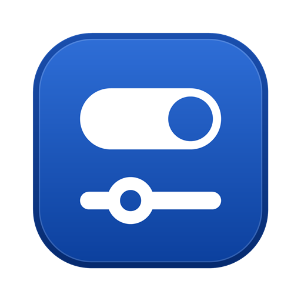</p>

<h1 align="center">gui_toolkit</h1>

<p align="center"><b>A fast, native, immediate-mode GUI toolkit.</b></p>

<p align="center"><a href="CHANGELOG.md"></a>
<a href="https://gt.sacha.house/"></a></p>

A native GUI toolkit in [Odin](https://odin-lang.org). You describe the interface in code on every frame; it keeps the state between
frames and draws with its own renderer: Direct3D 11 on Windows, Vulkan on Linux (through WebGPU).
The design (box tree, keyed persistence, size-kind layout, signals, tag-based themes) follows the UI layers of the
[RAD Debugger](https://github.com/EpicGamesExt/raddebugger); this project is the toolkit and the apps built on it, not a port of the debugger.

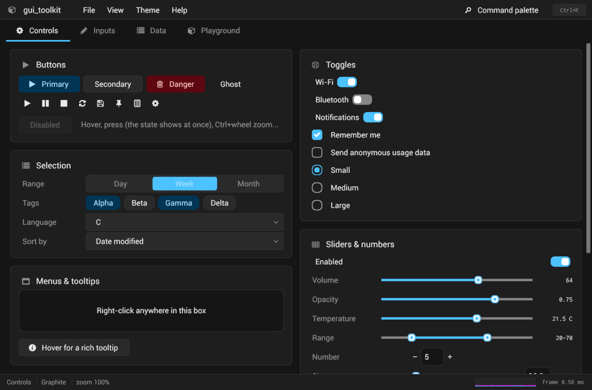

On Windows it needs nothing beyond Odin's `core:` and `vendor:` packages and the system (Direct3D 11, DirectWrite). On Linux, wgpu-native and a small Rust library for text are linked into the program. Programs are one file (icon font and fallback text fonts compiled in): the widget gallery is
2.4 MB, the todo example 2 MB. They idle at 0 % CPU, and a frame of the gallery takes under 1 ms of CPU (`fidget --bench=300`).

    odin run tools/tk -- build fidget       # the widget gallery  ->  build/fidget(.exe)
    odin run tools/tk -- build todo         # a todo app
    odin run tools/tk -- build smoke        # renderer / font / draw smoke test (no UI layer)
    odin run tools/tk -- build transforms   # rotated / skewed / scaled shapes, text and images, rounded clips (draw layer only)
    odin run tools/tk -- build stream       # a thread posting lines to the interface (ui.post)
    odin run tools/tk -- build panes        # splitters and accordions
    odin run tools/tk -- build docking      # panels docked, stacked, split and floated by dragging their tabs
    odin run tools/tk -- build todo -debug

`build.bat` and `./build.sh` are shortcuts for `tk build`. Every other step is a command of `tools/tk` too: `ci`, `desktop_tests`,
`release`, `fetch_wgpu`, `cdp`, `screenshots`, `site_build`, `doc_check`... (the head of `tools/tk/main.odin`). On Linux, `nix develop` gives what they need (`flake.nix`).

Needs the Odin compiler (`dev-2026-11a`, pinned) and, on Windows 10+, MSVC (Visual Studio or its Build Tools). **Linux**
(X11 and Wayland, Vulkan through wgpu-native, text by the native backend: Fontations, HarfRust, ICU4X, fonts from
fontconfig): `odin run tools/tk -- fetch_wgpu` puts wgpu-native beside Odin, `tk ci` checks every package, builds the
examples and runs the windowless tests; [opencode native](https://github.com/sachahjkl/opencode_native) ships a Linux build.
**New project? Start with [docs/getting-started.md](docs/getting-started.md)**: the toolkit as a submodule, a window in a
few lines (`examples/hello`), the backends and options, the tests, the versions, and the pitfalls.

## Screenshots

| | |
|---|---|
| 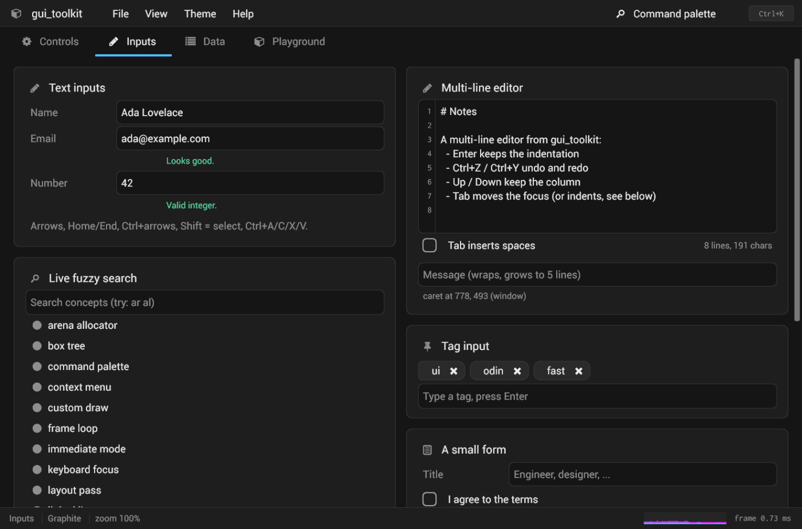 | 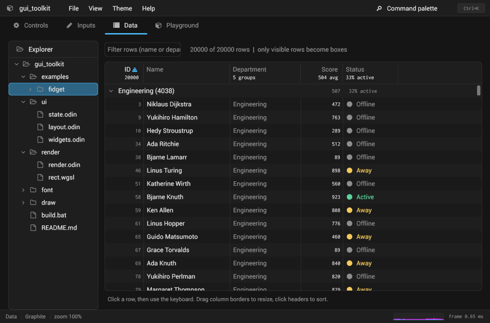 |
| **Inputs**: validated fields, multi-line editor, live fuzzy search, tag input, form | **Data**: 20,000-row virtualized table (groups with totals, sort, filter, resize), file tree |
| 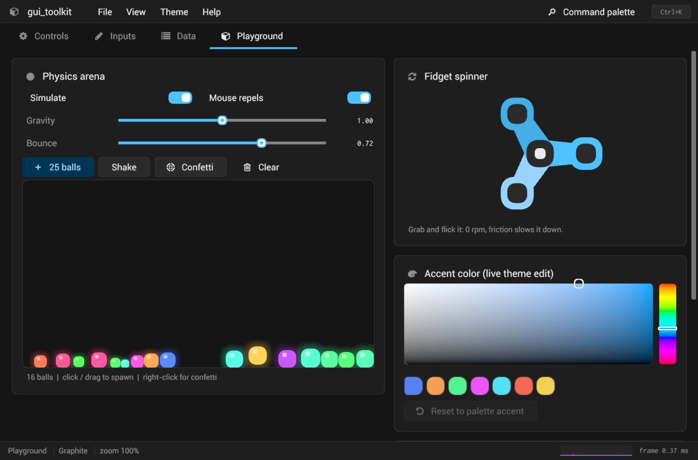 | 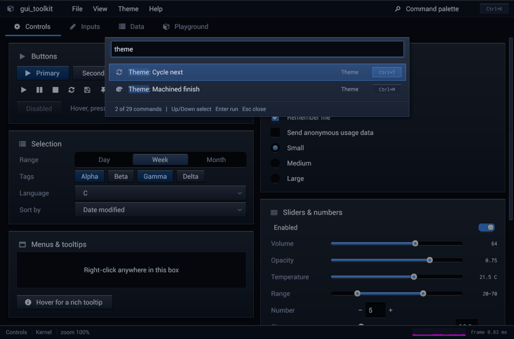 |
| **Playground**: physics balls, fidget spinner, live accent color picker | **Command palette** (Ctrl+K), fuzzy matches highlighted, Nord theme |
| 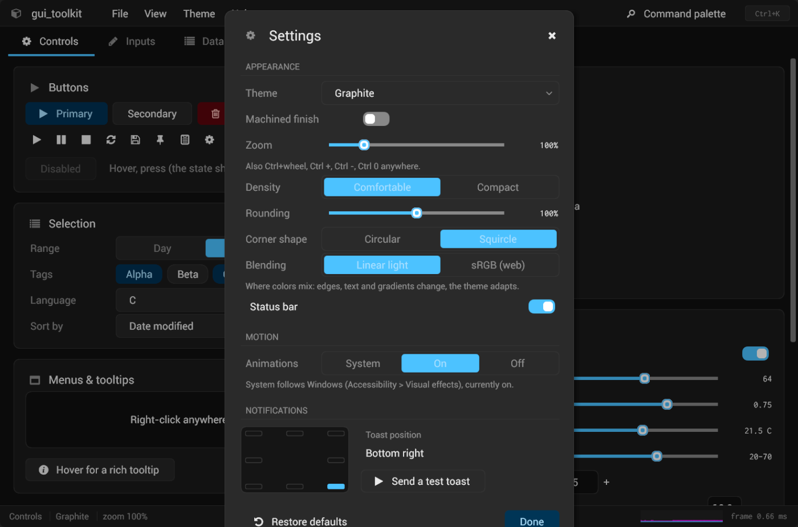 | 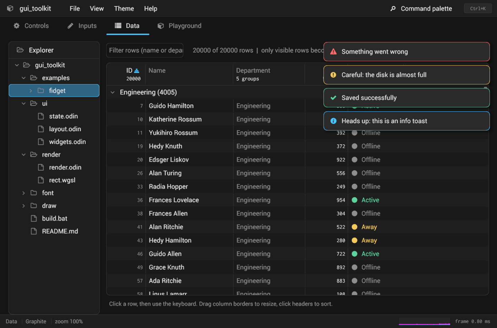 |
| **Settings**: theme, zoom, animations, toast position (click a cell) | **Toasts**: 8 anchor positions, border tinted by kind |
| 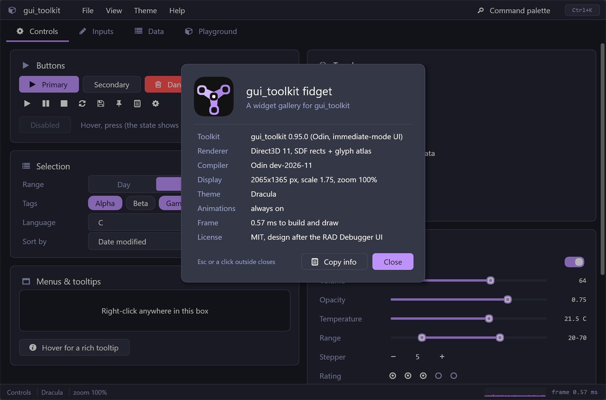 |  |
| **About** (F1), Dracula theme | **Daylight** theme (19 themes, cross-fading) |
| 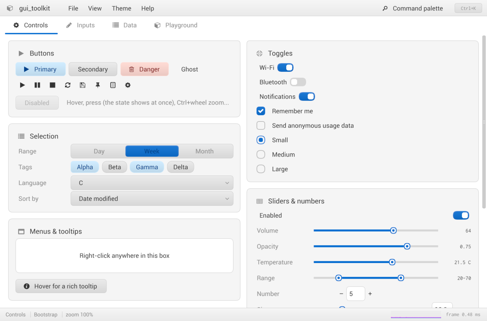 | 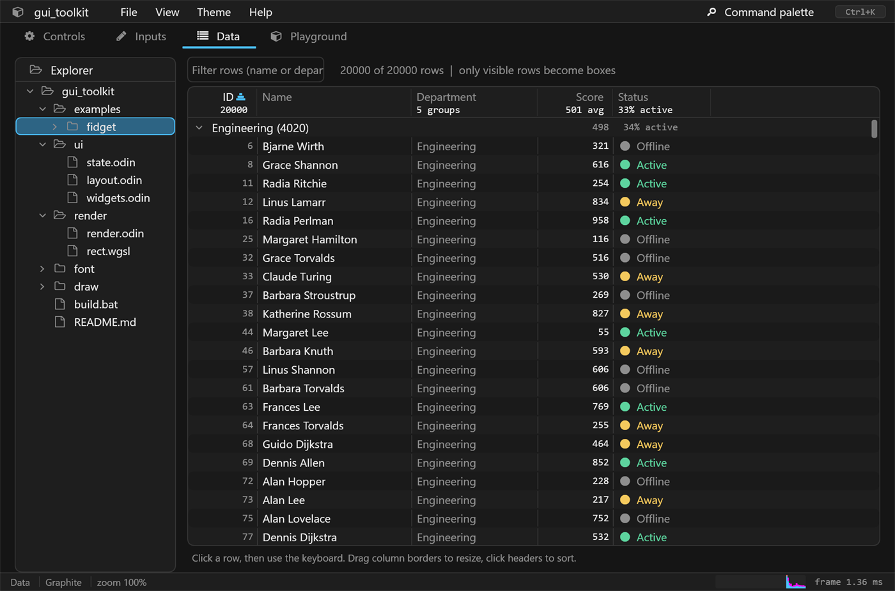 |
| **Bootstrap** theme: gradient finish, embossed text, focus glow | **Compact** density: more rows, same text size |

<p align="center">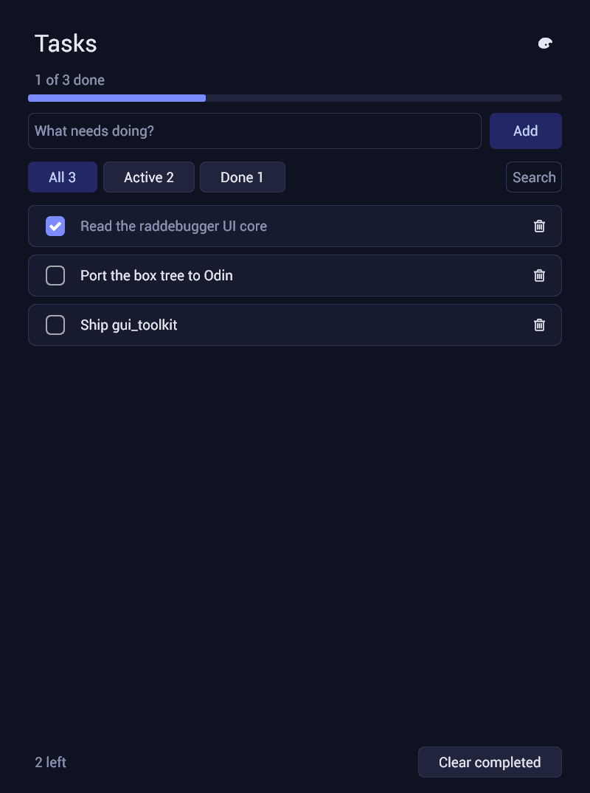<br><b>examples/todo</b></p>

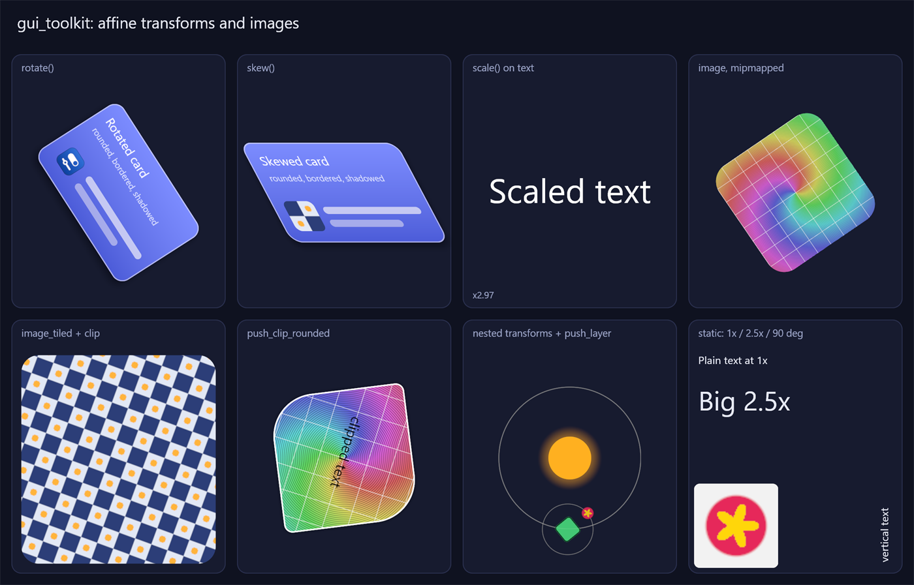
<p align="center"><b>examples/transforms</b>: the draw layer's affine transforms, rounded clips and images</p>

Screenshots are regenerated with `odin run tools/tk -- screenshots -build` (default settings, over the DevTools protocol: the mouse and the windows in front are left alone).

## What it looks like

```odin
if ui.style({width = ui.fill(), radius = em * 0.45}) {
	if ui.row(.Center) {
		res := ui.line_edit("###new_task", &app.input, "What needs doing?")
		if ui.tags("accent_button") {
			if ui.button("Add###add").clicked || res.committed { add_task(app, ui.field_string(&app.input)) }
		}
	}
	if ui.scroll_y("###list") {
		for &t in app.tasks {
			ui.checkbox(fmt.tprintf("###chk_%d", t.id), t.title, &t.done)
		}
	}
}
```

Scopes use Odin's `@(deferred_none)`, so `if ui.row() { ... }`, `if ui.style({...}) { ... }`, `if ui.tags("card") { ... }`
open and close themselves. Overrides for a single box go through `ui.next({...})`.

## Versioning

The toolkit follows semantic versioning (`ui.VERSION`; while `0.x`, a minor bump may change the API).
Changes are listed in [CHANGELOG.md](CHANGELOG.md); releases are git tags `vX.Y.Z`. A change adds a fragment to
[changelog.d/](changelog.d/README.md) and leaves the version alone: `tk release` (tools/tk) assembles the fragments and writes
the version when one is published ([CONTRIBUTING.md](CONTRIBUTING.md)).

## Layers (same layering as raddebugger, one Odin package each)

| Package | Role |
|---|---|
| `platform` | The window on Win32, X11 and Wayland: DPI, events, clipboard, cursors, OS animation preference. Live-resize safe (`poll_events` is re-entrancy guarded). |
| `render` | Direct3D 11 on Windows, WebGPU on Linux (`docs/webgpu.md`; `-define:TOOLKIT_RENDER=wgpu` tries it on Windows too; the shaders are written once, in WGSL). One instanced-quad pipeline draws rounded rects / borders / shadows (SDF, circular or squircle corners), glyphs, RGBA images (mipmapped, premultiplied), gradients and analytic shadows, with an optional 2D affine transform and rounded clip per instance; retained instances replayed from persistent GPU heaps. Colors are given linear; a blend space chosen per renderer (and per layer) says where they mix: linear light, or sRGB values as web browsers do. Optional translucent window (DirectComposition: fp16 scRGB, or 8-bit sRGB). A separate 2D canvas engine (D3D11) replays recorded canvas drawing on the GPU: [docs/canvas.md](docs/canvas.md). |
| `font` | Text on DirectWrite on Windows, on a native backend (Fontations, HarfRust, ICU4X) on Linux: system / file / memory faces, cascades with per-character fallback (`unicode-range`, then the system fallback), shaping (OpenType features, ligatures, kerning, complex scripts) with a thread-safe word cache, bidi (UAX #9), line breaks (UAX #14), carets through clusters, grayscale glyph bitmaps at subpixel positions and color glyphs (emoji) in atlas pages, or (`Settings.text_renderer = .Slug`) glyphs drawn on the GPU from their outline curves with the [Slug](https://github.com/EricLengyel/Slug) algorithm (no bitmaps: sharp under any scale, rotation or skew). Embedded fallback fonts (Roboto, Inconsolata). See [docs/text.md](docs/text.md). |
| `draw` | Rect / glyph run / image primitives; clips (scissor, rounded, ellipse, polygon; transformed), alpha and 2D affine transform stacks, layers with filters (blur, color matrices, drop shadow), blend modes and backdrops, gradients, box shadows, retained pictures (text included: shaped runs, color glyphs) over the renderer. See [docs/draw.md](docs/draw.md). |
| `ui` | The toolkit: boxes, keys, layout, signals, theme, animation, widgets, popups, zoom. |
| `host` | A window as an object, above `ui` and `render`: its interface, its surface, its pacing and the order of a frame, with hooks for what an application's frame does of its own (several builds, a frame held back); several windows on one device (`host_open`, `host_frame`, `hosts_wait`). [docs/getting-started.md](docs/getting-started.md). |
| `paint` | A vector rasterizer on the CPU for pictures made ahead of time (logos, icons): an RGBA canvas, paths of lines, Béziers, arcs, rounded rectangles and ellipses, filled (non-zero, even-odd) and stroked (width, joins, caps) with antialiasing, solid colours and linear / radial gradients, a clip, one canvas drawn into another at another size (cubic, nearest), PNG and .ico files. Pure Odin, deterministic, any target. `tk make_logo` draws the toolkit's logo with it. See [docs/paint.md](docs/paint.md). |
| `png` | The PNG codec of every package: straight RGBA8 to a PNG file at two levels (`.Small` for a file to keep, `.Fast` for a picture taken while a program runs) and any PNG back to straight RGBA8; its tEXt chunks read and written without the pixels; pure Odin, any platform. See [docs/png.md](docs/png.md). |
| `qr` | QR Codes (ISO/IEC 18004, model 2): a text or bytes at the smallest version that holds it, numeric, alphanumeric or byte mode, levels L, M, Q and H, the mask of lowest penalty; `ui.qr_code` draws one in whole device pixels, dark on white. Pure Odin, any target. See [docs/qr.md](docs/qr.md). |
| `flate` | DEFLATE / zlib / gzip as streams (any chunk size in, the output it allows out), dynamic Huffman codes; pure Odin, any platform. See [docs/flate.md](docs/flate.md). |
| `fsx` | File helpers with the guarantees a persistent store relies on, on every system (`fsx_<os>.odin`): atomic write (`.tmp` renamed over the file), positional reads, directory listing and creation, recursive delete that avoids the Windows shell, `path_kind` (links never followed), `temp_dir`. Platform-neutral interface (no Windows or POSIX type crosses it). See [docs/fsx.md](docs/fsx.md). |
| `i18n` | The text an application shows, in one place (`i18n.tr`): a procedure group with a plain, a translator-context and a count-dependent form; the English literal is the key, a call is free (same bytes, no lookup), and a language can later swap in one flat table. Pure Odin, any target. See [docs/i18n.md](docs/i18n.md). |
| `devtools` | The Chrome DevTools Protocol on 127.0.0.1 (`TOOLKIT_DEVTOOLS=<port>`): a program driven by scripts and inspected in Chrome's DevTools. See [docs/devtools.md](docs/devtools.md). |
| `dbus` | The D-Bus calls the Linux side needs. |
| `config` | A typed preference registry — an about:config for any application (`config.Prefs`): named, typed, documented, bounded preferences with four layers (default < user < command line < policy, policy locks), prefix observers, atomic save of user changes only, snapshots, and titles / summary / search for a settings UI. Pure Odin, any target. See [docs/config.md](docs/config.md). |
| `store` | A program's small files of keys and values (`key<separator>value` lines): read once at the start, kept in memory, written later by a worker of their own once the changes rest, atomically; a `Writer` does the same for a file the program formats. Pure Odin, any target. See [docs/store.md](docs/store.md). |
| `prefs_page` | A program's settings page, built from its `config` registry with no code per preference: the pages with their icons, the search, a line per preference with its title, its description and its control (a switch, a choice, a slider, a field with its unit), reset, the themes as cards. See [docs/prefs_page.md](docs/prefs_page.md). |
| `diff` | A unified diff read once into its lines (hunks, numbers, what changed in a line), two texts compared, and its rows: stacked or split, the code in its colours, only the rows in view built. See [docs/diff.md](docs/diff.md). |
| `remote` | How the reading of a value from a server stands (idle, loading, ready, refused, failed), with a ticket that drops the answer of a reading given up. See [docs/remote.md](docs/remote.md). |
| `winrt` | Windows Runtime APIs from Odin with no projection: HSTRINGs, factories, the IDs of generic instances, `await` for an asynchronous operation, event handlers, vectors. See [docs/winrt.md](docs/winrt.md). |
| `setup` | A program installs itself for the user from its own dialog: the state of the install, Install, Repair, Upgrade, Uninstall, open the installed copy, the offer at a start. See [docs/setup.md](docs/setup.md). |
| `arena` | Lifetime and ownership primitives: a `Scope` tree (a growing virtual-memory arena plus reverse-order cleanups, closing a scope closes its children) and a generational `Pool` (fixed-address slots addressed by a `Handle` that can never dangle). Pure Odin, any target. See [docs/arena.md](docs/arena.md). |
| `update` | Signed updates of a program: the manifest a release publishes per platform and channel (Ed25519, the product's key and signing context), what a program checks before it installs anything (signature, product, channel, platform, a strictly newer version, the file's size and SHA-256), and the new program put in place of the running one (Windows: the running one renamed aside; Linux: renamed over). The program downloads with its own client. See [docs/update.md](docs/update.md). |
| `desktop` | The program on the user's desktop, in the user's profile only: a launcher in the application menu, a desktop shortcut, the program on the PATH (with a console launcher on Windows), the icons of the theme, the system's thumbnails of files (the freedesktop.org cache and thumbnailers, the Windows shell's), and for a browser the registration as a candidate browser with its URL schemes. The installed copy: its files copied with a manifest, the system's record (Settings > Apps), an uninstall that removes exactly what was placed, NixOS's runtime. Every name and mark comes from the program's `Identity`; every place is an injectable root for tests. See [docs/desktop.md](docs/desktop.md). |
| `process` | What a program knows of its own process: its arguments as UTF-8, its executable, and an output for the person or script that started it, also from a Windows program with a window. See [docs/process.md](docs/process.md). |
| `instance` | One running copy of an application per named resource: the first start owns a name, a second start hands an opaque message to it and comes forward instead of opening a second copy. Platform-neutral interface (a name, an identity token, `[]byte` messages, a handler); named mutex + message window on Windows, lock file + Unix socket on POSIX (`instance_<os>.odin`). See [docs/instance.md](docs/instance.md). |
| `testkit` | Reusable building blocks for an application's own tests: a block of test-server ports (so several worktrees test side by side, `url` rewrites the default ports to the run's block) and a reader of the process's memory, open handles and (on Windows) GDI / USER objects for endurance and leak tests (`process_<os>.odin`). Pure of any product name. See [docs/testkit.md](docs/testkit.md). |
| `cdp` | A client of the Chrome DevTools Protocol for tools: a toolkit window (the `devtools` server) or a browser, one WebSocket for a run; find, click, keys, text, pictures, waits, screencasts, scripts and timelines (a picture after each action, compared with another run). See [docs/cdp.md](docs/cdp.md). |
| `site` | A project's website from its own pages: CHANGELOG.md as a changelog page, news and classic pages, what each page says when shared (feed, sitemap, manifest), Markdown as HTML, and the pages checked in a real browser. See [docs/site.md](docs/site.md). |
| `changelog` | A CHANGELOG made of fragments, one file per change in `changelog.d/`: each checked, what the next version brings, and the version's section assembled from them when it is published (`release.ship` does it). See [docs/changelog.md](docs/changelog.md). |
| `toolbox` | What the tools of a project share (`tk`, a program's own build tool): a command run with its output shown or captured (its folder, its environment, a time limit), the environment of a child, the exit code of a finished process, the SHA-256 of bytes and files, and a download pinned by SHA-256 (curl with retries, GitHub's API when a release download fails). See [docs/toolbox.md](docs/toolbox.md). |

## Features

- **Layout**: pixels / text / percent / children-sum sizes with strictness, floating boxes, cross-axis alignment,
  wrapping rows (`flow`), borders kept out of the content (border-box), scrolling with overlay scrollbars
  (at the right edge, or at the left one with `.Scrollbar_Left`; `set_scrollbar_autohide` shows them only under the pointer).
- **State survives rebuilds**: hover/press/focus animation, scroll offsets and text-field state are keyed by id strings
  (`"Label##hidden"`, `"Label###stable_id"`, `"###id"` as in raddebugger).
- **Themes**: 25 themes, most with a dark and a light version, the system's light or dark followed (`theme_show`); a
  program's own colours moved to the theme shown (`theme_recolor`); a user's themes from a file of theirs. See
  [docs/themes.md](docs/themes.md). `(tags -> color)` patterns, `apply_palette` expands a palette; colors cross-fade
  when it changes. Interaction states (hover, press, focus, selection) show at once, as visible steps per role
  (`hover_fill`, `press_fill`: a fraction of the way to the tint in sRGB values, right in both blend spaces);
  `Theme.transition_ms` brings back short fades. Finishes: flat, gradient (Bootstrap 2), glass (Aero), optionally over
  a translucent window with the Windows 11 acrylic backdrop, or machined (bevelled buttons, sunken wells, carved lines).
- **Look controls**: corner rounding (square to very round, squircle or circular corners) and density
  (comfortable / compact), both live.
- **Zoom, built in**: Ctrl+wheel, Ctrl +, Ctrl -, Ctrl 0 scale every size and the font (`ui.zoom`, `ui.set_zoom`;
  the effective scale is dpi scale x zoom). Apps write sizes in logical pixels.
- **DPI**: per-monitor aware, window sized from the monitor DPI and clamped to the work area.
- **Animations** follow the OS "show animations" setting (`Build_Params.animations`); when off, every transition jumps.
- **Widgets**: label, button (+icon variant), icon button, checkbox, radio, switch, slider, slider with a field for
  the exact value (`slider_field`), range slider, stepper, segmented control, chips, rating, progress bar, dropdown, tabs, key caps, cards, form rows, single-line text field
  (selection, word moves, clipboard, mouse), **multi-line editor** (`text_edit`: undo / redo, line numbers,
  indentation, Up / Down keep the column), scroll region, **menus** (context menus, dropdowns, menu bar: submenus,
  separators, disabled items, shortcuts, full keyboard, kept on screen), **keyboard lists** (`List_State`: active row,
  Page Up / Down, type-ahead, Enter / Escape, kept in view), wrapped text (`paragraph`), tooltip with hover delay,
  toasts (8 anchor positions, bordered, stacked with a glide), modal dialogs, a **colour picker** (`color_picker`: sat/val square, hue and opacity bars, old and new colour, hex / rgb / hsl / oklch text; the parts on their own too), numbers stepped in a field (`field_num_step`: Up / Down with Shift, Alt, Ctrl, and the wheel), fuzzy-match helper + highlighted labels, QR Codes (`qr_code`, [docs/qr.md](docs/qr.md)), custom-draw boxes.
- **2D transforms and images** (draw layer): `draw.push_transform` with a CSS-style `Affine` matrix (rotate, skew,
  scale, nested) applies to rects, borders, shadows, gradients, text and images, antialiased in local space; scaled
  text is re-rasterized at its screen size. `draw.push_clip_rounded` clips to a rounded rect under any transform.
  `render.create_texture_rgba` + `draw.image` / `draw.image_tiled`: mipmapped, rounded corners, tiling. See
  [docs/draw.md](docs/draw.md) and `examples/transforms`.
- **Effects** (draw layer, the CSS model): layers with group opacity, filter chains (gaussian blur of any radius,
  brightness / contrast / grayscale / sepia / saturate / hue-rotate / invert / opacity color matrices, drop shadows),
  the 16 blend modes of CSS Compositing plus plus-lighter / plus-darker, backdrops (what is already drawn behind a
  shape, filtered: frosted glass), ellipse and polygon clips (nonzero / even-odd). GPU passes, pooled render targets,
  pixel-tested. See [docs/draw.md](docs/draw.md) and `examples/effects`.
- **Blend spaces** (`render.Blend_Space`): mix colors in linear light (the UI's default) or on sRGB values like a web
  browser (`rgba(0,0,0,.5)` over white = 128, CSS gradients, opacity, image filtering), per renderer and per layer, with
  Skia's text correction (Chromium's Windows settings by default in sRGB). The UI theme adapts its translucent colors.
- **Retained drawing** (`draw.Picture`): record once, replay every frame for a few draw calls whatever the number of
  instances (text too: glyphs keep their atlas pages, a page reused makes only the pictures on it stale); instances live in persistent GPU heaps (budget, eviction, re-upload after a device loss); transforms pushed
  while recording are *slots* whose matrices change without recording (animations, scrolling). Immediate drawing and
  replays mix in one frame in exact z order. 8,000 rotating cards: 7.5 ms of CPU per frame immediate, 0.26 ms retained.
- **Gradients and shadows in the shader**: `draw.gradient` (linear, radial, conic, repeating, stop positions and
  transition hints, interpolation in sRGB / linear / Oklab / Oklch / Lab / Lch / HSL / HWB with hue methods, tiles,
  dithering), `draw.box_shadow` / `draw.inset_shadow` (the exact gaussian blur of a rounded rect: erf along x, the
  corner arcs integrated by angle; within 1 level of 8 bits of a numeric convolution).
- **Device loss**: `render.recover` recreates the device and every texture under the same handle (`frame_begin` and
  `draw.begin_frame` do it on their own).
- **Idle = 0 % CPU**: the loop blocks on the message queue; timed wakes only for the caret blink and tooltip delay.
- **Low input latency**: one frame in flight (waitable swap chain, `SetMaximumFrameLatency(1)`), and the loop waits for
  the GPU *before* reading input (`platform.wait_event` -> `render.wait_for_frame` -> `platform.poll_events`).
  Measured input-to-scan-out at 60 Hz: ~80 ms with DXGI's default queue, ~47 ms with this wait, and 34 ms from a key to the screen in opencode native (`-define:RENDER_PROBE=true` prints
  it; `-define:LOW_LATENCY=false` restores the old behaviour for comparison). Live resize presents once per step (WM_PAINT).
  `platform.wait_handle(w, render.frame_waitable(&r))` waits the same way while taking input as it arrives (time-stamped:
  `Event.stamp`).
- **Frame pacing**: `platform.display_info` gives the exact refresh rate of the window's monitor (followed across
  monitors and mode changes); `render.set_present_mode` (vsync, or tearing for variable refresh), `set_sync_interval`;
  `render.take_displayed` reports every frame that reached the screen (vblank time, input latency, missed refreshes),
  `measured_refresh_hz` and `vblank_grid` the measured vblank interval and phase. `render.set_latency_probe(r, true)`
  splits the input -> screen time into wait / work / Present / scan-out (`latency_summary`: p50 / p95 / max, in ms and
  in refreshes); see `src/render/latency.odin`.
  On a dynamic or variable refresh display the reported rate is the one the screen rests at: `Display_Info.max_hz` is the
  highest mode at the current size, `platform.refresh_is_variable(hz, max_hz)` says whether to aim above `hz`, and
  `platform.display_live_hz(w)` reads the rate the compositor runs at now (primary monitor only). The swap chain's latency object
  does not pace an app on such a screen (it is released at once): `platform.Frame_Slots` / `frame_slot_wait` is the app's
  own cap on its cadence (a grid of slots one period apart, pure: the caller gives the time and waits, taking input meanwhile
  with `wait_handle` on a timer), so that a mouse at 1 kHz makes a frame per period and not per move.

- **Keyboard**: Tab / Shift+Tab focus navigation (trapped inside modals, scrolled into view, focus ring), arrow keys
  move the focus spatially, Enter / Space activate, arrows drive sliders, menus and dropdowns; an open menu owns the
  keyboard (Up / Down / Home / End over enabled items, Right / Left through submenus, letters jump, Escape closes one
  level); lists keep an active row; `tab_stops(false)` scopes leave widgets out of the Tab order; `tab_direction` and
  `focus_step` let an app hand the focus to content of its own (a document view) and back. Line edits keep an edit
  history (Ctrl+Z / Ctrl+Y) and expose their edit commands for menus (`field_cut`, `field_paste`, `field_undo`...); a paste
  asks the clipboard without waiting and inserts its text when it comes ([docs/clipboard.md](docs/clipboard.md)).
- **Disabled / muted** scopes: `if ui.disabled(cond) { ... }` disables a whole subtree with a neutral look.
- **Status bars and frame statistics** (`status.odin`): `status_bar` (a bar along the bottom, smaller text),
  `status_fill` (its flexible, clipped part), `status_item` (compact text, tones, monospace digits, clickable),
  `status_separator`; `Frame_History` (a ring of samples of up to 8 stacked series: `history_push`, `history_at`,
  `history_find_tag` for values that arrive late, `history_stats` with mean / p50 / p95 / p99 / over-budget,
  `history_rate`) and `frame_graph` (stacked bars, newest at the right, dashed budget line, rare spikes cut and marked,
  the bar under the pointer in the result); `stat_row` / `stat_heading` / `swatch` for detail panels and legends;
  `popover` (a panel anchored above or below a widget that stays open while the app builds it). Nothing asks for
  frames: the graph changes when the app pushes a sample. `render.set_gpu_timing` measures the GPU time of each frame
  at run time (`gpu_next_frame` + `gpu_result` match it to its frame), `render.texture_memory` reports GPU memory.
  See the status bar of `examples/fidget`.
- **Integrated title bar** (tabs in the title bar, as Edge and Chrome): `platform.set_integrated_title(w, true)`, then
  `if ui.title_bar(id) { ...; ui.window_buttons() }` with `Build_Params.window` set. The empty parts of the bar drag the
  window, clickable boxes stay the app's; the system gets its usual answers (double-click to maximize, Aero Snap, Snap
  Layouts over the maximize button on Windows 11, system menu, resize along the top edge), maximized windows stay on
  their monitor (auto-hidden taskbars still come up). Caption buttons with the system's sizes, glyphs and colours.
  `platform.set_fullscreen`. Try `fidget --integrated`. Where the system can draw the title bar
  (`platform.system_title_available`: Windows, X11, KDE) a program can offer it and switch at any time; the window
  buttons then are the system's (`ui.window_buttons` draws none). An app with its own menu of the title bar takes the
  right clicks on its empty parts (`platform.set_caption_menu_app`, `ui.caption_right_clicked`).
- **Cursors**: every CSS cursor (`platform.Cursor`, `cursor_from_css`); on Windows the system's own when it has one, on Linux the user's theme (X11: libxcb-cursor, else the server's cursor font; Wayland: `wp_cursor_shape_v1`, else libwayland-cursor), the
  others (grab, grabbing, zoom, cell, copy, alias...) drawn in the user's pointer scheme and size; custom cursors from
  RGBA images with a hotspot (`custom_cursor_create`, scaled per dpi, shared, released); the cursor changes at once,
  also during a drag. Try `examples/cursors`.
- **Panes**: splitters, accordions and lists reordered by dragging ([docs/panes.md](docs/panes.md)).
- **Docking**: the app's panels in stacks of tabs the user drags to split, join, float and dock back, every drop target
  also in a menu for the keyboard, the layout saved as one line of text ([docs/docking.md](docs/docking.md)).
- **Accessibility**: screen readers (NVDA, Narrator) read the windows through UI Automation (AccessKit): every widget
  says its role, name, states and value, the focus follows, requests (invoke, set value, select, focus) arrive as input;
  built only while a reader listens, sent incrementally ([docs/accessibility.md](docs/accessibility.md)).
- **Threads and the system**: `ui.post` runs calls posted from any thread at the next build (a lock-free ring,
  [docs/post.md](docs/post.md)); a notification area icon with menu and notifications ([docs/tray.md](docs/tray.md)); system notifications with
  buttons, without an icon ([docs/notifications.md](docs/notifications.md));
  the clipboard's images, HTML and files ([docs/clipboard.md](docs/clipboard.md)); file dialogs and shell actions
  ([docs/dialogs.md](docs/dialogs.md)); drag and drop ([docs/dragdrop.md](docs/dragdrop.md)).
- **Tables and graphs**: `table_build`, a sortable table of texts (titles that sort and resize, a columns' menu, the
  keyboard while a filter field has it, cut cells in a tooltip) on `vlist`; `type_to_field` (typing anywhere filters);
  `line_graph`, `sparkline` and `meter_bar` for values over time ([docs/data-views.md](docs/data-views.md)).
- **Long lists**: `vlist` builds only the rows in view (rows of any height, measured and cached; keyboard and type-ahead
  over all rows); wrapped paragraphs are cached between frames; scroll regions glide along an impulse or ease-out curve
  on the app's frame clock (`set_scroll_settings`). Middle-click autoscroll (as Chrome and Firefox do it): a press of
  the wheel drops an anchor and the pointer's distance from it scrolls, the farther the faster, along a tunable
  acceleration curve; hold or toggle modes, a direction cursor and an anchor marker ([docs/autoscroll.md](docs/autoscroll.md)).

Not there yet: a macOS backend; off Windows, color glyphs in SVG and sbix; on Linux, pixel tests (its CI runs the other tests, and the backends against real X11 and Wayland servers).

## Testing

`odin test tests/affine -vet` runs the unit tests of the affine helpers. `odin test tests/keyboard -vet -define:ODIN_TEST_THREADS=1`
drives menus, submenus, lists, line edit history and wrapped text with synthetic input, without a window;
`tests/status` the sample history (ring, resize, statistics, rates) and the frame graph's scale and hit testing;
`tests/chrome` the integrated title bar's hit test (zones, edges, maximized) and regions, the virtualized list, the wrap
cache and the scroll curve; `tests/cursors` the cursors' CSS names, system or drawn, the drawn shapes, resampling, and
custom cursors on a hidden window. `tests/layers`, `tests/effects`,
`tests/blend_space`, `tests/gradients`, `tests/shadows` and `tests/retained` (text, color emoji and transformed glyphs included) are pixel tests on an offscreen WARP renderer (most in both blend spaces); `tests/text` covers faces, fallback, shaping, bidi, line breaks, carets, color glyphs and the atlas pages (`atlas_stress`); `tests/slug` the Slug text (outlines, bands against the exact winding number, the glyph store and its eviction, pixels against the atlas, order, clips, rotation, pictures, device loss). `odin run tools/textcompare -- -out <dir> -dpr 1.75` writes atlas | Slug | difference images of the same scenes and measures both (CPU, GPU, first paint, memory).

`tests/examples/whatsnew_test.odin` runs `examples/whatsnew` in the test's process with no window and drives it over the devtools protocol (docs/devtools.md), with a client that needs no socket: each page must show no layout warning, nothing a screen reader cannot name, and look like its reference image (`tests/examples/baseline`, `TOOLKIT_TEST_UPDATE=1` writes them); then a wheel burst in the lazy column, find with its scope gone, the recorder, the screencast, Chrome's DevTools' way through the box tree. `tk timeline_test` tests the timelines of `src/cdp` (docs/cdp.md) against the program over a real socket.

Timing checks (durations, CPU or GPU times, frames in a time window) are opt-in: `base.perf_skip` skips them unless
`GUI_PERF=1` (or `true`) is set and `CI` is not, and prints `perf: skipped (...)`. Run them by hand, never in CI:
`GUI_PERF=1 odin test tests/colr -vet`, `GUI_PERF=1 odin test tests/window -vet`, `GUI_PERF=1 odin test tests/gpufx -vet`.

`tests/examples` drives `examples/fidget` and `examples/todo` in the test's process (`src/testkit/session`: no window of the system, no input of the machine):
clipboard, Tab and arrow focus, Space activation, editor undo / redo, zoom keys, palette, Settings dialog and its dropdown, menus closing on a click
outside, toggles, segmented, chips, slider, tooltip, context menu, wheel scroll, theme, saved files. Debug aids: `-define:UI_PROBE=true` logs every press with the hit box's rect; `--dump` (fidget) prints oversized boxes.

## License

MIT (see LICENSE). A personal project by [sachahjkl](https://github.com/sachahjkl), not tied to any company; anyone is free
to use it. The design and several algorithms follow the RAD Debugger (MIT, Epic Games Tools): see NOTICE.md.

The optional Slug text renderer uses the shaders and the algorithm of [Slug](https://github.com/EricLengyel/Slug) by
Eric Lengyel (MIT; the patent is in the public domain since 2026-03-17): credit and license text in NOTICE.md, the
pinned reference shaders in `src/font/slug_ref/`.
