<p align="center">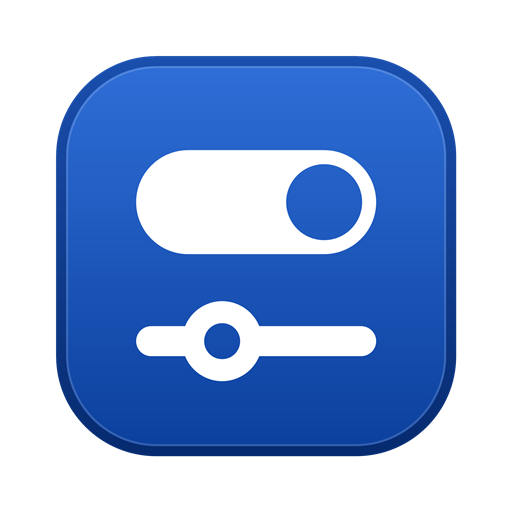</p>

<h1 align="center">gui_toolkit</h1>

<p align="center"><a href="CHANGELOG.md"></a></p>

A native GUI toolkit in [Odin](https://odin-lang.org): a retained-state immediate-mode UI with a Direct3D 11 renderer.
The design (box tree, keyed persistence, size-kind layout, signals, tag-based themes) follows the UI layers of the
[RAD Debugger](https://github.com/EpicGamesExt/raddebugger); this project is the toolkit and the apps built on it, not a port of the debugger.

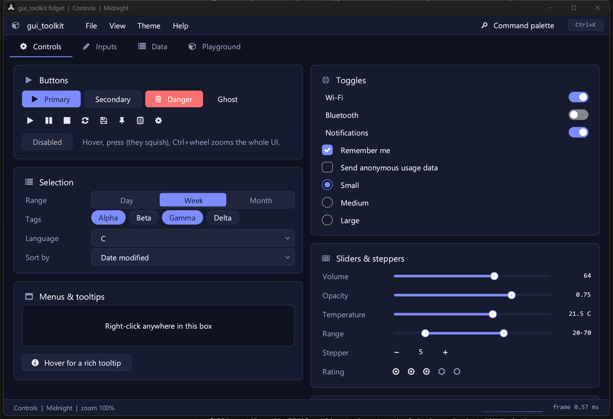

No dependencies beyond Odin's `core:` and `vendor:` (`directx/d3d11`) and the platform (DirectWrite for text). The exes are self-contained (icon font compiled in, fallback text fonts for Wine): the widget gallery is
1.3 MB, the todo example 950 KB; windows show in ~0.25 s, idle at 0 % CPU, and a frame of the gallery takes under 1 ms
of CPU (`fidget --bench=300`).

    build.bat fidget     # the widget gallery           ->  build\fidget.exe
    build.bat todo       # a todo app                   ->  build\todo.exe
    build.bat smoke      # renderer / font / draw smoke test (no UI layer)
    build.bat transforms # rotated / skewed / scaled shapes, text and images, rounded clips (draw layer only)
    build.bat todo debug

Needs the Odin compiler (tested with `dev-2026-10`) and Windows 10+ (Win32 + D3D11 only for now).
Prebuilt binaries are attached to the [GitHub releases](https://github.com/sachahjkl/gui_toolkit/releases).

## Screenshots

| | |
|---|---|
| 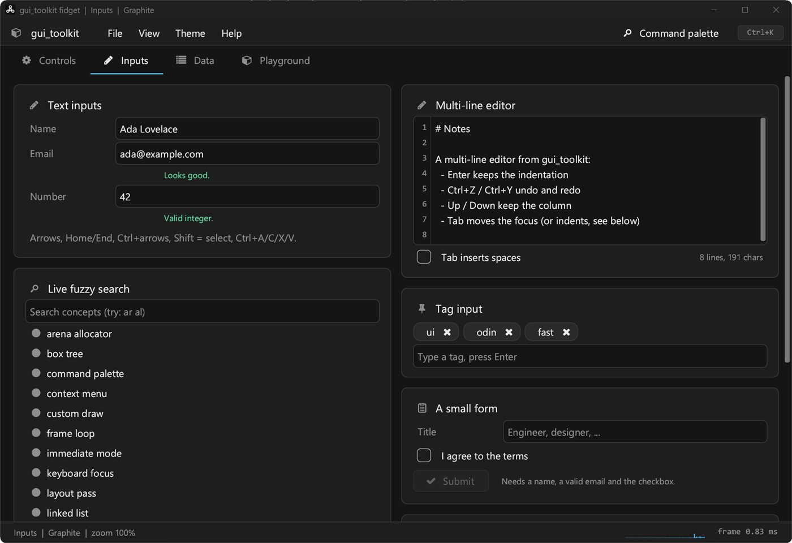 | 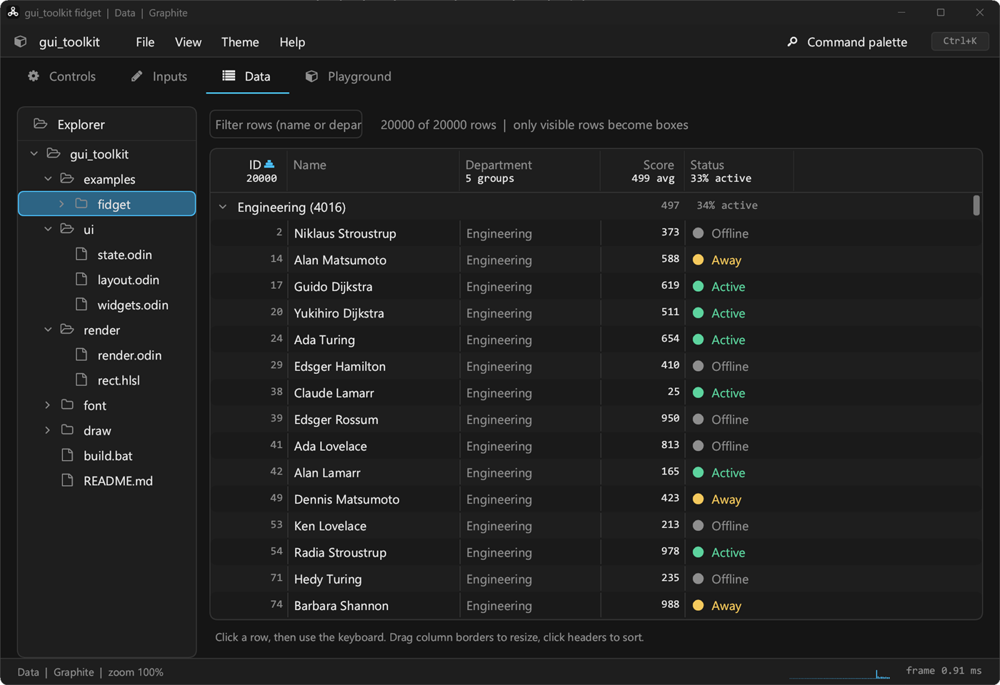 |
| **Inputs**: validated fields, multi-line editor, live fuzzy search, tag input, form | **Data**: 20,000-row virtualized table (groups with totals, sort, filter, resize), file tree |
| 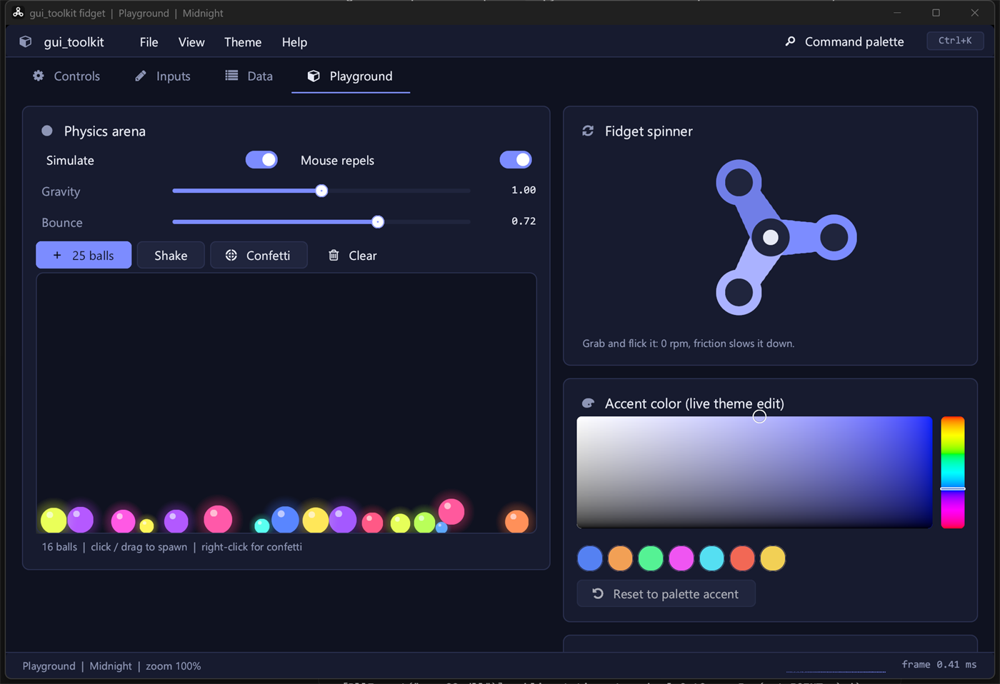 | 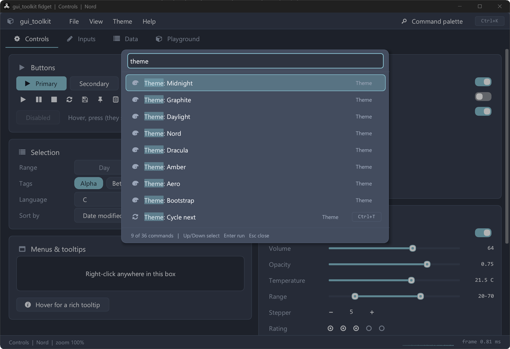 |
| **Playground**: physics balls, fidget spinner, live accent color picker | **Command palette** (Ctrl+K), fuzzy matches highlighted, Nord theme |
| 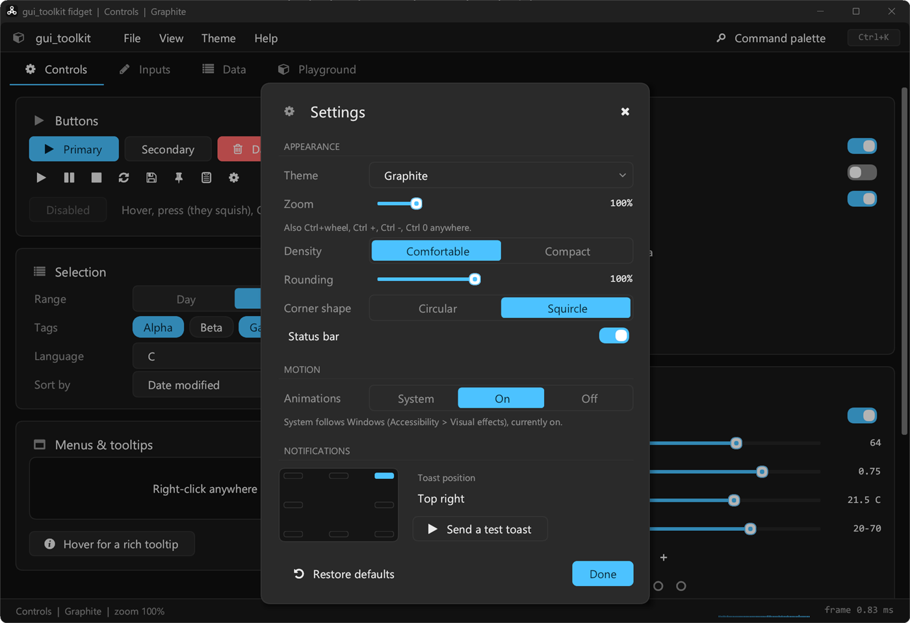 | 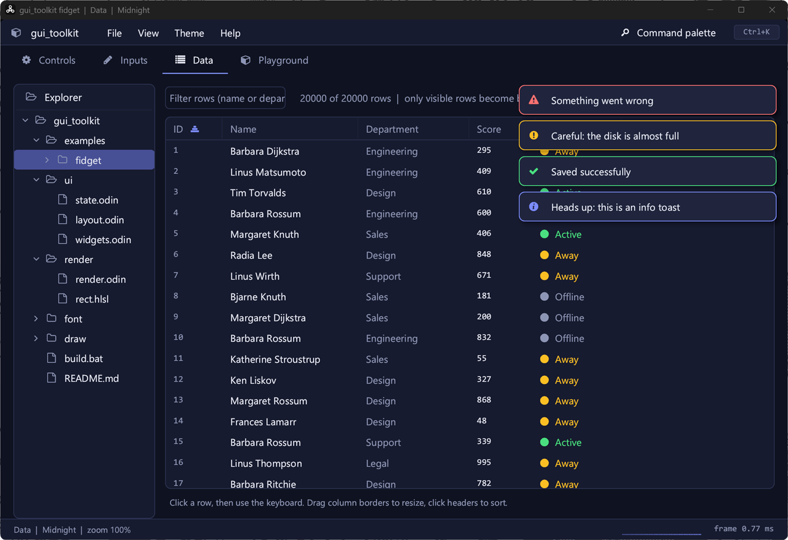 |
| **Settings**: theme, zoom, animations, toast position (click a cell) | **Toasts**: 8 anchor positions, border tinted by kind |
| 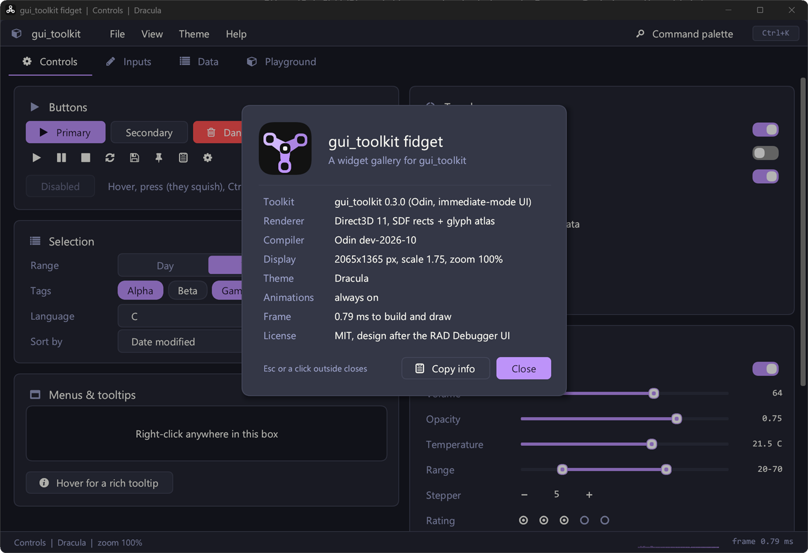 | 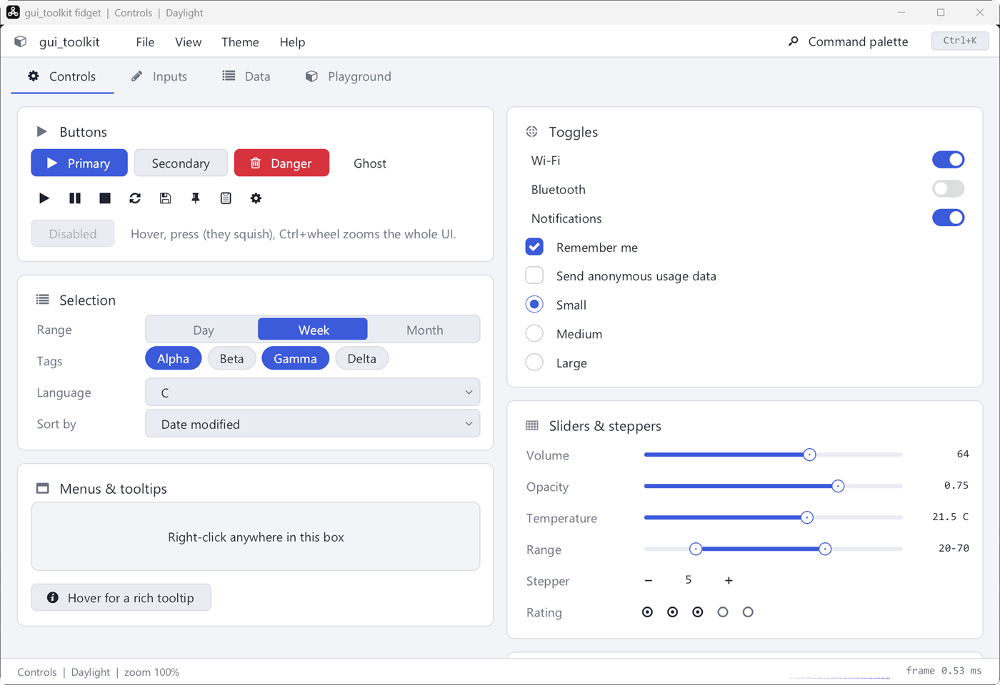 |
| **About** (F1), Dracula theme | **Daylight** theme (8 themes, cross-fading) |
| 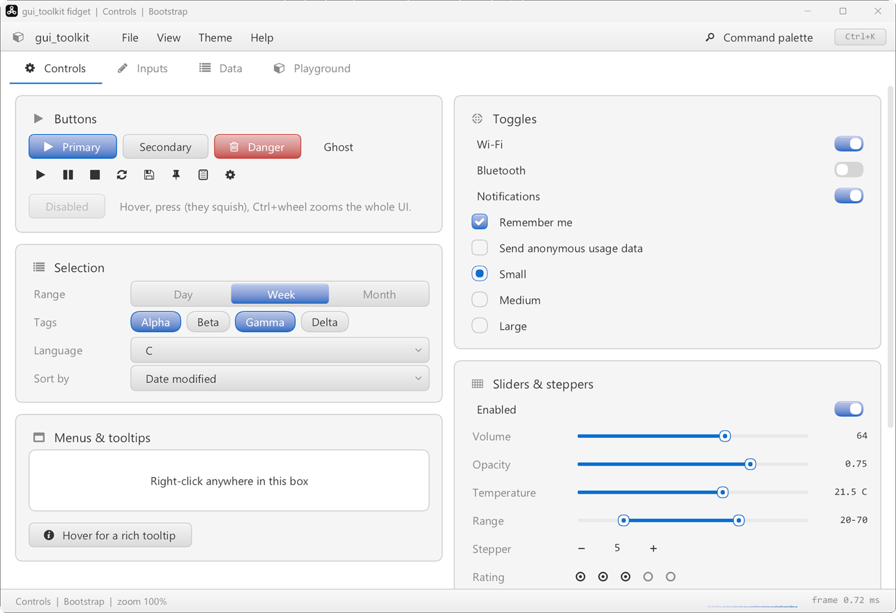 | 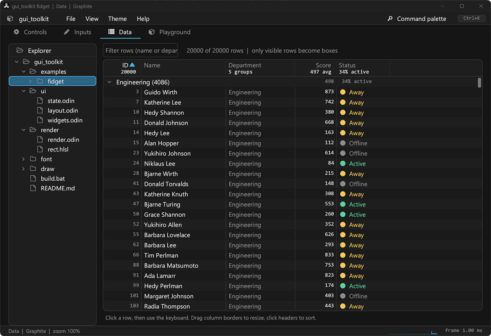 |
| **Bootstrap** theme: gradient finish, embossed text, focus glow | **Compact** density: more rows, same text size |

<p align="center">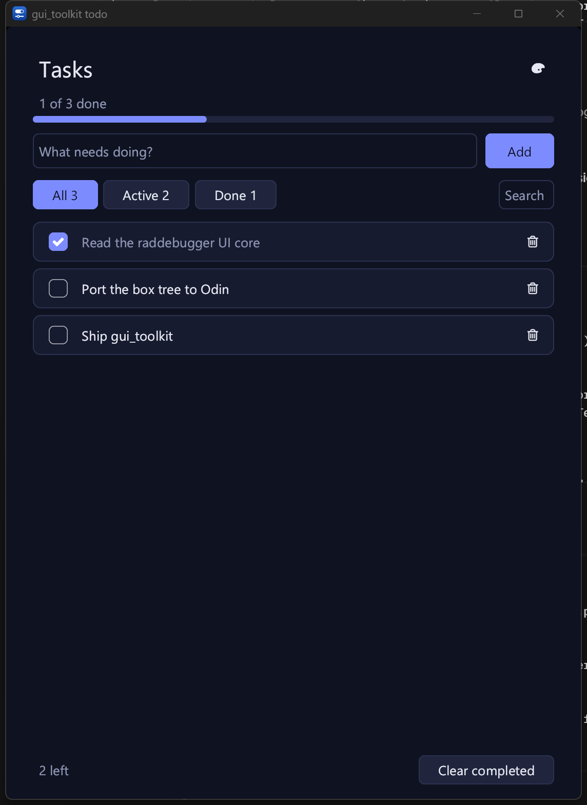<br><b>examples/todo</b></p>

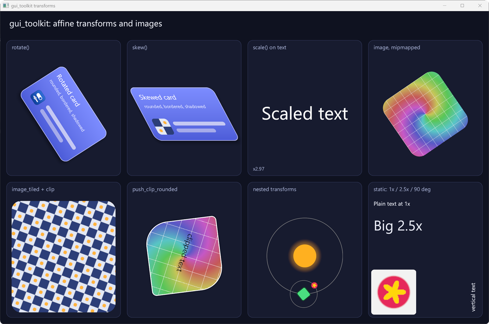
<p align="center"><b>examples/transforms</b>: the draw layer's affine transforms, rounded clips and images</p>

Screenshots are regenerated with `powershell -File tools/screenshots.ps1` (default settings, 175 % DPI).

## What it looks like

```odin
if ui.style({width = ui.fill(), radius = em * 0.45}) {
	if ui.row(.Center) {
		res := ui.line_edit("###new_task", &app.input, "What needs doing?")
		if ui.tags("accent_button") {
			if ui.button("Add###add").clicked || res.committed { add_task(app, ui.field_string(&app.input)) }
		}
	}
	if ui.scroll_y("###list") {
		for &t in app.tasks {
			ui.checkbox(fmt.tprintf("###chk_%d", t.id), t.title, &t.done)
		}
	}
}
```

Scopes use Odin's `@(deferred_none)`, so `if ui.row() { ... }`, `if ui.style({...}) { ... }`, `if ui.tags("card") { ... }`
open and close themselves. Overrides for a single box go through `ui.next({...})`.

## Versioning

The toolkit follows semantic versioning (`ui.VERSION`, currently `0.9.0`; while `0.x`, a minor bump may change the API).
Changes are listed in [CHANGELOG.md](CHANGELOG.md); releases are git tags `vX.Y.Z`.

## Layers (same layering as raddebugger, one Odin package each)

| Package | Role |
|---|---|
| `platform` | Win32 window, DPI, events, clipboard, cursors, OS animation preference. Live-resize safe (`poll_events` is re-entrancy guarded). |
| `render` | D3D11. One instanced-quad pipeline draws rounded rects / borders / shadows (SDF, circular or squircle corners), glyphs, RGBA images (mipmapped, premultiplied), gradients and analytic shadows, with an optional 2D affine transform and rounded clip per instance; retained instances replayed from persistent GPU heaps. Colors are given linear; a blend space chosen per renderer (and per layer) says where they mix: linear light, or sRGB values as web browsers do. Optional translucent window (DirectComposition: fp16 scRGB, or 8-bit sRGB). |
| `font` | Text on DirectWrite: system / file / memory faces, cascades with per-character fallback (`unicode-range`, then the system fallback), shaping (OpenType features, ligatures, kerning, complex scripts) with a thread-safe word cache, bidi (UAX #9), line breaks (UAX #14), carets through clusters, grayscale glyph bitmaps at subpixel positions and color glyphs (emoji) in atlas pages. Embedded fallback fonts (Roboto, Inconsolata). See [docs/text.md](docs/text.md). |
| `draw` | Rect / glyph run / image primitives; clips (scissor, rounded, ellipse, polygon; transformed), alpha and 2D affine transform stacks, layers with filters (blur, color matrices, drop shadow), blend modes and backdrops, gradients, box shadows, retained pictures (text included: shaped runs, color glyphs) over the renderer. See [docs/draw.md](docs/draw.md). |
| `ui` | The toolkit: boxes, keys, layout, signals, theme, animation, widgets, popups, zoom. |

## Features

- **Layout**: pixels / text / percent / children-sum sizes with strictness, floating boxes, cross-axis alignment,
  wrapping rows (`flow`), borders kept out of the content (border-box), scrolling with overlay scrollbars.
- **State survives rebuilds**: hover/press/focus animation, scroll offsets and text-field state are keyed by id strings
  (`"Label##hidden"`, `"Label###stable_id"`, `"###id"` as in raddebugger).
- **Theme**: `(tags -> color)` patterns, `apply_palette` expands an 11-color palette (dark and light included);
  colors cross-fade when the palette changes. Finishes: flat, gradient (Bootstrap 2) or glass (Aero), optionally over
  a translucent window with the Windows 11 acrylic backdrop.
- **Look controls**: corner rounding (square to very round, squircle or circular corners) and density
  (comfortable / compact), both live.
- **Zoom, built in**: Ctrl+wheel, Ctrl +, Ctrl -, Ctrl 0 scale every size and the font (`ui.zoom`, `ui.set_zoom`;
  the effective scale is dpi scale x zoom). Apps write sizes in logical pixels.
- **DPI**: per-monitor aware, window sized from the monitor DPI and clamped to the work area.
- **Animations** follow the OS "show animations" setting (`Build_Params.animations`); when off, every transition jumps.
- **Widgets**: label, button (+icon variant), icon button, checkbox, radio, switch, slider, range slider, stepper,
  segmented control, chips, rating, progress bar, dropdown, tabs, key caps, cards, form rows, single-line text field
  (selection, word moves, clipboard, mouse), **multi-line editor** (`text_edit`: undo / redo, line numbers,
  indentation, Up / Down keep the column), scroll region, **menus** (context menus, dropdowns, menu bar: submenus,
  separators, disabled items, shortcuts, full keyboard, kept on screen), **keyboard lists** (`List_State`: active row,
  Page Up / Down, type-ahead, Enter / Escape, kept in view), wrapped text (`paragraph`), tooltip with hover delay,
  toasts (8 anchor positions, bordered, stacked with a glide), modal dialogs, color pickers (sat/val + hue), fuzzy-match helper + highlighted labels, custom-draw boxes.
- **2D transforms and images** (draw layer): `draw.push_transform` with a CSS-style `Affine` matrix (rotate, skew,
  scale, nested) applies to rects, borders, shadows, gradients, text and images, antialiased in local space; scaled
  text is re-rasterized at its screen size. `draw.push_clip_rounded` clips to a rounded rect under any transform.
  `render.create_texture_rgba` + `draw.image` / `draw.image_tiled`: mipmapped, rounded corners, tiling. See
  [docs/draw.md](docs/draw.md) and `examples/transforms`.
- **Effects** (draw layer, the CSS model): layers with group opacity, filter chains (gaussian blur of any radius,
  brightness / contrast / grayscale / sepia / saturate / hue-rotate / invert / opacity color matrices, drop shadows),
  the 16 blend modes of CSS Compositing plus plus-lighter / plus-darker, backdrops (what is already drawn behind a
  shape, filtered: frosted glass), ellipse and polygon clips (nonzero / even-odd). GPU passes, pooled render targets,
  pixel-tested. See [docs/draw.md](docs/draw.md) and `examples/effects`.
- **Blend spaces** (`render.Blend_Space`): mix colors in linear light (the UI's default) or on sRGB values like a web
  browser (`rgba(0,0,0,.5)` over white = 128, CSS gradients, opacity, image filtering), per renderer and per layer, with
  Skia's text correction (Chromium's Windows settings by default in sRGB). The UI theme adapts its translucent colors.
- **Retained drawing** (`draw.Picture`): record once, replay every frame for a few draw calls whatever the number of
  instances (text too: glyphs keep their atlas pages, a page reused makes only the pictures on it stale); instances live in persistent GPU heaps (budget, eviction, re-upload after a device loss); transforms pushed
  while recording are *slots* whose matrices change without recording (animations, scrolling). Immediate drawing and
  replays mix in one frame in exact z order. 8,000 rotating cards: 7.5 ms of CPU per frame immediate, 0.26 ms retained.
- **Gradients and shadows in the shader**: `draw.gradient` (linear, radial, conic, repeating, stop positions and
  transition hints, interpolation in sRGB / linear / Oklab / Oklch / Lab / Lch / HSL / HWB with hue methods, tiles,
  dithering), `draw.box_shadow` / `draw.inset_shadow` (the exact gaussian blur of a rounded rect: erf along x, the
  corner arcs integrated by angle; within 1 level of 8 bits of a numeric convolution).
- **Device loss**: `render.recover` recreates the device and every texture under the same handle (`frame_begin` and
  `draw.begin_frame` do it on their own).
- **Idle = 0 % CPU**: the loop blocks on the message queue; timed wakes only for the caret blink and tooltip delay.
- **Low input latency**: one frame in flight (waitable swap chain, `SetMaximumFrameLatency(1)`), and the loop waits for
  the GPU *before* reading input (`platform.wait_event` -> `render.wait_for_frame` -> `platform.poll_events`).
  Measured input-to-scan-out at 60 Hz: ~80 ms with DXGI's default queue, ~47 ms now (`-define:RENDER_PROBE=true` prints
  it; `-define:LOW_LATENCY=false` restores the old behaviour for comparison). Live resize presents once per step (WM_PAINT).

- **Keyboard**: Tab / Shift+Tab focus navigation (trapped inside modals, scrolled into view, focus ring), arrow keys
  move the focus spatially, Enter / Space activate, arrows drive sliders, menus and dropdowns; an open menu owns the
  keyboard (Up / Down / Home / End over enabled items, Right / Left through submenus, letters jump, Escape closes one
  level); lists keep an active row; `tab_stops(false)` scopes leave widgets out of the Tab order; `tab_direction` and
  `focus_step` let an app hand the focus to content of its own (a document view) and back. Line edits keep an edit
  history (Ctrl+Z / Ctrl+Y) and expose their edit commands for menus (`field_cut`, `field_paste`, `field_undo`...).
- **Disabled / muted** scopes: `if ui.disabled(cond) { ... }` disables a whole subtree with a neutral look.

Not there yet: word wrap in the editor, IME composition, drag-and-drop files, Linux/macOS backends.

## Testing

`odin test tests/affine -vet` runs the unit tests of the affine helpers. `odin test tests/keyboard -vet -define:ODIN_TEST_THREADS=1`
drives menus, submenus, lists, line edit history and wrapped text with synthetic input, without a window. `tests/layers`, `tests/effects`,
`tests/blend_space`, `tests/gradients`, `tests/shadows` and `tests/retained` (text, color emoji and transformed glyphs included) are pixel tests on an offscreen WARP renderer (most in both blend spaces); `tests/text` covers faces, fallback, shaping, bidi, line breaks, carets, color glyphs and the atlas pages (`atlas_stress`)

`tools\keyboard_test.ps1` sends real keystrokes with modifiers to `examples/fidget` (33 checks: clipboard, Tab and arrow
focus, Space activation, editor undo / redo, zoom keys, palette, Settings dialog and its dropdown, menus closing on a
click outside) and reads the state from the
window title (`--state_title`); keys are sent only while fidget is the foreground window.
`tools\ui_test.ps1` drives `examples/todo` and `tools\fidget_test.ps1` drives `examples/fidget` with real clicks
(typing, Enter, toggles, segmented, chips, dropdown, slider, tooltip, context menu, wheel scroll, command palette,
theme switch) and check the title / saved files. They abort if another window covers the target point.
Screenshot coordinates: image viewers often downscale captures (e.g. to 2000 px wide); scale click targets by
window width / image width, or clicks land a few percent off. Debug aids: `-define:UI_PROBE=true` logs every press with the hit box's rect; `--dump` (fidget) prints oversized boxes.

## License

MIT (see LICENSE). The design and several algorithms follow the RAD Debugger (MIT, Epic Games Tools): see NOTICE.md.
