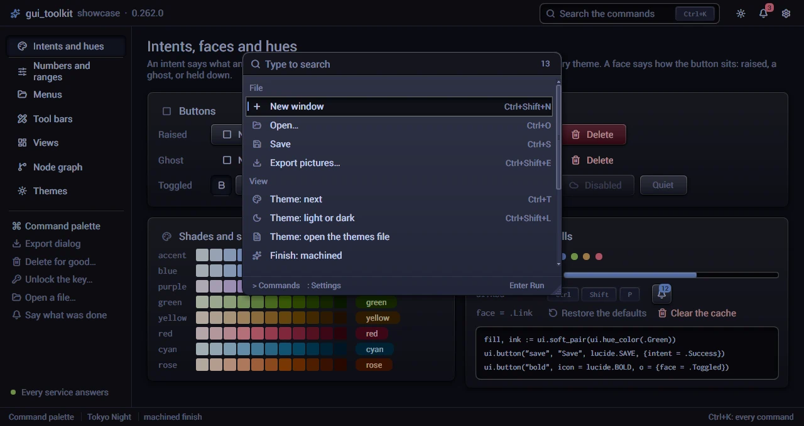

# Commands: keys, palette and the sheet of the keys

A program names each of its commands once, in a table of `ui.Command`: its label, its group and its keys. The same table
gives the key handling, the shortcut of a menu's line, a tooltip's text, the command palette and the sheet of the keys:
they cannot disagree.



```odin
Cmd :: enum u8 { End_Task, Kill, Shortcuts }

// (no line for the palette: the toolkit owns its command, ui.palette_command(); palette_keys reads its keys and the
// sheet lists it)
COMMANDS := [Cmd]ui.Command{
	.End_Task  = {label = "End task", group = "Processes", keys = {{.Delete, {}}}},
	.Kill      = {label = "Kill…", group = "Processes", keys = {{.Delete, {.Shift}}}},
	.Shortcuts = {label = "Keyboard shortcuts", group = "Window", keys = {{.F1, {}}}, scope = .Window},
}

// each frame, before the page is built, in every page and mode: a window command's keys work whatever has the focus
for c in Cmd { if ui.command_pressed(COMMANDS[c], can(c)) { run(c) } }

// a menu's line, a tooltip
if ui.menu_item(COMMANDS[.Kill].label, ui.command_shortcut(COMMANDS[.Kill]), disabled = !can(.Kill)).clicked { run(.Kill) }
tip := ui.command_tip(COMMANDS[.Kill])          // "Kill… (Shift+Delete)"

// the palette (palette.md) and the sheet: views (views.md), home Dialog
disabled: [Cmd]bool
for c in Cmd { disabled[c] = !can(c) }
ui.palette_commands(&app.palette, COMMANDS[:], disabled[:], {version = app.can_version})   // the palette's commands source
ui.palette_keys(&app.palette)                                                            // Ctrl+K, Ctrl+Shift+P
if c, ok := ui.palette_chosen(&app.palette); ok {                                        // the build after the choice
	if i, is := ui.palette_chosen_command(&app.palette, c); is { run(Cmd(i)) }
}
if show_keys { ui.shortcuts_sheet_open(&app.sheet, COMMANDS[:]) }
```

| | |
|---|---|
| `Chord{key, mods}` | a key and its modifiers; the zero value is no key |
| `ZOOM_IN_KEYS`, `ZOOM_OUT_KEYS`, `ZOOM_RESET_KEYS` | the keys of a program's zoom commands, the same everywhere: Ctrl+= and Ctrl++ (Ctrl+Shift+=, + on an AZERTY's or a QWERTY's = key), Ctrl+keypad +; Ctrl+-, Ctrl+keypad -; Ctrl+0 (`keys = ui.ZOOM_IN_KEYS[:]`). A program with zoom commands of its own sets `Build_Params.disable_zoom`, else the window's zoom takes those keys |
| `Command{label, group, keys, icon, tags, scope, toggle}` (`toggle`: a switch; its menu line takes `checked`, its palette row shows its mark and stays open: [palette.md](palette.md)) | `keys`: its chords, as many as it has (`[]Chord`; Zoom in: Ctrl+=, Ctrl+Num +, Ctrl+Shift+=), the first one shown in menus and tooltips (a zero chord among them is none); `tags`: other words the palette finds it by ("exit", "close" for Quit), a match of them after one of the label's |
| `chord_text(chord)` | `Ctrl+Shift+P`, `Shift+Delete`, `F5`: modifiers in the order Ctrl, Shift, Alt; in the language in use (`Ctrl+Maj+P`): the words of `platform.key_text`, which names a `Key`, a `Hotkey` and keys written in English (below) |
| `key_tip(label, chord)` | a tooltip's text for a control that is no command: `Settings (Ctrl+,)`, the label alone with no key |
| `command_shortcut(c)`, `command_keys_text(c)`, `command_tip(c)` | the first key's text; every key's, apart by commas; `label (key)` |
| `Command.scope` | `.Page` (the default): its keys reach it as any key does, not from behind a dialog. `.Window`: a window command (the palette, the keyboard shortcuts, the settings, close, quit): its keys work whatever has the focus and whatever the page, over a view shown as a dialog too (below) |
| `command_pressed(c, disabled)` | one of its keys was pressed this frame: the press is taken. A command that cannot act (`disabled`) takes no key. A key that types text is not taken while a text field (a line edit, a text area) has the keyboard: the field gets it. A chord that the widget with the keyboard claims (`keys_claim`) is not taken either |
| `chord_pressed(chord, scope)` | one chord by `command_pressed`'s rules, for a program that reads its keys with its own table (a sequence of two chords, bindings of its own) |
| `keys_claim(owner, ..pass)` | a widget that has the keyboard (box `owner`) keeps every chord, a window command's too, but the chords of `pass` (at most `KEYS_CLAIM_PASS_MAX`). Call it at each build while it owns them (a terminal, a shortcut recorder: `hotkey_field` claims while it records). Its claim counts from the build it is made in and the next one |
| `command_window_typing_keys(commands)` | the window commands' keys that type text, as `command_typing_keys` says them. A program's test expects none |
| `command_key_types_text(chord)` | whether the chord types text in a field: a letter, a digit, a punctuation mark, Space, Backspace or keypad + and -, with no modifier or with Shift alone. Ctrl or Alt with any key, and F1–F12, Escape, Enter, Tab, Delete, Insert, the arrows, Home, End, Page Up, Page Down, Menu and Print with any modifier: false |
| `command_typing_keys(commands)` | one line per key of the table that types text, `"<label>: <key>"` (`"Rectangle: R"`, `"Add a step…: Shift+A"`), the key by its `platform.Key` name. A program's unit test compares it with the keys it means (below) |
| `palette_commands(&p, commands, disabled, o)` | the palette's commands source ([palette.md](palette.md)): the program's table (valid while the palette is open), `disabled` and `Palette_Commands_Options` copied when `o.version` changes (0: when their addresses do). `palette_chosen_command(&p, choice)` gives a chosen command's index |
| `palette_command()`, `palette_keys(&p)`, `palette_toggle(&p)` | the toolkit's window command of the palette (Ctrl+K, Ctrl+Shift+P), for a menu and the sheet; the one reader of its keys; a button's open or close |
| `shortcuts_sheet_open(&sheet, commands, title, version)`, `shortcuts_sheet_is_open(&sheet)`, `shortcuts_sheet_close(&sheet)`, `shortcuts_sheet_destroy(&sheet)` | the view of the sheet (a `Shortcuts_Sheet`, the program's): every command that has a key, grouped, its keys at the right, and the toolkit's palette command after them (the sheet adds it: no table holds it); scrolls past `SHEET_HEIGHT` of the window. `commands` stays valid while it is open; `version` as the palette's |

### A key that types text

A letter, a digit, a punctuation mark, Space or Backspace, alone or with Shift, is the key of a text field while one has
the keyboard: `command_pressed` leaves it to the field. A command on such a key works only while no field has the
keyboard (a canvas tool, Space for a preview). A program whose field always has the keyboard (a search that keeps it)
must give its commands no such key: its menus would show a key that never works. A program checks its table in a unit
test:

```odin
@(test)
keys_that_type_text :: proc(t: ^testing.T) {
	got := ui.command_typing_keys(COMMANDS[:])
	testing.expect(t, slice.equal(got, []string{"Rectangle: R", "Preview: Space"}), fmt.tprint(got))
}
```

A program that reads its keys with its own code checks each chord with `command_key_types_text`. The reasons are in
[src/md/features/commands.md](../src/md/features/commands.md).

### Window commands

The palette, the keyboard shortcuts, the settings, close the window and quit work in every page and every mode of the
window: the settings page, a page whose field has the keyboard, a docked or floating view with the focus. Mark them
`scope = .Window` and read them each frame in every page, before the page is built. Do not guard them with a test of the
focus or of the page: `command_pressed` takes their keys from a field, a list, a view and from behind a view shown as a
dialog. Their keys need Ctrl or Alt, or a key that types nothing (F1): a program's test checks it.

```odin
@(test)
window_commands_type_nothing :: proc(t: ^testing.T) {
	testing.expect_value(t, len(ui.command_window_typing_keys(COMMANDS[:])), 0)
}
```

A widget that owns every chord while it has the keyboard claims them at each build. The window command then yields.
Name the reason in a comment:

```odin
// (a shell takes Ctrl+K, Ctrl+W and the rest; Ctrl+Shift+T hides the shells from inside them)
ui.keys_claim(grid.key, ui.Chord{.T, {.Ctrl, .Shift}})
```

### A key's text

Every text a person reads names a key with `platform.key_text`, in the language in use; the toolkit's catalogue has the
words (context `key`: Shift is `Maj` in French, Print `Impr. écran`, Page Down `Pg suiv`). A program adds none.

| Call | English | French |
|---|---|---|
| `platform.key_text(.Page_Down)` | `Page Down` | `Pg suiv` |
| `platform.key_text(platform.Hotkey{key = .Print, mods = {.Shift}})` | `Shift+Print` | `Maj+Impr. écran` |
| `platform.key_text("Ctrl+K, Ctrl+Shift+P")` | `Ctrl+K, Ctrl+Shift+P` | `Ctrl+K, Ctrl+Maj+P` |
| `ui.chord_text({.Escape, {}})` | `Escape` | `Échap` |

The text form reads `hotkey_text`'s words (`Page_Up`, `Return`), a portal's (`CTRL+SHIFT+a`) and the usual short ones
(`Esc`, `Enter`, `PageDown`, `Del`), a list apart by commas; a word that names no key (`,`, `ù`) stays as it is. A file
keeps `platform.hotkey_text`'s English, never this text: `hotkey_parse` reads that one back.

### Nothing in proportion to the commands at a frame

The palette ranks on the chores, once per query or per change of a source ([palette.md](palette.md)). The sheet lists
the commands that have a key when they change (`version`: a table rebound in place gives one), and builds the lines
near its view (a screen each side, and where the view is heading), found by two searches by halves; the room of the
others goes to two spacers. `Shortcuts_Sheet.listings` counts the lists made (a test reads it).

What is typed in the palette keeps the items whose title (or title and group) holds it whole, or in pieces that each
begin a word, the words in order (`fuzzy_words`: "prio" finds "Raise the priority", "ks" "Keyboard shortcuts"; letters
scattered in a word match nothing, so "prio" does not find "Previous section"), or, when nothing is found so, each word
with a slip or two (`fuzzy_typos`: "Qestart pencode" finds "Restart opencode native"; none in a word of three letters,
one up to six, two beyond), the best matches first (the text whole before pieces, at a word's start before elsewhere,
ending where its word ends before inside a longer word: "inspecteur" before "inspecteurtool"; a match in the title
before one that needs the group's letters). Escape closes the palette, and the sheet.

### Keys the user changes

The keys in effect are the table that the program passes. No reader keeps a key of its own: `command_pressed`,
`command_shortcut`, `command_tip`, the palette and the sheet read `Command.keys` of the commands they are given. A program
whose user rebinds a key, or turns one off by a setting, keeps its constant table and derives the table in effect from it
when its settings change:

```odin
COMMANDS := [Cmd]ui.Command{
	.Palette = {label = "Command palette", group = "Window", keys = {{.P, {.Ctrl, .Shift}}, {.K, {.Ctrl}}}},
	...
}

// when the settings change (not each frame)
app.commands = COMMANDS                                                    // a copy: COMMANDS stays
if !settings.palette_ctrl_k { app.commands[.Palette].keys = COMMANDS[.Palette].keys[:1] }   // Ctrl+K off
app.commands[.Kill].keys = app.kill_keys[:]                               // the user's keys, in the program's memory
app.commands_version += 1                                                 // changed in place: the sheet lists it again

ui.palette_commands(&app.palette, app.commands[:], disabled[:], {version = app.commands_version})

for c in Cmd { if ui.command_pressed(app.commands[c], !can(c)) { run(c) } }
if show_keys { ui.shortcuts_sheet_open(&app.sheet, app.commands[:], version = app.commands_version) }
```

A key turned off is not taken: what reads the keys after the commands gets it. Why a table and not a key of a setting
in `Command` or a table of overrides beside it: `ui` reads no settings (`config` is not its import), and an override
passed beside the table must reach five readers, any of which can forget it. One table cannot disagree with itself. A
table built at run time keeps its keys' slices in memory of its own, as its tags (a slice literal in a procedure is on its
stack).

### What the user chose before

`ui.Choice_Memory` remembers each choice that the user makes in a palette or a picker: its count and its last time.
A choice weighs its count, halved every half-life since it was last made (`CHOICE_HALF_LIFE_DAYS`, 14). The command
palette owns one (`palette_memory_open(&p, s, path)`, [palette.md](palette.md)) and notes its choices itself. A picker
of a program's own names each choice with a stable key ("tab.new", "setting:appearance.theme") and notes it:

```odin
ui.choice_memory_open(&app.choices, &app.ui, path)   // read on the chores; "": in memory only
ui.choice_note(&app.choices, item.key)               // the person chose it
ui.choice_memory_close(&app.choices)                 // the program's end: the file is written when it returns
```

| | |
|---|---|
| `choice_memory_open(&m, s, path, Choice_Memory_Options{half_life_days, most})` | reads `path` on the chores (`ui.task`); the choices are merged at a next build of `s`, the ones made meanwhile kept (their counts added). `most`: the choices kept at most (`CHOICE_MOST`, 500) |
| `choice_memory_acquire(s, path, o) -> ^Choice_Memory`, `choice_memory_release(m)` | one memory per file for the process, counted: the windows of a program that give one path share it, and one write holds every window's choices. The last release closes it. `""`: a memory of its own, in memory only. The ones who share it build on one interface thread (the command palette's `palette_memory_open` uses it) |
| `choice_note(&m, key, now_ms = 0)` | the choice `key` was made now. Over `most`, the lightest goes (of equal weights, the oldest). The file follows |
| `choice_weight(&m, key, now_ms = 0) -> f64` | its count, halved every half-life since it was last made; 0: never made |
| `choice_bonus(&m, key, query, now_ms = 0) -> f64` | what it adds to a ranked score: with nothing typed, its weight; while typing, its weight times `CHOICE_BONUS_WEIGHT` (6), at most `CHOICE_BONUS_MOST` (30): a good match still beats a frequent poor one |
| `choice_recent(&m, keys, most = CHOICE_RECENT_MOST) -> []int` | the indices in `keys` of the choices made, the heaviest first, at most `most` (5) |
| `choice_memory_text(&m)`, `choice_memory_merge(&m, text)` | the file's text; adds a file's choices (a choice in both: counts added, the later time). False: not such a file |
| `choice_memory_flush(&m)`, `choice_memory_close(&m)` | write now and wait for the disk; that, and free (the memory is zero after). A choice made before the file was read (a quick quit) is kept: the close has a chore read the file, waits for it (`CHOICE_CLOSE_BOUND`, 2 s), merges and writes both; past the bound it leaves the file as it is |

The interface's thread never touches the file. A task reads it, and a `store.Writer` writes it on its own thread,
atomically, once the choices rest one second (five at most): [store.md](store.md). Until the read comes, a choice changes
the memory only: a write then would lose the file's choices. `m.version` counts the changes, for `rank`'s `version`.

The file is a header line (`CHOICE_FILE_HEADER`), then `count<tab>last_ms<tab>key` per choice, sorted by key: the same
choices make the same file. A key holds no line break (`choice_note` refuses it).

A list ranked with `rank` reads the memory in its bonus: `bonus = proc(it: ^Item, user: rawptr) -> f64 { return
ui.choice_bonus(memory, it.name, query) }`, the memory and the query in `user`.

A list of a program's own (a picker) ranks each entry as the palette does: `ui.palette_match(query, label, group,
tags)` gives its score and what lights in its label. Its commands, sessions and settings go in the toolkit's palette,
as its sources ([palette.md](palette.md)), not in a palette of its own.

### A ranked list

`ui.rank(query, items, entry, user, match, bonus, cache, version) -> []Rank_Hit` filters any list the way the palette does: each item is
matched, the hits are kept, the best first; equal scores keep the list's order, and an empty query keeps every item in
order. A picker, a slash menu, a mention list and a palette call it with their own items.

| Name | What it is |
|---|---|
| `Rank_Entry{label, group, tags, last, skip}` | an item as `entry(&item, user)` gives it: the text that lights, its group, other words that find it, a last text that finds it when nothing else does (nothing lights then), and `skip` for an item that is never in the list |
| `Rank_Hit{index, score, ranges}` | a kept item: its index in `items`, its score (higher first), what lights in its label |
| `Rank_Match` | how a query matches: `rank_palette` (the default: `palette_match`), `rank_fuzzy` (`fuzzy_score` of "label  group"), or a program's own, which folds its texts in the cache's slots it is given (`fuzzy_cache_text`, at most `RANK_MATCH_SLOTS`) |
| `bonus(&item, user) -> f64` | optional: added to the score of a hit only (how often the user chose it lately) |
| `cache: ^Fuzzy_Cache` | optional: the query and each item's texts folded, kept between calls; a list ranked each frame folds again only the texts that changed |
| `version: u64` | optional, with a cache: the items' version as the program counts their changes (what they are, what `bonus` reads). A call with the query and the version (not 0) of the last one returns the hits it kept and reads no item: a list shown at each frame costs nothing while neither changes |

The hits and their ranges are in temp memory; with a `version`, they are the cache's, kept until its next `rank`.

```odin
hits := ui.rank(query, models, proc(m: ^Model, _: rawptr) -> ui.Rank_Entry {
	return {label = m.name, group = m.provider}
}, match = ui.rank_fuzzy, cache = &picker.search)
for h in hits { ui.matched_label(fmt.tprintf("###m%d", h.index), models[h.index].name, h.ranges) }
```


A list that a program builds again each frame folds its texts once with a `ui.Fuzzy_Cache` (the palette keeps one):

| Procedure | Result |
|---|---|
| `fuzzy_needle(query) -> Fuzzy_Needle`, `fuzzy_text(s) -> Fuzzy_Text` | the query and a text folded once, for many matches: `fuzzy_find`, `fuzzy_score`, `fuzzy_words`, `fuzzy_typos` and `palette_match` take them in the place of strings, with the same results |
| `palette_entry(label, group, tags) -> Palette_Entry` | an entry folded: its label, the label with its tags, the label with its group and its tags |
| `fuzzy_cache_needle(&c, query)` | the needle, folded again only when the query changed |
| `fuzzy_cache_text(&c, slot, ..parts)` | the text of a slot (an item's place in the list; `parts` one after the other), folded again only when it changed: it is compared with what the slot held, byte by byte |
| `palette_entry_cached(&c, slot, label, group, tags)` | an entry kept in the slots `3 * slot` to `3 * slot + 2` |
| `fuzzy_cache_keep(&c, slots)`, `fuzzy_cache_destroy(&c)` | lets go of the slots from `slots` on; of all |

```odin
needle := ui.fuzzy_cache_needle(&app.search, query)
for it, i in items {
	if score, ranges, ok := ui.palette_match(needle, ui.palette_entry_cached(&app.search, i, it.title, "", it.tags)); ok { ... }
}
ui.fuzzy_cache_keep(&app.search, 3 * len(items))
```

The fold of a text goes 16 bytes at a time over its ASCII runs (`ascii.lower_run`) and a rune at a time past them, with
the same bytes as `unicode.to_lower`.

A program's settings go in its palette too: the settings source, `prefs_page.palette_settings_add` ([palette.md](palette.md)).

A key held, not pressed: `ui.key_held(key)` is true from its press in the window to its release, by the key's own
events (not by the modifiers' state, which a compositor may leave stale after one of its own shortcuts). A key pressed
before the window had the keyboard is not held, and none is once the user left the window. Ctrl, Shift and Alt are keys
there: a monitor stops its refresh while Ctrl is held alone.

`tests/commands` tests the texts, the keys (any number of them, the table in effect), the keys held, the palette (`palette_test.odin`), the sheet (its list made once, the lines near its view) and the memory of choices (`choices_test.odin`: weights, the recent ones, the bonus, the file read and written).
