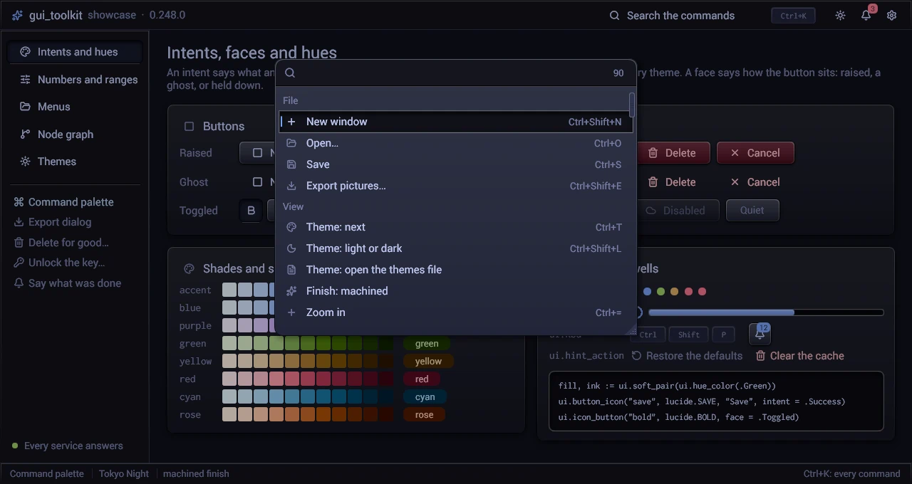

# Commands: keys, palette and the sheet of the keys

A program names each of its commands once, in a table of `ui.Command`: its label, its group and its keys. The same table
gives the key handling, the shortcut of a menu's line, a tooltip's text, the command palette and the sheet of the keys:
they cannot disagree.



```odin
Cmd :: enum u8 { End_Task, Kill, Palette, Shortcuts }

COMMANDS := [Cmd]ui.Command{
	.End_Task  = {label = "End task", group = "Processes", keys = {{.Delete, {}}}},
	.Kill      = {label = "Kill…", group = "Processes", keys = {{.Delete, {.Shift}}}},
	.Palette   = {label = "Command palette", group = "Window", keys = {{.K, {.Ctrl}}, {.P, {.Ctrl, .Shift}}}},
	.Shortcuts = {label = "Keyboard shortcuts", group = "Window", keys = {{.F1, {}}}},
}

// each frame, when no menu or dialog has the keys
for c in Cmd { if ui.command_pressed(COMMANDS[c], can(c)) { run(c) } }

// a menu's line, a tooltip
if ui.menu_item(COMMANDS[.Kill].label, ui.command_shortcut(COMMANDS[.Kill]), disabled = !can(.Kill)).clicked { run(.Kill) }
tip := ui.command_tip(COMMANDS[.Kill])          // "Kill… (Shift+Delete)"

// the palette and the sheet
if run_palette { ui.palette_open(&app.palette) }
disabled: [Cmd]bool
for c in Cmd { disabled[c] = !can(c) }
if i, resized := ui.palette(&app.palette, COMMANDS[:], disabled[:]); i >= 0 { run(Cmd(i)) }   // resized: save app.palette.size
ui.shortcuts_sheet(&app.sheet, "keys", COMMANDS[:])   // app.sheet.open = true shows it
```

| | |
|---|---|
| `Chord{key, mods}` | a key and its modifiers; the zero value is no key |
| `Command{label, group, keys, icon, tags}` | `keys`: its chords, as many as it has (`[]Chord`; Zoom in: Ctrl+=, Ctrl+Num +, Ctrl+Shift+=), the first one shown in menus and tooltips (a zero chord among them is none); `tags`: other words the palette finds it by ("exit", "close" for Quit), a match of them after one of the label's |
| `chord_text(chord)` | `Ctrl+Shift+P`, `Shift+Delete`, `F5`: modifiers in the order Ctrl, Shift, Alt |
| `key_name(key)` | a key's printed name (`Page Down`, `Enter`, `Escape`) |
| `command_shortcut(c)`, `command_keys_text(c)`, `command_tip(c)` | the first key's text; every key's, apart by commas; `label (key)` |
| `command_pressed(c, disabled)` | one of its keys was pressed this frame: the press is taken. A command that cannot act (`disabled`) takes no key |
| `palette_open(&p)` | opens the palette (`Command_Palette`, the program's) at the top centre of the window (`PALETTE_TOP` of its height), its field empty |
| `palette(&p, commands, disabled, o) -> (int, resized)` | while it is open: the commands under their groups' headings, each with its icon and its first key; the index chosen, or -1; `resized`: the user changed its size (`p.size`, logical pixels: keep it). Ctrl, Alt or Shift with Enter chooses too: `p.chosen_mods` says which |
| `Palette_Options{memory, names, recent_title, first, keys, foot, version}` | what a program adds: `version`, its commands' version (below); what the user chose before (`memory`, a `Choice_Memory`, and each command's key in it, `names`; below), the heaviest choices on top under their heading ("Recent") while nothing is typed and a match raised by its weight while something is; a command first while something is (an alias typed whole); per command the text of its keys as the program shows them (its user's own, a sequence "Ctrl+M, T"); a line under the list |
| `shortcuts_sheet(&sheet, id, commands, title, version)`, `shortcuts_sheet_destroy(&sheet)` | while `sheet.open` (a `Shortcuts_Sheet`, the program's): a dialog, every command that has a key, grouped, its keys at the right; scrolls past `SHEET_HEIGHT` of the window. `version` as the palette's |

### Nothing in proportion to the commands at a frame

The palette keeps its list (`Command_Palette.lines`, its own memory) and matches and ranks the commands again only
when what the list depends on changes: the query, the commands, `first`, the memory of choices (`Choice_Memory.version`)
or the language in use (`i18n.version()`: the labels are translated). The commands are known by `Palette_Options.version`
and their count: a program bumps `version` when its table changes (labels, groups, tags, icons, `names`). With `version`
0 the palette knows them by the table's address and its count: a constant table needs nothing, but a table built again
each frame, or changed in place, must give a version. `disabled` and the keys are read only for the lines built: they
do not rank anything. A frame that changes nothing builds the lines near the view (a screen each side, and where the view
is heading), finds them by two searches by halves, and leaves the room of the others to two spacers. The sheet does the
same: it lists the commands that have a key when they change (`version`, as the palette's: a table rebound in place gives
one), and builds the lines near its view. `Command_Palette.rankings` and `Shortcuts_Sheet.listings` count the lists made
(a test reads them).

The palette is a dialog (a `modal` of a `size`, in ems: its edges and its corner's grip resize it, `PALETTE_WIDTH_EM` by
`PALETTE_HEIGHT_EM` at first, never under `PALETTE_MIN_EM`) with a field at its top and the commands under it; a command's
`icon` (a glyph of the state's `icon_font`) shows before its label. Its list holds a whole number of lines at any size
(what is left of a line goes under it), so the foot never cuts its last line. Up, Down, Page Up, Page Down move the selection;
the pointer moving over a line selects it. What is typed keeps the commands whose label
(or label and group) holds it whole, or in pieces that each begin a word, the words in order (`fuzzy_words`: "prio" finds
"Raise the priority", "ks" "Keyboard shortcuts"; letters scattered in a word match nothing, so "prio" does not find
"Previous section"), or, when nothing is found so, each word with a slip or two (`fuzzy_typos`: "Qestart pencode" finds "Restart
opencode native"; none in a word of three letters, one up to six, two beyond), the best matches first (the text whole before pieces, at a word's start before elsewhere; a match in the label
before one that needs the group's letters), the headings go and each line says its group, and the first match is selected: Enter runs
it. A command that cannot act now is greyed and is not chosen. Escape closes the palette,
and the sheet.

### Keys the user changes

The keys in effect are the table that the program passes. No reader keeps a key of its own: `command_pressed`,
`command_shortcut`, `command_tip`, the palette and the sheet read `Command.keys` of the commands they are given. A program
whose user rebinds a key, or turns one off by a setting, keeps its constant table and derives the table in effect from it
when its settings change:

```odin
COMMANDS := [Cmd]ui.Command{
	.Palette = {label = "Command palette", group = "Window", keys = {{.P, {.Ctrl, .Shift}}, {.K, {.Ctrl}}}},
	...
}

// when the settings change (not each frame)
app.commands = COMMANDS                                                    // a copy: COMMANDS stays
if !settings.palette_ctrl_k { app.commands[.Palette].keys = COMMANDS[.Palette].keys[:1] }   // Ctrl+K off
app.commands[.Kill].keys = app.kill_keys[:]                               // the user's keys, in the program's memory
app.commands_version += 1                                                 // changed in place: the sheet lists it again

for c in Cmd { if ui.command_pressed(app.commands[c], !can(c)) { run(c) } }
ui.palette(&app.palette, app.commands[:], disabled[:])
ui.shortcuts_sheet(&app.sheet, "keys", app.commands[:], version = app.commands_version)
```

A key turned off is not taken: what reads the keys after the commands gets it. Why a table and not a key of a setting
in `Command` or a table of overrides beside it: `ui` reads no settings (`config` is not its import), and an override
passed beside the table must reach five readers, any of which can forget it. One table cannot disagree with itself. A
table built at run time keeps its keys' slices in memory of its own, as its tags (a slice literal in a procedure is on its
stack).

### What the user chose before

`ui.Choice_Memory` remembers each choice that the user makes in a palette or a picker: its count and its last time.
A choice weighs its count, halved every half-life since it was last made (`CHOICE_HALF_LIFE_DAYS`, 14). The palette lists
the heaviest choices on top while nothing is typed, and raises a match by its weight while something is. A program names
each choice with a stable key ("tab.new", "pref:appearance.theme"), passes the memory to the palette and notes each choice:

```odin
ui.choice_memory_open(&app.choices, &app.ui, path)   // read on the chores; "": in memory only
NAMES := [Cmd]string{.Kill = "process.kill", ...}
if i, _ := ui.palette(&app.palette, COMMANDS[:], disabled[:], {memory = &app.choices, names = NAMES[:]}); i >= 0 {
	ui.choice_note(&app.choices, NAMES[Cmd(i)])
	run(Cmd(i))
}
ui.choice_memory_close(&app.choices)                 // the program's end: the file is written when it returns
```

| | |
|---|---|
| `choice_memory_open(&m, s, path, Choice_Memory_Options{half_life_days, most})` | reads `path` on the chores (`ui.task`); the choices are merged at a next build of `s`, the ones made meanwhile kept (their counts added). `most`: the choices kept at most (`CHOICE_MOST`, 500) |
| `choice_note(&m, key, now_ms = 0)` | the choice `key` was made now. Over `most`, the lightest goes (of equal weights, the oldest). The file follows |
| `choice_weight(&m, key, now_ms = 0) -> f64` | its count, halved every half-life since it was last made; 0: never made |
| `choice_bonus(&m, key, query, now_ms = 0) -> f64` | what it adds to a ranked score: with nothing typed, its weight; while typing, its weight times `CHOICE_BONUS_WEIGHT` (6), at most `CHOICE_BONUS_MOST` (30): a good match still beats a frequent poor one |
| `choice_recent(&m, keys, most = CHOICE_RECENT_MOST) -> []int` | the indices in `keys` of the choices made, the heaviest first, at most `most` (5) |
| `choice_memory_text(&m)`, `choice_memory_merge(&m, text)` | the file's text; adds a file's choices (a choice in both: counts added, the later time). False: not such a file |
| `choice_memory_flush(&m)`, `choice_memory_close(&m)` | write now and wait for the disk; that, and free (the memory is zero after) |

The interface's thread never touches the file. A task reads it, and a `store.Writer` writes it on its own thread,
atomically, once the choices rest one second (five at most): [store.md](store.md). Until the read comes, a choice changes
the memory only: a write then would lose the file's choices. `m.version` counts the changes, for `rank`'s `version`.

The file is a header line (`CHOICE_FILE_HEADER`), then `count<tab>last_ms<tab>key` per choice, sorted by key: the same
choices make the same file. A key holds no line break (`choice_note` refuses it).

A list ranked with `rank` reads the memory in its bonus: `bonus = proc(it: ^Item, user: rawptr) -> f64 { return
ui.choice_bonus(memory, it.name, query) }`, the memory and the query in `user`.

A program with a palette of its own (commands, sessions and settings in one list) ranks each entry the same way:
`ui.palette_match(query, label, group, tags)` gives its score and what lights in its label.

### A ranked list

`ui.rank(query, items, entry, user, match, bonus, cache, version) -> []Rank_Hit` filters any list the way the palette does: each item is
matched, the hits are kept, the best first; equal scores keep the list's order, and an empty query keeps every item in
order. A picker, a slash menu, a mention list and a palette call it with their own items.

| Name | What it is |
|---|---|
| `Rank_Entry{label, group, tags, last, skip}` | an item as `entry(&item, user)` gives it: the text that lights, its group, other words that find it, a last text that finds it when nothing else does (nothing lights then), and `skip` for an item that is never in the list |
| `Rank_Hit{index, score, ranges}` | a kept item: its index in `items`, its score (higher first), what lights in its label |
| `Rank_Match` | how a query matches: `rank_palette` (the default: `palette_match`), `rank_fuzzy` (`fuzzy_score` of "label  group"), or a program's own, which folds its texts in the cache's slots it is given (`fuzzy_cache_text`, at most `RANK_MATCH_SLOTS`) |
| `bonus(&item, user) -> f64` | optional: added to the score of a hit only (how often the user chose it lately) |
| `cache: ^Fuzzy_Cache` | optional: the query and each item's texts folded, kept between calls; a list ranked each frame folds again only the texts that changed |
| `version: u64` | optional, with a cache: the items' version as the program counts their changes (what they are, what `bonus` reads). A call with the query and the version (not 0) of the last one returns the hits it kept and reads no item: a list shown at each frame costs nothing while neither changes |

The hits and their ranges are in temp memory; with a `version`, they are the cache's, kept until its next `rank`.

```odin
hits := ui.rank(query, models, proc(m: ^Model, _: rawptr) -> ui.Rank_Entry {
	return {label = m.name, group = m.provider}
}, match = ui.rank_fuzzy, cache = &picker.search)
for h in hits { ui.matched_label(fmt.tprintf("###m%d", h.index), models[h.index].name, h.ranges) }
```


A list that a program builds again each frame folds its texts once with a `ui.Fuzzy_Cache` (the palette keeps one):

| Procedure | Result |
|---|---|
| `fuzzy_needle(query) -> Fuzzy_Needle`, `fuzzy_text(s) -> Fuzzy_Text` | the query and a text folded once, for many matches: `fuzzy_find`, `fuzzy_score`, `fuzzy_words`, `fuzzy_typos` and `palette_match` take them in the place of strings, with the same results |
| `palette_entry(label, group, tags) -> Palette_Entry` | an entry folded: its label, the label with its tags, the label with its group and its tags |
| `fuzzy_cache_needle(&c, query)` | the needle, folded again only when the query changed |
| `fuzzy_cache_text(&c, slot, ..parts)` | the text of a slot (an item's place in the list; `parts` one after the other), folded again only when it changed: it is compared with what the slot held, byte by byte |
| `palette_entry_cached(&c, slot, label, group, tags)` | an entry kept in the slots `3 * slot` to `3 * slot + 2` |
| `fuzzy_cache_keep(&c, slots)`, `fuzzy_cache_destroy(&c)` | lets go of the slots from `slots` on; of all |

```odin
needle := ui.fuzzy_cache_needle(&app.search, query)
for it, i in items {
	if score, ranges, ok := ui.palette_match(needle, ui.palette_entry_cached(&app.search, i, it.title, "", it.tags)); ok { ... }
}
ui.fuzzy_cache_keep(&app.search, 3 * len(items))
```

The fold of a text goes 16 bytes at a time over its ASCII runs (`ascii.lower_run`) and a rune at a time past them, with
the same bytes as `unicode.to_lower`.

A program's settings go in its palette too: `prefs_page.palette_commands` and `prefs_page.show` (docs/prefs_page.md).

A key held, not pressed: `ui.key_held(key)` is true from its press in the window to its release, by the key's own
events (not by the modifiers' state, which a compositor may leave stale after one of its own shortcuts). A key pressed
before the window had the keyboard is not held, and none is once the user left the window. Ctrl, Shift and Alt are keys
there: a monitor stops its refresh while Ctrl is held alone.

`tests/commands` tests the texts, the keys (any number of them, the table in effect), the keys held, the palette (and that it ranks only when its list changes, building the lines near its view), the sheet and the memory of choices (`choices_test.odin`: weights, the recent ones, the bonus, the file read and written).
