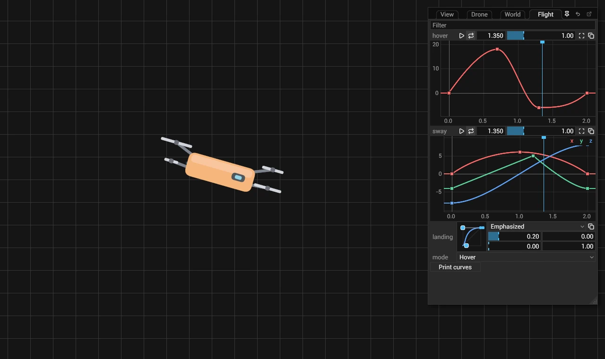

# debug: a program's state and acts in a debug window

The `debug` package (`src/debug`) shares a program's own state and acts with a debug surface. Its values are shown and
edited live, its acts are pressed, in a dense window beside the page. The tools reach the same panels by the same names
through the devtools ([devtools.md](devtools.md)). The intent is [src/md/features/debug-panel.md](../src/md/features/debug-panel.md).


## A panel

A panel is a procedure. Register it once, on the interface thread; the toolkit runs it when the panel is needed: its
tab is shown, or a tool lists, sets or presses.

```odin
import "gt:debug"

drone_debug :: proc(app: ^App) {
	d := &app.drone
	debug.number("model", &d.model, lo = 0, hi = 3)
	debug.choice("mode", &d.mode)                       // an enum: its names by reflection
	if debug.section("Transform") {
		debug.vector("rotation", &d.rotation, lo = -180, hi = 180, step = 0.5)
		debug.vector("position", &d.position)
	}
	debug.color("body", &d.body)
	debug.plot("height", &app.height)                   // the program pushes into it each frame
	debug.value("world", &app.world)                    // any Odin value, by reflection
	if debug.act("Print") { fmt.println(debug.odin_text(d^)) }
}

debug.panel(&h.state, "Drone", drone_debug, app)        // once, after the window opens
```

- The procedure calls `debug.*` and the program's own code. It calls nothing else of `ui`: the toolkit runs it in the
  window's build, and for the tools before a build.
- `data` stays valid until `debug.panel_remove(s, name)` or the State ends. A name registered again replaces the first.
  A panel's procedure cannot register or remove a panel: there the calls do nothing.
- The procedure runs each frame while its tab shows, and never while the window is closed. Values from a worker thread
  come through a snapshot that the worker posts (`ui.post`) and the program keeps: the panel reads the snapshot.

## The calls

| Call | What |
|---|---|
| `number(label, &x, lo, hi, step)` | any integer or float, dragged in its field |
| `vector(label, &v, lo, hi, step)` | `[N]T`, N from 1 to 4, one field per component, each marked by its axis's colour |
| `toggle(label, &b)` | a bool |
| `choice(label, &e)` | an enum, its names in a list |
| `text(label, &s)` | a string; what the surface writes is its own copy, the program's string is never freed |
| `color(label, &c)` | a `ui.Color`: a swatch and its four channels |
| `watch(label, value)` | any value as text, read only |
| `plot(label, &history, top)` | a `ui.Value_History` as a graph across the field, with its highest, last and lowest values (`top` > 0: a scale from zero to `top`) |
| `act(label)` | a button: true when pressed, by a person or a tool |
| `section(label, open)` | `if debug.section("Transform") { ... }`: a group that opens and closes |
| `note(words)` | a line of words in the window |
| `value(label, &x)` | any value by reflection (see below) |
| `odin_text(x)` | a value written as Odin source, to paste back (works in a release build too) |

Each call that edits returns true when the value changed, by a person or by a tool: the program's code under it runs
then. An act takes no arguments: show the arguments as values before it. Acts one after another share a row, as many
as it holds.

`section` ends where the scope of its call ends (Odin's `@(deferred_out)`), as `ui.menu` ([menus.md](menus.md)). Under a
negation the section closes at the end of the `if`, and the values after it are outside it: a tool does not find
`Papier/state`, only `state`.

```odin
// wrong: the section ends with the `if`
if !debug.section(p.name) { continue }
debug.value("state", &p.state)

// right: the section's values in its block
if debug.section(p.name) { debug.value("state", &p.state) }

// right too: the call as a statement; the section ends with the block that holds it
open := debug.section(p.name)
if !open { continue }
debug.value("state", &p.state)
```

`toolbox.check_scopes` finds the wrong form in a program's sources, for every procedure with a deferred end: it is a
step of the program's check ([toolbox.md](toolbox.md)).

### Reflection

`debug.value("world", &app.world)` shows any value. A struct is a section of its fields. A number, a bool, an enum, a
string, a vector of 2 to 4 numbers and a `ui.Color` are edited. An array or a slice shows `debug.ITEMS_MAX` items. A
pointer is followed `debug.DEPTH_MAX` levels. Anything else is watched as text. A value given without a pointer is
shown read only. A field's tag says more:

```odin
World :: struct {
	gravity: f32 `debug:"0..20"`,     // bounds
	seed:    u64 `debug:"ro"`,        // read only
	cache:   ^Cache `debug:"-"`,      // hidden
	step:    f32 `debug:"0..1,step=0.01"`,
}
```

## Curves

A value animated over time: keys on a timeline, Bézier handles, played on the program's object while it is edited. The
intent is [src/md/features/curve-editor.md](../src/md/features/curve-editor.md).



```odin
Drone :: struct {
	hover: debug.Curve,       // its height over time
	sway:  [3]debug.Curve,    // a lean and a turn, a channel per axis
	land:  ui.Cubic_Bezier,   // how it lands
}
app.play: debug.Playback      // the program's clock for them

// each frame, a release build too
debug.playback_step(&app.play, dt, debug.curve_span(d.hover))
height := debug.curve_eval(d.hover, app.play.time)
lean := debug.curves_eval(d.sway, app.play.time)
down := ui.tween_curve(ui.key_from_string(0, "land"), landing ? 1 : 0, 1200, d.land)

// in a panel's procedure
debug.curve("hover", &d.hover, &app.play)
debug.curves("sway", d.sway[:], &app.play)
debug.easing("land", &d.land)
```

### The model, in every build

| Name | What |
|---|---|
| `Curve` | `count` keys sorted by time, `CURVE_KEYS_MAX` (32) at most: plain data, a constant of the program |
| `Curve_Key` | `time`, `value`, `in_handle` and `out_handle` (the control points, (time, value) from the key), `interp` (`.Bezier`, `.Linear`, `.Constant`: the segment that leaves it), `broken` (its handles move apart) |
| `curve_eval(c, t)` | its value at `t`: the first key's before it, the last key's after it, 0 without a key; O(log keys) |
| `curves_eval(cs, t)` | `[N]Curve`'s values at `t`, a `[N]f32` |
| `curve_span(c)`, `curves_span(cs)` | the time from the first key to the last, `{from, to}` |
| `Playback` | `time`, `speed` (0: 1), `paused`, `once` (else it loops): the program's clock, shown and changed by the editor |
| `playback_step(&p, dt, span)` | one frame: the time moves at its speed, loops over `span` or stops at its end; returns it |
| `curve_insert(&c, key)`, `curve_remove(&c, i)`, `curve_smooth(&c, i)` | a key at its time (its index, -1 when full), a key gone, smooth handles (its neighbours' slope, a third of each segment) |
| `curve_text(c)`, `curves_text(cs)` | Odin source to paste back: `debug.Curve{count = 2, keys = {0 = {...}, 1 = {...}}}` (the keys by index: Odin takes no shorter array literal); `odin_text` writes a curve so too |

### The editor

`curve(label, &c, &play)`, `curves(label, cs, &play, names = "xyzw")` (4 channels at most) and `easing(label, &e)` are
items of a panel; `debug.value` shows a `Curve`, a `[N]Curve` and a `ui.Cubic_Bezier` field with them. Without a
Playback, the editor plays its own. Its rows: the head, by the curve's name (play, loop, the playhead's time, the speed,
frame all, Print to the standard output and the clipboard); the graph, the channels' letters in its corner (a click shows
or hides one); with a key selected, smooth, broken or aligned handles, its time and value (a change moves every key
selected by as much) and its interpolation. The head and the key's row share their columns. The easing editor is one
row: the square, then the presets and Print, then the handles' numbers.

In the graph:

- **A key**: click it (Shift or Ctrl adds it or takes it away), or drag a box from an empty place. Drag it: the keys
  selected follow, sorted as they pass each other; Shift keeps the main direction, Ctrl snaps to the grid.
- **A handle** of a key selected: drag it; the other turns with it unless the key's handles are broken; Alt breaks them,
  Shift flattens it. A handle stays within its segment.
- **Add**: a double click on nothing, on the channel whose curve passes nearest. **Delete**: Delete or Backspace.
- **The view**: the wheel zooms about the pointer (Ctrl: time only, Shift: value only), the middle button pans, F frames
  all, Ctrl+A selects all.
- **The time**: drag in the time's ruler; Space plays or pauses.
- **Undo**: Ctrl+Z; Ctrl+Shift+Z or Ctrl+Y redoes.

The easing editor: a square graph from (0, 0) to (1, 1) with its two handles (x in 0..1, y free), the toolkit's easings
as presets, its four numbers, a dot that runs along it while the pointer is on the square and once after a change, and
Print (`ui.Cubic_Bezier{0.2, 0, 0, 1}`). A curve editor with no Playback of the program's starts paused.

For a test's pointer: `debug.curve_screen(s, path, {time, value})` is where that point of a curve item is drawn,
`debug.curve_channel_at(s, path, channel)` where a channel's letter is;
`debug.box_name(path, "graph")` names its graph.

## The window

- **Ctrl+Alt+Shift+D** opens and closes it in a build with the devtools, as the wireframe's W and the exploded view's
  E. `debug.open(s)`, `debug.close(s)`, `debug.shown(s)` and `debug.show_panel(s, name)` do the same from the program.
- It is a view ([views.md](views.md)): it opens floating at the top right, docks at the right, goes to a window of its
  own, and the views remember where. Floating, its tabs are its title bar: drag its free part to move it.
- Its tabs: **View** (the wireframe, the exploded view, the zoom, the density, the frame times, the boxes), then one tab
  per panel. The pin at the end of the tabs sends the panel shown to a view of its own, which docks or floats apart.
  Its tab comes back when that view closes.
- The filter field keeps the rows whose sections and label hold each word typed, the words lit as in every filtered
  list.
- Every window that `gt:host` opens has it (`host_open`, `host_adopt`, a view's own window): the key works in every
  program, with the View tab, and each panel adds a tab. A window opened without `gt:host` gets it with its first
  panel, or with `debug.attach(s)` for the View tab alone. A window that the devtools serve has it too.

### A number's field

- Drag across it: the value follows the pointer, Shift ten times slower, Ctrl ten times faster.
- The wheel over it steps it, even in a view that scrolls. A scroll in progress goes on: a field that slides under a
  still pointer takes the wheel only after a rest of `ui.WHEEL_LATCH_MS`. Up and Down step it while it has the keyboard (Shift ten,
  Ctrl a hundred, Alt a tenth).
- A double click, Ctrl+click or Enter types it; Enter, or the keyboard going elsewhere, applies; Escape gives the value
  back.
- With both bounds it fills as a slider's track, from zero when the range holds zero.

## The dense look

The window is dense: small text, rows one line high, hairlines, square corners, a label and its field on one row,
numbers in the mono face at the right. It follows the theme's colours, light or dark, and not the person's density. The pieces are in
`ui`, for a program's own instrument too:

```odin
if ui.dense_scope() {
	if ui.tree_header("###transform", "Transform", &app.open) {
		if ui.dense_row("position") { ui.drag_vector("###position", &app.position, step = 0.5) }
		if ui.dense_row("speed") { ui.drag_number("###speed", &app.speed, lo = 0, hi = 10) }
	}
}
```

- `ui.dense_scope()`: the dense look for what is built inside it, every corner square. `View_Options.square` makes a
  view's floating window square too. Use it for instruments only, never for a person's
  screens.
- `ui.drag_number(id, &v, lo, hi, step, o)`: `int`, `f32` or `f64`. `ui.Drag_Options`: `speed` (what a pixel adds),
  `steppers` (− and + at its ends), `disabled`, `mark` (a colour at its left edge).
- `ui.drag_vector(id, &v, lo, hi, step, o)`: N of them on one row.
- `ui.tree_header(id, label, &open)`: a header that opens and closes; the caller keeps `open`.
- `ui.dense_row(label, id, label_width, ranges)`: a label and its field on one row.
- `ui.Dense_Labels`: a panel's labels' column as wide as its longest label (`DENSE_LABEL_MIN_EM` to `DENSE_LABEL_MAX_EM`,
  a longer one cut). `dense_labels_begin(&l)` before the rows, `dense_row(label, label_width = dense_label_column(&l,
  label, indent))` for each, `dense_labels_end(&l)` after, `dense_labels_destroy(&l)` at the end: each label measured
  once, the column the widest of the last build's. The debug window keeps one per panel.

## The tools

| Method | What |
|---|---|
| `Toolkit.debugPanels` | the panels and their items: `path`, `kind` (number, vector, bool, choice, text, color, watch, plot, act, curve, easing), `value`, and `min`, `max`, `step`, `integer`, `choices`, `readOnly` where they apply; a curve's `value` is its channels, each a list of keys `{"time", "value", "in_handle": [t, v], "out_handle": [t, v], "interp": "bezier" \| "linear" \| "constant", "broken"}` (Print's names, `debug.CURVE_KEY_FIELDS`), and `channels` their letters |
| `Toolkit.debugSet {path, value}` | sets a value: a number, a bool, a string, an enum's name, an array of numbers, a colour as `"#rrggbbaa"`; held to its bounds and its step. A curve: the list `debugPanels` gives (one channel: its keys alone), a missing field its zero, the keys sorted; an easing: four numbers or a preset's name (`"Emphasized"`) |
| `Toolkit.debugPress {path}` | presses an act: its code runs before this frame's build |

From the command line and in scripts: `tk cdp debug` lists every value, `tk cdp debug-set Drone/Transform/position 1,2,3`
sets one, `tk cdp debug-press Drone/Print` presses an act; a tool of its own calls `cdp.debug_panels`, `cdp.debug_set` and
`cdp.debug_press` ([cdp.md](cdp.md)).

A path is the panel, its sections and the label: `Drone/Transform/position`. Every section is open to a tool, and a
closed window answers too. In the program's own process: `debug.list(s, &sb)`, `debug.set(s, path, text)`,
`debug.press(s, path)`. For a test's click, `debug.box_name(path, part)` names a box of the window (`"value"`,
`"c0"`, `"act"`, `"section"`, `"row"`).

A panel's test needs no window. It runs on a bare `ui.State` with `debug.list`, `debug.set` and `debug.press`: no fonts,
no theme, no session. It works on a release runner with no display and no offscreen renderer, where `testkit/session`
fails.

```odin
s: ui.State
ui.init(&s, nil, nil)
defer ui.destroy(&s)
debug.panel(&s, "Drone", drone_debug, &drone)
testing.expect_value(t, debug.set(&s, "Drone/speed", "2.5"), "")
```

## Cost

- A release build (`TOOLKIT_DEVTOOLS` false): every call is empty or returns false (`debug.ENABLED`); the key is not read.
  The curves' model (`curve_eval`, `playback_step`, `curve_text`...) stays: a release plays its curves.
  A release that keeps its panels builds with `-define:TOOLKIT_DEVTOOLS=true`: the devtools come too, their server off
  until `TOOLKIT_DEVTOOLS=<port>` asks it. The debug window's cost in a release is in the intent
  ([debug-panel.md](../src/md/features/debug-panel.md), "Cost").
- The window closed: nothing runs.
- The window open: the tab shown builds its rows, as any view.
