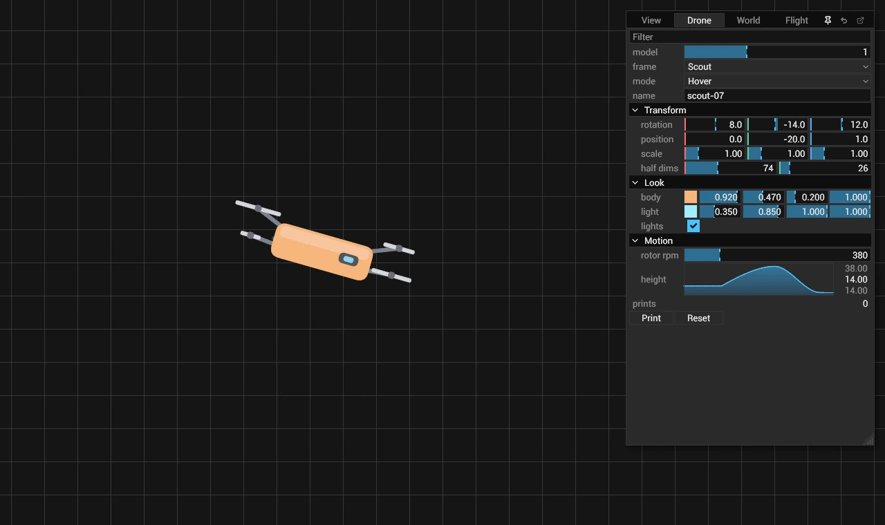

# debug: a program's state and acts in a debug window

The `debug` package (`src/debug`) shares a program's own state and acts with a debug surface. Its values are shown and
edited live, its acts are pressed, in a dense window beside the page. The tools reach the same panels by the same names
through the devtools ([devtools.md](devtools.md)). The intent is [src/md/features/debug-panel.md](../src/md/features/debug-panel.md).



## A panel

A panel is a procedure. Register it once, on the interface thread; the toolkit runs it when the panel is needed: its
tab is shown, or a tool lists, sets or presses.

```odin
import "gt:debug"

drone_debug :: proc(app: ^App) {
	d := &app.drone
	debug.number("model", &d.model, lo = 0, hi = 3)
	debug.choice("mode", &d.mode)                       // an enum: its names by reflection
	if debug.section("Transform") {
		debug.vector("rotation", &d.rotation, lo = -180, hi = 180, step = 0.5)
		debug.vector("position", &d.position)
	}
	debug.color("body", &d.body)
	debug.plot("height", &app.height)                   // the program pushes into it each frame
	debug.value("world", &app.world)                    // any Odin value, by reflection
	if debug.act("Print") { fmt.println(debug.odin_text(d^)) }
}

debug.panel(&h.state, "Drone", drone_debug, app)        // once, after the window opens
```

- The procedure calls `debug.*` and the program's own code. It calls nothing else of `ui`: the toolkit runs it in the
  window's build, and for the tools before a build.
- `data` stays valid until `debug.panel_remove(s, name)` or the State ends. A name registered again replaces the first.
  A panel's procedure cannot register or remove a panel: there the calls do nothing.
- The procedure runs each frame while its tab shows, and never while the window is closed. Values from a worker thread
  come through a snapshot that the worker posts (`ui.post`) and the program keeps: the panel reads the snapshot.

## The calls

| Call | What |
|---|---|
| `number(label, &x, lo, hi, step)` | any integer or float, dragged in its field |
| `vector(label, &v, lo, hi, step)` | `[N]T`, N from 1 to 4, one field per component, each marked by its axis's colour |
| `toggle(label, &b)` | a bool |
| `choice(label, &e)` | an enum, its names in a list |
| `text(label, &s)` | a string; what the surface writes is its own copy, the program's string is never freed |
| `color(label, &c)` | a `ui.Color`: a swatch and its four channels |
| `watch(label, value)` | any value as text, read only |
| `plot(label, &history, top)` | a `ui.Value_History` as a graph across the field, with its highest, last and lowest values (`top` > 0: a scale from zero to `top`) |
| `act(label)` | a button: true when pressed, by a person or a tool |
| `section(label, open)` | `if debug.section("Transform") { ... }`: a group that opens and closes |
| `note(words)` | a line of words in the window |
| `value(label, &x)` | any value by reflection (see below) |
| `odin_text(x)` | a value written as Odin source, to paste back (works in a release build too) |

Each call that edits returns true when the value changed, by a person or by a tool: the program's code under it runs
then. An act takes no arguments: show the arguments as values before it.

### Reflection

`debug.value("world", &app.world)` shows any value. A struct is a section of its fields. A number, a bool, an enum, a
string, a vector of 2 to 4 numbers and a `ui.Color` are edited. An array or a slice shows `debug.ITEMS_MAX` items. A
pointer is followed `debug.DEPTH_MAX` levels. Anything else is watched as text. A value given without a pointer is
shown read only. A field's tag says more:

```odin
World :: struct {
	gravity: f32 `debug:"0..20"`,     // bounds
	seed:    u64 `debug:"ro"`,        // read only
	cache:   ^Cache `debug:"-"`,      // hidden
	step:    f32 `debug:"0..1,step=0.01"`,
}
```

## The window

- **Ctrl+Alt+Shift+D** opens and closes it in a build with the devtools, as the wireframe's W and the exploded view's
  E. `debug.open(s)`, `debug.close(s)`, `debug.shown(s)` and `debug.show_panel(s, name)` do the same from the program.
- It is a view ([views.md](views.md)): it opens floating at the top right, docks at the right, goes to a window of its
  own, and the views remember where. Floating, its tabs are its title bar: drag its free part to move it.
- Its tabs: **View** (the wireframe, the exploded view, the zoom, the density, the frame times, the boxes), then one tab
  per panel. The pin at the end of the tabs sends the panel shown to a view of its own, which docks or floats apart.
  Its tab comes back when that view closes.
- The filter field keeps the rows whose sections and label hold each word typed, the words lit as in every filtered
  list.
- A window gets the surface with its first panel, or with `debug.attach(s)` for the View tab alone. A program served by
  the devtools has it.

### A number's field

- Drag across it: the value follows the pointer, Shift ten times slower, Ctrl ten times faster.
- The wheel over it steps it, even in a view that scrolls. A scroll in progress goes on: a field that slides under a
  still pointer takes the wheel only after a rest of `ui.WHEEL_LATCH_MS`. Up and Down step it while it has the keyboard (Shift ten,
  Ctrl a hundred, Alt a tenth).
- A double click, Ctrl+click or Enter types it; Enter, or the keyboard going elsewhere, applies; Escape gives the value
  back.
- With both bounds it fills as a slider's track, from zero when the range holds zero.

## The dense look

The window is dense: small text, rows one line high, hairlines, square corners, a label and its field on one row,
numbers in the mono face at the right. It follows the theme's colours, light or dark, and not the person's density. The pieces are in
`ui`, for a program's own instrument too:

```odin
if ui.dense_scope() {
	if ui.tree_header("###transform", "Transform", &app.open) {
		if ui.dense_row("position") { ui.drag_vector("###position", &app.position, step = 0.5) }
		if ui.dense_row("speed") { ui.drag_number("###speed", &app.speed, lo = 0, hi = 10) }
	}
}
```

- `ui.dense_scope()`: the dense look for what is built inside it, every corner square. `View_Options.square` makes a
  view's floating window square too. Use it for instruments only, never for a person's
  screens.
- `ui.drag_number(id, &v, lo, hi, step, o)`: `int`, `f32` or `f64`. `ui.Drag_Options`: `speed` (what a pixel adds),
  `steppers` (− and + at its ends), `disabled`, `mark` (a colour at its left edge).
- `ui.drag_vector(id, &v, lo, hi, step, o)`: N of them on one row.
- `ui.tree_header(id, label, &open)`: a header that opens and closes; the caller keeps `open`.
- `ui.dense_row(label, id, label_width, ranges)`: a label and its field on one row.

## The tools

| Method | What |
|---|---|
| `Toolkit.debugPanels` | the panels and their items: `path`, `kind` (number, vector, bool, choice, text, color, watch, plot, act), `value`, and `min`, `max`, `step`, `integer`, `choices`, `readOnly` where they apply |
| `Toolkit.debugSet {path, value}` | sets a value: a number, a bool, a string, an enum's name, an array of numbers, a colour as `"#rrggbbaa"`; held to its bounds and its step |
| `Toolkit.debugPress {path}` | presses an act: its code runs before this frame's build |

From the command line and in scripts: `tk cdp debug` lists every value, `tk cdp debug-set Drone/Transform/position 1,2,3`
sets one, `tk cdp debug-press Drone/Print` presses an act; a tool of its own calls `cdp.debug_panels`, `cdp.debug_set` and
`cdp.debug_press` ([cdp.md](cdp.md)).

A path is the panel, its sections and the label: `Drone/Transform/position`. Every section is open to a tool, and a
closed window answers too. In the program's own process: `debug.list(s, &sb)`, `debug.set(s, path, text)`,
`debug.press(s, path)`. For a test's click, `debug.box_name(path, part)` names a box of the window (`"value"`,
`"c0"`, `"act"`, `"section"`, `"row"`).

## Cost

- A release build (`TOOLKIT_DEVTOOLS` false): every call is empty or returns false (`debug.ENABLED`); the key is not read.
  A release that keeps its panels builds with `-define:TOOLKIT_DEVTOOLS=true`: the devtools come too, their server off
  until `TOOLKIT_DEVTOOLS=<port>` asks it.
- The window closed: nothing runs.
- The window open: the tab shown builds its rows, as any view.
