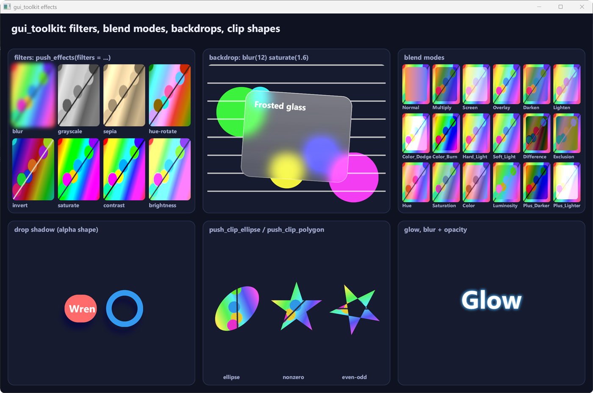

# Drawing: transforms, clips, images and effects

The `draw` package is the immediate-mode layer under `ui`: you can also use it on its own (see `examples/smoke`,
`examples/transforms` and `examples/effects`). This page covers the 2D transforms, the clips and the images added in
0.4.0, the layers (group opacity) and offscreen rendering added in 0.4.1, the effects added in 0.5.0 (filters,
blend modes, backdrops, ellipse and polygon clips), the blend spaces added in 0.6.0, and the retained pictures,
gradients, box shadows and device-loss recovery added in 0.7.0.


## Affine transforms

```odin
Affine :: struct { a, b, c, d, e, f: f32 }

//   x' = a*x + c*y + e
//   y' = b*x + d*y + f
```

The convention is the one of CSS `matrix(a, b, c, d, e, f)`, canvas `setTransform` and SVG, so a CSS matrix goes in
as is: `draw.Affine{a, b, c, d, e, f}`. Screen space is y-down: a positive angle turns clockwise on screen, as CSS
`rotate()` does.

| Proc | Meaning |
|---|---|
| `AFFINE_IDENTITY` | identity |
| `affine_mul(m, n)` | `m` after `n`: `apply(mul(m, n), p) == apply(m, apply(n, p))`. CSS `transform: t1 t2` is `mul(t1, t2)` |
| `affine_translate(t)`, `affine_scale(s: Vec2)`, `affine_rotate(radians)`, `affine_skew(ax, ay = 0)` | constructors (CSS `translate`, `scale`, `rotate`, `skew`) |
| `affine_around(m, origin)` | `m` around `origin` (CSS `transform-origin`) |
| `affine_apply(m, p)`, `affine_apply_vector(m, v)` | point / direction |
| `affine_inverse(m) -> (Affine, ok)` | inverse; `ok = false` when singular (zero scale) |
| `affine_bounds(m, r) -> Rect` | axis-aligned bounds of a transformed rect |
| `affine_determinant`, `affine_scale_factor`, `affine_is_identity`, `affine_is_scale_translate` | queries |

### The transform stack

```odin
draw.push_transform(dc, draw.affine_around(draw.affine_rotate(0.3), draw.rect_center(card)))
draw.rect(dc, card, color, 12)            // rounded corners, border, shadow: all rotate
draw.text(dc, font_id, 15, pos, white, "Rotated")
draw.image(dc, tex, icon_rect, radius = 6)
draw.pop_transform(dc)
```

- `push_transform(dc, m)`: what is drawn next goes through `m` first, then through the transforms already pushed
  (nesting like CSS stacking contexts: a child's screen transform is `parent * child`).
- `pop_transform(dc)` pops one level. `pop_xform` is the same proc (kept for `push_scale`).
- `push_scale(dc, center, s)` is unchanged: scales around a screen point, on top of the current transform.
- `current_transform(dc)` returns the local-to-screen matrix; `affine_inverse` of it maps a mouse position into the
  local space (hit testing).

Everything `draw` draws follows the transform: rects (rounded, per-corner radii, borders, soft shadows), per-corner
gradients (`rect_corners`), text and images. Sizes given in local units (radius, border, shadow softness) scale with
it.

### How it is drawn

- **Uniform scale + translation** (no rotation or skew): baked on the CPU into the instance, as before. This is the
  path of `push_scale` and of everything drawn without a transform; its output is pixel-identical to 0.3 (except
  that the blur of soft shapes now scales with them).
- **Anything else**: the matrix goes once per pushed level into a per-frame table (a structured buffer); each
  instance carries its index (`Rect_Inst.xform`). The vertex shader transforms the 4 corners and grows the quad by
  one screen pixel; the pixel shader evaluates the rounded-rect distance in **local** space and divides it by its
  screen-space rate of change (derivatives of the local position, exact for an affine map). Edges keep a 1 px
  antialiased ramp under rotation, skew and non-uniform scale.
- **Text** is laid out at its nominal size (so `font.text_width` still measures it), but when the transform scales it
  by more than 10 % the glyphs are rasterized at the on-screen size (`TEXT_RASTER_TOLERANCE`): scaled text stays
  sharp. Under scale + translation the glyphs also snap to the pixel grid (at subpixel positions, see
  [text.md](text.md)). Rotated text at its layout size is placed at the same subpixel positions in local units and
  samples the atlas bilinearly. Text is drawn from shaped glyph runs (`draw.glyph_run`; `draw.text` shapes then calls
  it).

## Planes: projected layers (3D transforms)

`draw.push_plane(dc, bounds, raster_scale, fx)` opens an offscreen layer over `bounds` (the *plane frame*: the current local space) and replaces the transform stack by the map from the plane frame to the layer's texels, so what is drawn until `pop_plane` is rasterized crisp at `raster_scale` texels per unit whatever happens to the plane later. `pop_plane` closes it and returns a `Plane_Layer`; `draw_plane(dc, layer, m, alpha, opts)` composites it through `m` (a `Mat4`, column-major like CSS `matrix3d()`: plane frame to the current local space, z dropped after the divide by w). `pop_plane_draw` does both. The quad is clipped against w > 0 by the rasterizer and sampled with perspective-correct interpolation (anisotropic along the long axis of the pixel's footprint), its edge antialiased from the plane's own coordinates; the clips and alpha stack of the moment apply.

Preserve-3d: pop several planes and give them to `draw_planes(dc, items)` (`plane_item(layer, m, alpha, opts, cull)` makes an item). It draws them in the order they hide each other: a plane wholly on the viewer's side of another's plane after it, else the depth of the middles, then paint order. Planes that cut through each other (or hide each other in a cycle) have no such order: they are split along each other's planes into convex pieces by a BSP, as Chromium's `BspTree` does, ordered back to front for a viewer in front, and each piece is the same layer drawn again with the cuts that bound it (`Plane_Draw.cuts`: half-spaces `n . (x/w, y/w, z/w) + d >= 0` of the space after the divide, tested per pixel on the interpolated plane position, up to `MAX_PLANE_CUTS` per draw: a piece bounded by more cuts is divided in two along a chord between two of its corners, repeatedly, so no cut is ever dropped; the pieces fit without a seam or an overlap, their cut edges are hard as Chromium's). An item can have several `parts` (the layer of a plane and flat things that ride on it: they share its plane, so they are cut and ordered with it). A plane whose content is unchanged is kept: give `Plane_Fx{cache_id, cache_key}` (the key signs what is drawn in the plane, not its matrix); `push_plane` returns false when the kept texture is still good and the caller skips its drawing; moving the plane then costs one instance. `Plane_Draw.cull_back` hides a plane seen from behind (the orientation of its projected rect). Not recorded in pictures.

Effects on the composite (`Plane_Draw`): `blend` (mix-blend-mode of the projected quad against what is under it: the quad's screen area becomes an ordinary layer, `push_effects`), `backdrop` (backdrop-filter: what lies under the quad is captured, filtered in screen space with lengths scaled by the plane's scale at its middle, and shown through the alpha of `shape`, a layer in the same plane frame, projected through the same matrix: the border box with its radii, clip-path and mask for CSS; without a `shape` the alpha of the plane itself). Both work on pieces of a split plane too.

Sharpness: the caller picks `raster_scale`: the most screen pixels per plane unit its projection asks for where it shows (the Jacobian of the homography at the corners of the visible polygon; Wren, `plane_plan`), and the bounds it rasterizes (the part that shows when the whole would be too big). `Plane_Fx.mips` gives the layer a full mip chain (`render.acquire_target_mips`, rebuilt by an `Op_Kind.Mips` after the plane is drawn; D3D11 `GenerateMips`, wgpu `mip.wgsl`); the pixel shader reads `ceil(long axis / taps)` taps along the long axis of the pixel's footprint (the singular values of the Jacobian of the layer position), each trilinear at the level of the short axis, so a plane that perspective makes smaller than its layer is filtered, not aliased, and one seen at a slant stays sharp. `open_plane_frame(dc)` gives the frame of the open plane (to map a pointer back through its projection, exactly: the inverse of a homography).

## Clips

- `push_clip(dc, r)`: as before, a scissor rect (free). Under rotation or skew it becomes the screen bounds of `r`
  plus an exact per-pixel clip of `r`.
- `push_clip_rounded(dc, r, radii: [4]f32)`: clips to a rounded rect in the **current local space** (any
  transform), antialiased, with the same corner shape as `rect` (so a clip matches a box drawn with the same radii).
  Use it for `overflow: hidden` + `border-radius`, or to clip the content of a rotated element. Nested shapes multiply
  (up to `render.MAX_CLIP_DEPTH` = 8 deep). The scissor is the shape's bounds, so pixels outside cost nothing.
- `push_clip_ellipse(dc, center, radii)`: an ellipse (a circle with equal radii), current local space, antialiased.
- `push_clip_polygon(dc, points, evenodd = false)`: a polygon with the nonzero or even-odd fill rule, antialiased by
  its exact signed distance. The vertices go into a per-frame table (`render.Frame_Data.points`, t4); the cost per
  pixel inside its bounds is proportional to the vertex count.
- `pop_clip(dc)` pops any kind. `current_clip(dc)` returns the scissor rect.

## Corner shape

`render.set_corner_smoothing(r, s)` sets the corner shape of every rounded rect and rounded clip of the renderer
(0 = circular arcs, 1 = squircle, the UI's default). Content with its own rules (CSS `border-radius` is circular)
draws inside `prev := draw.set_circular_corners(dc, true)` ... `draw.set_circular_corners(dc, prev)`: those
primitives and clips are circular whatever the renderer's setting (`render.FLAG_CIRCLE` per instance,
`render.CLIP_CIRCLE` per clip shape).

## Layers: group opacity

```odin
draw.push_layer(dc, bounds, 0.5)      // bounds: current local space, must contain what is drawn
draw.rect(dc, a, red)                  // overlapping shapes...
draw.rect(dc, b, blue)                 // ...do not show through each other
draw.pop_layer(dc)                     // composited once, at 50 %
```

`push_alpha` fades every primitive on its own: where two of them overlap, the one below shows through. CSS
`opacity` (and any "fade this group" effect) needs the group drawn first, then blended once: `push_layer` /
`pop_layer` do that with an offscreen render target.

- The layer covers the screen bounds of `bounds` (through the current transform), cut to the current clip and to
  the frame; pixels drawn outside are lost. Pass tight bounds: the cost is the layer's area.
- Inside, everything works as outside: transforms, clips (rounded, rotated), images, text, nested layers, alpha.
  The alpha stack restarts at 1 inside a layer; the layer's `alpha` times the enclosing alpha applies when it is
  composited.
- The clip stack restarts too: what is drawn inside is cut only by the layer's rect and the clips pushed inside.
  The clip shapes around the layer cut its composite (after its filters: a blurred layer inside a rounded clip is
  blurred, then clipped, as CSS does).
- The composite is pixel for pixel (`render.FLAG_LAYER`: texels fetched, no filtering), with no transform (the
  content was already transformed).
- Layers are fp16 (`R16G16B16A16_FLOAT`), premultiplied, in their blend space (`Layer_Effects.space`, the enclosing
  one by default): an opaque layer looks like no layer (antialiased edges may differ by a couple of 8-bit levels, the
  layer keeping more precision).
- Render targets come from a pool in the renderer (`render.acquire_target`, sizes rounded up to 128 px, released
  after 120 unused frames, `render.release_targets`, `render.targets_bytes`). A target is handed back as soon as
  the last step reading it is recorded (`render.release_target`): many layers in a frame share a few textures.
- A layer that would be empty, or larger than `render.max_texture_size`, falls back to `push_alpha` (its filters
  and blend mode are then lost).
- `draw.layer_depth(dc)`: layers open. `end_frame` closes any left open.

How it is drawn: the frame is a list of steps run in the order they were recorded (`render.Frame_Data`): draw
calls (a `Batch` into a `target`: 0 = the frame, k = `layers[k - 1]`) and operations (`render.Op`: clear a layer,
copy what a target holds, run a filter pass). A layer is cleared when pushed, drawn, then sampled by the instance
that composites it; each target is drawn with its own viewport and `target_origin` (the screen pixel at its texel 0,
subtracted by the vertex shader and added back for clip shapes and scissors).

## Effects: filters, blend modes

```odin
fx := draw.Layer_Effects{
	alpha   = 0.9,
	filters = {draw.filter_blur(4), draw.filter_drop_shadow({0, 6}, 5, draw.srgb(0, 0, 0, 0.5)), draw.filter_sepia(0.6)},
	blend   = .Multiply,
}
draw.push_effects(dc, card, fx)   // `card`: local bounds of what is drawn (the filters' spread is added)
draw.rect(dc, card, color, 12)
draw.text(dc, font_id, 15, pos, white, "Filtered")
draw.pop_layer(dc)
```

`push_effects` is `push_layer` with filters and a blend mode, applied in the CSS order: filters, then opacity, then
the blend with what is already drawn. `push_layer(dc, bounds, alpha)` is `push_effects` with only an alpha.

| Filter | CSS | Notes |
|---|---|---|
| `filter_blur(sigma)` | `blur()` | gaussian, standard deviation in local units (follows the transform) |
| `filter_drop_shadow(offset, sigma, color)` | `drop-shadow()` | the blurred alpha of what is drawn, moved, in `color`, under it. CSS gives a blur radius: sigma = radius / 2 |
| `filter_brightness`, `filter_contrast`, `filter_grayscale`, `filter_sepia`, `filter_saturate`, `filter_hue_rotate` (radians), `filter_invert`, `filter_opacity` | the functions of the same name | 4 x 5 color matrices of Filter Effects 1 §13 |
| `filter_matrix(m)` | `feColorMatrix` | any `Color_Matrix` (row-major 4 x 5 on straight values) |

- Colors are filtered **in sRGB**, on straight values for the matrices (each result clamped, so
  `brightness(3) brightness(0.5)` is not the identity) and premultiplied values for blurs, as browsers compute them;
  a linear layer is converted once at each end of the chain, an sRGB layer not at all.
- `filter_is_identity(f)` tells filters that change nothing (`brightness(1)`, `blur(0)`...): `push_effects` skips
  them, and a chain of identities runs no pass. `filters_outset(m, filters)` is how far they spread content, in
  screen pixels (left, top, right, bottom); the layer is grown by it, and so is the area whose content may spread
  into the visible part.
- **Blur**: two separable passes, taps folded in bilinear pairs. Above `render.set_blur_sigma_limit` (8 screen
  pixels by default) the image is first reduced by 2, 4 or 8 in one pass (box averages through bilinear taps; 16 and
  more in two), blurred there (the variance of the reduction and of the bilinear resampling taken off the
  gaussian's), and stays reduced: the next pass, or the composite (`render.FLAG_SCALED`), samples it back up. The
  cost per pixel is bounded whatever the radius; `tests/gpufx` keeps the result within 2.5 % of coverage of the exact
  gaussian (0.6 % on average) from sigma 3 to 30. What lies outside the layer is transparent.
- **Color matrices**: up to `render.MAX_COLOR_MATRICES` consecutive ones run in one pass; those that end a chain are
  applied by the composite itself (`render.FLAG_MATRIX`, matrices in the frame's gradient table): a layer with only
  color filters runs no pass at all.
- **Drop shadow**: the blur of the input's alpha, then one pass that moves it, tints it and puts the input on top.
- Pass targets are not cleared: a pass writes its region and a one-texel transparent ring past it, and reads no
  further. Results are stored as `render.set_filter_precision` says: `.Half` (fp16, the default) or `.Unorm8`
  (sRGB-encoded 8 bits, as browsers keep them: half the memory and bandwidth).

**Kept results** (`draw/layer_cache.odin`). Give a layer `cache_id` (its identity), `cache_key` (a signature of what
you draw in it) and `cache_anchor` (the screen point its content moves with): once the same key came two frames in a
row, the filtered result is kept, and while the key, the filters run by passes, the transform's linear part, the
anchor's fraction and the bounds relative to the anchor stay the same, `push_effects` returns false (skip the
content) and `pop_layer` composites the kept texture, moved by the anchor's whole-pixel moves (scrolling). Opacity,
blend mode and trailing color matrices are applied by the composite: animating them keeps the result. With a blend
mode, composited into the opaque frame, `cache_under` (a signature of what lies under) keeps the blended pixels
themselves: no copy, layer or blend while both keys hold. `backdrop_capture` / `backdrop` take the same three
parameters (the key describing what lies under the rect). `set_layer_cache(dc, budget_bytes, max_layer_px,
idle_frames)` (64 MB, 4 Mpx, 600 frames by default; 0 bytes turns it off), `layer_cache_stats`, `layer_cache_forget`,
`layer_cache_clear`. A lost device or an emptied pool (`render.targets_generation`) drops everything. `push_mask` takes
the same fields and returns false likewise: the kept result has its mask in it (skip the content and the mask layers;
`mask_layer` does nothing then), so `cache_key` must cover the mask layers too. Trailing matrices of a masked layer stay
live only when they commute with the mask (every CSS filter function does); others run before the mask.

**GPU profile** (`render/gpu_profile.odin`): `render.set_gpu_profile(r, true)` puts a timestamp after each step of
`frame_submit` (a run of draw calls into one target, a clear, a copy, a filter pass); `render.gpu_profile(r)` gives,
a few frames later, the time, count, pixels written and estimated traffic of each kind of step
(`Gpu_Step`), the render targets bound and the slowest steps. `detail = true` times every draw call (batch, instance
count, kinds, flags, scissor of the slowest).

**Blend modes** (`Blend_Mode`, CSS Compositing 1): `Normal`, `Multiply`, `Screen`, `Overlay`, `Darken`, `Lighten`,
`Color_Dodge`, `Color_Burn`, `Hard_Light`, `Soft_Light`, `Difference`, `Exclusion`, `Hue`, `Saturation`, `Color`,
`Luminosity`, and the composite operators `Plus_Darker`, `Plus_Lighter`. When the layer is composited, what lies
under it in the enclosing layer (or the frame) is copied (`Op.Copy` into `render.acquire_snapshot`), and the
composite instance (`render.FLAG_BLEND`) computes the spec's formulas on straight sRGB values and writes the result
(its batch draws without hardware blending; clip shapes around it still apply). A blend sees only what was drawn in
its enclosing layer: open a layer to make an **isolated group**.

## Backdrops

```odin
draw.backdrop(dc, glass, radii, {draw.filter_blur(12), draw.filter_saturate(1.6)})   // frosted glass
draw.rect_corners(dc, glass, tint, radii)                                            // then the panel itself
```

`backdrop_capture(dc, r, filters)` copies what the current target (frame or layer) holds under the screen bounds of
`r` (cut to the current clip), filters it with edges repeated (a blur does not darken the borders), and returns a
`Backdrop`; `backdrop_draw(dc, b, r, radii)` draws it clipped to the rounded rect `r` under the current transform,
clips and alpha (`render.FLAG_SCREEN`: texels are screen pixels). `backdrop` does both. Capture before opening a
layer and draw inside it to fade the backdrop with the element (CSS `backdrop-filter` with `opacity`).

## Cost of effects

Measured with `examples/effects` (`--bench=200`, `-define:GPU_TIMING=true`, 1280 x 820 window at 125 %, release
build):

| Scene | Layers | Filter passes | Pooled targets | `end_frame` (CPU) | GPU |
|---|---|---|---|---|---|
| demo page (8 filtered thumbnails, frosted glass, 18 blend modes, shadow, clips, glow) | 28 | 22 | 8 (6.5 MB) | 0.03 ms | 0.42 ms |
| 12 cards: frosted backdrop (blur 12) + drop shadow + sepia, full window | 12 | 108 | 11 (9.6 MB) | 0.06 ms | 2.2 ms |
| 40 cards, same | 40 | 360 | 11 (5.0 MB) | 0.18 ms | 2.0 ms |

Unreleased (`examples/effects --bench=300`, 2240 x 1400, GPU p50 under the per-step profile; the stress cards' content is
kept, their backdrops move): demo page 2.29 → 2.28 ms (21 layers, 11 passes instead of 28 and 20); 40 cards
4.61 → 2.91 ms (0 layers drawn, 120 passes instead of 360), 4.21 ms without kept results.

## Blend spaces

Colors given to `draw` are always **linear** (`draw.srgb`, `draw.hex` convert). The **blend space**
(`render.Blend_Space`) says where they are mixed: alpha blending, antialiased edges, interpolation of corner colors,
image filtering and mips, layer composites.

| | `Linear` (default) | `Srgb` |
|---|---|---|
| mixes | linear light (physically correct) | sRGB-encoded values, as every web browser (CSS Color 4, Compositing 1) |
| `rgba(0, 0, 0, .5)` over white | 188 | 128 |
| frame render target view | `B8G8R8A8_UNORM_SRGB` (the hardware encodes) | `B8G8R8A8_UNORM` (the shader writes sRGB values) |
| RGBA textures | `R8G8B8A8_UNORM_SRGB`, premultiplied in linear light | `R8G8B8A8_UNORM`, premultiplied on sRGB values |
| translucent window | fp16 scRGB swap chain | 8-bit premultiplied sRGB swap chain (color space set explicitly) |
| filters, blend modes | converted to sRGB and back at the ends of a chain | computed as they are (no conversion) |
| text (default `Text_Rendering`) | coverage^0.8 blended in linear light (the toolkit's historical look) | Chromium on Windows: Skia's sRGB curve, contrast 1.0 |

```odin
render.init(&r, hwnd, size, space = .Srgb)            // or render.init_offscreen(&r, size, space = .Srgb)
render.set_blend_space(&r, .Linear)                    // later, between frames
draw.push_effects(dc, bounds, {alpha = 1, space = .Srgb})   // a layer of its own space
prev := draw.set_interpolation(dc, .Srgb)              // CSS gradients: sRGB whatever the frame's space
```

- **Per renderer**: `render.init(..., space)`, `render.init_offscreen(..., space)`, `render.set_blend_space` (recreates
  the frame's view, switches a translucent window's swap chain format, releases pooled targets, resets the text
  rendering to the space's default), `render.blend_space`.
- **Per layer**: `Layer_Effects.space` (`Inherit`, `Linear`, `Srgb`): the layer's draw calls blend in it; its composite
  blends in the enclosing target's space (an opaque layer of one space inside a frame of the other is exact).
  `draw.blend_space(dc)` is the space of what is drawn now. Each target's space goes to the shader in its constant
  buffer (`target_space`).
- **Interpolation**: `draw.set_interpolation(dc, .Target | .Srgb | .Linear)` chooses where the corner colors of
  `rect_corners` are interpolated (`render.FLAG_LERP_SRGB` / `FLAG_LERP_LINEAR` per instance). Colors are interpolated
  **premultiplied** (a transparent corner does not darken the others), as CSS gradients are.
- **Textures** are stored in the renderer's space when created (`render.texture_space`); an instance drawing one carries
  `render.FLAG_TEX_SRGB` when its texels are sRGB values, and the shader converts when the texture's space and the
  target's differ (after `set_blend_space`, existing textures keep working). The same flag marks layer composites
  and backdrops of sRGB layers.
- **`read_pixels`** returns 8-bit sRGB in both spaces; `frame_begin`'s clear color is linear (premultiplied) in both.

### Text

Glyph coverage becomes alpha through `render.Text_Rendering` (`render.set_text_rendering`, per renderer):

```odin
Text_Rendering :: struct { curve: Text_Curve, gamma, contrast, coverage_exponent: f32 }
Text_Curve :: enum u8 { None, Srgb, Power }
```

The coverage is raised to `coverage_exponent`, then corrected as Skia does (`SkMaskGamma`, what Chromium uses): the
text's luminance `s` and a background guessed as its opposite `d = 1 - s` are taken through the curve (`Srgb`: the
sRGB transfer function, Skia's `SK_GAMMA_SRGB`; `Power`: `x^gamma`, Skia's `SK_GAMMA_EXPONENT`); the coverage `a` is
boosted, `a' = a + (1 - a) * contrast * Ld * a` (the contrast fades out as the guessed background gets dark), the
wanted color `Ls * a' + Ld * (1 - a')` is taken back through the curve, and the shader uses the coverage that makes the
target's own blend (sRGB values or linear light) give it. With the same settings, text therefore has the same weight in
both spaces (tested). The per-glyph terms are computed by the vertex shader; the pixel shader adds one curve
evaluation.

What Chromium does on Windows (chromium `skia/BUILD.gn`: `SK_GAMMA_SRGB`, `SK_GAMMA_CONTRAST=1.0` since Chrome 132; the
ClearType tuner's registry values replace them when present): `TEXT_RENDERING_SRGB`, the default of the `Srgb` space.
Measured against Edge on the same page (Segoe UI 15 px at 175 %): ink per pixel of text width within 2 % for black on
white and for light on dark, where plain sRGB coverage is 4 % heavier and 17 % lighter respectively. Remaining
differences come from the rasterizer: stb_truetype, unhinted, grayscale; Edge uses DirectWrite with ClearType.
Linux Chromium's values are `{curve = .Power, gamma = 1.2, contrast = 0.2}`.

### The UI in the sRGB space

The `ui` package's translucent colors (hover tints, focus glow, sheens, scrollbars, theme entries with an alpha,
disabled fading) are tuned for linear light. `ui.apply_palette(t, p, space)` and `ui.tuned(color, over)` change their
alpha so they look the same over the theme's background (`draw.alpha_like_linear`: luminance match), and `draw_tree`
interpolates the UI's gradients in linear light: a UI looks the same in both spaces, except antialiased edges and text.
`examples/fidget` has the switch in its Settings dialog (and `--blending=srgb`); `examples/effects` and
`examples/transforms` take `--srgb`.

### Cost

Measured with `-define:GPU_TIMING=true` (minimum of 4 runs, GPU p50): `examples/effects --stress=12` 1.25 ms (0.5.0),
1.19 ms (Linear), 1.20 ms (Srgb); `examples/transforms` 0.47 / 0.49 / 0.40 ms; `--stress=2000` 0.291 / 0.288 / 0.285
ms. The shader work added (a division by the interpolated alpha, a conversion when spaces differ, the text curve) is
below the run-to-run noise.

## Retained drawing: pictures

```odin
pic: draw.Picture
draw.picture_begin(dc, &pic)                 // what is drawn now is recorded, not drawn
for c, i in cards {
	draw.push_transform(dc, spin(c))         // while recording, a pushed transform is a slot of the picture
	slots[i] = draw.current_slot(dc)
	draw.rect(dc, c.rect, c.color, 8)
	draw.text(dc, font_id, 13, c.pos, draw.WHITE, c.label)
	draw.pop_transform(dc)
}
draw.picture_end(dc)

// every frame
for c, i in cards { draw.picture_set_slot(&pic, slots[i], spin(c)) }   // move content without recording
if draw.replay(dc, &pic, draw.affine_translate({0, -scroll})) == .Stale { /* record again (see below) */ }
```

A picture holds instances, clips, gradients and transform slots in its own space. Its first replay uploads them to
persistent GPU heaps (`render.Heap_Kind`: instances, slots, clips, polygon points, gradients; first-fit ranges, grown
by a GPU copy); later replays cost one draw call per batch of the picture (a batch ends where a clip or an image
changes, as for immediate drawing) and a small constant buffer, whatever the number of instances.

- **A replay** draws under `m` after the current transform, faded by the alpha stack, cut by the clips pushed around
  it, in the frame's order: immediate drawing and replays interleave with exact z order, inside layers too. It returns
  `.Culled` when nothing can show (its bounds miss the clip; nothing is uploaded), `.Stale` when it must be recorded
  again (below), `.Drawn` otherwise.
- **Slots**: transforms pushed while recording (`push_transform`, `push_scale`) become slots, nested like the stack.
  `picture_set_slot(pic, k, local)` changes slot `k` relative to its parent; its descendants follow. Only the changed
  range of slots is uploaded again. `push_slot(dc, k)` draws in an existing slot again during the same recording.
- **The same pixels**: under a uniform scale + translation (`affine_is_scale_translate` of replay matrix x slot) the
  vertex shader bakes positions exactly as `draw` bakes them on the CPU, so a picture replayed at an integer
  translation is identical to direct drawing, byte for byte (tested). Under rotations and skews the transformed path is
  the same as direct drawing; matrices are composed in another order (a level of 8 bits on rare edge pixels).
- **Clips** recorded in a picture live in the space of their slot. A `push_clip` (plain rect) becomes the scissor at
  replay when the picture is under a uniform scale + translation (exact, free), a per-pixel shape otherwise, as when
  drawn directly.
- **Text** (glyph runs: shaped positions, subpixel positions, color glyphs) keeps the glyph atlas positions it was
  recorded with, at the raster size of its scale (`picture_begin`'s `raster_scale` times the slot's scale); positions
  are baked on the pixel grid only at the picture's own scale. The picture remembers the atlas pages its glyphs are on
  with their epoch (`Picture.pages`, `font.Page_Ref`). It is **stale** when one of those pages was reused for other
  glyphs (only the pictures on that page: an eviction elsewhere costs nothing), when the text rendering settings
  changed (`font.set_settings`, `font.clear_atlas`), or when a text would be rasterized at another size (scale beyond
  `TEXT_RASTER_TOLERANCE` changed): replay returns `.Stale`, `picture_stale` tells beforehand. A picture that is not
  stale marks its pages as used by the current frame: they are not reused before the frame is drawn. Batches of a
  picture remember which gray / color page they sample (`Batch_Bounds.gray`, `.color`) and bind the replaying
  context's textures of those pages.
- **Images** are referenced by texture handle. Offscreen effects are not recordable: `push_layer` / `push_effects`
  fall back to the alpha alone and `backdrop_capture` returns nothing while recording; apply effects around a replay.
- **Memory**: `set_retained_budget(dc, bytes)`: past it, pictures not drawn in the current frame give their ranges back,
  least recently drawn first, and upload again from their recording (kept on the CPU) when drawn next.
  `retained_bytes` tells what is used and reserved. `picture_release` gives the GPU ranges back explicitly,
  `picture_destroy` frees everything (call it before freeing the `Picture`).

Measured with `examples/transforms --stress=N --bench=200` (`-define:GPU_TIMING=true`, release, 2244 x 1489):

| Scene | Immediate: draw calls (CPU) | Retained: CPU per frame | GPU (immediate / retained) |
|---|---|---|---|
| 2,000 rotating cards (14,890 instances) | 1.71 ms | 0.07 ms (2,000 slots changed) | 0.53 / 0.42 ms |
| 8,000 rotating cards (62,890 instances) | 7.54 ms | 0.26 ms (8,000 slots changed) | 1.15 / 1.16 ms |
| 8,000 cards, still | 6.61 ms | 0.09 ms | 1.05 / 0.76 ms |

## Gradients

```odin
draw.gradient(dc, r, draw.Gradient{
	kind = .Radial, center = {60, 40}, radii = {60, 40}, space = .Oklch, hue = .Longer,
	stops = {{color = draw.hex(0xff0000ff), pos = 0}, {color = draw.hex(0x0000ffff), pos = 1}},
	tile = {{0, 0}, {120, 80}}, repeat = {true, true}, dither = true,
}, radii = {8, 8, 8, 8})
```

One instance (`render.KIND_GRADIENT`) per gradient, filled into a rounded rect like `rect` (so it follows transforms,
clips and pictures); the color is evaluated per pixel from an entry of the frame's (or the picture's) gradient table.

- **Kinds**: `Linear` (t = 0 at `start`, 1 at `end`), `Radial` (t = 1 on the ellipse of `radii` around `center`),
  `Conic` (t = 0 at `angle`, radians clockwise from up, one turn = 1). `repeating` repeats the stops from the first
  position to the last (a period of zero paints the average color, CSS Images 4 §3.6).
- **Stops**: linear colors with straight alpha, positions in t (any value, never decreasing), and a transition hint to
  the next stop (`has_hint`, `hint` = where in the interval the colors mix half and half: CSS's hint exponent).
- **Interpolation** (`Gradient_Space`): premultiplied, in sRGB values (CSS default), linear light, Oklab, Oklch, CIE Lab
  and Lch (D50, Bradford), HSL, HWB; polar spaces follow `Hue_Method` (shorter, longer, increasing, decreasing) and
  powerless hues (grays) take their neighbor's. The colors are converted on the CPU once, back per pixel.
- **Tiles**: `tile` is one copy of the gradient (geometry relative to its corner); `repeat` per axis, `spacing` between
  copies (CSS background-repeat: space); without repeat, outside the tile is transparent. A zero tile: the gradient
  spans the drawn rect.
- **Dithering**: triangular noise of one 8-bit level in the target's encoding, against banding of slow ramps.

## Box shadows

```odin
draw.box_shadow(dc, shape, radii, sigma, color, hole = border_box, hole_radii = border_radii)   // CSS box-shadow
draw.inset_shadow(dc, padding_box, padding_radii, hole, hole_radii, sigma, color)              // CSS inset
```

The gaussian blur (standard deviation `sigma`, CSS: half the blur radius) of a rounded rect with per-corner circular
radii, computed analytically per pixel (`render.KIND_SHADOW`): the convolution is the integral over rows of
Phi(left edge) - Phi(right edge); each edge is straight (a product of two erf) except along its two corner arcs, which
are integrated over their angle (smooth there, unlike along y) at 16 samples, only where the gaussian matters. Against
a numeric convolution (`tests/shadows`): within 1 level of 8 bits for sigma 3 to 10, 1.7 levels at sigma 0.8. An
outer shadow is not drawn inside `hole` (CSS cuts it out of the border box: correct under translucent boxes); an inset
one is drawn inside the padding box, outside the blurred hole. Under a third of a screen pixel of blur the shape is
drawn with an antialiased edge.

## Device loss

When the GPU is reset or removed (driver update, TDR), `Present` fails: the renderer marks itself lost
(`render.device_lost`). The next `draw.begin_frame` (or `render.frame_begin`) calls `render.recover`: a new device,
swap chain (or offscreen target), pipeline, and every texture re-created **under the same handle** with its size and
format, contents cleared. `render.Renderer.device_generation` changes: owners of images upload them again
(`draw.begin_frame` uploads the glyph atlas pages again whole from their CPU copy: glyphs stay where they were and
pictures with text stay valid); the retained heaps are emptied
(`heap_generation`), pictures upload again from their recording at their next replay. If no device can be had yet,
frames draw nothing and recovery is tried again. `render.simulate_device_loss` exercises the path in tests.

## Offscreen rendering (tests, export)

```odin
render.init_offscreen(&r, {64, 64}, warp = true)   // no window; WARP = software rasterizer, deterministic
// ... draw.begin_frame / render.frame_begin / draw / draw.end_frame / render.frame_end as usual
pixels := render.read_pixels(&r)                    // RGBA8, sRGB, top-down
render.destroy(&r)                                  // releases every GPU object
```

`tests/layers` uses it to check group opacity against direct drawing pixel by pixel; `tests/effects` checks every
filter and blend mode against the formulas of the specifications on flat colors, the blur's energy, symmetry and
gaussian profile, the antialiased coverage of ellipse and polygon clips, backdrops, and target reuse;
`tests/blend_space` checks blending, edges, gradients and their interpolation, textures (premultiplication,
filtering, mips, a texture of the other space), layers of either space, `set_blend_space` and the text correction.
The first two run in both spaces.



## Images

```odin
tex := render.create_texture_rgba(&r, w, h)                 // mips = true by default
render.update_texture_rgba(&r, tex, 0, 0, w, h, pixels)      // RGBA8, sRGB, straight (not premultiplied) alpha
draw.image(dc, tex, dst_rect)                                 // whole texture
draw.image(dc, tex, dst_rect, src = {{0, 0}, {32, 32}}, tint = draw.WHITE, radius = 8)
draw.image_corners(dc, tex, dst_rect, src, tint, radii)      // per-corner radii
draw.image_tiled(dc, tex, dst_rect, tile_rect)               // repeat (background-repeat)
render.destroy_texture(&r, tex)
```

| Proc | Notes |
|---|---|
| `render.create_texture_rgba(r, w, h, mips := true) -> Texture` | 0 when out of range (`render.max_texture_size(r)`, 16384 on feature level 11) |
| `render.update_texture_rgba(r, tex, x, y, w, h, pixels, stride := 0)` | sub-rectangle upload; `stride` in bytes (0 = `w * 4`) |
| `render.destroy_texture(r, tex)` | the handle may be reused by a later create |
| `render.texture_size(r, tex) -> [2]int` | |
| `draw.image(dc, tex, dst, src: Rect = {}, tint: Color = WHITE, radius: f32 = 0)` | `src` in texels, zero = whole texture |
| `draw.image_corners(dc, tex, dst, src, tint, radii: [4]f32)` | |
| `draw.image_tiled(dc, tex, dst, tile: Rect, tint = WHITE, radii = {})` | one copy of the whole texture on `tile`, repeated, cropped to `dst` |

- **Color**: pixels are sRGB and not premultiplied (what PNG / JPEG decoders and the web produce). The upload
  premultiplies them in the texture's blend space (see Blend spaces): in linear light, stored as
  `R8G8B8A8_UNORM_SRGB` (the sampler decodes to linear before filtering, so filtering and mips happen in linear light),
  or on the sRGB values, stored as `R8G8B8A8_UNORM` (filtering and mips on sRGB values, as browsers). Either way the
  values are premultiplied: no dark fringes around transparent pixels. `tint` is a linear color with straight alpha,
  like every other color in `draw`; the alpha stack applies.
- **Filtering**: trilinear. Mips are regenerated (`GenerateMips`) before the first frame that follows an update.
  Without tiling, sampling never reads outside `src` (sprite sheets do not bleed).
- **Tiling** uses the hardware wrap mode on the whole texture: seamless, one instance, the tile can be any size and
  offset (scrolling backgrounds). For one-axis repeat make `dst` one tile tall or wide. Repeating a sub-rectangle of a
  texture is not supported in one draw: draw one `image` per tile.
- **Batching**: glyphs read a gray atlas page (t0) and images their own texture (t1), so text, shapes and one image
  share a batch; switching to a different image (a color glyph page is one), another gray page or a different scissor
  starts a new draw call.

## Cost

`Rect_Inst` grew from 128 to 144 bytes (transform index, clip index, flags). Measured with `examples/transforms`
(`--stress=N --bench=300`, `-define:GPU_TIMING=true`, 2244 x 1489 window, release build):

| Scene | Instances | Transforms | Draw calls (CPU) | `end_frame` (upload + submit) | GPU |
|---|---|---|---|---|---|
| demo page | 319 | 9 | 0.06 ms | 0.01 ms | 0.56 ms |
| 2,000 cards, flat (CPU-baked path) | 14,890 | 0 | 1.50 ms | 0.086 ms | 0.51 ms |
| 2,000 cards, each rotated | 14,890 | 2,000 | 1.62 ms | 0.090 ms | 0.64 ms |
| 8,000 cards, flat | 62,890 | 0 | 6.47 ms | 0.34 ms | 1.05 ms |
| 8,000 cards, each rotated | 62,890 | 8,000 | 7.09 ms | 0.50 ms | 1.08 ms |

The widget gallery (`fidget --bench=400`, pages 0 and 2) measures the same as 0.3.2 (0.60 / 1.02 ms per frame).

## Limits

- A rotated or skewed `push_clip` / `push_clip_rounded` costs a little pixel-shader work for every pixel drawn inside
  its bounds; more than 8 nested clip shapes are ignored (the outermost 8 apply).
- Soft shapes (shadows, `soft > 1`) blur in local units: under a strong downscale the blur can drop below a pixel.
- Rotated text is the glyph bitmap at its layout size, sampled bilinearly (slightly softer than axis-aligned text).
- The transform stack is 2D affine. Perspective (3D) is done with planes (`push_plane`, `draw_planes`, above), not with `push_transform`.
- A layer costs one render target of its size and a full-screen-sized fill at most; dozens of large layers per
  frame are expensive (callers should fall back to `push_alpha` when the group holds a single primitive, which is
  exact).
- Filters run in screen space: a blur under a non-uniform scale or a skew is isotropic (the transform's mean
  scale), a drop shadow's offset follows the transform exactly.
- Every effect except the color matrices reads pixels around the one it writes: a layer whose bounds are cut by
  the window edge blurs as if nothing lay past `bounds` + the filters' reach outside the visible area.
- In the `Linear` blend space (the default) translucent content composited over other content is lighter than in a web
  browser (50 % black over white: 188 instead of 128); use the `Srgb` space for web content (see Blend spaces).
- Filters always compute on sRGB values (CSS shorthand filters as browsers run them); SVG's
  `color-interpolation-filters: linearRGB` is not available.
- `rect_corners` interpolates corner colors in sRGB or linear light only; `draw.gradient` has the other spaces.
