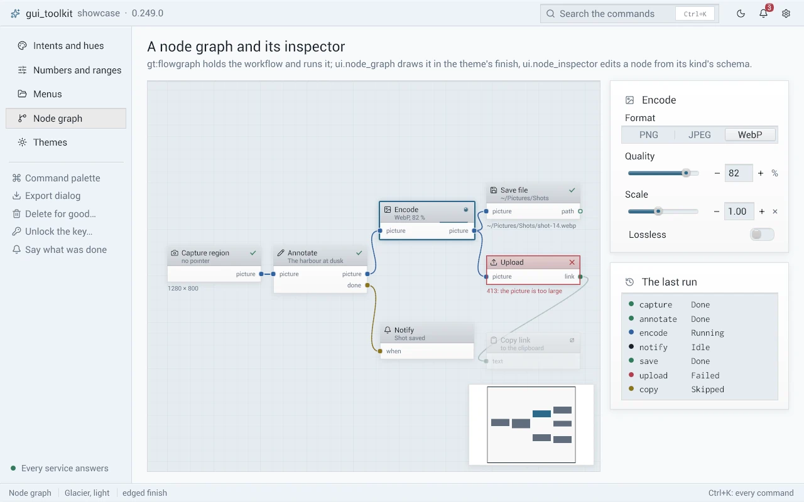

# flowgraph: graphs a person edits and runs

`gt:flowgraph` (package `tk_flowgraph`, `import flowgraph "gt:flowgraph"`) holds a graph of nodes linked port to port
(a workflow, a pipeline), the catalog of its node kinds, its JSON text, and a run of it. It has no window and no
thread: `ui.node_graph` draws a graph ([node_graph.md](node_graph.md)), `ui.node_inspector` edits a node's parameters,
and the program does each node's work. Its undo is `gt:undo` ([undo.md](undo.md)).

## The catalog

A program describes its node kinds as data. The edits, the file, the run, the inspector and the add palette read it:
they need no code per kind.

```odin
PICTURE :: flowgraph.Port_Kind(1)
TEXT    :: flowgraph.Port_Kind(2)

Kind :: enum { Capture, Blur, Editor, Save }

CATALOG := flowgraph.Catalog{
	kinds = {
		{name = "action"},                       // flowgraph.ACTION, the engine's
		{name = "picture", transient = true},    // let go as soon as no node waits for it
		{name = "text"},
	},
	nodes = {
		{name = "capture", title = "Capture", outputs = {{name = "picture", kind = PICTURE}}, max_count = 1, min_count = 1},
		{name = "blur", title = "Blur", inputs = {{name = "picture", kind = PICTURE}}, outputs = {{name = "picture", kind = PICTURE}},
		 params = {{name = "radius", title = "Radius", type = .Float, lo = 0.5, hi = 64, step = 0.5, unit = "px", default_number = 4}}},
		{name = "editor", title = "Edit", inputs = {{name = "picture", kind = PICTURE}}, outputs = {
			{name = "picture", kind = PICTURE},
			{name = "done", kind = flowgraph.ACTION, on = .Done},
			{name = "cancelled", kind = flowgraph.ACTION, on = .Cancelled},
		}},
		{name = "save_file", title = "Save file", effect = true,
		 inputs = {{name = "picture", kind = PICTURE}, {name = "when", kind = flowgraph.ACTION}}},
	},
}
```

| Type | What it is |
|---|---|
| `Catalog` | `kinds` (indexed by `Port_Kind`), `nodes` (indexed by `Node.kind`) |
| `Kind_Def` | `name`; `accepts`: the other kinds an input of this kind takes (a text takes an address); `any`: it takes every kind but `ACTION`; `transient`: its values are let go as soon as every reader is decided |
| `Node_Def` | `name` (the file's word), `title`, `group` and `tags` (the add palette), `icon`, `inputs`, `outputs`, `params`, `place` (the program's id of where its work runs), `effect` (Skipped in a dry run), `max_count` (at most this many in a graph; 0: no limit), `min_count` (a delete leaves this many) |
| `Port_Def` | `name`, `kind`, `multiple` (an input that takes several links), `on` (an `ACTION` output: the `Outcome` that fires it) |
| `Param_Def` | `name` (the file's key), `title`, `type`, `lo`, `hi`, `step`, `unit`, `choices`, `default_number`, `default_text`, `default_color`, `placeholder` |
| `Param_Type` | `Int`, `Float`, `Bool`, `Color`, `Choice` (an index in `choices`), `Text`, `Folder` (a path), `List` (a text chosen from names the program gives at run time) |

`Port_Kind` is a `u8`, the same id as `ui.Graph_Port.kind`: `kind_colors[kind]` is its colour. The kind 0 is `ACTION`.
`port_accepts(cat, from, to)` says whether an input of kind `to` takes a value of kind `from`.

## The graph and its edits

`Graph` holds `nodes` (`Node`: `id`, `kind`, `pos`, `params`), `links` (`Link`: `from_node`, `from_port`, `to_node`,
`to_port`, the layout of `ui.Graph_Link`) and `next_id`. A node's parameters are `params[i]` for `Node_Def.params[i]`
(`Param`: `number`, `text` (owned), `color`), at most `PARAMS_MAX`.

The edits keep the graph valid, so a run never meets a graph it cannot read:

| Procedure | What it does |
|---|---|
| `node_add(g, cat, kind, pos) -> u64` | a node with its kind's defaults; 0 when refused (`can_add`: not a kind of the catalog, or at its `max_count`) |
| `node_add_linked(g, cat, kind, pos, at: Port_Ref) -> u64` | the same, linked to the port `at` (`{node, port, side}`, `side` `.In` or `.Out`) by its first port that fits (`fit_port(g, cat, at, kind)`); what a link let go on nothing makes |
| `node_copy(g, cat, id, offset) -> u64` | a copy of a node, its parameters, no link |
| `can_link(g, cat, l)`, `link(g, cat, l) -> (replaced, ok)` | both ends exist and differ, the kinds agree, no cycle; an input that takes one link loses the old one (`replaced`) |
| `unlink(g, l)` | removes a link |
| `nodes_delete(g, cat, ids) -> int` | removes nodes and their links; a kind at its `min_count` stays |
| `nodes_move(g, ids, delta)` | moves nodes |
| `reaches(g, from, to)` | whether `to` comes after `from` along the links |
| `graph_clone`, `graph_destroy`, `graph_node`, `graph_node_index`, `graph_count`, `node_def`, `kind_named`, `node_params_default` | the rest |

The parameters read clamped to their range or their choices, as a hand-edited file may hold anything: `param_int`,
`param_float`, `param_bool`, `param_text`, `param_color`, `param_choice_text`; `param(cat, n, name)` is the `^Param`,
`param_def` its definition and place. `param_set(n, index, value)` sets one (its text copied).

## A run

A run is one state machine per node, on the interface's thread. The program starts it, takes the nodes that are ready,
does each one's work where it must be done (a job of a worker, the interface, a person), and says how it ended:

```odin
run: flowgraph.Run
flowgraph.run_init(&run, graph, &CATALOG, {id = 1})
for !flowgraph.run_over(&run) {
	for task in flowgraph.run_next(&run) {
		switch Kind(task.kind) {
		case .Capture: flowgraph.run_finish(&run, task.node, {outcome = .Done, outputs = {0 = picture_value(shot)}})
		case .Editor:  editor_open(task)   // later: run_finish (Done) or run_cancel
		case .Blur, .Save: worker_send(job_of(task))   // its result comes back: run_finish
		}
	}
	wait_for_a_result()
}
flowgraph.run_destroy(&run)
```

| Node_State | |
|---|---|
| `Waiting` | a node linked into it is not decided yet |
| `Running` | `run_next` gave it to the program |
| `Done`, `Failed`, `Cancelled` | its work ended so (`run_finish`; `run_cancel`: a person gave up) |
| `Skipped` | an input it waits for never came; or a dry run and an `effect`; or the program declined it (`run_skip`) |

`node_step(state, event)` is the table: `Waiting` takes `Start` and `Skip`; `Running` takes `Finished`, `Failed`,
`Cancelled` and `Skip`; every other pair is refused (a late result). `run_finish` refuses a node that is not running and
releases its values.

A node runs when each value input has a value (one that takes several: at least one) and each **action input** that is
linked has fired. An action output fires when its node ends as its `on` says. So in this graph:

```
Capture.picture ──> Editor.picture
Capture.picture ──> Save.picture
Editor.done ──────> Save.when
Editor.cancelled ─> Notify.when
```

Save waits for the editor and saves the captured picture when the person confirms; when they cancel, Save is Skipped and
Notify runs. An action input left unlinked asks for nothing. A branch is a node whose work gives a value on one output
only: what hangs on the other is Skipped.

`run_next` returns `[]Task` (temp allocator): `node` (its place in `run.nodes`), `id`, `kind`, `inputs` (`Input`: `port`,
`value`, by port then link order; `task_input(task, port)` is the first of a port). `Result` gives `outcome`, `message`
and `outputs[port]`, one value per value output (payload nil: not made); the action outputs are the run's. `run_over`:
every node is decided; `run_busy`: a node is running; `action_fired(run, node, port)`. `Run_Options.dry` skips the
effects (a preview).

### Values

A `Value` is a `kind` and a counted `^Payload`: the program's data and its free procedure. `value_make(kind, data,
free)` makes one (one reference, the caller's), `value_hold` takes another, `value_release` gives one back, and the last
frees the data. The count is atomic: a job holds a value while it works on a worker and may release it there.
`value_data(v, T)` is the data as a `^T`.

A run shares values, read only: fan-out gives each branch the same payload; a node that changes it makes a new one. The
inputs a task gets are the run's; a job keeps what it reads with `value_hold`. A transient kind's value is let go as soon
as every node that reads it is decided; the others stay until `run_destroy`, for the program to read (`run.nodes[i].outputs`).

## The file

`set_text(set, cat, format) -> string` writes a `Graph_Set` (`list` of `Graph_Entry`: `id`, `name`, `labels`, `graph`;
`next_id`) as JSON; `set_parse(text, cat, format) -> (set, why)` reads it back. `Store_Format` names the version and the
keys, so a program keeps those of its file (`{version = 1, list = "workflows", labels = "triggers"}`):

```json
{"version": 1, "graphs": [{"id": 1, "name": "Screenshot", "labels": ["region"], "next_id": 5,
  "nodes": [{"id": 1, "kind": "blur", "x": 0, "y": 120, "params": {"radius": 4}}],
  "links": [{"from": 1, "from_port": 0, "to": 2, "to_port": 0}]}]}
```

A parameter is written under its name: a number, `true` / `false`, `"#rrggbbaa"` (`color_text`, `color_parse`), a
string. What the text lacks takes its default; a node of an unknown kind, a link that is not valid, an id taken twice
are dropped or given a new id; a text of a newer version is refused (`why`). Reading and writing the file is the
program's, on a worker. `set_find`, `set_add`, `set_remove`, `set_destroy`, `entry_clone`, `entry_destroy` edit a set.

## In a window

`ui` shows a graph with `node_graph` and edits a node with `node_inspector`:

```odin
// after each change of the model (not at each frame)
ui.flow_nodes_make(&app.flow, &app.graph, &CATALOG, {user = app, look = look})
// each frame
events := ui.node_graph("###flow", &app.view, app.flow.nodes[:], app.flow.links[:], app.selection[:], {
	user = app,
	can_link = proc(user: rawptr, l: ui.Graph_Link) -> bool {
		app := (^App)(user)
		return flowgraph.can_link(&app.graph, &CATALOG, ui.flow_link(l))
	},
})
```

- `Flow_Nodes` holds the widget's nodes, ports and links (owned); `flow_nodes_make(out, g, cat, opts)` makes them again,
  `flow_nodes_destroy` frees them. `Flow_Options.look(user, node, def) -> Flow_Node_Look` gives what a node shows beyond
  its kind: `subtitle`, `color`, `state`, `message`, `thumbnail` (copied).
- `flow_link(l)` is a widget's link as the model's; `flow_state(s)` a run's state as the widget's (`Cancelled` is shown
  `Skipped`).
- `flow_palette(g, cat, from) -> (commands, enabled)` is the add palette for `ui.palette`: a command per kind, the index
  chosen is the kind; off at its `max_count`, and with `from` (`Graph_Dropped_Link.from`) off without a port that fits.
  Then `flowgraph.node_add_linked(g, cat, kind, at, {from.node, from.port, flowgraph.Side(from.side)})`.



### node_inspector

`node_inspector(id, ins, cat, node, opts) -> Node_Inspector_Result` draws a node's parameters from its kind's schema:
`ui.number` with its slider for `Int` and `Float` (bounded), a toggle for `Bool`, a segmented choice (three choices or
fewer) or a dropdown for `Choice`, a colour button and its picker for `Color`, a text field for `Text`, a text field and
"Choose…" for `Folder`, a dropdown of the names `opts.lists(user, node, param)` gives for `List` (its first entry, the
empty value, says `placeholder`).

It changes nothing. Its result says `changed` (the parameter, -1: none) and its new `value`; `new_step` when the change
is of another parameter or node than the last one (a slider dragged is one undo step); `pick_folder` when a Folder's
"Choose…" was pressed (the program opens the system's dialog off the interface's thread and sets the text); `typing`
while a field has the keyboard. The program takes its undo step, then applies the value:

```odin
res := ui.node_inspector("###params", &app.inspector, &CATALOG, node)
if res.changed >= 0 {
	if res.new_step { undo.push(&app.history, flowgraph.graph_clone(app.graph), 100, flowgraph.graph_destroy) }
	flowgraph.param_set(node, res.changed, res.value)
}
```

`Node_Inspector` keeps its fields between frames, made for one node. When the program changes the parameters itself (an
undo), it sets `ins.node = 0`: the fields show the model again. `ins.last_change = {}` makes the next change a step of its
own (after the file is written). `node_inspector_destroy` frees it.

## Tests

`src/flowgraph` tests the edits (a loop refused, the kinds of a link, `max_count`, `min_count`, the action ports), a run
(the order of the links, fan-out, a branch, a failure, a node cancelled, the conditions between nodes, a dry run, the
values freed at their last release, the table of `node_step`) and the file (a round trip of every type of parameter,
what a text gets wrong, the keys of a format). `tests/scenarios/node_inspector_test.odin` drives the inspector, a graph
linked through the widget, and the palette.
