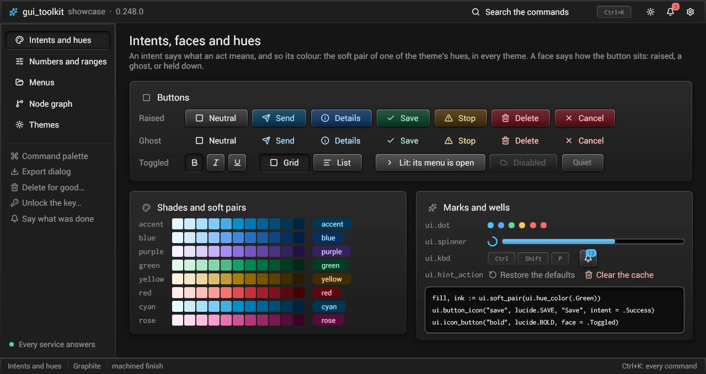

# Getting started: gui_toolkit in a new project

From an empty folder to a window, then the choices a project makes (render backend, text backend, accessibility), the
tests, the versions, where state lives, and the pitfalls met so far. Every command below was run as written on a clean clone (Windows 11,
PowerShell 5.1).

## 1. Prerequisites

| What | Version | Needed for |
|---|---|---|
| Windows 10 or 11 x64, or Linux x64 | | Windows: Win32, Direct3D 11 by default. Linux: X11 or Wayland, WebGPU over Vulkan (`tools/tk fetch_wgpu`), Rust for the text library (the native text backend, `FONT_BACKEND`'s default off Windows). No macOS backend. |
| [Odin](https://github.com/odin-lang/Odin/releases/tag/dev-2026-11) | **`dev-2026-11`** (`odin version` says `dev-2026-11-nightly:9a69916`) | everything. The CI pins this archive by SHA-256 (`.github/actions/setup-odin/action.yml`); another nightly may not build the toolkit |
| MSVC: Visual Studio 2022 or its Build Tools, workload "Desktop development with C++" (MSVC x64 and a Windows 10/11 SDK) | | Odin links with `link.exe` and finds it by itself (no developer prompt needed); `rc.exe` for an exe icon (`-resource:`) |
| PowerShell 5.1 or 7 | | the scripts of `tools\` |
| Rust, the stable toolchain of [rustup](https://rustup.rs) (`x86_64-pc-windows-msvc`) | stable | only for the two optional native libraries (section 4: native text, accessibility) |

Nothing else: the default build (Direct3D 11, DirectWrite, no accessibility) uses only Odin's `core:` and `vendor:` and
the system. The fonts it falls back to (Roboto, Inconsolata, the icon font) are compiled into the exe.

## 2. A new project with the toolkit as a submodule

```powershell
mkdir myapp; cd myapp
git init
git submodule add https://github.com/sachahjkl/gui_toolkit libs/gui_toolkit
git -C libs/gui_toolkit tag -l                # the published versions
git -C libs/gui_toolkit checkout vX.Y.Z       # the latest (examples/hello is in every version after 0.43.0)
mkdir app, build                              # (odin does not create the output folder: "don't have access to write")
```

The smallest application is `examples/hello` (a label, a text field, a button that counts its clicks). Copy it, with
the toolkit's packages imported through a collection named `gt`:

```powershell
(Get-Content libs\gui_toolkit\examples\hello\main.odin) -replace '"\.\./\.\./src/', '"gt:' -replace '^package hello', 'package myapp' | Set-Content app\main.odin
odin build app -collection:gt=libs/gui_toolkit/src -vet -out:build/myapp.exe -subsystem:windows
build\myapp.exe                  # the window
build\myapp.exe --frames=3       # three frames of the hidden window, prints "hello: 3 frames, 11 boxes", exits 0
```

`import "gt:ui"`, `"gt:draw"`, `"gt:render"`, `"gt:font"`, `"gt:platform"` (and `"gt:flate"`, `"gt:base"`) are the
packages, in the toolkit's `src` folder; they import each other by relative paths, so any collection name works. `-o:speed` for a release build
(about 9 s for hello), `-debug` for a debugger (and the Direct3D debug layer: `D3D_DEBUG` follows `-debug`).
`-subsystem:windows` gives no console: what the program prints is lost unless it is redirected
(`Start-Process build\myapp.exe -RedirectStandardOutput out.txt -Wait`); leave it out while developing to see it.

`examples/hello/main.odin` is a window as an object, `host.Host` (the `gt:host` package, above `ui` and `render`):

```odin
App :: struct { shared: host.Shared, main: host.Host }          // what the windows share; one window

host.host_open(&app.main, &app.shared, {title = "My app", size = {640, 400}}, build, app)
platform.show_window(app.main.win)
for !platform.is_closed(app.main.win) {
	host.hosts_wait({&app.main})   // 0 % CPU at rest
	host.host_frame(&app.main)
}
host.host_close(&app.main)
```

`build :: proc(h: ^host.Host, size: host.Vec2)` holds the widgets (`h.user` is the `app` given to `host_open`). What it does
for you, in order:

1. `host_open`: `font.init`, `platform.open_window(..., transparent = true)`, `render.init_window(&r, win, win.size, transparent = true)`,
   `render.set_fixed_surface(&r, platform.monitor_size(win))` (below: a resize never stretches a frame), a UI font
   (`font.load_system_or_embedded(..., platform.system_font_path("segoeui.ttf"), font.FALLBACK_UI_DATA)`),
   `draw.init`, `ui.apply_palette` + `ui.init`, and `win.on_frame`: a frame with `inner = true`, called from inside the
   system's loops (live resize, menus) by `WM_PAINT`;
2. `host_frame`: `render.pace_frame` -> `platform.poll_events` -> `render.resize` -> `ui.begin_build` ->
   your widgets -> `ui.end_build` -> `draw.begin_frame` -> `render.frame_begin` -> `ui.draw_tree` -> `draw.end_frame` ->
   `render.frame_end(&r, !at_once)` -> `render.paced_present` -> `free_all(context.temp_allocator)` (`docs/pacing.md`);
3. `hosts_wait`: `platform.wait_event(win, ui.wake_in_ms(&s))` unless `ui.needs_frame(&s)` (an animation): 0 % CPU
   at rest, woken by input or by the interface's own timers (caret blink, tooltip).

What a frame of yours does besides is a hook of the Host (`src/host/host.odin`): `params` (the style, the animations of each
build), `input` (events the interface does not see), `builds` (several builds in a frame: `host.host_build` again),
`hold` (no picture this frame), `after_build`, `before_input`, `dragging`, `rest_frame`. A window hidden with
`host.host_hide` gets no `host_frame` until `host.host_show` (the program waits on it with `platform.wait_event` and
reads it with `poll_events`); the first frame after the show makes the renderer's surface again. Another window is another
`host_open` with the same `Shared`: a surface on the same renderer, built in turn, `hosts_wait({&a, &b})` for both
(`hosts_frame` makes a frame of each). The steps above are all public: a program may make its frames by hand, as
`examples/fidget` does, or mix both.

**Redraw only what changed.** Set `h.partial_redraw = true` (any time; it is read at every frame): each frame then compares
what every box draws with the last frame and redraws only where something changed (a hover, a caret, an animation, a toast).
An idle frame redraws nothing; the window shows the same pixels as with whole frames. A program that makes its frames by hand
calls `ui.set_partial_redraw(&state, true)` before `ui.draw_tree`; `ui.damage_stats(&state)` says what the last frame
redrew. How it works and what makes a frame whole: docs/draw.md "Automatic damage".

**A window that resizes without stretching.** An ordinary swap chain (`open_window` and `init_window` with their defaults)
is scaled to the window by the system: while the window is resized, the last frame is shown stretched until one of the new
size arrives. Three lines give a composition swap chain whose buffers keep the size of the screen, so that a frame of the old
size is clipped by the window instead (`examples/hello` has them; a window grown past the screen is shown scaled once, the
buffers then follow):

```odin
win := platform.open_window("My app", {640, 400}, transparent = true)        // when the window is made: too late afterwards
render.init_window(&r, win, win.size, transparent = true)
render.set_fixed_surface(&r, platform.monitor_size(win))
```

It stays opaque as long as the frame is (`render.frame_begin` with an alpha of 1). Colours in the linear blend space are
then held in 16-bit floats, twice the memory of the ordinary swap chain, for buffers of the screen's size. WebGPU has no fixed
surface (`set_fixed_surface` returns false), so the recipe does not help there ([webgpu.md](webgpu.md)).
`tools/resize_probe` checks a program from outside: it resizes the window and reads where a column of fixed width ends.

The widgets are calls in `build` (`ui.label`, `ui.button(...).clicked`, `ui.line_edit`, `if ui.row() { ... }`):
README.md ("What it looks like", "Features") and `examples/fidget` (the gallery of every widget) show the rest.

`examples/showcase` shows what a program gets from the toolkit, one scene each: the intents and the hues, the numbers
and ranges, the command palette, a menu that searches, the dialogs, the settings page, a node graph and its inspector,
the toasts, every theme and finish. Its data is fixed, so each scene is the same picture at each run.
`odin run tools/tk -- build showcase`, then `build/showcase --scene=graph --theme=Nord --light` opens a scene in a theme;
the head of `examples/showcase/main.odin` lists its flags. Its code is the place to copy a scene from.



A password is `ui.line_edit(id, &field, secret = true)`: bullets in place of its characters, and it is neither copied nor cut.
Once it is used, `ui.field_wipe(&field)` leaves nothing of it in memory (widgets.md, "A secret's memory").
Give it `reveal = &shown` (a `bool` the program keeps) and an eye at its end shows the text and hides it again; shown, it is
text like any other. The field keeps the keyboard when the eye is clicked.

A field with things beside it in one surface (a search icon, the field, a count) is an `if ui.field_frame(id) { ... }`.
The frame draws an input's background, border and corners (its radius from `next`), and one focus ring around all of
it while a box inside has the keyboard focus (the box flag `.Focus_Within`). Build the field inside under the tag
`"bare"` (`if ui.tags("bare") { ui.line_edit(...) }`): the default theme makes a bare field's background, border and
focus ring clear, so it does not draw a second box inside the frame.

A box's `square_corners` (`ui.Corners`: `.Top_Left`, `.Bottom_Left`, `.Top_Right`, `.Bottom_Right`) stay square whatever its
radius: its background, border, shadow, hover and focus ring follow (`ui.box_radii`, `ui.radii_grown`; `ui.paint_rect_corners`
is `paint_rect` with a radius per corner).

```odin
ui.next({width = ui.fill(), height = ui.px(em * 2), radius = em * 0.45})
if ui.field_frame("###search") {
	glyph(ICO_SEARCH)
	ui.next({width = ui.fill(), height = ui.pct(1)})
	if ui.tags("bare") { ui.line_edit("###field", &field, "Search") }
}
```

## 3. What `tk build` does

`odin run tools/tk -- build <example> [-debug]` (in the toolkit's folder; `build.bat` and `./build.sh` are its shortcuts) is
`odin build examples/<example> -out:build/<example> -o:speed -vet` (or `-debug` instead of `-o:speed`). On Windows it adds
`-subsystem:windows` and `-resource:examples/<example>/<example>.rc` when the example has an icon; on Linux it builds the native
text backend first (the default backend there). It builds the examples only; your project calls `odin build` itself as
above.

## 4. Choices made when compiling (`-define:`)

| Define | Values | What it needs |
|---|---|---|
| `TOOLKIT_RENDER` | `d3d11` (default), `wgpu` | wgpu: `odin run libs/gui_toolkit/tools/tk -- fetch_wgpu "-dest:build"` once (checks the `wgpu_native` library Odin ships, puts DXC's `dxcompiler.dll` + `dxil.dll` next to the exe; without them shaders compile with FXC, about 2.5 s more at start). Ship the DLLs of `build\` with the exe |
| `FONT_BACKEND` | `dwrite` (the default, Windows only), `native` (required on Linux: without it no text is shaped) | native: `odin run libs/gui_toolkit/tools/tk -- build_text` (cargo, about 45 s the first time) -> `libs\gui_toolkit\build\text\gt_text.lib` |
| `A11Y_ACCESSKIT` | `false` (default), `true` | `odin run libs/gui_toolkit/tools/tk -- build_a11y` (cargo, about 20 s) -> `libs\gui_toolkit\build\a11y\gt_a11y.lib` |
| `FONT_TEXT_RENDERER` | `atlas` (default on Windows), `slug` (default elsewhere, the only one there) | nothing (Slug: glyphs drawn from their outlines on the GPU; also per `font.State` at run time) |
| `TOOLKIT_WGPU_DX12_COMPILER` | `auto` (default), `dxc`, `fxc` | |
| `TOOLKIT_DEVTOOLS` | `true` in a `-debug` build and a test, else `false` | `true`: the CDP endpoint of `devtools.start_from_env` in a release build ([devtools.md](devtools.md)) |
| `LUCIDE_SUBSET` | `""` (default: the whole Lucide font), an absolute path | the program's icons only, made by `toolbox.lucide_subset` ([lucide.md](lucide.md)) |
| `FONT_EMBED_FALLBACK` | `true` (default), `false` | `false`: no Roboto or Inconsolata compiled in; only for a program that loads its fonts itself |

What each costs in the executable: [builds.md](builds.md). A program's tool declares them once in `toolbox.Project.features`.

The three commands of `tools/tk` are independent (any order; each does nothing when its output is current: a `STAMP` file next to it).
They write into the toolkit's own `build\` folder, where its packages link them from (`foreign import
"../build/text/gt_text.lib"`). `fetch_emoji` (the color emoji font of `tests/colr`) and `build_naga` (the WGSL
to HLSL translator, for whoever edits the shaders) are for the toolkit's own work, not for an application.

- **Render backend.** On Windows, Direct3D 11 is the default and the complete one. wgpu (WebGPU: Direct3D 12 on Windows, Vulkan on Linux, where it is
  the only one) has the same interface and passes the same pixel tests, but no GPU canvas engine, no fixed surface and no frame
  latency setting: [webgpu.md](webgpu.md). Choose Direct3D 11 unless
  you need WebGPU itself.
- **Text backend.** DirectWrite is the default on Windows: system fonts, shaping, fallback. `native` (Fontations,
  HarfRust, ICU4X in Rust) needs no DirectWrite: it is the backend on Linux, and an option on Windows:
  [font-backend.md](font-backend.md), [text.md](text.md).
- **Accessibility.** On Windows, without `A11Y_ACCESSKIT=true` screen readers see an empty window (on Linux a small AT-SPI bridge is always there). With it, every widget is read
  through UI Automation, and the tree costs nothing until a reader asks: [accessibility.md](accessibility.md). A program
  with a Rust library of its own builds `native/a11y` (and `native/text`) into it instead and adds
  `-define:A11Y_NATIVE_LINK=false` (`FONT_NATIVE_LINK=false`): one Rust standard library per program.

## 5. Tests

In the toolkit's folder (the CI runs the same: `.github/workflows/ci.yml`):

```powershell
odin test tests/flate -vet                                         # one package
odin test tests/keyboard -vet -define:ODIN_TEST_THREADS=1           # packages that build interfaces: one test at a time
odin run tools/run_tests                                           # every package, on a desktop of its own (needs the native libraries)
odin run tools/run_tests -- -backend:wgpu              # the pixel tests on WebGPU (after tools/tk fetch_wgpu)
```

Pixel tests draw on an offscreen renderer on WARP (`render.init_offscreen(&r, size, warp = true)`: software, the same
pixels on every machine, no window). Timing assertions only run with `GUI_PERF=1` and never in CI (`base.perf_skip`).
A test of your own interface uses `src/testkit/session` ([testing.md](testing.md)): an application with no window, input through the
event path, real pixels, barriers on a state, and a clock of its own, so that the caret blink, double clicks and delays do not depend on how
fast the machine runs.

## 6. Versions and changes

Semantic versioning, `ui.VERSION`, git tags `vX.Y.Z` with a GitHub release each; while `0.x` a minor version may change
the API (CHANGELOG.md says how). Pin the submodule to a tag and read the CHANGELOG's section before moving it. A change to
the toolkit itself follows [CONTRIBUTING.md](../CONTRIBUTING.md): a fragment in `changelog.d/`, never an edit of
`CHANGELOG.md` or `src/ui/version.odin`.

## 7. Where state lives

What is one window's or one app's lives in the struct that owns it, so that several apps run in one process, each on a thread of
its own: the window's in `platform.Window`, the device's in `render.Renderer`, the interface's in `ui.State` (the names of the
caption buttons too: `ui.set_window_button_names` translates the current State's). A package-level variable is one of four
classes, and only these:

| Class | What | Example |
|---|---|---|
| `const` | a table, written by the compiler, or once (at start-up, a `sync.Once`) before anything reads it; then only read, by any thread | `ui.THEMES`, the Wayland protocol tables, the sRGB tables |
| `process` | a resource of the process, one whatever the number of apps: locked, atomic, or bound to a thread its note names | the clipboard store, the device made early (`render.preload_device`), the window class, a library of the system |
| `thread` | `@(thread_local)`: each thread its own | the State a thread builds, the frame gate, OLE on Windows, the display connection and session bus on Linux |
| `test` | a test's own | |

On Linux each thread that opens windows has its own connection to the display server (its events, its seat's focus) and its own
session bus: a window's procedures are called on the thread that opened it, as on Windows, whose messages are the thread's.

`tools/globals_allowed.txt` lists every global of the packages with its class and why; `tests/globals` (in `odin run tools/run_tests`)
fails on a global that is not listed, on one listed that is gone, and on a class the code contradicts (`@(thread_local)` is
`thread`, and only it). `odin test tests/globals -define:GLOBALS_WRITE=true` rewrites the list from the code, keeping the classes
known; a new one gets `?` until it is classified, or moved into its struct.

## 8. Pitfalls

- **The output folder must exist**: `odin build ... -out:build/x.exe` fails with "Error(013): don't have access to write"
  when `build\` is missing.
- **`odin test` deletes its exe** after the run. To run a test program several times (to chase an unstable test):
  `odin build tests/<name> -build-mode:test -out:build/<name>_test.exe`, then run the exe.
- **A `render.Surface` (second window) in a local variable**: it is several kilobytes; with `-o:speed -debug` LLVM spent
  more than ten minutes on the module that copied one. Make it where it lives: `render.surface_init(&r, &app.surface,
  hwnd, size)`, not `s, ok := render.surface_create(...)`.
- **One interface build at a time per thread**: `ui.begin_build` inside another build (a frame made from `WM_PAINT`
  while a menu's loop runs inside your build) asserts; check `ui.building()` at the top of the frame procedure (hello
  does). The `ui` package keeps the State being built per thread (`@(thread_local)`): each thread builds its own
  interface, and a public `ui` proc called on a thread where no `init`, `use` or `begin_build` selected a State stops at
  once with `ui.NO_STATE_MESSAGE` ("ui: no begin_build on this thread") instead of crashing further on.
- **Several windows**: give each window a `ui.State` of its own and pass `Build_Params.inactive = true` when building a
  window that is not the one the user is in: its focused text fields keep their focus but show no caret and ask for no
  wake to blink it (`ui.inactive()` tells a widget of your own), as every desktop does.
- **Keys**: widgets are found again from frame to frame by their id. `"Label"` alone uses the text as the id: two
  buttons labelled "OK" collide and a label whose text changes loses its state. Use `"Text###stable_id"` (the part after
  `###` is the key) for anything whose text changes, as hello does for the counter.
- **A press on a box that is not a button** (a right click that opens a menu on a message, a card): check it with
  `ui.pointer_on(box)`, not with its rect alone. It says whether the pointer is on the box with nothing drawn over it there,
  as the last build laid it out: a box that a later sibling covers (a message the conversation scrolls under its composer,
  a panel under a floating one) is not under the pointer, the box in front is. A `.Clickable` box's own `right_clicked`
  already goes to what is in front.
- **Free the frame's temporaries**: `free_all(context.temp_allocator)` at the end of each frame (the `fmt.tprintf`
  strings of labels live there). `ui.field_destroy` the `Text_Field`s you made.
- **`expect_assert` in tests**: on Windows the test runner's handling of an assertion races the system's end of the
  process; a test program can end without a word. Catch an expected assertion on a thread of your own
  (`tests/ui_robust/nested_build_test.odin`).
- **wgpu at start-up**: without DXC's DLLs next to the exe, every shader compiles with FXC (seconds). `tools/tk
  fetch_wgpu "-dest:<exe folder>"` puts them there.
- **Rust libraries out of date**: after updating the submodule, run `tools/tk build_text` / `build_a11y` again (they
  rebuild only when the sources changed); an old `gt_a11y.lib` with new Odin code fails at link or at run time.
- **Console output of a `-subsystem:windows` exe is lost**: redirect it, or build without the flag while developing.
