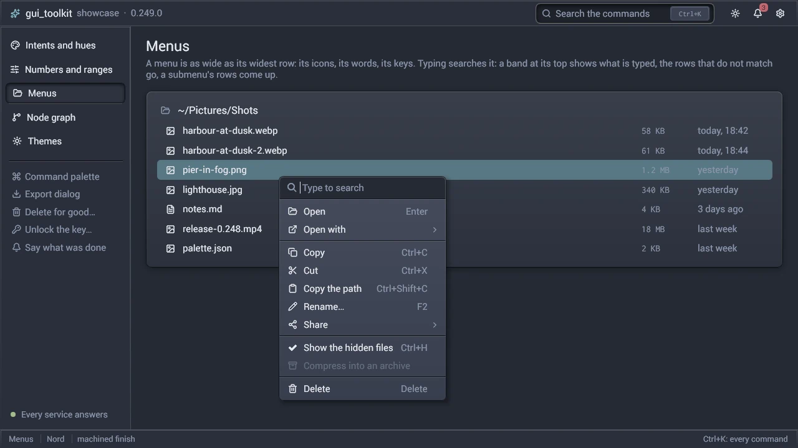
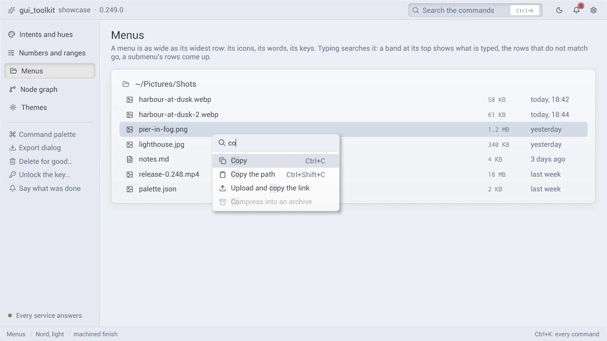

# Menus (`src/ui/popups.odin`)

A menu is a floating panel of rows, named by its `id` as a widget is, opened at a point or under a rect
(`menu_open(id, at)`), and built while it is open:

```odin
if sig.right_clicked { ui.menu_open("file_menu", ui.mouse_pos()) }
if ui.menu("file_menu") {
    if ui.menu_item("Copy", "Ctrl+C").clicked { ... }
    ui.menu_separator()
    if ui.menu_submenu("Show as") {
        if ui.menu_item("QR code", "Ctrl+Shift+Q").clicked { ... }
    }
}
```

| A context menu | The same, `co` typed |
|---|---|
|  |  |

## Its procedures

| Procedure | What it does |
|---|---|
| `menu_open(id, at, anchor = 0, from_keyboard = false, search = true, nested = false)` | opens the menu `id` at `at`, a `Menu_At`: a point (`Vec2`, its top-left corner) or a rect (`Rect`: below it, above it when there is no room). It replaces any open menu. `anchor`: the box that opens it (a press on it is not a press outside: the widget toggles the menu). `from_keyboard`: its first item starts selected. `search`: what is typed filters the items (off: a typed letter selects the next item that starts with it; a menu of a few fixed choices, a drop-down's list). `nested`: in the block of an open menu, the menu opens over it and that menu stays open behind it |
| `menu(id, width = 0)` | `if menu(id) { ... }` builds the menu while it is open, a nested one in the block of the menu that opened it |
| `menu_item(text, shortcut, checked, icon, disabled, keep_open, icon_font)` | one row; `disabled` (or a `disabled` scope): muted, skipped by the keyboard |
| `menu_submenu(text, icon, disabled)` | `if menu_submenu("Open with") { ... }` a row that opens a submenu |
| `menu_close()`, `menu_is_open(id)`, `menu_any_open()` | closes every level; whether `id` is open (any level); whether a menu is open |
| `menu_bar_button(id) -> string` | an entry of a menu bar: the id of its menu, for `menu` |

A menu's id is the window's, not that of where it is built: two menus of one id are one menu. A menu of each row puts the
row in its id (`fmt.tprintf("row_menu_%d", row.id)`).

## Its width

A menu is as wide as its widest row: the icon column, the label, the shortcut or a submenu's arrow, and their padding. One
procedure gives a row's width from the same numbers the row is laid out with, in the window's style (the menu's rows
are built in it, whatever the style where `menu` is called): a theme of a wider `text_pad` makes the menu wider, never a
label cut.

- `menu(id, width)`: `width` is a minimum (a drop-down's list is as wide as its button
  at least). A row wider than it widens the menu.
- A menu wider than the window is as wide as the window. Only then is a label cut ("..."), and its row shows the whole label
  as a tooltip when the pointer rests on it (0.5 s).
- A submenu, a nested menu and a `dropdown`'s list follow the same rule.
- The command palette is as wide as the person makes it (a `modal` of a `size`): a line it cuts shows its whole text as a tooltip
  in the same way.

## The menu of a text field

`field_menu(id, target, owner, secret, read_only)` builds the menu of a text field, `id` its menu: Undo, Redo, Cut, Copy,
Paste, Delete and Select all, each with its keys and its Lucide icon, and the search band of every context menu. `target`
is an `Edit_Target`: a `line_edit`'s `^Text_Field` or a `text_edit`'s `^Text_Area`; each edit goes through its own edit
history, as its keys do. `owner` is the field's widget, which a paste's text comes to (`field_paste`). A `secret` is
neither copied nor cut; a field `read_only` is only copied and selected.

`line_edit` and `text_edit` open it on a right press, the field taking the keyboard (their `menu`, true by default; false:
the program has its own).
