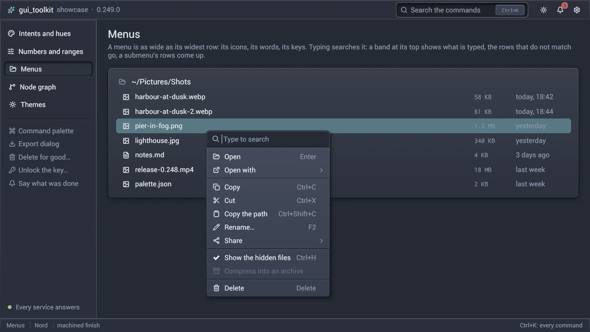
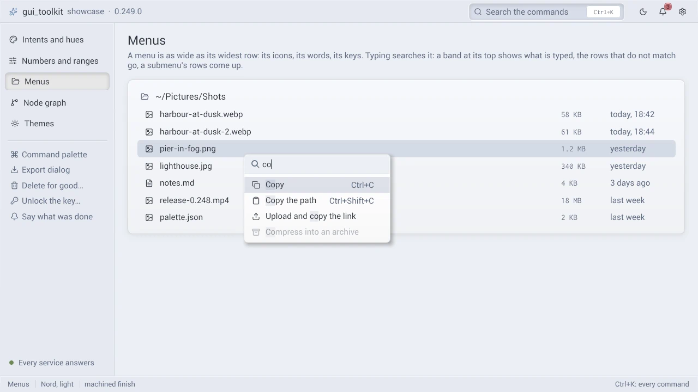

# Menus (`src/ui/popups.odin`)

A menu is a floating panel of rows, named by its `id` as a widget is, opened at a point or under a rect
(`menu_open(id, at)`), and built while it is open:

```odin
if sig.right_clicked { ui.menu_open("file_menu", ui.mouse_pos()) }
if ui.menu("file_menu") {
    if ui.menu_item("Copy", "Ctrl+C").clicked { ... }
    ui.menu_separator()
    if ui.menu_submenu("Show as") {
        if ui.menu_item("QR code", "Ctrl+Shift+Q").clicked { ... }
    }
}
```

A block that is no button (a message, a card, an image) takes a right press with `ui.context_take(box)`, called after
what is in it is built: the innermost that asks keeps the press, one box a build; a field that opened its own menu on that
press keeps it; nothing drawn over the pointer (a dialog, a floating panel) lets it through.

```odin
if ui.context_take(card) { app.menu_for = card_id; ui.menu_open("card_menu", ui.mouse_pos()) }
```

| A context menu | The same, `co` typed |
|---|---|
|  |  |

## What is typed filters it

Every menu filters what is typed: the context menus, a menu bar's, a tool bar's, a drop-down's list, a field's menu.
A field at its top (`search_band`, as the palette's) shows the letters. The items that do not have them in order go,
a submenu's items come up into the menu, and the first match is selected: Enter chooses it.

- A letter typed while a submenu is open closes the submenu and goes to its menu's field. A nested menu has its own field.
- Until something is typed, Space chooses the selected item, and Left, Right, Home and End move in the menu.
- A drop-down's list opens on its current value: Enter keeps it while nothing is typed.
- A panel opened as a menu with no item (a slider's) has no field: it has nothing to filter.

There is no mode where a typed letter selects the next item that starts with it: the filter's first match gives the
same, and one way to type in every menu is one thing to learn.

## Its procedures

| Procedure | What it does |
|---|---|
| `menu_open(id, at, anchor = 0, from_keyboard = false, nested = false, align = .Start)` | opens the menu `id` at `at`, a `Menu_At`: a point (`Vec2`, its top-left corner) or a rect (`Rect`: below it, above it when there is no room). It replaces any open menu. `anchor`: the box that opens it (a press on it is not a press outside: the widget toggles the menu). `from_keyboard`: its first item starts selected. `nested`: in the block of an open menu, the menu opens over it and that menu stays open behind it. `align` (`Menu_Align`): below a rect, the edge the menu lines up with, `.Start` its left, `.End` its right (a button at the end of a toolbar: the toolkit knows the menu's width) |
| `menu(id, width = 0)` | `if menu(id) { ... }` builds the menu while it is open, a nested one in the block of the menu that opened it. A tool bar's tool with a `menu`, folded into its "…" menu, opens `id` as a submenu of its row: the same block builds it there |
| `menu_item(text, shortcut, checked, icon, disabled, keep_open, icon_font)` | one row; `disabled` (or a `disabled` scope): muted, skipped by the keyboard |
| `menu_submenu(text, icon, disabled)` | `if menu_submenu("Open with") { ... }` a row that opens a submenu |
| `menu_control(label, id = "")` | `if menu_control("Width") { ui.slider(...) }` a row that holds a widget: `label` at its left, in line with the items' labels, the widget at its right. The widgets of every control row of a level start at one column, after the widest label. Not an item: the keyboard skips it, and using its widget does not close the menu |
| `menu_heading(text)`, `menu_separator()` | a small weak title above a group of rows; a line between two groups (neither is an item) |
| `menu_close()`, `menu_is_open(id)`, `menu_any_open()` | closes every level; whether `id` is open (any level); whether a menu is open |
| `menu_bar_button(id) -> string` | an entry of a menu bar: the id of its menu, for `menu` |

A menu's id is the window's, not that of where it is built: two menus of one id are one menu. A menu of each row puts the
row in its id (`fmt.tprintf("row_menu_%d", row.id)`).

## Open with

`ui.Open_With` lists the applications that open a file, with their icons, inside a program's submenu, and opens the file
with the one chosen:

```odin
ow: ui.Open_With                                   // one per menu that offers it; zero is ready
ui.open_with_ask(&ow, s, path)                      // when the menu opens: a chore reads the handlers and their icons
if ui.menu_submenu(i18n.tr("Open with")) {
	if ui.open_with_items(&ow, "ow") { ui.open_with_run(&ow) }
}
ui.open_with_destroy(&ow)
```

| Procedure | What it does |
|---|---|
| `open_with_ask(ow, s, path)` | reads the handlers of the file at `path` (`desktop.handlers_for_file`) and each one's icon (`desktop.handler_icon`, `OPEN_WITH_ICON_PX`) on a chore; the answer comes to `s`. What was read before goes |
| `open_with_items(ow, id_prefix = "ow") -> (chosen: bool)` | the items, in the block of a `menu_submenu`: "Reading…" while they are read, "No application" when there is none, else each application with its icon (the default first, "Name (default)"). True in the build where one is clicked. The items are named `<id_prefix>_<index>` |
| `open_with_chosen(ow) -> (h: desktop.Handler, ok: bool)` | the handler clicked last: a program that prepares the file first runs `desktop.open_with` itself, on its worker |
| `open_with_run(ow, path = "")` | opens the file (`path` "": the one asked) with the handler chosen, on a chore; a toast says when it does not start |
| `open_with_destroy(ow)` | frees the list, its icons and their textures; an answer on its way is dropped |

`Open_With.state` is `.Idle`, `.Reading` or `.Ready`. The hooks `handlers_of`, `icon_of` and `open` replace the
system's calls (nil: the desktop's); a test gives a fixed list. They run on a chore.

## Its width

A menu is as wide as its widest row: the icon column, the label, the shortcut or a submenu's arrow, and their padding. One
procedure gives a row's width from the same numbers the row is laid out with, in the window's style (the menu's rows
are built in it, whatever the style where `menu` is called): a theme of a wider `text_pad` makes the menu wider, never a
label cut.

- `menu(id, width)`: `width` is a minimum (a drop-down's list is as wide as its button
  at least). A row wider than it widens the menu.
- A menu wider than the window is as wide as the window. Only then is a label cut ("..."), and its row shows the whole label
  as a tooltip when the pointer rests on it (0.5 s).
- A submenu, a nested menu and a `dropdown`'s list follow the same rule.
- The command palette is as wide as the person makes it (a `modal` of a `size`): a line it cuts shows its whole text as a tooltip
  in the same way.

## The menu of a text field

`edit_menu(id, target, owner, kind)` builds the menu of a text field, `id` its menu: Undo, Redo, Cut, Copy,
Paste, Delete and Select all, each with its keys and its Lucide icon, and the field of every menu (`search_band`, as the palette's: [widgets](widgets.md)). `target`
is an `Edit_Target`: a `line_edit`'s `^Line_Edit` or a `text_edit`'s `^Text_Edit`; each edit goes through its own edit
history, as its keys do. `owner` is the field's widget, which a paste's text comes to (`edit_paste`). `kind`
(`Line_Edit_Kind`): a `.Secret` is neither copied nor cut; a `.Read_Only` field is only copied and selected.

`line_edit` and `text_edit` open it on a right press, the field taking the keyboard (unless their options' `own_menu`:
the program has its own).
