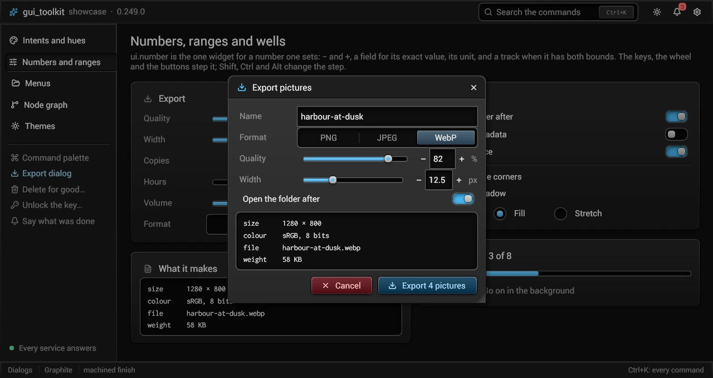
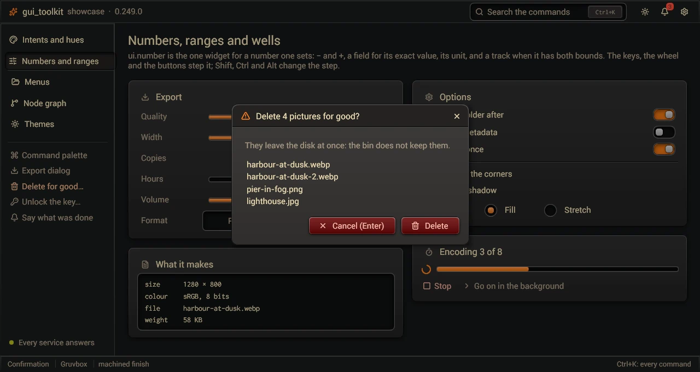
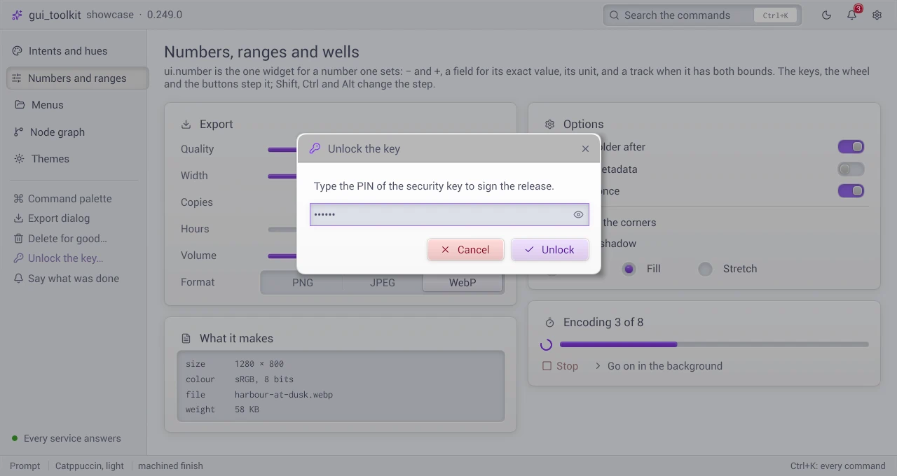

# Modal dialogs (`src/ui/overlays.odin`)

`ui.modal(id, &open, options)` dims the page and shows a panel: `if ui.modal("about", &open, {width_em = 32}) { ... }`.
`open` is the caller's: true opens it; Escape, a press outside or its close button set it false. Its `Modal_Options`, the
sizes in ems of the style where `modal` is called:

| Field | What it says |
|---|---|
| `width_em` | its width (0: `DIALOG_WIDTH_EM`, 29) |
| `height_em` | its height, what is in it filling it (`height = fill()`); 0: as tall as what is in it |
| `min_width_em`, `min_height_em` | how small the person can make it (with `size`) |
| `size` | `nil`: not resizable. Else the size the person gave it, in ems, the program's to keep (`{}`: none yet) |
| `top` | its top held at this fraction of the window's height (a command palette); `nil`: centered |

- It is always within the window however small: narrower than it asks if it must (the window has the last word over the
  least size), and never past its bottom.
- With `size`, the person resizes it by its edges and corners; it stays centered, so the opposite side moves too, and the
  side held stays under the pointer. A double click on an edge or a corner goes back to `width_em` × `height_em`. A window
  made smaller does not change `size`. With `top`, its bottom edge and corners follow the pointer, the top has no grips.
- A resizable dialog of `height_em` 0 opens as tall as what is in it, between its least size and the window. What fills it
  (`fill()`) counts as what it holds, and a region that scrolls counts as all of its content, measured on the last frame.
  No program adds up its header and its buttons to size it.
- A resizable dialog's bottom right corner is square, with the resize grip in it: a bevel in the theme's `resize_grip shade` (the border colour: darker on a light theme, lighter on a dark one) and dots on it. A floating panel of the dock has the same grip.

A dialog that opens is laid out once unseen, and the next frame comes at once: the first frame that shows it has it at its
size and place, and what is in it laid out. Its scrim and its panel then fade in together (`MODAL_FADE_MS`, 120 ms; at once
with the animations off). What had the focus loses it on that first frame shown, not before: its focus ring goes as the
dialog comes.

Several dialogs may be open, one in another or one after the other; the one built last is on top. It has the keyboard: Tab goes round its own stops and Escape closes it, the ones under it wait (it is known at the end of the build, so `open` turns false at the next one: an Escape read as a dialog opens is that dialog's). A dialog that opens takes the focus from what had it, and gives it back when it closes, unless something else took it meanwhile.

## A dialog's header and its close button (`src/ui/dialog_parts.odin`)



```odin
if ui.modal("files", &open, {width_em = 40, height_em = 28, size = &size}) {
    if ui.dialog_header("files_head", "Files", {icon = lucide.FOLDER, icon_font = ui.lucide_icons(), close = true}) {
        ...                                         // the header's own controls, after the title (a toolbar)
    }
    ...                                             // what is in the dialog
}
```

`dialog_header(id, title, o)` is a strip across the dialog's top, a shade darker than the dialog
(`DIALOG_HEADER_DARKEN`), `DIALOG_HEADER_EM` tall: an icon of the accent at its start (`o.icon`, `o.icon_font`; 0: the
state's icon font), the title, then what its block builds. Build it first in the dialog, before the body's scroll, so that
it stays on top while the body scrolls.

- `o.close` (`Dialog_Header_Options`): a close button (Lucide's X, a ghost button) in the dialog's top right corner. It is a square of
  `DIALOG_CLOSE_EM`, centered on the strip, at the same margin `m` from the dialog's top and right edges, its corners
  concentric with the dialog's: radius `max(R - m, 0)` (`corner_place`, [themes](themes.md#corners-in-corners)). A click closes
  the dialog (its `open`). It is built last in the dialog: the last stop of Tab. `o.close_label` is its name to a screen
  reader ("": "Close").
- The header's right end, `m + side + m`, stays free: a control of the header never touches the button.
- `modal_corner(flags, id)` builds the corner's control of a program's own look, in the header's block: its place, its size
  and its radius are the button's (`Fixed_Radius`: a custom draw rounds with `b.radius`); what `next` said is kept, but for
  those. The toolkit's button is then not built. The click is the program's.
- The grips of a resized dialog leave the corner to it: at its top and right, they are no deeper than `m`.

`confirm`, `shortcuts_sheet` and the Setup dialog have this header and its close button.

## A confirmation (`src/ui/confirm.odin`)

| `ui.confirm` | `ui.prompt`, a secret |
|---|---|
|  |  |

`ui.confirm(id, &open, options)` is the question before an act that is not taken back: a title, a note in the weak text
(what comes of it), what it acts on one per line when there is more than one (`CONFIRM_LINES_MAX` shown, the others
counted), then Cancel (intent `.Cancel`) and the act's button in the danger colours. It answers `.Confirmed`, `.Cancelled` (the Cancel
button, Escape, a press outside) or `.None` while it waits.

- Enter answers what is safe: Cancel, and the act only with `enter_confirms` (an act that is safe and was asked for). The
  button Enter presses says so: "Cancel (Enter)".
- Its words other than the caller's (Cancel, "and %d more", "%s (Enter)") are the toolkit's, in the language in use
  (`confirm_default_labels`); `Confirm_Options.labels` gives a program's own.

## A prompt (`src/ui/confirm.odin`)

`ui.prompt(id, &open, &field, options)` asks for an answer typed in: a title, a sentence (`note`: what to type), one
field, Cancel (intent `.Cancel`) and OK (`act`, else `Prompt_Labels.ok`). The field has the keyboard as it opens. Enter
in it answers `.Confirmed` (the text is the field's); Escape, Cancel or a press outside `.Cancelled`; `.None` while it
waits. `secret` makes it a password field (`reveal`: the caller's bool for the eye that shows it); once the answer is
used or given up, `ui.field_wipe(&field)` leaves nothing of it in memory. Its words other than the caller's
(Cancel, OK) are the toolkit's, in the language in use (`prompt_default_labels`); `Prompt_Options.labels` gives a
program's own.

```odin
switch ui.prompt("unlock", &app.asking, &app.pin, {title = "Unlock", note = "Type the PIN of the key.", secret = true}) {
case .Confirmed: unlock(app, ui.field_string(&app.pin)); ui.field_wipe(&app.pin)
case .Cancelled: ui.field_wipe(&app.pin)
case .None:
}
```

## A strip across a dialog's top

A strip across the top of a dialog (its title, a search field) is a box whose custom draw is `dialog_top_draw`: give it
the dialog's radius (`radius = em * DIALOG_RADIUS_EM`) and, for a colour of its own, a `^Color` in `custom_user` (none: a
field's, `input background`, the colour of a menu's search band: every place that searches looks alike; not the box's
`bg`, which inside a dialog is the dialog's). Its top
corners are the dialog's as drawn, it begins inside the dialog's rim, and a line parts it from what is under it. A raised
dialog's rim and edge are drawn over what is in it (`machined_plate_frame`): a child's background or line never covers
them.

## A list to choose from (`src/ui/dialog_parts.odin`)

`choice_row(id, index, &sel, title, detail, icon, icon_font)` is one row of a list a dialog asks to choose from (the
accounts of a security key, the passkeys of a site). The row `index == sel` is drawn as the command palette's selected
line: sunk in a well with a bar of the accent, its words in the theme's own colours. The pointer moving over a row
selects it: the highlight follows the pointer, and Enter takes what it shows. Up and Down are the caller's. It returns
true when the row is clicked.

## A dialog's body and buttons (`src/ui/dialog_parts.odin`)

`if dialog_body("id") { ... }` holds what a dialog says and asks, with its margins (`DIALOG_MARGIN_EM`) and gaps
(`DIALOG_GAP_EM`); `if dialog_buttons("id") { ... }` is its row of buttons, at its right end, the main act last. With
`dialog_header`, every dialog has the same three parts.
