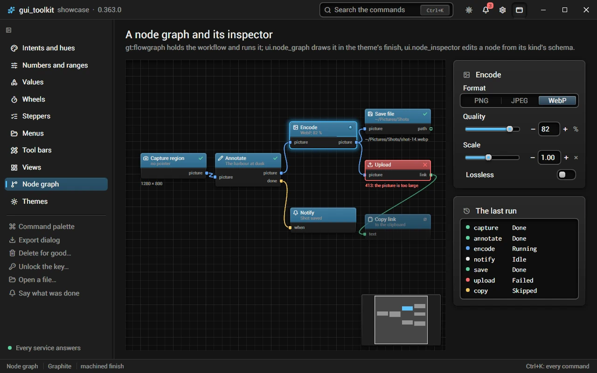

# node_graph: a graph of nodes and links

`ui.node_graph` shows a graph and lets the user edit it. A node is a box with a header (an icon, a title, a subtitle),
ports on its sides (or on its top and bottom edges) and optional widgets. A link is a curve from an out port to an in port. The program owns the model:
its nodes, links, selection and undo. The widget draws them and returns events. The program applies the events, and the
next frame shows the result.

```odin
app.view: ui.Graph_View   // kept between frames: the offset, the zoom, the gesture in progress

events := ui.node_graph("###flow", &app.view, nodes, links, app.selected[:], {
	kind_colors = {ui.color("hue_blue"), ui.color("hue_green")},
	snap        = 12,
	minimap     = {show = true},
})
for e in events { apply(app, e) }
```

The box takes the size that `next` gives it. Without a size, it fills its parent.



A program whose model is a `flowgraph.Graph` makes the widget's nodes with `ui.flow_nodes_make`, edits a node with
`ui.node_inspector` and offers the kinds of its catalog with `ui.flow_palette` ([flowgraph.md](flowgraph.md)).

## The model

| Type | What it is |
|---|---|
| `Graph_Node` | `id`, `title`, `subtitle`, `icon` (a glyph of `icon_font`), `color` (the header's accent; `{}`: the theme's), `pos` (top-left, graph units), `width` (0: 13 em), `inputs`, `outputs`, `state`, `message`, `thumbnail` and `thumbnail_size` |
| `Graph_Port` | `id` (unique on its node), `name`, `kind` (the program's type: its colour is `kind_colors[kind]`), `side`, `multiple` (an in port that takes several links) |
| `Graph_Link` | `from_node`, `from_port` (an out port), `to_node`, `to_port` (an in port) |
| `Graph_Link_Look` | how one link is drawn: `intent` (an `Intent`; `.Neutral`: the colour of its out port's kind, else the theme's hue of the intent) and `dash` (`Graph_Dash`: `.Solid`, `.Dashed`, `.Dotted`, measured in the link's widths) |
| `Graph_Node_State` | `Idle`, `Running` (a lamp and a bar that moves), `Done` (a check), `Failed` (red header, red edge, the message in red), `Skipped` (faded) |

A node's title wraps at the node's width, on two lines at most. A longer title ends its second line with an ellipsis, and
the whole title shows in a tooltip (`tooltip_near`, around the node) when the pointer rests on the header. A title of
two lines makes the header one line taller.

A graph unit is a logical pixel at the zoom 1. The widget copies what it draws into the frame's memory. The program can
change its model between two frames.

## Gestures and keys

| Input | What it does |
|---|---|
| a click on a node | selects it (`Graph_Selected`); Shift or Ctrl+click adds it or takes it out |
| a drag of a node | moves it, with the selection if it is selected (`Graph_Moved` at the release, snapped to `snap`) |
| a drag on the background | a band: the nodes it touches are selected (with Shift or Ctrl: added) |
| a click on the background | clears the selection |
| a drag from an out port | a new link; the ports it can end on glow, the others are dimmed; let go on a port: `Graph_Linked` |
| a drag from an in port | its link comes off (`Graph_Unlinked` if it is let go on nothing, `Graph_Unlinked` and `Graph_Linked` on another port); an in port without a link starts a link backward |
| a link let go on nothing | `Graph_Dropped_Link`: the program can offer to add a node there, linked |
| the pointer on a link | the nearest link under it stands out (see Drawing); where several links are under it, a tooltip names it (its two ends) and says which of them it is |
| Alt+wheel over several links | the next of them (the wheel down) or the one before (a touchpad's fractions add up to a step); over one link or none, the wheel moves the view |
| the pointer on a node | its links stand out |
| a click on a link | selects the link under the pointer (drawn thicker); Delete removes it |
| a right click | `Graph_Context`: where, on which node and port |
| a double click on a node | `Graph_Opened` |
| the middle button, or Space with the left one | moves the view |
| the wheel, a touchpad's two fingers | move the view (Shift: across) |
| Ctrl+wheel, a touchpad's pinch | zooms around the pointer, from 0.2 to 3, gliding when animations are on |
| a click or a drag in the minimap | centres the view there |

With the keyboard on the graph (a click on it gives it):

| Key | What it does |
|---|---|
| Delete, Backspace | `Graph_Deleted`: the selected nodes, the selected link and the links of those nodes |
| Ctrl+A | selects every node |
| F | fits the view to the nodes |
| Escape | drops the gesture in progress; else clears the selection |
| the arrows | move the selection by `snap` (1 without a snap); with Shift, ten times |
| +, − | zoom around the middle |

Over the graph, Ctrl+wheel is the graph's: the graph's box has the flag `.Ctrl_Wheel`, and the interface's own zoom
(Ctrl+wheel elsewhere) leaves it. Any `.Scroll_Self` box can take this flag.

## Events

`node_graph` returns `[]Graph_Event` in the temp allocator, in the order they happened. The slices in them are in the
temp allocator too.

| Event | Fields | What the program does |
|---|---|---|
| `Graph_Moved` | `nodes`, `delta` | adds `delta` to their `pos` (one undo step) |
| `Graph_Linked` | `link`, `replaced` | adds `link`; removes `replaced` (the old link of an in port that takes one) |
| `Graph_Unlinked` | `link` | removes it |
| `Graph_Selected` | `nodes` | replaces its selection |
| `Graph_Deleted` | `nodes`, `links` | removes them |
| `Graph_Context` | `at`, `node`, `port` | opens a menu (`ui.menu_open`) |
| `Graph_Opened` | `node` | opens the node's settings |
| `Graph_Dropped_Link` | `from`, `at` | offers a node to add at `at`, linked to `from` |

## Options

`Graph_Options`:

- `user`: given to the procedures below.
- `kind_colors`: a colour per port kind. A kind with no colour takes the accent.
- `can_link(user, link) -> bool`: whether a link may be made. `nil`: ports of the same kind only. A port never links to
  its own node, nor to a port of the same side.
- `body(user, node, em)`: widgets inside a node, under its ports and its thumbnail. They are built with a font of `em`
  frame pixels: the interface's em times the zoom, so they scale with the graph. Under the zoom `GRAPH_DETAIL_ZOOM`
  (0.5), they, the port names and the thumbnail are not shown.
- `icon_font`: the font of `Graph_Node.icon`.
- `snap`: the grid that moves snap to, in graph units (0: none).
- `direction` (`Graph_Direction`): `.Right` (the default) puts the in ports on a node's left edge and the out ports on
  its right edge; links run from left to right. The ports of a side are spread evenly over the edge beside the node's
  thumbnail and widgets, which start right under the header; the edge is at least a row (1.55 em) per port. A port's
  name is drawn on the node when nothing is beside it (no thumbnail, no widgets). `.Down` puts the in ports over a
  node's top edge and the out ports under its bottom edge, outside the node, spaced evenly (one port: the middle);
  links run from top to bottom and bend vertically: a tree. Port names are not drawn in `.Down`. A name that is not
  drawn shows in a tooltip when the pointer rests on its port. A node's `message` is a line inside it in `.Down`,
  under its header (under the node, the links leave).
- `port_rows`: in `.Right`, each port on a row of its own with its name, the thumbnail and widgets under the rows (for
  typed ports whose names must stay visible next to a body).
- `link_looks`: a `Graph_Link_Look` per link, in the order of `links`. A shorter slice (or none) leaves the other links
  plain. A link that is selected or under the pointer is drawn thicker and lighter, in its own look (see Drawing).
- `minimap` (`Graph_Minimap`): a map of the graph and the view. `show`; `corner` (a `Corner`; nil: `.Bottom_Right`);
  `size` in logical pixels (0: a quarter of the area's width, from 100 to 200 pixels, 0.65 as tall, at most 0.35 of the
  area's height). An area too small for it shows none. Its transform freezes while dragging so moving past its edge
  cannot run away. When all nodes are panned off-screen, a floating "Back to content" button appears beside it, toward
  the middle, to call `graph_fit`.

```odin
// Tower's swarm: a tree from top to bottom, each link in the state of its child
looks := make([]ui.Graph_Link_Look, len(links), context.temp_allocator)
for l, i in links { looks[i] = look_of(child_state(l.to_node)) }   // {intent = .Danger}, {dash = .Dashed}...
events := ui.node_graph("###swarm", &app.view, nodes, links, app.selected[:], {
	direction  = .Down,
	link_looks = looks,
	minimap    = {show = true, corner = .Top_Right},
})
if app.view.hover_node != 0 { /* show its card */ }
```

## The view

`Graph_View.offset` (logical pixels from the box's top-left to the graph's origin) and `Graph_View.zoom` are the
program's to set or save. Its other fields are the widget's.

- `hover_node` is the node under the pointer (one of its ports counts), 0 when there is none or when the pointer is
  over something built over the graph. `hover_link` is the link under the pointer (nil during a gesture): the nearest
  to it, or the one Alt+wheel chose among those there. Both are set at each build.
- `graph_fit(view, nodes, area)` zooms (to 1 at most) and pans to show every node; `area` in logical pixels, 0: the box
  of the last frame. With the minimap of the last build, the nodes fit beside it or above it (below it in a top corner),
  whichever shows them larger: none is under it.
- `graph_to_screen(view, p)` and `graph_from_screen(view, p)` convert between graph units and frame pixels (by the box
  of the last frame).
- `graph_zoom_about(view, zoom, at)` sets the zoom, the point `at` of the box staying where it is.
- `graph_node_rect(view, node)` is a node's rectangle in graph units.
- `graph_port_pos(view, node, side, index)` is the centre of a port in graph units.

## Drawing

The box draws a sunken canvas (`machined_well`) with a grid. A node is a raised panel (`machined_plate`), so it follows
each finish: flat, gradient, machined, edged. Its header is tinted with its accent. A selected node has a ring of the
accent. Links are cubic curves (`draw.bezier`) in the colour of their out port's kind, or in their own look (`link_looks`): an
intent's hue, dashes or dots (`draw.path_dash`).

The link under the pointer stands out of the links that cross it:

- It is drawn over every other link, thicker, its colour stepped toward the text's, on a halo of its colour.
- Its two ports glow and the edges of its two nodes take its colour.
- The other links fade toward the canvas.
- A node under the pointer does the same for all its links, in and out; the others fade less.
- The links of the selected nodes and the selected link are drawn over the plain ones, thicker and lighter. They do not
  fade the others.
- In every theme the hovered link reads at 3:1 on the canvas at least, and a faded link keeps 1.5:1.

The emphasis fades in and out with the animations (`ui.anim`). The fade asks for frames while it runs; at rest it asks
for none.

Only the nodes and links in view are drawn and built. A node out of view has no box: its widgets' state (a text
field's) does not survive it. A running node asks for frames while it is in view; at rest the graph asks for none.

Each node in view is an accessibility group named by its title, with its subtitle as description and its selection.

## A whole program

```odin
package flow

import "core:fmt"
import host "gt:host"
import "gt:platform"
import "gt:ui"

Kind :: enum u8 { Picture, File }

App :: struct {
	shared:   host.Shared,
	main:     host.Host,
	view:     ui.Graph_View,
	nodes:    [dynamic]ui.Graph_Node,
	links:    [dynamic]ui.Graph_Link,
	selected: [dynamic]u64,
	next_id:  u64,
	scale:    [dynamic]f32,   // a parameter per node, for its slider
}

picture_in  := []ui.Graph_Port{{id = 1, name = "picture", kind = u8(Kind.Picture), side = .In}}
picture_out := []ui.Graph_Port{{id = 2, name = "picture", kind = u8(Kind.Picture), side = .Out}}
file_out    := []ui.Graph_Port{{id = 3, name = "file", kind = u8(Kind.File), side = .Out}}

add :: proc(app: ^App, title: string, pos: [2]f32, inputs, outputs: []ui.Graph_Port) {
	app.next_id += 1
	append(&app.nodes, ui.Graph_Node{id = app.next_id, title = title, pos = pos, inputs = inputs, outputs = outputs})
	append(&app.scale, 50)
}

node_index :: proc(app: ^App, id: u64) -> int {
	for n, i in app.nodes { if n.id == id { return i } }
	return -1
}

remove_link :: proc(app: ^App, l: ui.Graph_Link) {
	for x, i in app.links { if x == l { ordered_remove(&app.links, i); return } }
}

apply :: proc(app: ^App, e: ui.Graph_Event) {
	switch v in e {
	case ui.Graph_Moved:
		for id in v.nodes { if i := node_index(app, id); i >= 0 { app.nodes[i].pos += v.delta } }
	case ui.Graph_Linked:
		if r, ok := v.replaced.?; ok { remove_link(app, r) }
		append(&app.links, v.link)
	case ui.Graph_Unlinked:
		remove_link(app, v.link)
	case ui.Graph_Selected:
		clear(&app.selected)
		append(&app.selected, ..v.nodes)
	case ui.Graph_Deleted:
		for l in v.links { remove_link(app, l) }
		for id in v.nodes {
			if i := node_index(app, id); i >= 0 { ordered_remove(&app.nodes, i); ordered_remove(&app.scale, i) }
		}
		clear(&app.selected)
	case ui.Graph_Context:
		// a menu at v.at: "Add a node here"...
	case ui.Graph_Opened:
	case ui.Graph_Dropped_Link:
		// a node added where the link was let go, linked to it
		add(app, "Save", v.at, picture_in, nil)
		append(&app.links, ui.Graph_Link{v.from.node, v.from.port, app.next_id, picture_in[0].id})
	}
}

// The widgets of a node: a slider of its parameter.
body :: proc(user: rawptr, node: u64, em: f32) {
	app := (^App)(user)
	i := node_index(app, node)
	if i < 0 { return }
	ui.next({width = ui.fill(), height = ui.px(em * 1.6)})
	ui.slider(fmt.tprintf("###scale%d", node), &app.scale[i], 1, 100, 1, "%.0f %%")
}

build :: proc(h: ^host.Host, size: host.Vec2) {
	app := (^App)(h.user)
	// (a summary of each node's parameter, made before the graph copies it)
	for &n, i in app.nodes { n.subtitle = fmt.tprintf("%.0f %%", app.scale[i]) }
	events := ui.node_graph("###flow", &app.view, app.nodes[:], app.links[:], app.selected[:], {
		user        = app,
		kind_colors = {ui.color("hue_blue"), ui.color("hue_green")},
		body        = body,
		snap        = 12,
		minimap     = {show = true},
	})
	for e in events { apply(app, e) }
}

main :: proc() {
	app := new(App)
	add(app, "Capture", {40, 80}, nil, picture_out)
	add(app, "Scale", {320, 60}, picture_in, picture_out)
	add(app, "Encode PNG", {600, 80}, picture_in, file_out)
	append(&app.links, ui.Graph_Link{1, 2, 2, 1}, ui.Graph_Link{2, 2, 3, 1})
	host.host_open(&app.main, &app.shared, {title = "Flow", size = {1000, 600}}, build, app)
	platform.show_window(app.main.win)
	for !platform.is_closed(app.main.win) {
		host.hosts_wait({&app.main})
		host.host_frame(&app.main)
	}
	host.host_close(&app.main)
}
```

The subtitles of this example live in the temp allocator: they are made before `node_graph`, which copies them, and the
frame's end frees them. A string changed in `body` shows only at the next frame: by then a temp string is freed.

## Tests

`tests/node_graph/node_graph_test.odin` drives the widget in an offscreen session: a node dragged (`Graph_Moved`), two
ports linked (`Graph_Linked`), a link of other kinds refused, a band selection, Delete, the zoom that keeps the point
under the pointer, `graph_fit`, `hover_node`, a link from a bottom port to a top port in `.Down`, each link's look read
by its pixels, a title on two lines then cut with its tooltip, and the minimap's corner and size that a fit avoids.
`tests/node_graph/tooltip_near_test.odin` places `tooltip_near` at each edge of the window.
`tests/node_graph/link_hover_test.odin` reads the hover of links where they cross: the nearest link picked among three,
Alt+wheel walking them (a touchpad's fractions adding up) and the tooltip that names them, the hovered link lit over
another and the others dimmed (by their pixels), the contrast of both on a light theme with pale kinds, a node's links
lit, the fade that comes to rest, and a dense bundle in the dark and light themes with the tooltip beside the hovered
link.
