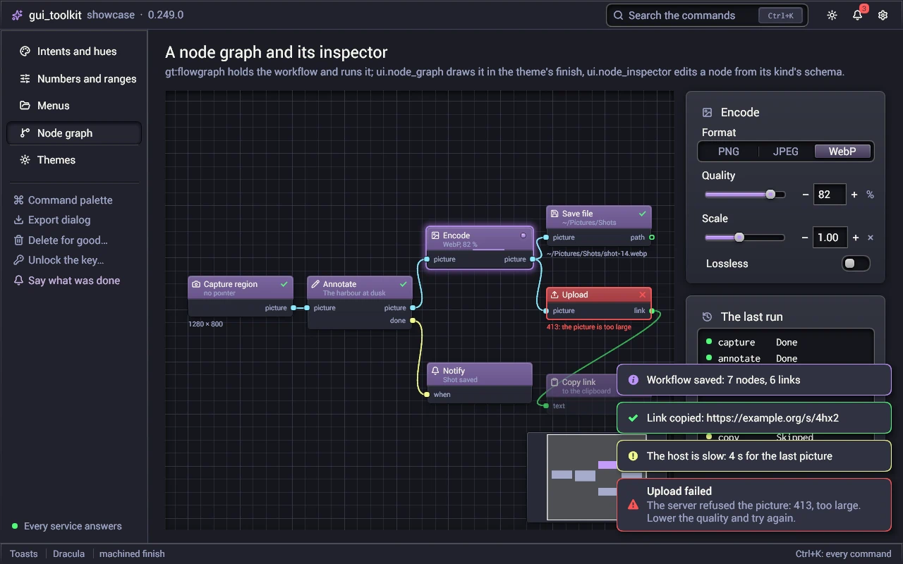

# System notifications

`src/platform/notify.odin`: a program shows a desktop notification with no icon in the notification area. Linux uses
`org.freedesktop.Notifications` on the session bus (`notify_linux.odin`); Windows uses toast notifications through the
Windows Runtime (`notify_windows.odin`, with the [winrt](winrt.md) package). On other systems `notify_supported` is
false. `tray_notify` ([tray.md](tray.md)) shows a notification from a tray icon; on Linux it uses the same code.

```odin
platform.notify_set_app({name = "Chat", aumid = "Example.Chat", icon_path = icon})   // once, before the first window

id, ok := platform.notify(w, {
	title   = "Ada",
	body    = "Lunch at noon?",
	actions = {{1, "Reply"}, {2, "Mute"}},
})

for e in platform.poll_events(w, true) {
	#partial switch e.kind {
	case .Notification_Click:  platform.raise_window(w); open_conversation(e.notification.id)
	case .Notification_Action: if e.notification.action == 2 { mute() }
	case .Notification_Closed: forget(e.notification.id)
	}
}
```

## API

| | |
|---|---|
| `notify_set_app(Notify_App)` | the program's name, its Windows AppUserModelID and its icon file; once, at start, before the first window |
| `notify_supported() -> bool` | Linux: a notification server answers on the session bus. Windows: Windows 10 or later, with toasts |
| `notify(w, Notification) -> (Notification_Id, bool)` | shows a notification; its results come as events of `w` |
| `notify_async(w, Notification, done, user) -> bool` | the same without waiting: the call goes out at once, `done(user, id, ok)` runs from the window loop when the system answers (Linux: the D-Bus reply; Windows: at once). What the interface's thread calls |
| `notification_clone`, `notification_destroy` | a notification that owns its text, kept until it is sent |
| `notify_close(w, id)` | takes it away; `Notification_Closed` (reason `Closed`) follows |
| `notify_activation_token(w) -> string` | Linux: the xdg-activation token of the last click on a notification of `w`, for 10 s |

`Notification`:

| field | |
|---|---|
| `title`, `body` | plain text; the body is escaped where the system reads markup |
| `icon_png` | a PNG file's bytes shown with the text; `nil`: the program's icon |
| `urgency` | `Normal`, `Low`, `Critical` |
| `actions` | buttons: `{id, label}`; the id comes back in `Event.notification.action` |
| `replace` | an earlier notification of the window that this one updates in place (`0`: a new one) |
| `silent` | no sound |

The events carry `Event.notification` (`id`, `action`, `reason`):

| kind | |
|---|---|
| `Notification_Click` | a click on the body |
| `Notification_Action` | a button: `action` is its id |
| `Notification_Closed` | the notification is gone: `reason` is `Expired`, `Dismissed`, `Closed`, `Failed` or `Unknown`; no event of it comes after |

A click does not raise the window: the program calls `raise_window` when it wants that. On Wayland, `raise_window` then
uses the server's activation token, so the compositor gives the window the focus.

## Linux

- `notify` asks for the server's capabilities once per session bus (`GetCapabilities`). Then it calls `Notify`:
  - `app_name`: `Notify_App.name`, else the app id (`set_app_id`), else the executable's name. `app_icon`: `icon_path` as a `file://` URI.
  - `actions`: `"default"` (a click on the body) and the buttons (their keys are their ids in decimal), only when the
    server has the `actions` capability.
  - hints: `desktop-entry` (the app id: the server groups the notifications by the `.desktop` file and focuses the
    program), `urgency` (0, 1, 2), `suppress-sound`, `image-data` (the PNG decoded to RGBA rows).
  - `expire_timeout`: -1, the server's default. A server does not expire a `Critical` notification.
- The body is escaped (`&`, `<`, `>`) when the server has `body-markup`. The summary is plain text for every server.
- The window listens to `ActionInvoked`, `NotificationClosed` and `ActivationToken` from its first notification. A signal
  about an id that the window did not show is ignored. The server's close reasons 1, 2, 3 are `Expired`, `Dismissed`, `Closed`.
- An offscreen window (`open_window_offscreen`) can show notifications: its wait watches the session bus.
- `notify_dbus_body` builds the arguments; it is pure and runs on every system.

## Windows

- Toasts need Windows 10 (build 10240) or later. On an older Windows, `notify_supported` is false and `notify` fails.
  There is no fallback to a tray balloon.
- A program that is not packaged shows toasts under an AppUserModelID registered for the user. At a window's first
  notification, `notify` writes `HKCU\Software\Classes\AppUserModelId\<id>` with `DisplayName` (`Notify_App.name`, else
  the executable's name) and `IconUri` (`icon_path`). The id is `Notify_App.aumid`, else the process's explicit
  AppUserModelID (`desktop.set_process_identity` sets one), else the executable's name.
- `notify_set_app` with an `aumid` sets the process's AppUserModelID when the process has none. The taskbar groups the
  windows by it: call it before the first window.
- The toast is the `ToastGeneric` template (`toast_xml`): the title and the body as two texts, the icon as the app logo,
  at most 5 buttons, `<audio silent="true"/>` for `silent`, `duration="long"` for `Critical`. `Low` goes to the
  notification centre with no popup (`SuppressPopup`).
- An icon is written to `%TEMP%\gt_notify\<hash>.png`: a toast reads its picture from a file. The files stay there for
  the notification centre.
- The toast's `Tag` is the id and its `Group` is `"gt"`: a toast with the same tag replaces the earlier one.
- The toast's `Activated`, `Dismissed` and `Failed` events come on a thread of the system. Their handlers queue what
  happened and post a message to the window; the window procedure makes the events on the window's thread.
- A click or a button ends the notification: its event, then `Notification_Closed` (`Dismissed`). A toast that left the
  screen by itself (`TimedOut`) stays in the notification centre, where a click still comes: no event for it.
- A click after the program has ended starts nothing: the toolkit registers no COM activator.
- The window needs its HWND: an offscreen window shows no toasts.
- Windows gives no activation token: `notify_activation_token` is `""`.

## Saying what was done: ui.announce



A program says what it just did (copied, saved, deleted) with `ui.announce(&announcer, kind, title, body)`: a
notification of the system (`notify_async`: nothing waits on the interface's thread; the next one replaces the last), a
toast of the window where the system shows none, or where the person chose it. `Announcer.mode` comes from
prefs_page's standard preference `general.messages` (`prefs_page.announce_mode`): System, Window or Off. A failure
(kind .Bad) is said even with Off.

```odin
app.announcer = {mode = prefs_page.announce_mode(&app.prefs), window = app.anchor}
ui.announce(&app.announcer, .Good, "Copied to the clipboard")
ui.announce(&app.announcer, .Good, "Saved", path)
ui.announce(&app.announcer, .Info, "Version 2 is ready", "Click to install it", action = install, user = app)
```

`announce` is the one call a program says something with: a toast of the window is always announce's.
A toast with a `body` has its title in bold on its line and the body under it. A message with an `action` (an update to
install, a report to open) is a toast of the window whatever the mode, since a notification of the system does not call
back here: a click on it does `action(user)` and dismisses it.

## Limits

- No timeout of the program's own: the system decides how long a notification stays.
- The registry key of the AppUserModelID stays after the program is removed.
- A large icon goes to the server as it is (Linux `image-data`): give a small one (64 or 128 pixels).

## Tests

`tests/notify` (every system): the `Notify` arguments read back as a server reads them, the escaping, the image, the
toast's XML, the arguments of a toast's activation. On Linux it also starts a `dbus-daemon` of its own, with no service
directory (no real notification server can start on it), and a fake `org.freedesktop.Notifications` on a thread. It
checks the recorded `Notify` calls and the events that offscreen windows receive for `ActionInvoked`,
`NotificationClosed` and `ActivationToken`. `src/winrt`'s tests check the IDs of the toasts' event handlers.
