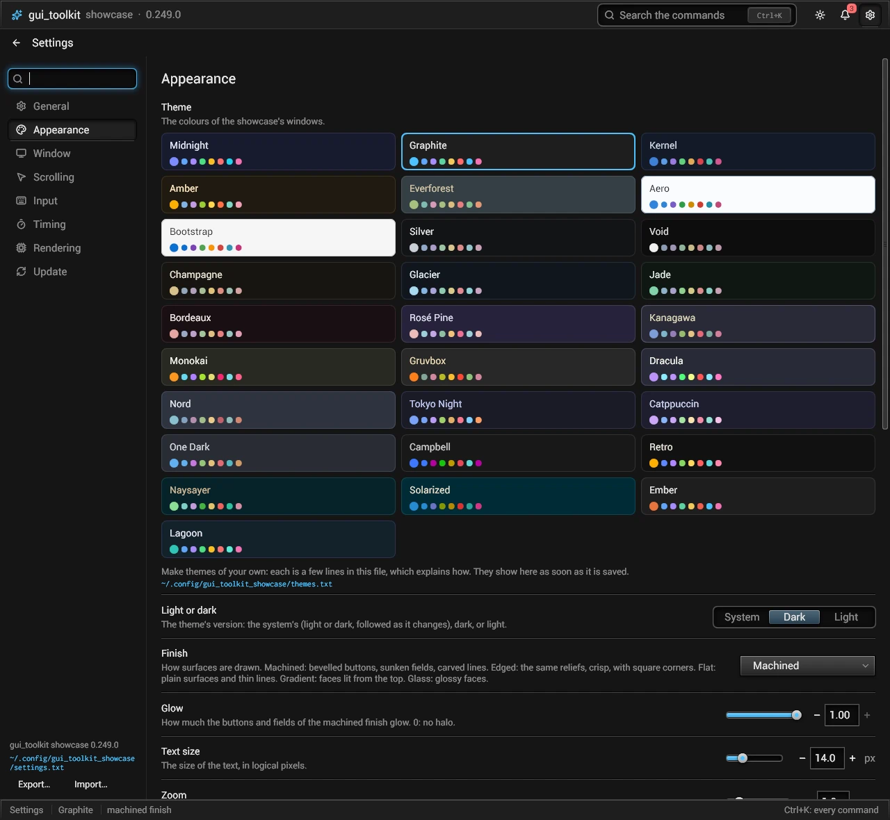
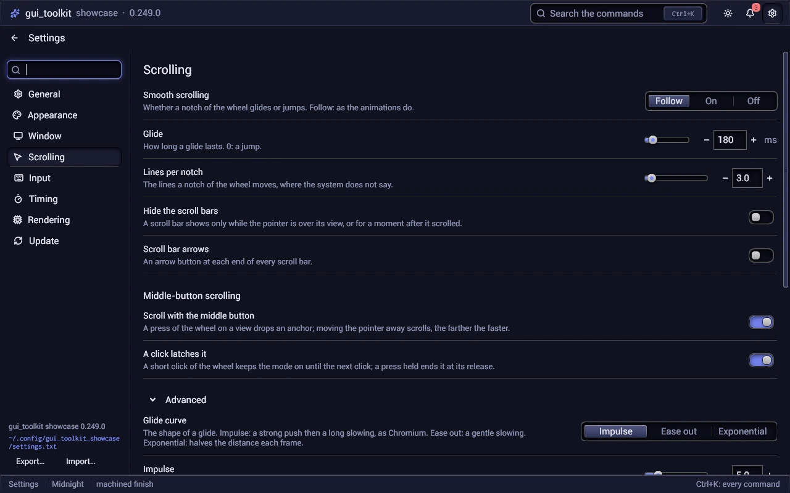
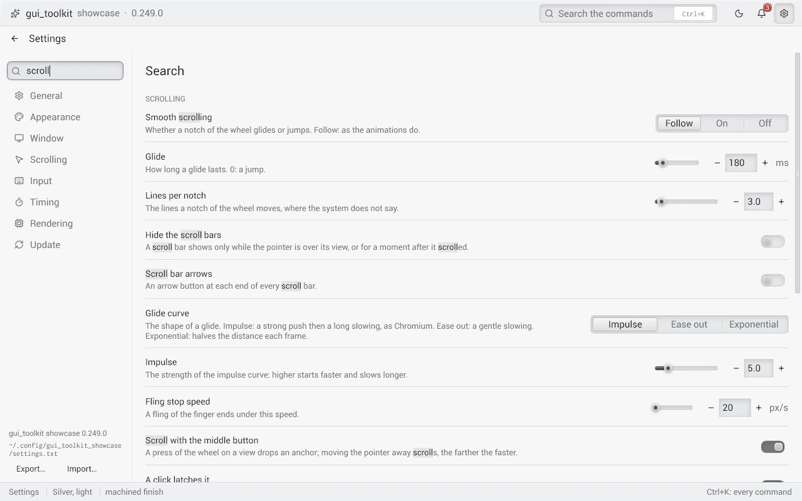

# prefs_page: a settings page from the preferences

`import prefs_page "gt:prefs_page"` (the package is named `tk_prefs_page`). It builds a program's settings from its
preference registry ([config.md](config.md)), with no code per preference, in the look of opencode native's settings.

```odin
page: prefs_page.Page                         // kept between frames; prefs_page.destroy(&page) at the end

ui.next({width = ui.fill(), height = ui.fill()})
prefs_page.build(&page, &prefs, {
	user    = app,
	pages   = {{category = "appearance", title = "Appearance", icon = ICO_PALETTE}, {category = "history", title = "History", icon = ICO_HISTORY}},
	icon_font = app.icons, search_icon = ICO_SEARCH, reset_icon = ICO_RESET,
	file = app.prefs_path,                         // at the sidebar's foot: a click opens it
	changed = proc(user: rawptr, name: string) {   // a value was set or reset
		app := (^App)(user)
		// the loop saves: config.user_writer_save, once per round
		apply(app)
	},
	themes = app.themes_file.all[:], themes_light = app.theme_shown.light,   // appearance.theme as cards
	themes_file = &app.themes_file,                // and the user's own themes under them
	custom_names = {"look.font"},
	custom  = proc(user: rawptr, name: string, em: f32) {   // the program's own control, under the words
		/* a font picker */
	},
})
```



## The standard settings

Every program has the same look, the same text, the same hand and the same place on the desktop: the toolkit declares
each of its settings that changes how a program looks or answers as a standard preference, with today's default, and
every program inherits them. `standard_register` registers the sets asked, with their titles, descriptions, choices,
bounds, search tags and the titles of their groups; the page then draws them with no code of the program's.
[settings.md](settings.md) lists every one with its default.

```odin
d := prefs_page.STANDARD_DEFAULTS   // system, machined, 14 px, glow 1, in the menu, updates on
d.theme, d.app_name = "cliche", "cliche"
prefs_page.standard_register(&prefs, prefs_page.STANDARD_ALL, d)
config.register(&prefs, PREF_DEFS[:])   // the program's own, after them

// applied now, then each one again when it changes (config.watch): nothing per frame
prefs_page.standard_watch(&app.standard, &prefs, &app.state, {renderer = &app.r, fonts = &app.fonts, partial_redraw = &app.host.partial_redraw})
defer prefs_page.standard_unwatch(&app.standard)

a := prefs_page.appearance_read(&prefs)   // the theme: the program shows it; again after each change
defer prefs_page.appearance_destroy(&a)
ui.theme_show(&theme, themes, prefs_page.appearance_choice(a), &shown, space)
```

| Set | Group (page) | What |
|---|---|---|
| `Appearance` | `appearance`, `window` | theme, light or dark, finish, glow, text size, zoom, density, rounding, smooth corners, animations; the system's title bar, where messages show |
| `Text` | `appearance.text` (in Appearance) | the interface, monospace and reading fonts, the emoji font, the system's fonts as a last resort, colour emoji, subpixel text, gamma, contrast, weight; advanced: the blending curve and space, subpixel positions, grid fitting, the renderer (Windows), Slug's tolerance, the atlas's and Slug's pages, the words kept |
| `Scrolling` | `scrolling`, `scrolling.autoscroll` | smooth scrolling, the glide's length, lines per notch, hidden bars, arrows; scrolling with the middle button; advanced: the curve, the impulse, the fling, the middle button's distances and speeds |
| `Input` | `input` | key and button repeats, undo steps and merge, type to find, the zoom step; advanced: the steps of Shift, Ctrl, Alt and Page |
| `Timing` | `timing` | the tooltip delay, the submenu delay, a menu item's height, the colour fade |
| `Rendering` | `rendering` | all advanced: presentation (vsync, tearing), frames queued, partial redraw, the blur limit, the filters' precision |
| `Update` | `update` | `update.auto`, `update.channel` (only with `Standard_Defaults.update_channels`: a choice of them), `update.base_url` (advanced); `update_source` reads the last two for the Updater |
| `Session` | `general` | `general.menu` (in the application menu), `general.autostart` (with the session), `general.messages` (System, Window, Off; read by `announce_mode` for ui.announce), `general.language` (`system`; at once, `language_start`) |

`STANDARD_ALL` is every set. Start from `STANDARD_DEFAULTS`: a zero `Standard_Defaults` has `menu` and `update_auto` off.
`Standard_Defaults.values` gives any other standard setting the program's own default, as the file writes it
(`{{"appearance.rounding", "0.25"}, {"rendering.partial_redraw", "true"}}`): registered as the default, a reset comes back
to the program's look.
`app_name` goes in the descriptions ("Start cliche with the session"); those texts are made in the `allocator` argument
and must live as long as the registry. The names are fixed: the programs' files hold them. The groups come in this
order among a program's own (theirs have the order 0): General, Appearance and Window before them, the others after.

### Applying them

`standard_apply(prefs, state, targets)` gives every standard preference that is registered, at its default too (a program's own default is its
`Standard_Defaults.values`), to
the toolkit's setters: `ui.set_feel` (repeats, undo, typeahead, steps, zoom step, tooltips, menus, the fade, the
wheel's lines, the fling), `set_zoom`, `set_density`, `set_rounding`, `set_animations`, `set_smooth_scroll`,
`set_scroll_settings`, `set_autoscroll_enabled`, `set_autoscroll_settings`, `set_scrollbar_autohide`,
`set_scrollbar_arrows`, `set_toast_position`, `set_partial_redraw`. `Standard_Targets` gives what lies outside the
interface (each nil: left alone): `renderer` (`set_corner_smoothing`, `set_text_rendering`, `set_blend_space`,
`set_present_mode`, `set_max_frame_latency`, `set_blur_sigma_limit`, `set_filter_precision`), `fonts`
(`font.set_settings`) and `partial_redraw` (a host's flag, `host.Host.partial_redraw`, which the host gives the
interface at each frame; nil: `ui.set_partial_redraw`). A preference at its default is left alone, so what a program set
itself stays until the user changes it.

`standard_watch(w, prefs, state, targets)` applies them, then watches the registry (`config.watch`): a change of one
applies that one alone, at once, on the thread that changed it. A zoom by Ctrl+wheel is not undone by a change of the
density. `standard_unwatch(w)` ends it; keep `w` where it is until then.

What the program applies itself:

- the theme (`appearance.theme`, `mode`, `finish`, `glow`, `font_size`): `appearance_read`, `appearance_choice`,
  `ui.theme_show`. After a change of `appearance.text.blend_space`, show the theme again with `render.blend_space(r)`;
- the fonts by name (`appearance.text.ui_font`, `mono_font`, `prose_font`, `emoji_font`), `appearance.text.page_size`,
  `window.system_title` and `update.base_url`: read at the start (`Def.restart`: "Takes effect at the next start");
- `update.channel`: at once, by `update.set_channel` on the program's Updater ([update.md](update.md), "Channels");
- `general.language`: `language_start(prefs, catalogues)` at the start, which then switches the language at once at each
  change of it ([i18n.md](i18n.md), "Changing the language");
- `general.menu` and `general.autostart`, on a worker with `desktop.apply` ([desktop.md](desktop.md)); `update.auto` by
  its Updater.

`appearance_read` reads a preference that is not registered as its standard default.

## What it shows

| A page, its group and its Advanced part | A search |
|---|---|
|  |  |

- On the left, the sidebar: the search in a well, then the pages, each a button with its icon and its title; the page
  shown is pressed in. A page is a top group of the registry (the first segment of the name). `Page_Options.pages` gives
  their order, titles and icons (a page with no preference in the registry is not shown); without it, each top group
  shows, by `config.groups_of`, with its `config.group_title`. At its foot: `Page_Options.version` ("Papier 0.15.0"), the
  settings file (`Page_Options.file`, shortened with `~`: a click opens it with the system's program, `ui.open`), then
  **Export…** and **Import…** (below) and what the last of them did.
- A page of the program's own: a `Page_Info` with `build` has no preference; the page shows its title and calls
  `build(user, em)` under it (a server's state, a list the program keeps). A search does not look in it. `heading`
  puts a small title above a page, which starts a group ("CLIENT", "SERVER"): one sidebar for the settings and the
  program's pages, not two.
- The sidebar's handle (`ui.splitter`) resizes it with the mouse; a double click puts 14 ems back. Its width is kept in
  the hidden preference `prefs_page.sidebar_width` (`SIDEBAR_PREF`, in ems; the page registers it at its first build),
  written when the handle is let go. It stays between 9 ems and half of the page. It is never narrower than its longest
  page title or heading on one line, in the language in use (`ui.button_width`): the handle does not go under that; at
  half of the page, a longer title wraps onto two lines. A page narrower than 40 ems shows the pages' icons alone.
- On the right: the page's title, then a line per preference, in the order the program registered them: its title
  (`config.title_of`) and its description (with "Locked by a policy", "Set on the command line for this run" or "Takes
  effect at the next start" when it applies) on the left, its control on the right, a reset button while the user's
  value differs from the default, a carved line under it.
- The preferences of an inner group (`appearance.text` in Appearance) follow those of the page's own group, under the
  group's title (`config.group_title`). The advanced ones (`Def.advanced`) of the page come last, under **Advanced**,
  folded until a click (`ui.accordion`; the page keeps it open while it lives).
- While a search is typed (title, name, description, tags or a group's title: `config.matches`): what matches in every
  page, the advanced ones too, under each page's title.
- Nothing goes past the window or is cut: the descriptions wrap; a control that would leave its words less than 12 ems
  goes under them, as wide as the line; the page scrolls.

The controls:

| Preference | Control |
|---|---|
| `Bool` | a switch |
| `String` with up to 4 choices (its own `choices`, or the program's `Page_Options.choices`) | a segmented choice; under the words when it takes more than 45 % of the line |
| `String` with more choices | a list |
| `String` with no choices | a field |
| `Int`, `Float` bounded | a number (`ui.number` with its slider: − and +, a field for its exact value, its unit after it); a float's step is round (0.1, 1, 10...) |
| other numbers, sizes in bytes | a field, its unit after it |
| a name in `Page_Options.custom_names` | the program's own (`Page_Options.custom`), under the words |
| a name in `Page_Options.hotkeys` (a key combination as text) | a field that records the keys pressed (`ui.hotkey_field`): a click, then the keys |
| a `pref` of `Page_Options.shortcut_prefs` | the same field, and what the system made of the keys under it (see below) |
| `appearance.theme`, with `Page_Options.themes` | the themes' cards, under the words |

A locked preference (a policy, the command line) shows its control disabled. `Page_Options.problem(user, name)` gives what
the program has to say under a line (a shortcut another program holds): it shows in red. `Page_Options.status(user, name)` says a
preference's state plainly, under its line, in the weak text (the keys a shortcut got). `Page_Options.page_foot(user,
category, em)` draws the program's own content under a page's preferences (not in a search): buttons, a list.

Each line whose value is the user's and differs from its default shows the reset button, whatever its control:
`differs_from_default(prefs, name, keys)` says when (`keys`: compared as key combinations, so "ctrl+print" is
"Ctrl+Print"). A value the user set equal to the default shows none. While one line of the page shown has it, a
**Restore defaults** button beside the page's title puts all of them back (each through `Page_Options.changed`, as its own
reset button does).

## Global shortcuts

A program with global shortcuts ([shortcuts.md](shortcuts.md)) gives its service in `Page_Options.shortcuts` and, in
`Page_Options.shortcut_prefs`, each preference that holds a shortcut's keys with the shortcut's id in the service:

```odin
SHORTCUTS := [?]prefs_page.Shortcut_Pref{{pref = "shortcut.region", id = "region"}, {pref = "shortcut.screen", id = "screen"}}
opts.shortcuts, opts.shortcut_prefs = app.shortcuts, SHORTCUTS[:]
```

Each line records keys. Under it, in the weak text, `shortcuts.status_text` ("Works in every program: Ctrl+Print.", "The
system gave other keys…", "Waiting for the system's answer…"); in red, `shortcuts.problem_text` ("Another program holds
Ctrl+Print: choose other keys.", "The system refused this shortcut.", keys that do not parse). While a field records
keys, the page holds the service (`shortcuts.hold`): Windows would take the very keys being recorded. The program's
`status` and `problem` run for its other preferences.

## Themes from the program

With `Page_Options.themes` (the program's list: its own theme, then `ui.THEMES`), `appearance.theme` shows as the themes'
cards and a click sets it. The cards show the version `appearance.mode` asks; for `system`, the one the program shows
now (`Page_Options.themes_light`: its `ui.Theme_Shown.light`; the page does not ask the system each frame).

A program that updates itself (`update.Updater`, `docs/update.md`) gives it in `Page_Options.updater`, and in `update_pref` the
preference whose line shows it ("": the standard `update.auto`). Under that line: the state in words (`update.status_words`:
up to date, a version available, downloading, installed, the last check's failure, or that a package manager updates this
copy), a **Check now** button, **Install <version>** when one is on offer, and **Restart now** when one is installed and the
program gives `Page_Options.restart`.

## Changes

A value goes through `config.set_from_string` at the `User` layer: every observer of the registry runs. A field applies
its text on Enter or when it loses the keyboard; a refused value stays as it was, and the reason shows under the line
("out of range: 1 to 64 KB"). A number applies a key, a click, a notch of the wheel, a button or what is typed at once;
a drag of its slider when it is let go. While the slider is held, `Page_Options.preview(user, name, value)` gets each value
it moves to, for the program to show at once (a rounding, a size) without writing it. `Page_Options.changed` runs after each
value set or reset: apply the change from there (or let `standard_watch` do it); the loop's `config.user_writer_save`
writes the file off the loop.

## Export and import

**Export…** asks for a file (the system's dialog, `ui.file_dialog`), then writes the user's settings (what differs from
the defaults) in the format of its extension: JSON (as the `settings.json` of Zed or VS Code), TOML, INI, or the
program's own (`.txt`: `config.export` with `.Own`). The text is made on the interface's thread, a task writes it. **Import…**
reads a file of the program's own format (a task reads it, `config.load_text` sets its values as the user's): settings
carried from another machine. `Page_Options.changed` hears of each value that changed; the loop's writer saves them. JSON,
TOML and INI are written only.

```odin
prefs_page.export_to(&page, path, prefs_page.export_format_of(path))   // what the dialog's answer does
prefs_page.import_from(&page, path)
text := config.export(&prefs, .Toml)
```

`export_format_of(path, chosen = .Json)` is the format of a file's extension (`config.Export_Format`: `Json`, `Toml`, `Ini`,
`Own`), else `chosen`. The page must have been built once: its tasks answer to the state it is built in. What came of
it shows at the sidebar's foot.

## Themes of the user's own

Every program can let the user make themes: a file beside the preferences, `[Name]` sections of colours
([themes.md](themes.md), "A user's themes"). `Themes_File` keeps it, and `Page_Options.themes_file` shows it under the
themes' cards: a line that says themes can be made, then the file's path as a link. A click makes the file from
`THEMES_TEMPLATE` when it is not there (comment lines: the keys, the colour format, `from = ...`, the light versions, a
commented example; nothing changes until a line is written) and opens it in the system's editor, on a task. It is read
again when it changes.

```odin
prefs_page.themes_file_init(&app.themes_file, themes_path, app_themes[:])   // the program's themes: first, and what `from` names
defer prefs_page.themes_file_destroy(&app.themes_file)

// each build: a task looks at the file at most every THEMES_FILE_POLL_MS (2 s), and reads it when it changed
if prefs_page.themes_file_poll(&app.themes_file, &app.state) { show_theme_again(app) }
opts.themes, opts.themes_file = app.themes_file.all[:], &app.themes_file
```

- `all` holds the program's themes, then the user's; a theme of the user's with the name of one of the program's takes
  its place. `serial` counts the reloads.
- `themes_file_poll(tf, state) -> bool` is true on the build the new themes came in. It looks only while builds happen:
  a window at rest is not woken for it, its next build looks.
- `themes_file_open(tf, state)` makes and opens the file (the link's click); a file that could not be written says so
  under the link (`tf.error`).
- `themes_file_write_template(path) -> bool` writes the template, and its folder, when there is no file; a file there is never
  touched. It touches the disk: a task's.

Keep the `Themes_File` as long as the `ui.State` its tasks answer to.

## Themes as cards

`theme_cards(list, current, light, em)` draws the themes of `list` three to a row, each in its own colours (its version
`light`): its surface, its name in its text, its hues as dots, a ring of its accent around the one named `current`. It
returns the index of the one clicked, or -1.

## The settings in place of the main view

A program with one window shows its settings in place of its main view (papier: in place of the history):

```odin
// the state: settings_open: bool, page: prefs_page.Page
open_settings :: proc(app: ^App) {   // the gear button, Ctrl+,
	app.settings_open = true
	prefs_page.focus_search(&app.page)
}

// in the build
if app.settings_open {
	o := settings_options(app)
	if !dialog_open && prefs_page.escape_leaves(&app.page) { app.settings_open = false }
	if prefs_page.back_bar(&app.page, o, "Settings", "Back to the history (Escape)", em) { app.settings_open = false }
	ui.next({width = ui.fill(), height = ui.fill()})
	prefs_page.build(&app.page, &app.prefs, o)
} else {
	build_main_view(app)
}
```

`back_bar(page, o, title, back_tip, em)` is a bar as wide as its parent: a back arrow (Lucide's `arrow-left` in
`Page_Options.icon_font`, else the word "Back") whose tooltip is `back_tip`, then the title. It returns true when the arrow
was pressed. `escape_leaves(page)` is true when Escape was pressed and no editor of a preference has the keyboard: that
Escape gives up the editor first.

## The installation

Every program installs itself the same way: one `Install` object holds the setup's `Dialog` ([setup.md](setup.md)), offers
the install at a start, keeps the user's answer in the settings, and shows the **Installation** page at the end of the
sidebar. The program declares what it is, as data: a `setup.Setup_Options` (its `desktop.Identity`, its version, its install
folder, its icons, its own options and `prepare` for its parts: the PATH, the start with the session).

```odin
prefs_page.install_init(&app.install, &app.prefs, setup_options())   // its settings loaded (registers install.choice)
prefs_page.install_offer(&app.install, &app.main.state, offer = !app.demo)   // its window open: read on a task
// each frame
if prefs_page.install_frame(&app.install, em) == .Launched { quit() }   // the modal while open, the work that ended
opts.install = &app.install                                          // the settings: the Installation page
// --setup
prefs_page.install_open(&app.install)
// at the end, before the window's State goes; then last, the single instance released
prefs_page.install_end(&app.install)
prefs_page.install_launch(&app.install)
```

- `install_offer(in, state, offer)` reads the install on a task; the installed copy deletes what an update left (`.old` files).
  When `offer` and `setup.wanted` say so (no install, one to repair, an older one to upgrade) and the user did not answer
  for this version, the setup's modal opens. `Install.known` and `running_it` say what the reading found (an updater wants
  to know which copy runs).
- `install_frame(in, em) -> setup.Event` draws the modal while it is open (`Install.logo` is its mark) and collects the work:
  the answer goes to `install.choice` (`INSTALL_CHOICE_PREF`, hidden: `installed`, `standalone`, `dismissed:<version>`;
  a page left answers nothing). It returns what happened: `Launched`, the program ends and `install_launch` starts the
  installed copy; `Installed` and `Uninstalled`, a program that applies its own desktop settings (`general.menu`) does
  it again.
- `install_end(in)` before the window's State goes: what an uninstall left is deleted once the process ends, the dialog's
  thread is waited for. `install_launch(in)` last, once the program's single instance is released: the installed copy
  asked for starts (started earlier, it would find this copy running and hand itself over to it).
- `install_open(in)` shows the modal (`--setup`, Settings > Apps' Uninstall). `install_open_now(in)`: the modal is open,
  a program leaves the keyboard to it.
- The page (`Page_Options.install`, category `INSTALL_PAGE`) is `setup.page`: while the modal is open it waits.

The command line is `setup.command_of` and `setup.command_run` (`--install`, `--uninstall`, `--setup`).

## Diagnostics

`Page_Options.diagnostics` (the `host.Host` of the window the settings are in) adds a **Diagnostics** page after the
installation: what a person on a slow machine copies and sends. One line each: the program (`Page_Options.version`), the
toolkit (`ui.VERSION`), the system (`core:sys/info`, read once on a task), the graphics adapter and API
(`render.adapter_info`, with a warning above the lines when it is a software rasterizer), the window's size in pixels and
its scale, the last frames' total, build and draw times (median and 95th percentile: `host.frame_stats`, kept in every
build), and partial redraw with the share of the pixels it drew. The lines are made again once a second while the page is
shown (`DIAGNOSTICS_REFRESH_MS`); **Copy** puts them on the clipboard as `key: value` lines (`diagnostics_text`).

## The toolkit's pages in the palette

A page of its own (`Page_Info.build`) with `Page_Info.tags` is a line of `palette_commands`: its title, the group
"Settings", its icon and its tags; its name is the page's category, and `show(page, prefs, o, category)` puts that page up,
the search cleared. The Installation and Diagnostics pages have theirs ("install", "uninstall", "path"; "gpu",
"performance", "slow"). `Page_Info.user` is what `build` is given (nil: `Page_Options.user`).

## Keyboard

Tab goes through the search, the pages and the controls. `focus_search(&page)` gives the search the keyboard at the
next build (a program opens the page with it). `editing(&page)` says whether a field (a number's too) has the keyboard: a program that
closes the page on Escape leaves that Escape to the field.

## The settings in the command palette

`palette_commands(prefs, o)` gives one `ui.Command` per preference the pages show (a hidden one is not): its label
is the title the page gives it, its group `Settings · <page>`, its icon the page's (else Lucide's sliders), its tags the
preference's (`config.Def.tags`: other words the settings' search and the palette find it by, "colours" and "dark" for a
theme). A program puts
them after its own commands in `ui.palette`; when one is chosen, it opens its settings and calls `show(page, prefs,
options, name)`: the page's search holds the preference's name in quotes, so it shows alone with its control, and the
page under the search is its own (clearing the search lands there).

The program makes this table when the settings change, not at each frame: a frame then walks no preference, and the
palette ranks again only when the table's version changes (docs/commands.md). Its labels and groups are in the language in
use: a change of `general.language` is a change of the settings (their version moves after the language switched), so the
table below follows it; a program that switches the language otherwise makes it again when `i18n.version()` moves.

```odin
// when the settings change (app.prefs.version): the table in memory of its own
if app.table_version != app.prefs.version + 1 {
    virtual.arena_free_all(&app.table_arena)
    a := virtual.arena_allocator(&app.table_arena)
    settings, names := prefs_page.palette_commands(&app.prefs, opts, a)
    app.table = slice.concatenate([][]ui.Command{app_commands, settings}, a)
    app.setting_names = names
    app.table_version = app.prefs.version + 1
}
if i, _ := ui.palette(&app.palette, app.table, disabled, {version = app.table_version}); i >= len(app_commands) {
    app.settings_open = true
    prefs_page.show(&app.page, &app.prefs, opts, app.setting_names[i - len(app_commands)])
}
```

## The update in the status bar

`update_badge(updater, restart, user)` is a button for a program's status bar: "Install 0.16.0" when a version is on
offer, "Downloading 0.16.0…" while it comes, "Restart to update to 0.16.0" once it is in place (`restart(user)`: the
program starts again). It builds nothing when there is nothing to do, and returns whether it built something.
