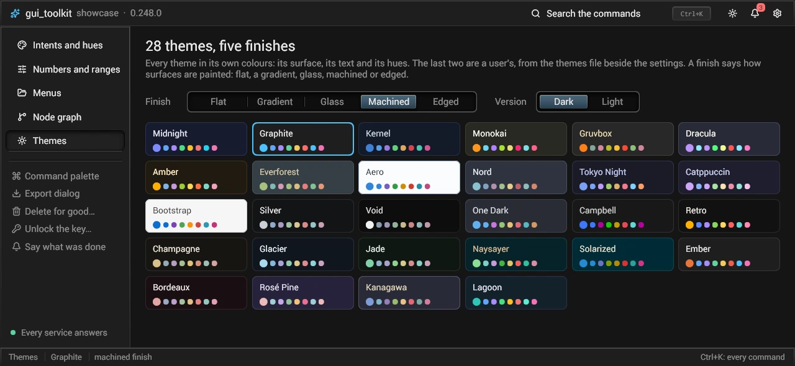
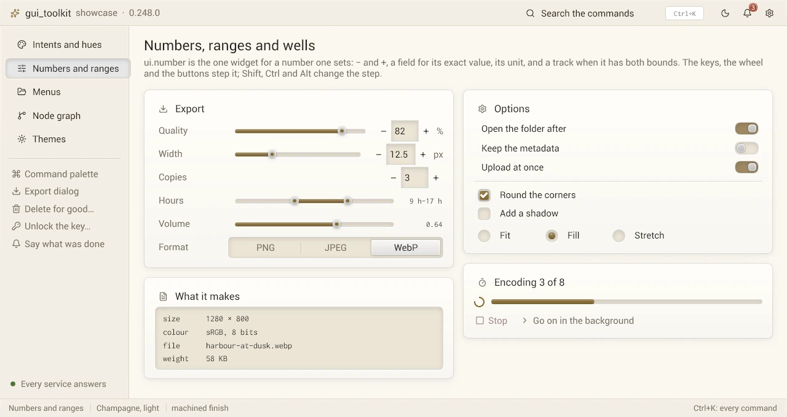
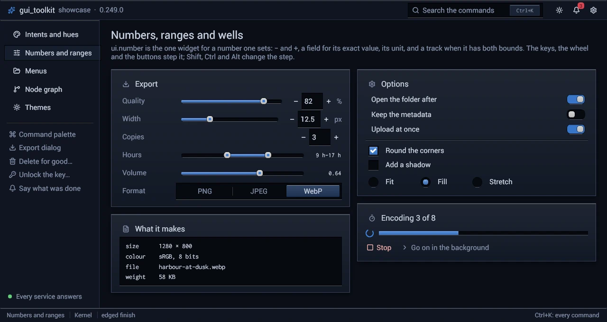
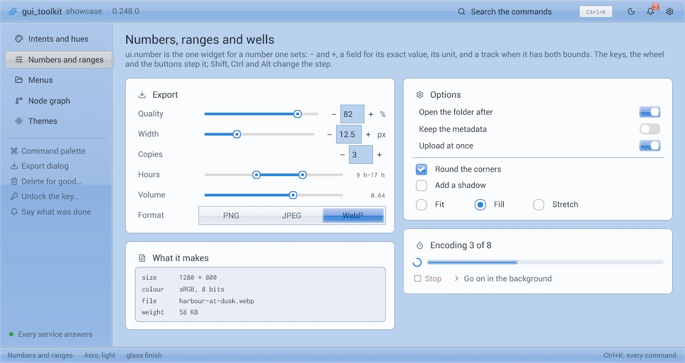
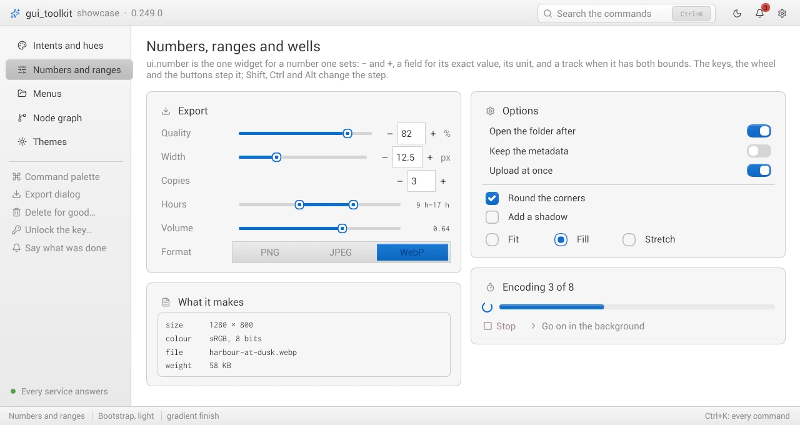

# Themes and finishes

A program shows one version (dark or light) of one theme, with one finish. The theme gives the colours, the finish how
surfaces are painted. `ui.theme_show` applies the three and follows the system when it goes light or dark.

```odin
choice := ui.Theme_Choice{name = "Nord", mode = .System, finish = .Machined, glow = 1}
if ui.theme_show(&app.theme, ui.THEMES[:], choice, &app.shown, render.blend_space(&app.r)) {
	platform.set_dark_title(app.win, !app.shown.light)   // the system's title bar, as the version shown
}
```

The last argument is the blend space of the renderer that draws with the theme, as `apply_palette` takes it: the
translucent entries (hover, selection) get the alpha that looks right in that space.

Call `theme_show` once per frame. It applies again when one of these changes:

- the choice: the name, the mode, the finish, the glow;
- the definition of the theme shown: its colours, its versions, its own finish (a themes file read again with the same names);
- the blend space;
- in the `System` mode, `platform.color_scheme_serial`.

Otherwise it costs a lookup in the list and one hash. Each change of the look bumps `Theme.serial`: the colours
cross-fade, the glow jumps.

## A theme

`ui.Theme_Def` is a name and the colours of its versions. A version (`ui.Theme_Colors`) holds:

| Part | Colours, in order |
|---|---|
| `steps` | well (fields, code), bg0 (the page), bg1 (bars), bg2 (panels, cards), bg3 (raised: buttons), line |
| `texts` | faint, weak, text, bright |
| `hues` | accent, blue, purple, green, yellow, red, cyan, rose |

`versions` says which versions a theme has: `Both`, `Dark_Only` or `Light_Only`. A theme can impose its finish
(`finish`: Aero is `Glass`, Bootstrap `Gradient`), let the page show the system's backdrop (`translucent`), and name the
text on its accent (`accent_text`; 0 picks the darkest step or the brightest text, whichever reads better on it).



`ui.THEMES` lists the toolkit's themes; the first is the default. A program puts its own first and appends
`ui.THEMES[:]`, or shows only its own.

| Procedure | What it does |
|---|---|
| `theme_find(list, name)` | the theme of this name (ASCII case ignored), and its index |
| `theme_version(t, light)` | the colours shown: the light version when asked and present, else the one there is |
| `theme_palette(t, light, finish)` | the `Palette` of the built-in widgets for that version |
| `theme_palettes(list, finish)` | every version of every theme as `Named_Palette` ("Nord", "Nord Light"): pickers, tests |
| `palette_of(name, light)` | a palette of `THEMES` by name: examples and tests |
| `theme_wants_light(mode)` | whether a mode shows the light version now (`System`: `platform.dark_mode_preferred`) |
| `theme_mode_of(name)`, `THEME_MODE_NAMES` | the modes by name: "system", "dark", "light" |
| `finish_of(name)`, `FINISH_NAMES` | the finishes by name: "flat", "gradient", "glass", "machined", "edged" |

The palette takes, from a version: `bg` = bg0, `bar` = bg1, `panel` = bg2, `panel2` = bg3, `border` = line,
`well` = well, `weak` and `text`, `accent`, `good` = green, `warn` = yellow, `bad` = red.

## A program's own colours in any theme

A program that draws with its own colours chooses them in one theme, its reference. `theme_recolor(&ref, shown, c)` moves
a colour `c` of the reference to the theme shown. A grey goes to the same place on the shown theme's greys. A colour goes
to the shown theme's hue nearest to it, mixed with the shown theme's grey as much as it was with the reference's. The
alpha stays. `theme_reference(colors)` makes the reference from its colours; a program can set `levels` itself when its
greys stand elsewhere. Cache the results: a program asks for the same few colours every frame.

## A user's themes

`themes_read(text, catalog, base)` reads a file of the user's. Each `[Name]` section is one theme. It starts as `base`'s
dark version, with no light version; `from = Name` starts it from a theme of `catalog` instead. A line `key = #rrggbb`
sets a colour; the keys are `THEME_KEYS` (well, bg0, bg1, bg2, bg3, line, faint, weak, text, bright, accent, blue,
purple, green, yellow, red, cyan, rose). `light.` before a key sets the light version, which the theme then has. Free the
list with `themes_destroy`.

```
[My theme]
from = Nord
accent = #e5c07b
light.accent = #b58900
```

A program does not read the file itself: `prefs_page.Themes_File` keeps it beside the preferences, makes it from a
commented template, opens it in the system's editor and reads it again when it changes, all on tasks
([prefs_page.md](prefs_page.md), "Themes of the user's own").

## Finishes

| Machined, light (Champagne) | Edged (Kernel) |
|---|---|
|  |  |
| **Glass** (Aero) | **Gradient** (Bootstrap) |
|  |  |

| Finish | Raised surfaces (buttons, bars) | Sunken ones (fields) | Separators |
|---|---|---|---|
| `Flat` | plain colour | plain colour, thin edge | a line |
| `Gradient` | a shade: the face a few percent lighter at its top than at its bottom, a fine lit line along its top; the text as on the plain colour | plain | a line |
| `Glass` | a glossy upper half, a white rim | plain | a line |
| `Machined` | bevelled: a soft shadow, a lit rim, a dark edge, engraved text; pressed, it sinks. Panels (cards, dialogs, menus, tooltips) are plates: a shaded face, a lit rim, a shadow | a well: inner shadow, lit lip, a ring of the accent when focused. Check boxes, radios, switches, sliders and progress bars are wells, what is on a raised key or a lit face in them | a carved groove |
| `Edged` | the machined reliefs drawn crisp, nothing blurred: a dark hairline around, a lit line along the top, a shade along the bottom; pressed, the shade along the top. Panels: a lit line along their top, a shadow | a well: a dark hairline around, dark lines under its top, a lit lip under it | a carved groove |

The machined and edged reliefs are drawn on both palettes. They are made for the dark: strong black shadows and edges,
faint white rims. On a light palette (`Theme.dark` false, set by `apply_palette`) the same reliefs are drawn by their
light: lighter shades and stronger white rims, lips and highlights (`RELIEF_ON_LIGHT`: shades × 0.3, lights 0.25 +
3.5 × their alpha up to 0.9, a face's bottom and a pressed face darkened × 0.45). A program's own relief takes the same
colours from `relief_shade_for(alpha, theme.dark)` and `relief_shine_for(alpha, theme.dark)`, with the alpha written for
the dark.
The theme `Kernel` (blue black, square tiles of colour) is made for `Edged`: it brings it whatever the program's finish.
The edged finish has square corners whatever the rounding asked (`rounding(s)` is 0 there, and `rad(r)` with it). What
is round by its shape keeps it: a radio's disc, a switch's pill, a slider's slot and knob, a lamp (`shape_rad(r)`: a
radius the rounding setting scales and the edged finish leaves).
`Theme.glow` (0..1) sets the strength of its halos: a focused well, a lamp.

### Corners in corners

A shape inset by `m` from both edges of a corner of radius `R` has a radius `r = max(R - m, 0)`: the two curves are
concentric and the gap between them is `m` all along. `concentric_radius(outer, inset)` gives it.
`corner_place(outer, outer_radius, corner, size, inset) -> (rect, radius)` places a control of `size` in a corner of a
rect, the same `inset` from both edges that meet there, with that radius: give it the radius the outer shape is drawn
with (`box_drawn_radius`), and draw the control with the radius it returns. A box laid against its parent's corner takes
the same rule (`box_drawn_radii`); a dialog's close button is placed by it (`dialog_header`'s `close`, `modal_corner`, [modals](modals.md)).

A box gets the machined drawing from its flags and its theme: `.Groove` is a groove (`hline`); `.Sunken` with a
background is a well (`line_edit`, `text_edit`, `input_frame`, the track of `segmented`; a clear background sits in a
well, as a bare field does); `.Plate` with an opaque background is a raised panel (`card`, `modal`, menus, tooltips); an
opaque background with a sheen is raised (bevelled when it is `.Clickable`). An accent fill a widget paints itself
(`paint_rect`) is a lit face, as in `Gradient` but a little stronger.

A program draws its own surfaces with the same primitives; in the edged finish each one draws its crisp form, outside
these two its flat form, so one call serves every finish (`machined()`: the reliefs are drawn; `edged()`: crisp):

| Procedure | What it draws |
|---|---|
| `machined_bevel(dc, r, radius, face, hot, pressed, glow)` | a raised face; `glow`: a halo under the pointer |
| `machined_well(dc, r, radius, base, focus, accent)` | a sunken surface, its focus a ring of `accent` |
| `machined_groove(dc, a, b, vertical)` | a carved line |
| `machined_plate(dc, r, radius, top, bottom, shadow, rim, border, glow)` | a raised panel: cards, popovers; `border` zero (the default): the relief's edge, another colour of alpha 0: none |
| `machined_lamp(dc, c, d, color, lit, glow)` | a status lamp: a glass bead and its halo |
| `machined_pip(dc, c, d, color)` | a small hole with a dab of colour: what is over |
| `relief_face(dc, r, color, radius)` | a face of colour lit along its top, shaded along its bottom (a tile, a part of a bar) |

What the machined finish draws reaches out of a box by up to `MACHINED_OVERFLOW_PX` logical pixels (a shadow, a halo,
the lip of a well). A region redrawn on its own must hold that much around its boxes.

## Button variants

A button's colours come from its intent and its face (`ui.button("del", "Delete", o = {intent = .Danger})`, `face = .Ghost`:
widgets.md). The theme gives them under these tags, named by the intent (`intent_tag`) and the ghost face; a program
says the intent, not the tag:

| Tag | Colours | For |
|---|---|---|
| `accent_button` (`.Primary`) | the accent's soft pair | the action a dialog is for |
| `info_button` (`.Info`), `success_button` (`.Success`) | the blue's, the green's soft pair | to inform, to confirm or save |
| `warn_button` (`.Warning`) | the warning hue's soft pair | an action done with care (end a task, stop a service) |
| `danger_button` (`.Danger`), `cancel_button` (`.Cancel`) | the bad hue's soft pair | an action that loses something (kill, delete); giving up |
| `ghost_button`, `icon_button` (`face = .Ghost`; a glyph alone) | no background until hovered | a tool among many |
| `well` | the theme's well, carved in | `ui.well`: a sunken box |
