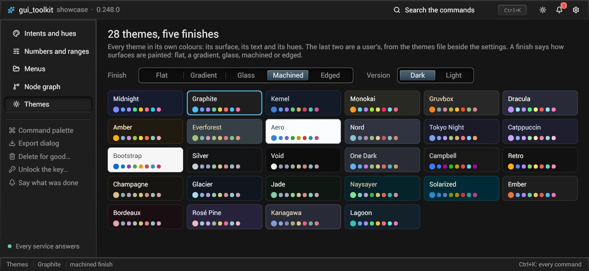
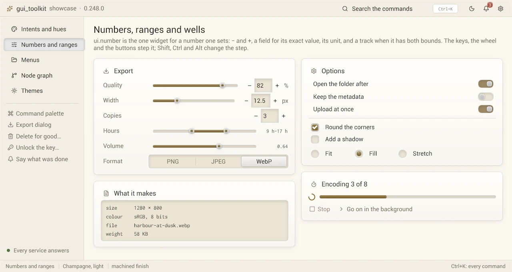
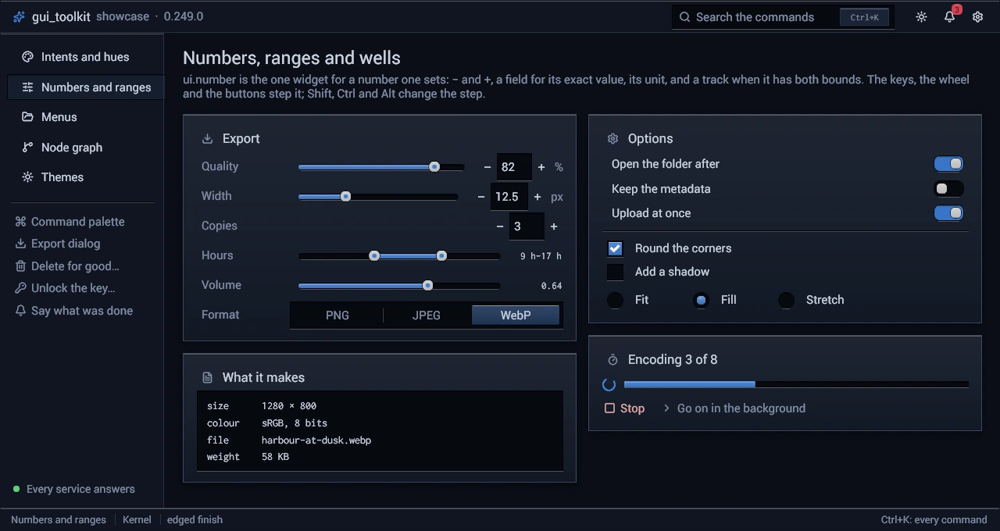
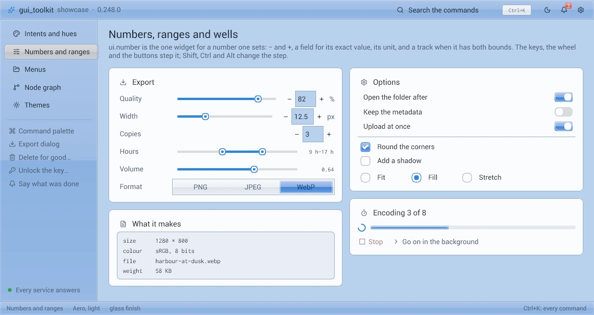
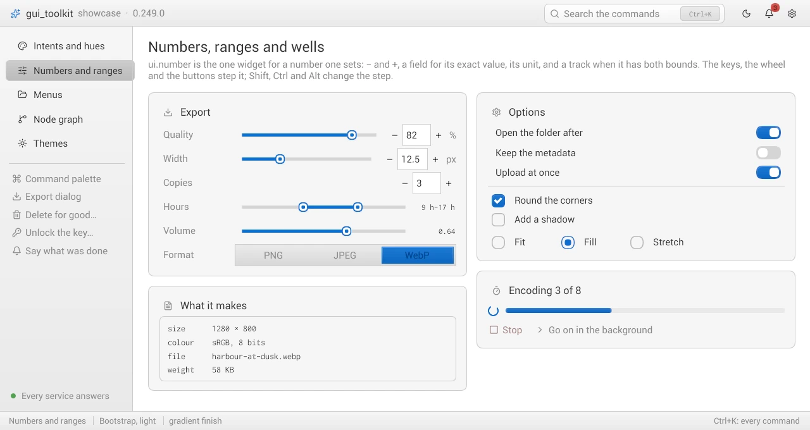

# Themes and finishes

A program shows one version (dark or light) of one theme, with one finish. The theme gives the colours, the finish how
surfaces are painted. `ui.theme_show` applies the three and follows the system when it goes light or dark.

```odin
choice := ui.Theme_Choice{name = "Nord", mode = .System, finish = .Machined, glow = 1}
if ui.theme_show(&app.theme, ui.THEMES[:], choice, &app.shown, render.blend_space(&app.r)) {
	platform.set_dark_title(app.win, !app.shown.light)   // the system's title bar, as the version shown
}
```

The last argument is the blend space of the renderer that draws with the theme, as `apply_palette` takes it: the
translucent entries (hover, selection) get the alpha that looks right in that space.

Call `theme_show` once per frame. It applies again when one of these changes:

- the choice: the name, the mode, the finish, the glow;
- the definition of the theme shown: its colours, its versions, its own finish, its look (a themes file read again with the same names);
- the blend space;
- in the `System` mode, `platform.color_scheme_serial`.

Otherwise it costs a lookup in the list and one hash. Each change of the look bumps `Theme.serial`: the colours
cross-fade, the glow jumps.

## A theme

`ui.Theme_Def` is a name and the colours of its versions. A version (`ui.Theme_Colors`) holds:

| Part | Colours, in order |
|---|---|
| `steps` | well (fields, code), bg0 (the page), bg1 (bars), bg2 (panels, cards), bg3 (raised: buttons), line |
| `texts` | faint, weak, text, bright |
| `hues` | accent, blue, purple, green, yellow, red, cyan, rose |

`versions` says which versions a theme has: `Both`, `Dark_Only` or `Light_Only`. A theme can impose its finish
(`finish`: Aero is `Glass`, Bootstrap `Gradient`), let the page show the system's backdrop (`translucent`), and name the
text on its accent (`accent_text`; 0 picks the darkest step or the brightest text, whichever reads better on it).



`ui.THEMES` lists the toolkit's themes; the first is the default. A program puts its own first and appends
`ui.THEMES[:]`, or shows only its own.

`look` (a `ui.Theme_Look`, last in the literal) is the theme's form beside its colours: its corners, its selections,
its focus, its motion, its font. `{}` is the toolkit's look; each part says only what differs from it. It rides in
`Palette.look` and in `Theme.look` (`apply_palette` copies it), so a program's palette and a test's carry one too.

## A theme's look

| Part | Its zero value | What a theme gives |
|---|---|---|
| `shape: Maybe(Theme_Shape)` | `SHAPE_DEFAULT` | the radius of each `Shape_Role` |
| `selections: [Selection_Role]Theme_Selection` | the accent's tint, the text kept | each selection's `fill` and `ink` (0xRRGGBBAA) |
| `focus: Theme_Focus` | a ring and its glow | `style`, `width`, `inset`, `color` |
| `still: bool` | false | no motion in its look |
| `font: Theme_Font` | the program's | `family`, `size` (a factor) |
| `relief: Maybe(Relief)` | the program's finish's preset | how surfaces are raised and sunk ("Reliefs" below); it wins over the finish |
| `scroll_bar: Theme_Scroll_Bar` | the standard bar | the bar's `form` and a `Keys` bar's `track` |
| `caption: Theme_Caption` | the program's title bar, the system's buttons | a band (`active`, `inactive`), its `ink`, `bold`, the `buttons`' style |
| `knob: Knob_Form` | the round knob | `Keys`: a slider's knob a key of the relief |
| `toggle: Toggle_Form` | the rounded track | `Check`: a switch drawn as the theme's check box |

The person's choices win over the theme's: the rounding setting scales its radii, the person's font family wins over
its family, the person's `Animations.On` keeps the motion a still theme removes.

### A theme's shape

`ui.shape_of(role)` is the radius of a role in the theme shown, before the rounding setting: in ems of the font size
(a widget multiplies it by its font size), the scroll bar's two roles in logical pixels. The widgets ask it; a program's
own control of the same kind asks it too.

| `Shape_Role` | `SHAPE_DEFAULT` | Who takes it |
|---|---|---|
| `Control` | 0.45 | a button, a field, `input_frame`, a dropdown, a number's field, the search launcher, the hot-key field, the font picker's button, the find bar |
| `Row` | 0.45 | a row's face: `list_row`, a menu's item, the palette's row, `choice_row`, the file browser's places, the font picker's rows, a button with `face = .Row` |
| `Card` | 0.6 | `card`, `list_card` (unless `Card_Options.radius`) |
| `Dialog` | 0.8 | `modal`, a view's internal window |
| `Menu` | 0.5 | a menu's panel |
| `Tooltip` | 0.4 | a tooltip |
| `Scroll_Thumb` | 3 px | the scroll bar's thumb |
| `Scroll_Arrow` | 2 px | the scroll bar's arrow buttons |

The other radii are their widget's own: a tab, a swatch, a strip's arrow, a node of a graph. A shape that is round by
its form (`shape_rad`: a radio, a switch, a slider's knob) keeps its radius.

### A theme's selections

| `Selection_Role` | Its fill (default alpha of the accent) | Its ink |
|---|---|---|
| `Text` | `selection` (0.35) | `selection text` |
| `List` | `selected background` (0.22) | `selected ink` |
| `Menu` | `menu_item selected background` (0.30) | `menu_item selected ink` |
| `Nav` | `nav selected background` (0.13) | `nav selected ink` |
| `Weak` | `weak_selected background` (0.09) | `weak_selected ink` |

A `fill` of 0 keeps the accent's tint; an `ink` of 0 keeps the text as it is. A selected row (a box built with
`.Chosen` under its selection's tags) reads its ink when it is built (`Box.ink`); every box built in it takes the ink
as its text colour, down to a box that draws an opaque face of its own (a button in the row keeps its text) or gives
its own `fg`. A program's own selected row gets it by building its box `.Chosen` with the tag `selected` pushed.

### A theme's focus

`Theme_Focus.style`: `Ring_Glow` (a solid ring of `FOCUS_RING_PX` and, in every finish but `Flat`, a glow around it),
`Ring` (the ring alone; `focus_glow` draws nothing) or `Dotted` (a dotted rectangle, one-pixel dots every two pixels,
`inset` logical pixels inside the box; a row's on its face; on a selected row in its ink). `width`: the ring's or the
dots' width in logical pixels (0: `FOCUS_RING_PX`, or 1 for the dots). `color`: 0 is the theme's `focus border`.
A relief's own focus (the machined well's ring of the accent) is the finish's.

### A still theme, a theme's font

`still`: while the person's `Animations` is `System`, a still theme turns the animations off as the system's "less
motion" does: states, fades, tweens, a palette's cross-fade, the scroll's easing when it follows the animations.

`font.family` is the interface's family of the theme, loaded on a chore as the person's family is
([font-picker.md](font-picker.md)); a family the person chose (`use_text_family`) wins over it, even while it loads.
`font.size` multiplies the program's font size (the person's text size) before the zoom; 0 and 1 leave it.

### A theme's scroll bar

`Theme_Scroll_Bar.form`: `Standard` (the desktop's bar of [scroll-bar.md](scroll-bar.md)) or `Keys`. A `Keys` bar has
the standard's parts at the standard's places: a flat trough (`track`, 0xRRGGBBAA; 0: the raised face half way to
white), and arrow buttons and a thumb that are keys of the relief (`machined_bevel` on `button background`: the rings
of a relief of rings). A held arrow is a pressed key, its triangle in the theme's `text`; the thumb does not light and
has no grip. The radii stay the roles' (`Scroll_Arrow`, `Scroll_Thumb`); marks and the find's ticks lie on the track
as on the standard bar. Every bar takes it, a text area's too.

### A theme's title bar

`Theme_Caption` dresses the title bar the program draws (`title_bar`, `window_buttons`):

| Field | What it does |
|---|---|
| `active`, `inactive` | the band's two stops from left to right (0xRRGGBBAA), drawn over the bar's face; both 0: no band; the second 0: one colour. The window's `active` picks them (no window: active) |
| `ink` | the text of what is built in the bar, down to a box with a face of its own (`Box.ink`, as a selected row's) |
| `bold` | what is built in the bar takes the bold face of the style's font, unless it gives its own |
| `buttons` | `System` (Windows 10's caption buttons) or `Keys`: a square key of the relief (8 : 7, 0.62 of the bar's height) in the middle of each button's box, its glyph drawn as shapes |

The buttons' boxes keep `CAPTION_BUTTON_WIDTH`: they are the window's hit regions. A dialog's `title_strip` takes the
band too, active.

A program that draws its own title bar (a row of tabs with `window_buttons`, in place of `title_bar`) takes the band
from these:

| Procedure | What it does |
|---|---|
| `caption_band(dc, r, active) -> bool` | draws the band of the theme shown over `r`; false: the theme gives none, nothing drawn |
| `caption_band_ink() -> Maybe(Color)` | the text on the band; nil: no band, or the text as it is |
| `caption_band_bold() -> bool` | whether the text on the band is bold |

### A theme's knob and switch

`Knob_Form.Keys` draws a slider's knob, and both knobs of a range slider, as a key of the relief (`machined_bevel`,
square): 0.6 em wide and 1.1 em tall, at rest whatever the pointer does. The track is a well of the relief 4 logical
pixels tall, with no lit run before the knob. `slider_key_rect(kx, cy, em)` is the key centred at `kx` on the track's
line `cy`; `slider_key_track(x0, x1, cy)` is the well from `x0` to `x1`. Both are on whole pixels. The value's text,
the hit area and the keys stay the slider's.

`Toggle_Form.Check` draws a switch as the theme's check box (the drawing of `checkbox`'s mark): a square of the
switch's height, centred in the switch's box. The switch keeps its box, its row, its hit area and its role for a screen
reader.

| Procedure | What it does |
|---|---|
| `theme_find(list, name)` | the theme of this name (ASCII case ignored), and its index |
| `theme_version(t, light)` | the colours shown: the light version when asked and present, else the one there is |
| `theme_palette(t, light, finish)` | the `Palette` of the built-in widgets for that version |
| `theme_palettes(list, finish)` | every version of every theme as `Named_Palette` ("Nord", "Nord Light"): pickers, tests |
| `palette_of(name, light)` | a palette of `THEMES` by name: examples and tests |
| `theme_wants_light(mode)` | whether a mode shows the light version now (`System`: `platform.dark_mode_preferred`) |
| `theme_mode_of(name)`, `THEME_MODE_NAMES` | the modes by name: "system", "dark", "light" |
| `finish_of(name)`, `FINISH_NAMES` | the finishes by name: "flat", "gradient", "glass", "machined", "edged" |

The palette takes, from a version: `bg` = bg0, `bar` = bg1, `panel` = bg2, `panel2` = bg3, `border` = line,
`well` = well, `faint`, `weak`, `text` and `bright`, `accent`, `good` = green, `warn` = yellow, `bad` = red.

The texts are entries a program asks by name: `"text"`, `"weak text"`, `"faint text"` (a hint, a line number; a palette
without one takes weak `FAINT_STEP` toward the page), `"soft text"` (a quiet text: weak `SOFT_STEP` toward text: code,
a tool's output) and `"bright text"` (a title, what is selected; without one, white on dark, black on light).
`theme_color(name)` reads any entry of the theme shown whatever tags are pushed: a custom draw, a colour computed
outside a build, as `hue(h)` does for the hues.

## A program's own colours in any theme

A program that draws with its own colours chooses them in one theme, its reference. `theme_recolor(&ref, shown, c)` moves
a colour `c` of the reference to the theme shown. A grey goes to the same place on the shown theme's greys. A colour goes
to the shown theme's hue nearest to it, mixed with the shown theme's grey as much as it was with the reference's. The
alpha stays. `theme_reference(colors)` makes the reference from its colours; a program can set `levels` itself when its
greys stand elsewhere. Cache the results: a program asks for the same few colours every frame.

`with_alpha(c, a)` is `c` with its alpha times `a`; `lighten(c, t)` and `darken(c, t)` move `c` a share `t` toward
white or black in sRGB steps (`srgb_step`), its alpha kept: the toolkit's own tints, for a program's too.

## A user's themes

`themes_read(text, catalog, base)` reads a file of the user's. Each `[Name]` section is one theme. It starts as `base`'s
dark version, with no light version; `from = Name` starts it from a theme of `catalog` instead. A line `key = #rrggbb`
sets a colour; the keys are `THEME_KEYS` (well, bg0, bg1, bg2, bg3, line, faint, weak, text, bright, accent, blue,
purple, green, yellow, red, cyan, rose). `light.` before a key sets the light version, which the theme then has. Free the
list with `themes_destroy`.

```
[My theme]
from = Nord
accent = #e5c07b
light.accent = #b58900
```

A program does not read the file itself: `prefs_page.Themes_File` keeps it beside the preferences, makes it from a
commented template, opens it in the system's editor and reads it again when it changes, all on tasks
([prefs_page.md](prefs_page.md), "Themes of the user's own").

## Finishes

| Machined, light (Champagne) | Edged (Kernel) |
|---|---|
|  |  |
| **Glass** (Aero) | **Gradient** (Bootstrap) |
|  |  |

| Finish | Raised surfaces (buttons, bars) | Sunken ones (fields) | Separators |
|---|---|---|---|
| `Flat` | plain colour | plain colour, thin edge | a line |
| `Gradient` | a shade: the face a few percent lighter at its top than at its bottom, a fine lit line along its top; the text as on the plain colour | plain | a line |
| `Glass` | a glossy upper half, a white rim | plain | a line |
| `Machined` | bevelled: a soft shadow, a lit rim, a dark edge, engraved text; pressed, it sinks. Panels (cards, dialogs, menus, tooltips) are plates: a shaded face, a lit rim, a shadow | a well: inner shadow, lit lip, a ring of the accent when focused. Check boxes, radios, switches, sliders and progress bars are wells, what is on a raised key or a lit face in them | a carved groove |
| `Edged` | the machined reliefs drawn crisp, nothing blurred: a dark hairline around, a lit line along the top, a shade along the bottom; pressed, the shade along the top. Panels: a lit line along their top, a shadow | a well: a dark hairline around, dark lines under its top, a lit lip under it | a carved groove |

The machined and edged reliefs are drawn on both palettes. They are made for the dark: strong black shadows and edges,
faint white rims. On a light palette (`Theme.dark` false, set by `apply_palette`) the same reliefs are drawn by their
light: lighter shades and stronger white rims, lips and highlights (`RELIEF_ON_LIGHT`: shades × 0.3, lights 0.25 +
3.5 × their alpha up to 0.9, a face's bottom and a pressed face darkened × 0.45). A program's own relief takes the same
colours from `relief_shade_for(alpha, theme.dark)` and `relief_shine_for(alpha, theme.dark)`, with the alpha written for
the dark.
The theme `Kernel` (blue black, square tiles of colour) is made for `Edged`: it brings it whatever the program's finish.
The edged finish (and a square relief: `Relief.square`) has square corners whatever the rounding asked (`rounding(s)`
is 0 there, and `rad(r)` with it). What is round by its shape keeps it: a radio's disc, a switch's pill, a slider's slot and knob, a lamp (`shape_rad(r)`: a
radius the rounding setting scales and the edged finish leaves).
`Theme.glow` (0..1) sets the strength of its halos: a focused well, a lamp.

### Reliefs

A finish is the name of a relief preset: `ui.relief_of(finish)` gives it (`RELIEF_FLAT`, `RELIEF_GRADIENT`,
`RELIEF_GLASS`, `RELIEF_MACHINED`, `RELIEF_EDGED`). `Theme.relief` is the relief drawn: `apply_palette` sets it from the
theme's `look.relief` when it has one, else from the palette's finish. A `ui.Relief` is:

| Field | What it says |
|---|---|
| `carved` | wells, keys, grooves and panels are drawn by the relief (`machined()` is true) |
| `square` | square corners whatever the rounding (`rounding(s)` is 0) |
| `sheen` | raised faces take their light; a ring of focus glows |
| `engrave` | the text on a raised face is engraved |
| `face`, `row` | how a fill (`paint_rect`) and a row's face are painted (`Face_Paint`, `Row_Paint`) |
| `extra` | the finish's own code: what of its look is not rings (`Relief_Extra`; `.None`: rings alone) |
| `no_glow`, `no_hover`, `no_shadow` | no halo whatever `Theme.glow`, no light under the pointer, no drop shadow nor dim behind a dialog |
| `surface_tones` | a well's, a groove's and a panel's rings take the tones of the raised face (`button background`) |
| `raised`, `pressed`, `sunken`, `groove`, `frame`, `bar` | the rings of a key, a pressed key, a well, a groove, a panel's frame, a rimmed bar |

A `Relief_Ring` has a `width` (pixels of one device pixel at least, rounded), `top_left` and `bottom_right` tones (a
step of the face toward white, above 0, or black, below 0: 1 is white, -1 black) and a `blur` (logical pixels). A
relief of rings (`carved`, `extra = .None`) is drawn from its rings by the same primitives a program calls
(`machined_bevel`, `machined_well`, `machined_groove`, `machined_plate`): a round shape takes its first ring as two
discs. `relief_rings(dc, r, rings, face)`, `relief_round` and `relief_lines` draw rings for a program's own surface;
`relief_tone(face, t)` is one tone. The widgets' own touches follow it too: under a relief of rings `machined_lamp` is a
flat disc of its colour (a radio's dot, a node's state), `machined_pip` a round well, `relief_face` (a tile, a stacked
bar's part) has the raised rings, `caption_face` is the theme's band or one colour in a bar's rings, and a switch's
or a slider's knob is the theme's `button background`.

`RELIEF_BEVEL` is Windows 95's: two rings of one pixel (white and the face's light along the top and left, black and
its shadow along the bottom and right, turned over when pressed or sunken), square, no halo, no hover light, no shadow.
The theme `Old Head` is made of it: one grey `#c0c0c0`, white fields, navy, square corners, a dotted focus, white on
navy for every selection, still, scroll bars of keys, a caption band from navy to blue (grey behind) with white bold
text and square keys, a slider's knob of keys and a switch drawn as a check box. Its relief wins over the program's
finish.

### Corners in corners

A shape inset by `m` from both edges of a corner of radius `R` has a radius `r = max(R - m, 0)`: the two curves are
concentric and the gap between them is `m` all along. `concentric_radius(outer, inset)` gives it.
`corner_place(outer, outer_radius, corner, size, inset) -> (rect, radius)` places a control of `size` in a corner of a
rect, the same `inset` from both edges that meet there, with that radius: give it the radius the outer shape is drawn
with (`box_drawn_radius`), and draw the control with the radius it returns. A box laid against its parent's corner takes
the same rule (`box_drawn_radii`); a dialog's close cross is placed by it (the views' header, [views](views.md)).

What a rounded frame holds is never rounded a second time inside it: rows whose backgrounds run from side to side (a
table's stripes, a list's zebra) are square (a row's hover and selection are a face inset in it, rounded on its own), and clipped to the frame's inside, where they take its curve at a corner. `clip_inside_open()`,
first in the frame, and `clip_inside_close()`, last in it, clip what is drawn between them to the frame's rect a line in
(its rim stays over them), its corners as drawn less that line (`clip_inside_push(dc, frame)` from a custom draw: a floating
dock panel). A frame its program draws itself gives the box its radius, so that the clip has the same corners.

A box gets the machined drawing from its flags and its theme: `.Groove` is a groove (`hline`); `.Sunken` with a
background is a well (`line_edit`, `text_edit`, `input_frame`, the track of `segmented`; a clear background sits in a
well, as a bare field does); `.Plate` with an opaque background is a raised panel (`card`, `modal`, menus, tooltips), or
with its own look (`Box.plate`, a `Plate_Look`: `card`'s options) in every finish, its background whatever it is; an
opaque background with a sheen is raised (bevelled when it is `.Clickable`). An accent fill a widget paints itself
(`paint_rect`) is a lit face, as in `Gradient` but a little stronger.

A program draws its own surfaces with the same primitives; in the edged finish each one draws its crisp form, in a
relief of rings its rings, outside these its flat form, so one call serves every finish (`machined()`: the reliefs are
drawn; `edged()`: crisp):

| Procedure | What it draws |
|---|---|
| `machined_bevel(dc, r, radius, face, hot, pressed, glow)` | a raised face; `glow`: a halo under the pointer |
| `machined_well(dc, r, radius, base, focus, accent, hot)` | a sunken surface, its focus a ring of `accent`; `hot` under the pointer: its face lifts a step, its lit rim brightens |
| `machined_groove(dc, a, b, vertical)` | a carved line |
| `machined_plate(dc, r, radius, top, bottom, shadow, rim, border, glow)` | a raised panel: cards, popovers; `border` a `Maybe(Color)`: nil (the default) the relief's edge, a colour of alpha 0 (`Color{}` included) none |
| `machined_lamp(dc, c, d, color, lit, glow)` | a status lamp: a glass bead and its halo |
| `machined_pip(dc, c, d, color)` | a small hole with a dab of colour: what is over |
| `relief_face(dc, r, color, radius)` | a face of colour lit along its top, shaded along its bottom (a tile, a part of a bar) |

What the machined finish draws reaches out of a box by up to `MACHINED_OVERFLOW_PX` logical pixels (a shadow, a halo,
the lip of a well). A region redrawn on its own must hold that much around its boxes.

### States in each finish

A state is drawn by the face itself ([widgets.md](widgets.md), "States"). The theme gives its steps under each tag:
`hover_fill` and `press_fill` (fractions toward the tint, in sRGB values: about 7 % and 12 %), `hover_border` (a border
that much toward the tint: fields, buttons' rims) and `hover_sheen` (a face that has none at rest appears raised: the
ghost and glyph buttons, the tabs; 0 for rows).

| Finish | Under the pointer | Pressed or toggled |
|---|---|---|
| `Flat` | the face a step toward the tint | a deeper step |
| `Gradient` | the face lifts, its shade and lit line kept | the shade turns over: its top darker, its bottom lighter, no lit line |
| `Glass` | the face lifts, its gloss kept | most of the gloss goes, the white rim too |
| `Machined`, `Edged` | the bevel's face lighter and its rim brighter; a well's face lifts and its lit rim brightens; a ghost's key rises out of the plate | the key goes in |

A row's face (a list's, a table's, a menu's, the palette's, a sidebar's: [widgets.md](widgets.md), "States") is inset
in the row and rounded as a button, and painted by the finish at its own, lower strength: a selected face fully, a face
under the pointer alone half as much.

| Finish | A row's face |
|---|---|
| `Flat` | a plain fill |
| `Gradient` | a soft gradient (its top 5 % toward white, its bottom 5 % toward black) and a faint lit line along its top |
| `Glass` | its upper half a little whiter, a thin rim of light; selected, a fine edge of the accent (no glossy plate: it was loud behind text) |
| `Machined` | a low plate: its top lit, its bottom shaded, a lit line along its top; selected, a faint dark edge |
| `Edged` | the same, crisp: a lit hairline along its top, a shade line along its bottom |

The theme's entries: `selected` and `weak_selected` (the selection's tint), `nav selected background` (a navigation's
calmer tint), `row_mark` (the accent's bar of a navigation's selected row: `nav row_mark`; 0 elsewhere).

## Button variants

A button's colours come from its intent and its face (`ui.button("del", "Delete", o = {intent = .Danger})`, `face = .Ghost`:
widgets.md). The theme gives them under these tags, named by the intent (`intent_tag`) and the ghost face; a program
says the intent, not the tag:

| Tag | Colours | For |
|---|---|---|
| `accent_button` (`.Primary`) | the accent's soft pair | the action a dialog is for |
| `info_button` (`.Info`), `success_button` (`.Success`) | the blue's, the green's soft pair | to inform, to confirm or save |
| `warn_button` (`.Warning`) | the warning hue's soft pair | an action done with care (end a task, stop a service) |
| `danger_button` (`.Danger`) | the bad hue's soft pair | an action that loses something (kill, delete); a Cancel is a neutral button |
| `ghost_button`, `icon_button` (`face = .Ghost`; a glyph alone) | no background until hovered | a tool among many |
| `well` | the theme's well, carved in | `ui.well`: a sunken box |
