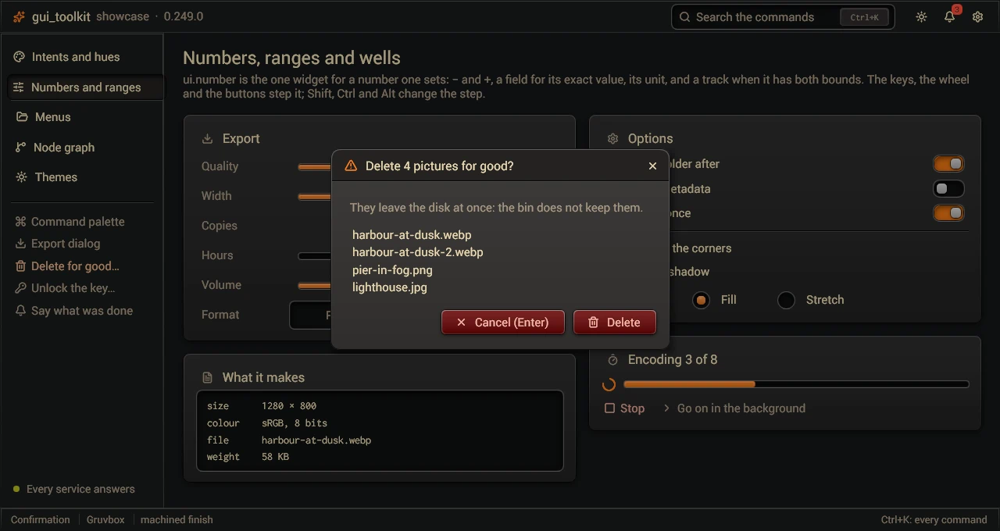
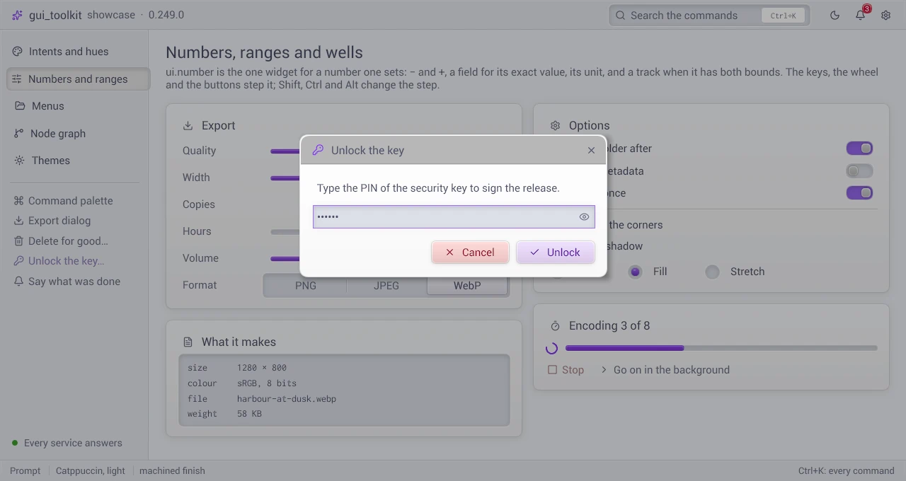

# Views (`src/ui/views.odin`)

A **view** is a build procedure and its data, declared once by an id. The program opens it, closes it and reads its
answer. The toolkit decides where it is built, and it remembers the presentation that the user chose, per id.

The four presentations are degrees of attachment to the owner window:

| Presentation | What it is | Modal |
|---|---|---|
| **Dialog** | centred over the owner window, with a scrim | yes |
| **Internal** | a floating window inside the owner window, drawn by the toolkit | no |
| **External** | an OS window of its own | no |
| **Panel** | docked to an edge of the owner window, or in a dock space of the program | no |

Each view has a **home**: Dialog or Panel. **Re-attach** brings a view back to its home; the view stays open.

This version builds the four presentations. The intent and the plan are in `src/md/features/views.md`.

## Where the views live

Every `ui.State` has a `Views`. Nothing is called to make it:

- **By default, a State's own.** `ui.state_views(&state)` gives it, and `ui.views()` gives the one of the State in use
  (the State being built, else the last one built or selected). It is made at its first use and destroyed by
  `ui.destroy`. It keeps its memory in memory only.
- **The program's, shared by its windows.** A program that keeps the memory in a file, or whose windows share their
  views (a view moved from one window to another, an external window), owns one `Views` and gives it to each window's
  State with `ui.set_views(&state, &app.views)`, before the first view of that State opens.
  `ui.views_init(&app.views, {path = ...})` reads its file (at start-up, before its first view);
  `ui.views_destroy(&app.views)` writes which views were open and frees it after the last build.
- **A zero `Views` works.** `views_init` is only for a file and for the header's words.

The ready-made views (`confirm_open`, `prompt_open`, `palette_open`, `shortcuts_sheet_open`, `setup.open`) and their
answers take no `Views`: they use `ui.views()`, the window being built.

## A view

```odin
App :: struct { state: ui.State, conflict: Conflict_View, ... }

vs := ui.state_views(&app.state)                   // its window's (or the program's: set_views)
ui.view_register(vs, "conflict", conflict_view, {title = i18n.later("A name is taken"), icon = lucide.FILES, width_em = 32})

conflict_view :: proc(v: ^ui.View, c: ^Conflict_View) {
	ui.view_title(v, fmt.tprintf(i18n.tr("%s is already there"), c.name))
	if ui.dialog_body("body") { ... }
	if ui.dialog_buttons("buttons") {
		if ui.button("skip", i18n.tr("Skip")).clicked { ui.view_end(v, int(Conflict.Skip)) }
		if ui.button("replace", i18n.tr("Replace"), o = {intent = .Danger}).clicked { ui.view_end(v, int(Conflict.Replace)) }
	}
}

// in a build: open it, and read its answer in a later build
vs := ui.views()
if job := job_asking(app); job != nil && !ui.view_is_open(vs, "conflict") {
	app.conflict.job = job
	ui.view_open(vs, "conflict", &app.conflict)
} else if job == nil {
	ui.view_close(vs, "conflict")
}
if code, ok := ui.view_ended(vs, "conflict"); ok {
	job_answer(app.conflict.job, code == ui.VIEW_CANCELLED ? .Cancel : Conflict(code))
}
```

- The build procedure draws the body only. The header is the toolkit's: the icon, the title (`View_Options.title`,
  shown with `i18n.tr`; `view_title` changes it from the next build), the program's controls
  (`if ui.view_header_tools(v) { ... }`), a small Detach icon, the close cross in the corner. `no_header` drops it from
  the dialog (a palette draws its search band at the top); an internal window always has its header (it moves it).
- `view_register(vs, id, build, o)`: `build` is a `proc(v: ^ui.View, data: ^T)`. `view_open(vs, id, &data)` checks
  that its data is a `^T`. The data is the program's, and must stay valid until the view closes.
- The dialogs of a State are built at the end of its build (`end_build`), over the page, under the menus and the
  toasts. The program calls nothing to build them.
- The owner of a view is the State being built when `view_open` is called, else the State in use (the last built or
  selected: `ui.init` selects it); `owner` names another one.
- One view can have several instances: `instance` (an editor's name, a service's name). Each has its own answer.

## The answer

`view_ended(vs, id, instance) -> (code, ok)` gives the answer once. `ok` is false until the view ended, and after the
answer was taken. The answer is read in the build after the one where the view ended; the toolkit asks for that build
at once.

| How it ended | Code |
|---|---|
| `view_end(v, code)` in its build | `code` (the program's: 0 and up) |
| Escape, Ctrl+W, the close cross, a press on the scrim | `VIEW_CANCELLED` (-1) |
| its owner window went (`ui.destroy`) | `VIEW_CANCELLED` |
| `view_close` | no answer |

An answer that is not taken is dropped when the view opens again. A view whose build calls `view_end` is not built
again.

## The procedures

| Procedure | |
|---|---|
| `state_views(s)`, `views()` | the Views of a State (its own unless set_views gave one), of the State in use |
| `set_views(s, vs)` | `s` builds its views from the program's `vs` (shared by its windows) |
| `views_init(vs, o)`, `views_destroy(vs)` | optional for a program's Views: `o.path`, the memory file ("": memory only); `o.labels`, the header's words |
| `view_register(vs, id, build, o)`, `view_registered(vs, id)` | |
| `view_open(vs, id, data, instance = "", owner = nil)` | one already open comes forward (a dialog goes on top) |
| `view_close(vs, id, instance)`, `view_is_open(vs, id, instance)` | |
| `view_ended(vs, id, instance) -> (code, ok)` | |
| `view_present(vs, id, p, place, instance)`, `view_reattach(vs, id, instance)` | moves it; the choice is remembered |
| `view_presentation(vs, id, instance)` | where it is, or where it opens next |
| `view_was_open(vs, id, instance)` | it was open when the program last quit |
| `view_restore(vs, id, data, first_start_open, instance, owner) -> bool` | at start-up: opens it if it was open at the last quit, or at the very first start (no line for it yet) when `first_start_open`; a view the user closed stays closed |
| `view_restored_instances(vs, id, allocator) -> []string` | at start-up: the instances of `id` open at the last quit, in the order their lines were written; the program opens each with its own data, and each opens where it was (section "What is remembered") |
| `view_has_focus(vs, id, instance)`, `views_focus(vs) -> (id, instance, ok)` | the keyboard focus is in a view (section "A program's command keys") |
| `view_dialog_size(vs, id, instance)` | the size the user gave its dialog, in ems (`{}`: none) |
| `view_maximise(vs, id, on, instance)`, `view_maximised(vs, id, instance) -> bool` | its dialog fills the window, or goes back to its size; for this opening only (after `view_open`: a viewer that opens maximised); the remembered size is not changed |
| `views_hold_keys(vs)` | a dialog of `vs` holds the keys of the State being built |
| `views_frame(vs, o = {})`, `views_dock(vs, name, o)` | the window's dock space around its content; a space of the program's (section Panels); `o`: `View_Dock_Options` |
| `views_space_maximised(vs, name) -> (edge, stack, ok)` | the stack of a space that its strip's Maximise shows alone |
| `views_space_reset(vs, name)` | the layout of a space as at first: its zones, axes and shares the defaults, its views back home (section Panels) |
| `view_dock_line(vs, edge, space) -> (Rect, ok)` | where a zone's handle draws its rule, window pixels (this frame's layout from a custom draw, else the last): a program's line across its title or status bar takes its place from here, so both meet on one pixel column; a side zone's rail has it too; `ok` false with no handle there |
| `views_commands(vs, allocator) -> (commands, acts)`, `views_command_run(vs, act)`, `views_version(vs)` | the palette's commands of the views |
| `views_space_format(m)`, `views_space_parse(text) -> (View_Space_Memory, ok)` | a dock space's line of the memory |
| `views_windows_follow(s, shown)` | the windows of the views of `s` hide and show with it (host_hide, host_show call it) |
| `views_set_windows(vs, w)`, `views_windows_ready(vs)`, `view_window_state(vs, id, instance)` | the backend of the views' windows (section External) |
| `views_set_window_end(vs, end, user)` | the program's end of each build of a view's window: its overlays there (section External) |
| `views_windows_step(s)`, `views_window_build()`, `view_window_close_asked(s)` | a backend's part: between frames, a window's build, its system close |
| `state_carry(from, from_root, to, to_root)`, `style_follow(dst, src)` | what follows a view to another place; a window's settings from the main one |
| inside a build: `view_end(v, code)`, `view_title(v, title)`, `view_icon(v, icon, icon_font)`, `view_room(v)`, `view_header_tools(v)`, `view_drag_handle(v, box)`, `view_fold_button(v) -> Signal` | `view_icon`: this opening's icon (one id, an icon per opening); `view_fold_button`: its side zone's Minimise or Restore, where the view places it (section Panels) |
| inside a build: `view_not_ready(v)`, `view_refit(v)` | what is in it waits for an answer: a dialog or an internal window stays unseen, 100 ms at most; what is in it came late or changed size: an internal window the person did not resize takes its height again |
| inside a build: `view_size(v, width_em, height_em)` | this opening's dialog size (an axis of 0: the kind's): a dialog that hugs what it shows; it wins over the remembered size, a resize by the user wins over it; past `DIALOG_MAX_WIDTH_EM` too |
| inside a build: `view_occluders(v, allocator) -> []Rect`; `views_floating_rects(vs, s, allocator) -> []Rect` | the floating views (internal windows, dialogs) over this view, or over the content of window `s`, bottom to top, window pixels: a native child window (a web view) steps aside or clips |
| `state_families(s)` | the bold and italic faces' families of `s` (a view's window: its owner's, one map): what `Rich_Context.faces` takes |
| `pointer_only_build(s)`, `view_window_due(s)` | a backend's: the owner's last frame came only from the pointer moving (its views' windows skip it), a view's window has a frame of its own to make |
| `focus_next_field()` | inside a build: the next field built (a `line_edit`, a `number`'s value, a `text_edit`) takes the keyboard: a view focuses its field on its first build without rebuilding a widget's keys |

`View_Options`: `title`, `icon`, `icon_font`, `home` (`.Dialog` or `.Panel`), `home_place`, `first` (the presentation
of the first opening), `float_edge` (an internal window of no rect of its own opens against this edge of the content,
`MODAL_MARGIN_EM` in: `.Right` at the top right, a tool window; nil: centred), `width_em`, `height_em` (0: as tall as what is in it), `min_width_em`, `min_height_em`,
`resizable` (grips; the size is remembered), `top` (the dialog's top at this fraction of the window), `no_header`,
`backdrop` (drawn first, under the header and the body), `extent_em`, `extent_frac`, `tabs_always`, `new_tab`,
`new_tab_label`, `under_children` and `moved` (the later presentations).

## The Dialog presentation

A dialog that opens is built and laid out unseen, the next frame at once, until two layouts in a row agree: the rects
of its panel and of every box in it. The first frame that shows it has it at its size and place. One that never
settles shows after six layouts. A dialog of a known size (resizable with `height_em`, or a size the person gave it,
or maximised) has nothing to measure: it shows in its first build. From the first frame shown, its scrim and its panel
fade in together (`MODAL_FADE_MS`, 120 ms; `View_Options.quick`, a dialog summoned by a key as the palette, 70 ms; at
once with the animations off). A frame moves the fade by 25 ms at most, so a late frame does not jump it. What had the
focus loses it on that first frame shown, not before.

A view whose content waits for an answer (a source's, a worker's) calls `view_not_ready(v)` in its build: its dialog,
or its internal window, stays unseen, built at each frame, until a build no longer calls it, for 100 ms at most from its
opening. A content that came later than that, or that changed size, calls `view_refit(v)`: an internal window the person
did not resize takes the height of what is in it again (one build as tall as its content, then that height). A plugin's
view does both with its first list (docs/plugins.md). The palette
does so until the ranking of its question has seen every source's answer, so it appears with its rows. A dialog shown
is not hidden again. `view_size` with another size before the dialog shows holds it too: the first frame drawn has the
size asked. The toolkit's dialogs that a key summons are `quick`: the palette, the shortcuts' sheet, a prompt, the file
browser, the key recorder. A box wholly transparent (`transparency` 1) is not drawn: a dialog's unseen frames redraw nothing.

- A dialog that is not resizable is as wide as what is in it asks (its title on one line, its row of buttons on one
  line), `width_em` at least, `DIALOG_MAX_WIDTH_EM` (46) at most. Past that, its title and the words of a button wrap.
  Nothing in it is cut, nothing goes past its edge. What is in it takes its width with `fill()`.
- `view_size(v, width_em, height_em)` sizes this opening's dialog (an image viewer hugs its picture): it wins over the
  size the user gave the id's dialog, a resize of this opening wins over it and is remembered, and a width past
  `DIALOG_MAX_WIDTH_EM` holds (the window's edge still does).
- It stays within the window however small, and never past its bottom.
- `resizable`: the user resizes it by its edges and corners; it stays centred. A double click on an edge goes back to
  `width_em` × `height_em`. The size is remembered when the grip is let go. Its bottom right corner is square, with the
  resize grip in it. With `top`, its bottom edge follows the pointer and its top has no grips.
- A resizable dialog of `height_em` 0 opens as tall as what is in it.
- Several dialogs can be open; the one opened last is on top. It has the keyboard: Tab goes round its own stops,
  Escape and Ctrl+W close it. A dialog that opens takes the focus, and gives it back when it closes, unless something
  else took it meanwhile.
- The header: a strip a shade darker than the dialog (`DIALOG_HEADER_EM` tall), the icon in the accent, the title
  (never cut: it wraps), the program's tools (a box made only when the body calls `view_header_tools`), the Detach icon
  (`lucide.PICTURE_IN_PICTURE_2`, in the weak colour, `VIEW_DETACH_EM`: it opens the view as an internal window where
  the dialog is), and the close cross (`DIALOG_CLOSE_EM`) at the same margin from the dialog's top and right edges, its
  corners concentric with the dialog's. The close cross is the last stop of Tab.
- A drag of the header past `DOCK_DRAG_EM` detaches the dialog: it is an internal window under the pointer at once,
  and the same press moves it. Escape during the drag puts it back as a dialog.
- **Maximise.** A `resizable` dialog has a Maximise button (`lucide.MAXIMIZE_2`, `View_Labels.maximize`) just left of
  the close cross; a double click on the header does the same. Maximised, it fills the window but `MODAL_MARGIN_EM`
  on each side, whatever its sizes, and keeps filling it as the window is resized; it has no grips, and its header's
  drag does not detach it. The button is then Restore (`lucide.MINIMIZE_2`, `View_Labels.restore`): the dialog goes
  back to the size it had. The remembered size stays the user's own, and the maximised state is this opening's only:
  it is not remembered, and it goes when the view leaves the Dialog presentation (Detach opens the floating window at
  its default place). `view_maximise(vs, id, true)` after `view_open` opens a viewer maximised;
  `view_maximised(vs, id)` reads it.

## The Internal presentation

An internal window floats inside its owner window, drawn by the toolkit: the same on every system. It is not modal:
no scrim, the page stays usable and keeps its keys.

- Layers, from the bottom: the page, the internal windows, the dialogs, the menus, the toasts. Several float at once;
  a press on one brings it to the front.
- Its header holds the icon, the title, the program's tools, Re-attach (`lucide.UNDO_2`; absent when it is at its
  home), Detach into a window (inactive without a backend of windows) and Close. The header moves it. Its
  edges and corners resize it: the side held follows the pointer, the other stays; at least `DOCK_FLOAT_MIN_EM`. Its
  bottom right corner has the resize grip.
- It stays inside the window: a window made smaller moves it in, its remembered rect unchanged.
- Its rect is remembered (`internal=`, logical pixels) when a move or a resize is let go. With none, it opens where the
  dialog was, else centred over the program's content (the content of `views_frame`, as its last layout made it: not
  over the panels; the whole window without a frame), across and down, as wide as what is in it asks (`width_em` at
  least: measured unseen with a dialog's measure, `natural_width`), as tall as what is in it.
- **What is in it is never cut across.** Whatever its rect (the memory's, a dialog's, a panel's, the user's resize),
  it is never narrower than what is in it on one line: a label stays whole. Its height is the user's: what does not
  fit is clipped, and the program's scroll regions scroll. A `form_row`'s label is at least its words on one line
  (its widget gives way).
- When it shows, the focus goes to its first stop. Escape and Ctrl+W close it (`VIEW_CANCELLED`) while the focus is
  in it. When it closes with the focus in it, the focus goes back to what had it.
- It is built unseen at its place until its layout is the same two builds in a row, as a dialog is. A move between a
  dialog and an internal window by a button never leaves a frame with the view in neither place or in both: the old
  place shows while the new one is measured, and goes in the frame the new one shows.

A view opens as an internal window when the memory says so (the user chose it), or `first = .Internal`, or
`view_present(vs, id, .Internal)`. `view_reattach` brings it back to its home.

## The External presentation

A view in a window of the system of its own, with its own `ui.State` on the program's `Views`. `ui` opens no window
itself: a backend does.

```odin
ui.views_set_windows(&app.views, host.view_windows(&app.shared))   // a host.Host program, once at start-up, for every window
ui.views_set_windows(&app.views, session.view_windows(s))        // a test (docs/testing.md)
```

- **One backend for every owner window.** A program of several windows that own views (cliche's history and its
  editors) sets it once: each view's window is made after the frames of the window that owns the view (its owner
  State, `View_Window_Ask.owner_state`; `host.view_windows` finds that Host among the program's).

- Without a backend, a view asked to be External floats inside its owner, and the owner says "No window: the system
  refused it." (a toast). The same when the backend refuses (`open` returns nil). `views_windows_ready(vs)`: whether
  a backend is there; the Detach into a window button and menu item are active then.
- **Between frames, never in a build.** `views_windows_step(s)` opens the windows wanted (hidden), shows each one once
  two layouts in a row agree, moves one dragged, and closes those no presentation uses. The host calls it after each
  frame of a window, then makes the frames of its views' windows; `hosts_wait` counts them.
- **A view's window builds when its owner builds.** Each frame of the owner window is followed by a frame of each of
  its views' windows: what woke the owner (a new sample posted to it, a reading) is in the views that show it, wherever
  they are. A program never wakes a view's window by hand. When nothing is due, the owner makes no frame and neither do
  they; a frame redraws only what changed (partial redraw). A view's window also makes its own frames for its input.
  A frame of the owner that came only from the pointer moving or the wheel over it (no key, no press, no posted call,
  no zoom: `pointer_only_build`) changes nothing a view's window shows: the view's windows skip it, unless one is due
  on its own (its input, an animation, posted calls, a wake, frames owed: `view_window_due`). A frame with no input (an
  animation, a wake) is not skipped: what woke the owner may be data a view shows.
- **No flash.** The old place stays drawn until the window's first picture is out; the next frame of the owner takes
  it away. The view is in two places for one frame at most, and never nowhere.
- Its header: the title, the program's tools, Re-attach, Close view (`View_Labels.close_view`). Escape and Ctrl+W close
  the view.
- **Its decorations are the program's choice**, as its owner window's (`window.system_title`, applied with
  `platform.set_integrated_title`): read at its opening (`View_Window_Ask.integrated_title`) and at each step, so a
  change at run time applies to the open view windows. With the program's own title bar, the window has no system
  decoration and the view's header is its title bar: the system drags it, a double click maximises it, and the
  window's minimise, maximise and close sit at its right end (`window_buttons`, the main window's code and look). That
  close is the system's close of the window: it re-attaches the view. The view's Close stays in the header. Its menu
  opens on a right click of the header's empty part (`caption_right_clicked`); the header's drag onto the owner's dock
  targets is the system's move there (the menu and the palette dock it). With the system's title bar: the header under
  it, without the window's buttons. The system's close of the window (its title bar's cross, Alt+F4) **re-attaches** it: it stays open. When it
  shows, the window is activated and the focus goes to its first stop; when it closes, the owner window is activated.
- **Drags** where the system gives positions (`platform.positions_known`: Windows, X11; not Wayland, asked at run
  time): a floating window's header let go outside the owner opens the view in a window there; an external window's
  header moves the window, and the owner shows its dock targets while the pointer is over it: let go on one, the view
  docks there and its window closes. On Wayland the system's title bar moves the window; the buttons and the menus move
  the view.
- `View_Options.moved(data, win)`: called when the view is shown in another window of the system than before (a native
  child window follows it). The scroll and the focus of the named boxes follow it (`state_carry`); the program's data
  is the program's.
- **It looks like its owner**, from its first build and at every change of the owner's (`State.style_owner`, at the
  start of each of its builds): the owner's base style (`Build_Params.base`: the program's font, its size, the row
  height, the paddings, the radius), zoom, density, rounding, the feel, animations, scrolling, the icon and monospaced
  fonts, the theme and the fonts (the same ones, shared), and its families (`set_family`: one map, the owner's, read
  through `state_families`; a copy would be freed twice). Its scale is its monitor's.
- **Its zoom is the program's.** Ctrl+=, Ctrl+-, Ctrl+0 and Ctrl+wheel in a view's window zoom the window it follows,
  which every window follows; the owner's `disable_zoom` holds in it too.
- **Its chrome follows the theme.** Its title bar is dark or light as its owner's window (`platform.set_dark_title`
  given to the owner: the view's window takes it at its opening and at each step; `platform.is_dark_title(w)` reads
  it); with `host.view_windows`, its ground (`Host.background`) is the owner Host's at each frame. A program sets them
  on its own windows only.
- **The program's input hook applies in it.** With `host.view_windows`, a view's window has its owner Host's `input`
  (a terminal takes its keys before the interface there too), `after_input` and `partial_redraw`, read at each frame.
  Its `user` is the owner's: the hook reads the program's data as in its own windows; `h.owner` (nil for the program's
  own windows) says it is a view's window.
- **`moved` at its opening too**: a view that opens straight into a window of its own (`first = .External`, the
  memory) is told its window once it shows, as after a move.
- A view opened from an external view's build has that window for owner: its dialogs show over the window.
- `view_window_state(vs, id, instance)`: the State of its window (nil: none).
- **The program's overlays in it.** A view's window has its own State: a context menu or a chip opened there is built
  only in that window's build. The program builds them at the end of its main window's build; for the views'
  windows it sets one hook, once:

  ```odin
  ui.views_set_window_end(&app.views, proc(user: rawptr, v: ^ui.View) { overlays((^App)(user)) }, app)
  ```

  `end(user, v)` comes at the end of each build of each view's window, after the view, at the window's root, in its
  State (`v`: the view it shows; `v.shown` false in an unseen layout). Its dialogs come after it. A view's own build
  does not call the overlays.
- **Its time is its owner's.** A view's window with no clock of its own (`set_clock`) keeps its owner's: a test's
  `advance` moves its delays too.
- `ui.view_close` of a view in a window of its own closes the window at the next step (its State goes with it).
- **An offscreen owner, an offscreen window.** With `host.view_windows`, a view's window of an offscreen owner (a
  program's test that attaches its app) is offscreen too, at the owner's scale: it builds, draws no picture
  (`Host.no_picture`: the offscreen renderer's target is the first window's), takes the activation when it shows and
  gives it back when it closes. `session.view_window` gives it to the test (docs/testing.md).

- **It follows its owner.** A program that hides its main window (`host_hide`; papier hides instead of quitting)
  hides its views' windows with it, and `host_show` shows them again where they were (Wayland: where the compositor
  puts them). While the owner is hidden, a window that settles waits to show with it.

A backend of your own (a program with its own loop) implements `View_Windows`: `open(user, ask) -> (state, win,
handle)` makes a hidden window and a State whose builds call `ui.views_window_build()`; `show` puts it on the screen;
`hide` takes it off, its State kept; `close` ends it (never from inside its frame); when the owner hides or shows it
calls `ui.views_windows_follow(owner, shown)`; its system close calls `ui.view_window_close_asked(state)`; after each
frame of an owner it calls `ui.views_windows_step(owner)` then frames the windows (it may skip them after a frame of
the owner for which `ui.pointer_only_build(owner)` is true, unless `ui.view_window_due(window)`).

### A native child window under floating views

A view with a native child window (`under_children`: a web view) is drawn over by nothing of the toolkit's: a floating
window or a dialog over it would be hidden by the page. `view_occluders(v)`, in its build, gives the rects of the
floating views over it (window pixels, bottom to top: every internal window and dialog over a panel or the content;
those above it over an internal window; the dialogs above it over a dialog); `views_floating_rects(vs, s)` gives those
over the content of window `s`. The page steps aside, or is clipped to what they leave.

## Panels

A panel is docked at an edge of a **dock space**. The window's frame is one: the program puts its content in
`views_frame`, and the panels go around it.

```odin
build :: proc(app: ^App) {
	if ui.views_frame(&app.views) {
		// the program's content: its title bar, its body, its status bar
		if ui.views_dock(&app.views, "mission", {}) {}   // a space of its own, in its layout (panels only)
	}
}

ui.view_register(&app.views, "files", files_view, {title = "Files", home = .Panel, home_place = {edge = .Left}, extent_em = 16})
```

- A space has four zones, one per edge, around its centre. `views_frame(vs)` is the window's frame (the space `""`);
  `views_dock(vs, name, {content = true})` is a space in the program's layout, the block its centre;
  `views_dock(vs, name, {})` has no content: its centre is a fifth zone, `.Center` (Mission Control's main area). A
  zone with no panel is not built: a frame with no panel costs one box around the content.
- The widths come from the splits: a zone's extent, and what the zones leave to the centre. The content and the panels
  ask the space for no width (`.Fits_Width`, [least-width.md](../src/md/features/least-width.md)), so a wide tool bar or
  row in them never pushes a zone out of the window. What does not fit overflows inside them: a program scrolls it or
  folds it there.
- A zone holds one stack or several in a row along its axis: one above the other at the left, the right and the
  centre, side by side at the top and the bottom (the first split of a zone's one stack may choose the other). A
  handle between two stacks moves their share of the zone. A view's place says its stack: `View_Place.stack`, its
  rank in the zone (0 first; the ranks stay compact as stacks empty).
- `views_frame` builds the panels and the internal windows before the content, so they read their keys first; it is
  where F6 is read. A program without `views_frame` still has its dialogs and its internal windows; the panels of its
  frame float (internal windows) until it builds one, and the panels of its own spaces wait for them.
- A panel alone in its stack adds nothing: no tab strip, no border, no background (rule 1), unless its kind says
  `tabs_always` (a terminal: its strip shows with one tab). Two panels or more in a stack are its tabs: a click shows
  one, a right click opens its menu, a drag past `DOCK_DRAG_EM` takes it out as an internal window under the pointer.
- **The strip**, left to right: the tabs, in the look of every row of tabs (`ui.tabs`: the shown one in the text's colour
  on a raised plate, the others flat and weak; the one shown brought into view when it changes), each a Tab stop, on a strip ([strip.md](strip.md)): too many for the
  stack, they scroll with arrows, never a bar; the "+" of the shown view's kind, right after the last tab (at the end of
  the tabs when they scroll), where the new tab appears; the shown view's moves (Float, Open in a window, Re-attach), small and weak; the program's tools of the
  shown view (`view_header_tools`); then at the right end Minimise, Maximise and Close of the stack, drawn as a
  window's caption buttons. In a stack too narrow for them (a side zone of a few ems) the moves go (the view's menu
  and the palette have them) and the three buttons are small icons. A lone panel shows the same strip after the
  pointer rests `VIEW_HOVER_DWELL_MS` (300 ms) in its top band (`VIEW_HOVER_EDGE_EM`) with no button down; it pushes
  the body down, so none of its controls lies over the body's. It stays while the pointer is in the panel, and goes
  when the pointer leaves it, on Escape, or after a click on the strip; only a new rest brings it back. A pointer that
  only crosses the band moves nothing.
  - `View_Options.new_tab: proc(data: rawptr)`: the "+" calls it with the shown view's data; the program opens a new
    instance (`view_open` with a name of its own), at once or later (a shell a server makes). Each "+" leaves the
    stack waiting for one instance of that kind: the next one that opens within `NEW_TAB_WAIT_MS` (10 s) joins the
    stack, its tab last and shown. Later than that, or when that stack is gone, it opens where its memory says. The
    same act is the first item of the band's menu and a palette command, in the words of `new_tab_label` ("New
    terminal"; "": "New tab").
  - The words of `View_Options` (`title`, `new_tab_label`) and of `Views_Options.labels` are the program's source
    words (English, `i18n.later`): the toolkit translates them when it shows them, so a change of language during the
    session shows at the next build.
  - **Maximise**: the stack fills the dock space; the other zones are not built and the program's content is laid out
    at no size (still built: its state is kept). Maximise again, or Escape with the focus in it, restores. Not
    remembered across runs. `views_space_maximised(vs, name) -> (edge, stack, ok)` says which.
  - **Minimise**: at the top and the bottom the zone shows its strips only; a click on a tab, or Minimise again,
    restores it. At the left and the right it becomes a rail one strip wide: a Restore button, then a button per view
    (its icon, its title as the tooltip), which restores the zone with that view shown. Remembered (`bottom.min=1` in
    the space's line). A side zone also folds to its rail by itself when the space leaves the content less than
    `DOCK_MIN_EM` beside it, and unfolds when the space is wide enough again; its Restore opens it meanwhile. A view
    with `View_Options.rail_em` (3.5, say) keeps that column instead of the icons' rail: it is built there with
    `View.rail` true and draws its compact form (`if v.rail { ...marks... } else { ...list... }`). The toolkit draws no
    Restore in that column: the view calls `ui.view_fold_button(v)` in a row it already has, in both forms. The button
    is the zone's Minimise when the zone is expanded and its Restore when it is collapsed (key `view_fold`). Put it at
    the same place in both forms (the start of the first row, say): it then stays under the pointer when the person
    folds and unfolds the zone. A debug build asserts that a view with `rail_em` calls it in its compact form. A view
    that calls it has no Minimise on its strip. A right click on it opens the view's menu (its moves, Maximise or
    Restore, Close); its tooltip says so (`View_Labels.menu_hint`). Outside a left or right zone it builds nothing and returns `{}`. A
    zone without `rail_em` keeps the strip's Minimise and the icons' rail's Restore.
  - **A rail keeps its edge line and opens by a pull.** A side zone's rail keeps the zone's handle: the same line
    against the content as expanded, and `view_dock_line` names it. Drag that handle outward past
    `SIDE_PULL_EM` (1 em) and the zone opens and follows the pointer; let go, its width is remembered. A drag
    inward, or a shorter one, does nothing. A drag of an expanded zone's handle down to its rail folds it, and its
    extent stays as it was before the drag. The handle is `ui.side_handle` ([panes.md](panes.md#a-side-panel-that-folds)).
  - **A narrow space folds a side zone.** When the space less the zone's extent leaves the content less than
    `DOCK_MIN_EM`, the zone folds to its rail; when it leaves `DOCK_MIN_EM` plus `SIDE_FOLD_GAP_EM` (1 em), it opens
    again. A Minimise, a Restore or a pull holds only until the space's width next crosses that threshold, either way:
    then the zone takes the automatic state again. The space's memory keeps both (`left.min=1 left.narrow=1`), so a
    restart in a window of the same size keeps the person's choice.
  - **Close** closes every view of the stack (each ends `VIEW_CANCELLED`). One tab closes by Ctrl+W in it, its menu or
    the palette.
  - A strip exists in a stack of panels only: an internal window and a window of its own hold one view each.
- The view's menu (a right click on its strip's tab, or on its fold button) has Detach into a window, Open as a
  floating window, the Dock items, Re-attach away from home, Maximise or Restore for a panel, and Close.
- `view_drag_handle(v, box)` marks the program's title box of a view: a lone panel moves by it (it floats, and a drop
  docks it again). A panel without one shows no grip; it moves by its icon, its menu or the palette.
- A zone's extent is the space's: its handle resizes it (the content keeps `DOCK_MIN_EM`), and the memory keeps it
  when the handle is let go. Before that, in this order: the space's `View_Dock_Options.extent_frac[edge]`, its
  `extent_em[edge]`, the first panel's `extent_frac`, its `extent_em`, else `width_em` or `height_em`, else
  `VIEW_ZONE_EM` (18).
- **A share or ems.** An `extent_frac` is a share of the space's width (left, right) or height (top, bottom): the zone
  follows the window's size. An `extent_em` is a fixed size (a sidebar). The user's drag is remembered in the zone's
  own unit: a share stays a share. `if ui.views_dock(&app.views, "mission", {extent_frac = {.Left = 0.25, .Bottom =
  0.3}}) {}` gives a space its zones' shares at first.
- **The layout as at first**: `views_space_reset(vs, name)` (`""`: the window's frame) puts the space's zones, axes,
  shares and tabs shown back to their defaults (its memory line goes), and each open view docked there or whose home
  is there back to its home: one the user floated or docked elsewhere comes back, one the user docked there goes home.
  A command "Reset the layout" calls it.
- **A panel of a space of the program's waits for it.** While its `views_dock` space is not built (a section not
  shown), the panel is open but not built and not shown, and no key is held for it; it shows in its space when the
  space is built again, its state kept. A view restored at start in a hidden section does not cover the page. A
  program that opens a view homed in a hidden section shows that section itself.
- A panel of the window's frame in a window that builds no `views_frame` shows at once as a floating window (there is
  no space to wait for); it goes to the frame from the frame after the window builds one. Every frame shows a view in
  one place at most.
- Keys: the panel's code reads keys only while the focus is in it (`key_press`, `key_take`). Ctrl+W closes it; an
  Escape it does not take gives the focus back. F6 and Shift+F6 move the focus to the next or the previous area: the
  content, each stack, each internal window.

### A program's command keys and the views' keys

`key_press` takes a key once: who reads it first has it. The order of a frame:

1. `views_frame`: the panels' and the internal windows' code (each only while the focus is in it).
2. The program's content and its command keys, wherever it reads them.
3. `end_build`: the dialogs (a dialog holds every key of its window while it is open), then the toolkit's F6 and
   Shift+F6, last: they act only when nothing of the build took them.

So a program reads its command keys where it builds, before or after `views_frame`: a binding of its own of F6 ("Next
panel") wins over the toolkit's. A command whose key a view also uses (a letter typed in a panel's field, Escape in a
floating window) asks where the focus is instead of guessing: `view_has_focus(vs, id, instance)`, or
`views_focus(vs) -> (id, instance, ok)` for any view (a dialog, a floating window, a panel, a view's window when it is
the active one). `views_hold_keys(vs)` says a dialog holds them all.

**What is typed right after an opening is the view's**, in every presentation. Every view is built in the frame it
opens (a dialog, a floating window, a panel opened after its space: at `end_build`), so the field its first build
focuses has the next frame's keys. A panel whose space of the program's is not built waits for it, with no key held;
one of the frame of a window with no frame floats until there is one. A view in a window of its own gets the keys typed before its window shows (they reach the owner
meanwhile): they are held for it and given to its first shown build, or to the floating window it falls back to when
the system refuses a window.

### Drops

While a view is dragged (a dialog's header, an internal window's header, a panel's tab or title), each space built in
that frame shows four squares, at the middle of its edges (a fifth at its centre, for a space without content whose
centre is empty). Over a stack, a cross shows at its middle: its centre square makes the view a tab of that stack; its
side squares split it, the view in a new stack before or after it (along the zone's axis; the four sides while the
zone has one stack, the side chosen setting the axis). An edge square of a zone that exists makes the view a tab of
its first stack. The square under the pointer lights up with the preview of where the view would go. Let go over a
square, the view docks there; elsewhere it is an internal window where it is. Escape puts it back where it was. The
squares show only during a drag. A zone holds `VIEW_STACKS_MAX` (8) stacks at most.

### The palette's moves

The command palette lists the views' moves by itself: `palette_commands` adds the moves source beside the commands
([palette.md](palette.md)). It lists the moves of the views of the window the palette is open over, but the palette's
own, and the toolkit runs the one chosen. A program needs nothing for them.

A menu of the views (the `docking` and `panes` examples) reads the same list:

```odin
// each frame: made again only when the views changed (views_version) or the language did
ui.views_commands_update(&app.view_cmds, &app.views)
for c, i in app.view_cmds.commands {
	if ui.menu_item(c.label, icon = c.icon).clicked { ui.views_command_run(&app.views, app.view_cmds.acts[i]) }
}
// at the end: ui.views_commands_destroy(&app.view_cmds)
```

A program of several windows keeps one `View_Commands` per window and gives its State:
`views_commands_update(&win.view_cmds, &app.views, owner = &win.host.state)` lists only the moves of the views that
window owns; `views_commands(vs, allocator, owner)` the same in memory of the caller's.

What it costs: `views_commands_update` is one comparison per frame, and one pass over the open views when they changed
(an opening, a close, a move, a new title). `views_commands(vs, allocator)` is the same list in memory of the caller's.

`views_commands(vs, allocator)` gives a `Command` per act of each open view, in the language in use: "Open <title> in
a window" (with a backend of windows), "Float <title>",
"Dock <title> to the left", "... to the right", "... to the bottom" (when the owner window builds `views_frame`),
"Re-attach <title>" (not at home), "Close <title>". An act that does nothing where the view is is absent. `acts[i]`
says what `commands[i]` does: `views_command_run(vs, acts[i])` does it (nothing when its view closed since).
`views_version(vs)` changes when a view opens, closes, moves or changes its title.

## The header's menu

A right click on a view's header (on a panel: on its top area or its tab) opens its menu: Detach into a window
(inactive without a backend of windows, absent in an external window), Open as a floating window (absent in an internal window), Dock left, Dock
right, Dock bottom (the window's frame edges: inactive when the owner window builds no `views_frame`; the edge where
it is now is absent), Re-attach (absent at home), Close. Its words are `View_Labels`' (`window`, `floating`, `dock_left`,
`dock_right`, `dock_bottom`, `reattach`, `close`); a word left empty is the toolkit's, in the language in use.

`dialog_body("id")` holds what a dialog says and asks, with its margins (`DIALOG_MARGIN_EM`) and gaps
(`DIALOG_GAP_EM`). `dialog_buttons("id")` is its row of buttons at its right end, the main act last; buttons that do
not fit go on more lines. `choice_row` is a row of a list to choose from (the accounts of a key, the passkeys of a
site). `ranges` lights what a search found in the title (`fuzzy_score`'s ranges); `beside` puts the detail at the right
of the title, on its line, weak: one line a row, for a list under a field (the path bar's).

## What is remembered

The memory is a `gt:store` file in the program's state folder (`Views_Options.path`). One line per view id:

```
props	v1 as=external open=0 dialog=58x40 internal=120,80,700,480 window=1180x760
sidebar	v1 as=panel open=1 dock=:left:18.5
```

| Field | What | Written when |
|---|---|---|
| `as` | the last presentation the user chose | `view_present`, `view_reattach`, a drop |
| `open` | it was open when the program quit | `views_destroy` |
| `dialog` | the dialog's size in ems | its grip is let go |
| `internal` | the internal window's rect | a move or a resize is let go |
| `dock` | the panel's place (`<space>:<edge>:<extent>:<stack>`) | it docks (a drop, a menu, a command), another view's split moves its stack |
| `window` | the external window's size, logical pixels | its window closes |
| `at` | the external window's outer top left, physical pixels | its window closes (where `positions_known`) |

A dock space has a line of its own, under `#<space>` (`#` for the window's frame): the extent of each zone in ems
(`left=18.0`) or as a share of the space (`bottom.frac=0.250`), whether it is minimised (`bottom.min=1`), its axis, and the share of each of its stacks but the
last, written when a handle is let go or a drop splits a stack (`views_space_format(View_Space_Memory)`,
`views_space_parse(text) -> (View_Space_Memory, ok)`):

```
#	v1 left=18.0 left.axis=y left.shares=0.400 bottom.frac=0.250 bottom.min=1
```

A view's `dock` field is `<space>:<edge>:<extent>:<stack>` (`center` for the centre zone of a space without content).

An absent field is the default of `View_Options`. A line that does not parse is ignored.

An instance has a line of its own, `<id>/<instance>`: its presentation, its place, and whether it was open at the
quit; the sizes stay its id's. At the quit, each instance open writes its line and each one not open loses its line, so
the memory holds the instances to reopen, not every one ever opened. An instance's name holds no tab and no line
break. At start-up:

```odin
for name in ui.view_restored_instances(&app.views, JOURNAL_VIEW, context.temp_allocator) {
	if j := journal_open(app, name); j != nil { ui.view_open(&app.views, JOURNAL_VIEW, j, name) }
}
```

 The store writes on its own thread: no disk call runs on the interface's thread after `views_init`.
`views_format(m)` and `views_parse(text)` are the line's format.

## The machine

Each instance has a `View_Machine`, a pure value. `view_step(m, event) -> (next, effects)` reads only its arguments;
the toolkit applies the effects (`View_Effects`). The states: `Closed`, `Opening` (built unseen until it settles),
`Shown`, `Moving` (it shows in `from` and is built unseen in `as`), `Dragged`. The events: `Open`, `Settled`, `Present`,
`Reattach`, `Drag_Start`, `Drop`, `Drop_Outside`, `Drag_Cancel`, `End`, `User_Close`, `Program_Close`,
`Window_Refused`, `Owner_Gone`, `Quit`. An event that a state does not take changes nothing. The table is section 3.2
of the design; `tests/views` tests each row.

## Ready-made views

| Procedure | What |
|---|---|
| `confirm_open(id, o)`, `confirm_answer(id) -> Confirm_Answer` | a question before an act that is not taken back |
| `prompt_open(id, &field, o)`, `prompt_answer(id)` | a question with an answer typed in |
| `palette_commands(p, commands, disabled, o)`, `palette_open(p, typed)`, `palette_is_open(p)`, `palette_close(p)`, `palette_chosen(p) -> (Palette_Choice, ok)` | the command palette ([palette](palette.md)) |
| `shortcuts_sheet_open(sheet, commands, title, version, extra)`, `shortcuts_sheet_set(sheet, commands, version, extra)`, `shortcuts_sheet_is_open(sheet)`, `shortcuts_sheet_close(sheet)` | the sheet of the keys |
| `setup.open(d, o, logo)`, `setup.update(d, o)` | the setup dialog ([setup](setup.md)) |
| `ui.file_dialog(s, kind, d, done, user, source)` | the file browser, the view `"file_dialog"` of each window ([file-browser](file-browser.md)): `done` once |

Each is a view of `ui.views()`: the Views of the window being built (or of the State in use), which reads its answer
in its own build.

`Confirm_Answer` is `.None` until the answer, then `.Confirmed` or `.Cancelled` once.

| `ui.confirm_open` | `ui.prompt_open`, a secret |
|---|---|
|  |  |

**A confirmation** has a title, a note in the weak text (what comes of it), what it acts on one per line when there is
more than one (`CONFIRM_LINES_MAX` shown, the others counted), then Cancel (a neutral button) and the act's button in
the colours of `act_intent` (nil: Danger; with `enter_confirms`, Success). Enter answers what is safe: Cancel, and the
act only with `enter_confirms`. The button Enter presses says so: "Cancel (Enter)". Its options are cloned when it
opens: the strings and the lines can be temporary. Its words other than the caller's are the toolkit's, in the
language in use (`confirm_default_labels`); `Confirm_Options.labels` gives a program's own.

```odin
ui.confirm_open("delete", {title = title, note = note, lines = names, act = i18n.tr("Delete")})
if ui.confirm_answer("delete") == .Confirmed { job_add(app, .Delete, app.confirm.paths[:]) }
```

**A prompt** has a title, a sentence (`note`), one field, Cancel and OK (`act`). The field has the keyboard as it
opens. Enter in it answers `.Confirmed` (the text is the field's); Escape or Cancel `.Cancelled`. `field` is the
program's and must stay valid until the answer: a secret stays in its memory only. `secret` makes it a password field
(`reveal`: the caller's bool for the eye). Once the answer is used or given up, `ui.line_edit_wipe(&field)` leaves
nothing of it in memory.

```odin
ui.prompt_open("unlock", &app.pin, {title = "Unlock", note = "Type the PIN of the key.", secret = true})
switch ui.prompt_answer("unlock") {
case .Confirmed: unlock(app, ui.line_edit_string(&app.pin)); ui.line_edit_wipe(&app.pin)
case .Cancelled: ui.line_edit_wipe(&app.pin)
case .None:
}
```

## A strip across a dialog's top

A strip across the top of a dialog (its title, a search field) is a box whose custom draw is `top_strip_draw`. Give the
box no radius of its own: its top corners are those it fills, the dialog's as drawn. For a colour of its own, put a
`^Color` in `custom_user` (none: a field's, `input background`, the colour of `search_band`). A raised dialog's rim and
edge are drawn over what is in it (`machined_plate_frame`). A search over a list is `search_band`
([widgets](widgets.md)), which draws this strip.

## From the modals of before

| Before | Now |
|---|---|
| `if ui.modal("x", &open, {width_em = 32, size = &size}) { body }` | `view_register(ui.views(), "x", x_view, {width_em = 32, resizable = true})`, `view_open(ui.views(), "x", &data)`; `x_view` holds the body |
| `ui.dialog_header("h", title, {icon, close = true})` | `View_Options.title`, `icon`; `view_title`; `view_header_tools` for its controls |
| `ui.modal_corner` (a corner control of the program's look) | none: the close cross is the toolkit's |
| `open = false` in the body | `view_end(v, code)` |
| `ui.confirm(id, &open, o)` each frame | `confirm_open(id, o)` once, `confirm_answer(id)` each frame |
| `ui.prompt(id, &open, &field, o)` | `prompt_open(id, &field, o)`, `prompt_answer(id)` |
| `ui.palette_open(&p)`, `ui.palette(&p, commands, disabled, o)` | `palette_commands(&p, commands, disabled, o)`, `palette_open(&p)`, `palette_chosen(&p)` ([palette](palette.md)) |
| `Command_Palette.open`, `.size` | `palette_is_open(&p)`; the size is the views' memory |
| `sheet.open = true`, then the sheet built at each frame | `shortcuts_sheet_open(&sheet, commands)` |
| `setup.open(&d, cfg)`, `setup.dialog(&d, cfg, em, logo)` | `setup.open(&d, cfg, logo)` in a build, `setup.update(&d, cfg)` |
| `prefs_page.install_frame(&in, em)` | `install_frame(&in)` |
| `ui.dialog_open()`, a program's own booleans of dialogs | `views_hold_keys(vs)`, `view_is_open` |

An answer comes one build later than the old return value; the toolkit asks for that build at once.
