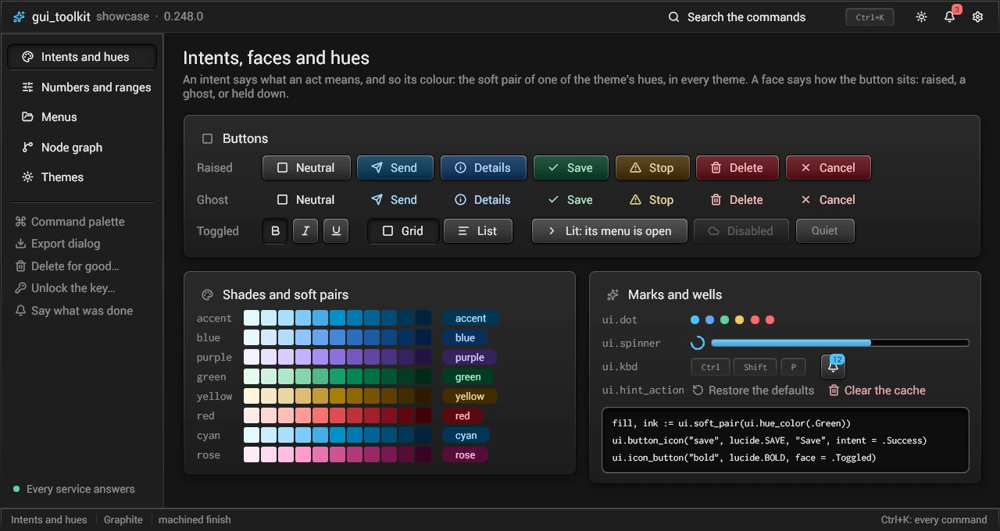
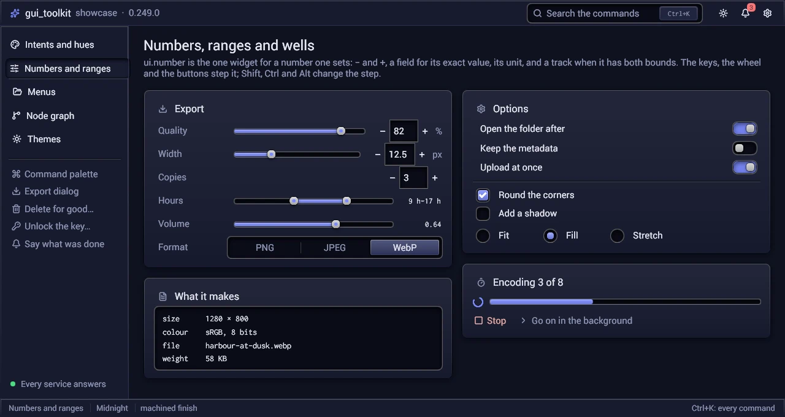

# Buttons, numbers and small widgets

The widgets a program asks for most, in `src/ui/widgets.odin` and `src/ui/widgets_ext.odin`: the buttons, the numbers one
sets, and small marks (a spinner, a dot, a label that shows what it cuts). Every widget takes a stable `id` (key.odin)
and keeps its value in the caller's variables.

## Buttons



One procedure:

```odin
button :: proc(id: string, text := "", icon := "", o := Button_Options{}) -> Signal
```

`id` is its id (key.odin: `"save"` or `"###save"`); what it shows is `text`, its words, and `icon`, a glyph of
`o.icon_font` (0: `State.icon_font`; `lucide_icons()` for Lucide's), in `o.icon_color` when given (a glyph that shows a
mode by its colour), else the words' colour. Changing them keeps its state. What the call asks
for decides how it is laid out:

| Call | How it is laid out |
|---|---|
| `button(id, text)`, `button(id, text, icon)` | one row: its glyph and words are boxes in it; its corners rounded |
| `button(id, icon = g)` | a glyph alone (a tool of a bar, a close cross): one box, its size the style's or `next`'s, a ghost unless told |
| `button(id, text, icon, {face = .Link})` | words (and a glyph) with no face, weak like a hint, lit under the pointer, as a link |

`Button_Options`:

- **`intent`** (`Intent`: Neutral, Primary, Info, Success, Warning, Danger): what the act means, and so its
  colour (a Cancel is Neutral: giving up is never coloured as a danger), the soft pair of its hue (`soft_pair`: a tinted fill, its words of the same hue), the same in every theme.
- **`face`** (`Maybe(Button_Face)`): how it sits. nil: `.Raised`, a glyph alone `.Ghost`. `.Raised`: a face of its own
  (bevelled by the machined finish). `.Ghost`: no face until the pointer is over it, a tool among many; an intent then
  colours its words. `.Toggled`: held down, the option chosen (the box flag `.Held`; a screen reader reads it pressed).
  `.Link`: no face at all, words that say what can be done and do it; an intent colours them, a little quieter away
  from the pointer.
- **`width`** (`{}`: as wide as what is in it; `fill()` a share of the row; `px(...)` its least) and **`height`** (of one
  line, in pixels, its least; 0: the toolkit's). They win over what `next` says. A button's words are never cut: a width
  or a height in pixels (from `o` or `next`) is a least, the button growing to its words on one line; given less room
  than that (a share of a narrow row, a dialog, a column), its words wrap onto more lines, its padding kept, and it grows
  taller. Its lines break only between words: a word wider than the room makes the button wider, never split. A height that is a share of the parent's (`pct`) stays that. `button_width(text, glyph)` is the width a button
  takes on one line in the style in use: what a column of buttons measures to be as wide as its longest.
- **`left`**: what is in a row wider than it at its left, whatever the style's `text_align`.
- **`quiet`**: a secondary act, smaller; a Neutral one's words weak until the pointer is over it.
- **`disabled`**: shown faded, takes no press and no focus.
- **`lit`**: drawn as under the pointer while what it opened is open (a menu). The box flag `.Lit`.
- **`tip`**: a tooltip once the pointer rests on it for `Feel.tooltip_delay_ms`; its description for a screen reader,
  and the name of a glyph alone (else its id: a glyph says nothing).
- **`icon_font`**: the glyph's font.

A row takes what the caller says of it, as any box:

- **Its size**: `o.width` and `o.height`, else `next`'s, else as wide as what is in it and a line of the toolkit's
  height. A `text_size(pad)` width is its words' and `pad` on each side. A `fill()` share is never narrower than what is
  in it; in a width of pixels too small for it, the padding gives way first.
- **Its padding**: beside its words, the toolkit's (0.95 of the font size, with the words' own `text_pad`); none when
  `next` gives a `text_pad`, which is then the words' own.
- **Its alignment**: what is in a row wider than it is centred unless a style or `next` sets `text_align`
  (`next({text_align = .Left})`, `style({text_align = .Right})`; `Style.text_aligned`), or `o.left`. The glyph of a
  glyph alone too.
- **Its words**: the style's font and size, and what `next` says of them: `font`, `font_size`, `fg`.

```odin
if ui.button("save", "Save", lucide.SAVE, {intent = .Success, icon_font = ui.lucide_icons()}).clicked { save(app) }
if ui.button("close", icon = lucide.X, o = {tip = "Close", icon_font = ui.lucide_icons()}).clicked { app.open = false }
ui.button("bold", "Bold", o = {face = app.bold ? .Toggled : .Raised})
if ui.button("restore", "Restore the defaults", o = {face = .Link}).clicked { restore(app) }
```

`ui.icon(icon, width, fg, icon_font)` is a glyph and no button: a cell `width` wide, as tall as its parent (0:
`State.icon_font`; `widget_icons()` for the toolkit's own marks, the `ICON_` characters).

The theme's tags of the buttons are named by the intent (`intent_tag`: `accent_button`, `info_button`,
`success_button`, `warn_button`, `danger_button`) and by the ghost face (`ghost_button`;
`icon_button` for a glyph alone): a theme gives them their colours (themes.md, "Button variants"); a program says
`intent =` and `face =`, not the tags.

`box_hot(b)` and `box_held(b)` say how much a box is drawn under the pointer and pressed in (its `.Lit` and `.Held`
flags count): a program's own draw of a button reads them.

### Wells and search launchers

`if ui.well("###facts") { ... }` is a sunken box, carved in the surface (code, a preview, a list of facts): the theme's
"well" colour, carved in by the machined finish. Its size and corners come from `next`; `axis` lays out its children.
A well around a field that shows when the field has the keyboard (a composer, a search): `flags = {.Focus_Within,
.Draw_Focus_Ring}`, the ring of the well lit while any box in it has the keyboard.

`ui.search_launcher(id, hint, keys, tip)` is a search field that opens a search elsewhere (a title bar's "Search the
commands" that opens the palette): sunken with an input's border, its magnifying glass, the hint in weak words, the keys
at its end. It holds no text; a click, Enter or Space is its `clicked`. Its size comes from `next` (19 ems wide).

### Search bands

`ui.search_band(id, &field, {placeholder, count, clearable})` is the search over a list that it filters: a band from edge
to edge in a field's background, a line under it, a magnifier, the field, and `count` (the number of results, weak) at its
end. The command palette, a menu that searches and a sidebar's filter all use it: one look wherever a list is searched.
Build it first in its box: its top corners are that box's (a dialog's, a menu's, a popover's). Its size comes from `next`
(the whole width, `SEARCH_BAND_EM` high). It returns the field's `Edit_Result`; focus the field with
`set_focus(res.box.key)`. The hint stays while the field is empty and has the keyboard. With `owner_keys`, the keys reach
the field through its owner (a menu keeps the keys that move in its items): the field is drawn with its caret and takes
neither the keyboard nor a click.

```odin
res := ui.search_band("find", &app.query, {placeholder = "Search the files", count = len(app.hits)})
if app.opened { ui.set_focus(res.box.key) }
if res.committed { open_hit(app) }
```

`ui.top_strip_draw` is the band's drawing, as a box's custom draw: a dialog's header uses it too, with a colour of its own.

### Words wrap rather than spill

A row whose children are wider together than it, once what may shrink did (its `fill()` spacers and shares, what has a
strictness under 1), does not let them spill past its edge to be cut: the words of a `.Text_Wrap` box of a text width
(a button's) wrap onto more lines (`wrap_room`: down to `WRAP_LEAST_EM` of its font size; a text that is never cut,
`.No_Text_Trunc`, down to its widest word, `widest_word_cached`), and the box holding them grows taller. The same in a column narrower than a child, and in a `.Wrap` row (`flow`) for an item wider than the row on its
own. A box that scrolls or lets its children overflow gives nothing: they fit already. `natural_width(b)` is the width a
box asks for before any layout (its words on one line, its children's): what a dialog and a popover measure to grow to
what is in them.

`flow(gap, id, align)`: `align` is where each line goes (`.End`: at the right, as a dialog's buttons).

### Scroll views in scroll views

Two views that scroll the same way, one in the other, show one bar on that axis: the innermost's. A box that scrolls along
an axis (`View_Scroll_X`, `View_Scroll_Y`) gives up its size along it when the room runs short, down to its `least`,
whatever its strictness: it scrolls to what it hides. In a view that scrolls the same way and lets its children overflow
(`Allow_Overflow_X`, `Allow_Overflow_Y`), it is held to that view's room. A wide table in a page that scrolls sideways
scrolls in its own box, and the page does not scroll for it.

## Tool bars (`src/ui/toolbar.odin`)

`if ui.toolbar(id) { ... }` is a bar of groups (`next` gives its size). `if ui.toolbar_group(id, o) { ... }` is one group,
built by the caller's code as anywhere else. When the groups do not fit, the bar folds them, the lowest `o.priority`
first (of two alike, the later one), until the rest fits with a "…" button; a group with `o.pinned` never folds (the
bar's end buttons). `o.separator` draws a line before the group in the bar. The "…" button stands before the first
pinned group; a click opens a panel under it where each folded group is a row, built by the same code: what is in it
works there as in the bar. A press outside the panel, or Escape, closes it; `ui.toolbar_menu_open(id)` says whether it
is open (a program's own Escape waits). A group's width is measured where it is built (`natural_width`) and kept.

```odin
ui.next({width = ui.fill(), height = ui.px(bar_h)})
if ui.toolbar("editor_bar") {
    if ui.toolbar_group("tools", {priority = 2}) { ... }
    if ui.toolbar_group("props", {separator = true}) { ... }   // folds first
    ui.spacer(ui.fill())
    if ui.toolbar_group("acts", {priority = 1}) { ... }
    if ui.toolbar_group("end", {pinned = true}) { ... }        // Cancel, Done: always shown
}
```

## Numbers



`ui.number(id, &value, lo, hi, step, unit, slider, disabled)` is the one widget for a number one sets, of any integer
or float type: − and + around a field where its exact value is typed, then its unit; with `slider = true` and both
bounds, a slider before them. It returns whether the value changed this frame.

```odin
ui.number("###count", &app.count, lo = 0)                                   // an int, no upper bound
ui.number("###width", &app.width, lo = 1, hi = 40, step = 0.5, unit = "px", slider = true)
```

- **Bounds**: `lo` and `hi` are optional (`nil`: none on that side). Every change is clamped to them and rounded to
  `step` (an integer to a whole number). At a bound, its button is disabled.
- **Step**: one step of the keys, the wheel and the buttons (0: 1; a float with both bounds: a hundredth of the range).
- **Field**: shows the value (its digits, a float's as many after the point as `step` has). Given the keyboard, the field holds the value, all selected; what is typed applies at Enter or when
  the keyboard goes elsewhere. Escape, or text that is no number, gives the value back. The text being typed lives in
  `ui.State` (`number_edit`): one field has the keyboard at a time, so a number keeps nothing of the caller's.
- **Keys** (the field has the keyboard): Up / Down a step, Page Up / Page Down ten; Shift ten times as much, Ctrl a
  hundred, Alt a tenth (`num_step_delta`).
- **Wheel**: over the field or the slider, a notch is a step (Shift: ten); in a view that scrolls, only once it has the
  keyboard (`wheel_steps`).
- **Buttons**: a step each (Shift: ten), repeated while held (`repeat_pressed`). They are no Tab stops: the field is.
- **Screen readers**: the field is a spin button (value, bounds, step; Set value, Increment, Decrement); the slider a
  slider.

`ui.slider(id, &value, lo, hi, step, format)` is the track alone, the lowest widget: its keys (arrows a step, Home / End,
Page Up / Page Down ten steps), its wheel, its screen reader's requests. `format` is a printf format of the value's text
at its right end ("": none, the track runs to it).

`ui.range_slider(id, &lo_v, &hi_v, lo, hi, step, format)` has two thumbs on one track. Each thumb is a Tab stop and a
slider for a screen reader; the active thumb (the one a press took, or the one Tab reached) moves as `slider` does:
arrows a step, Home / End to its ends (the other thumb is one), Page Up / Page Down ten steps. The wheel over the track
moves the active thumb (none: the one nearest the pointer). `format` is each value's ("%.0f": "20-80"; "": no text).
It shares its keys, its rounding and its drawing with `slider`.

## What a value widget returns

Every widget that edits a value of the caller's returns `changed: bool`, true in the frame the value changed:
`checkbox`, `radio`, `toggle`, `slider`, `range_slider`, `number`, `segmented`, `dropdown`, `tabs`, the colour pickers
(`color_picker`, `hue_picker`, `alpha_picker`, `sat_val_picker`), `hotkey_field`.

```odin
if ui.toggle("###dark", "Dark", &app.dark) { apply_theme(app) }
```

What else its box says (hovered for a tooltip, a right click, its key for a test or a screen reader) is the signal of
its box, read right after it with `prev_box`:

```odin
if ui.checkbox("###done", task.title, &task.done) { app.dirty = true }
if ui.signal(ui.prev_box("###done")).right_clicked { open_menu(app, task) }
```

`hue_picker(id, &hue, axis)` and `alpha_picker(id, hue, sat, val, &alpha, axis)` lay their bar along `axis` (`.X`:
left to right, `.Y`: top to bottom).

## Text fields

A single-line field is a `Line_Edit` (the program keeps it), edited by `line_edit(id, &edit, Line_Edit_Options{...})`; a
multi-line one is a `Text_Edit`, edited by `text_edit(id, &edit, Text_Edit_Options{...})`. Their procedures carry the
type's name: `line_edit_string`, `line_edit_set`, `line_edit_clear`, `line_edit_wipe`, `line_edit_clear_history`,
`line_edit_undo`, `line_edit_select_all`...; `text_edit_string`, `text_edit_set`, `text_edit_select_all`, `text_edit_clear_history`,
`text_edit_destroy`... `edit_menu` is the menu of either ([menus](menus.md)); `input_frame` is one surface for a field
and what goes with it (getting-started.md).

`Line_Edit_Options`:

- **`placeholder`**: weak words while the field is empty and has no keyboard.
- **`placeholder_focused`**: the placeholder stays while the field has the keyboard (a search opened with the keyboard in it).
- **`kind`** (`Line_Edit_Kind`): `.Plain`; `.Secret`, a password (bullets, neither copied nor cut); `.Read_Only`, shown,
  selected and copied, never changed.
- **`reveal`** (`^bool`, with `.Secret`): an eye at its end shows the text and hides it again.
- **`clearable`**: a cross at its end empties it while it holds text (not `.Read_Only`, nor beside the eye).
- **`own_menu`**: the program builds its own menu on a right press; else the field opens `edit_menu`.

`Text_Edit_Options`: `placeholder`, `line_numbers`, `tab_indents` (Tab inserts spaces), `wrap`, `auto_height` with
`min_lines` and `max_lines`, `highlight` (syntax colouring, text.md), `own_menu`, `enter_commits` (Enter is
`committed` and Shift+Enter breaks the line, as in a chat box or a caption typed in place; without it Enter breaks the
line and Ctrl+Enter is `committed`).

```odin
ui.line_edit("###password", &app.password, {kind = .Secret, reveal = &app.shown})
ui.text_edit("###notes", &app.notes, {placeholder = "Notes", wrap = true, auto_height = true, max_lines = 8})
```

## Small widgets

| Procedure | What it is |
|---|---|
| `spinner(id, size)` | the busy arc, turning: three quarters of a circle in the accent. While shown it asks for the next frames itself (none with animations off); a busy progress indicator to a screen reader |
| `dot(id, size, intent)` | a filled disc of the intent's hue (a recording, a state); with no intent, of the text's colour where it stands (a dot in a button's words). The icon fonts have no filled circle |
| `label_tip(text)` | a label whose whole text shows in a tooltip when its box cuts it and the pointer rests on it (`Feel.tooltip_delay_ms`); it takes no press |

## A secret's memory

`ui.line_edit_wipe(&f)` empties a `Line_Edit` and leaves nothing of its text in memory: its buffer (all its capacity) and
every step of its undo and redo history are zeroed before they go. Call it once a password or a PIN is used or given
up. A step the history drops on its own (the oldest, a redo replaced) is zeroed too. What the buffer held before it last
grew is out of reach: reserve the capacity of a secret's field before it is typed in (`reserve(&f.buf, n)`).
