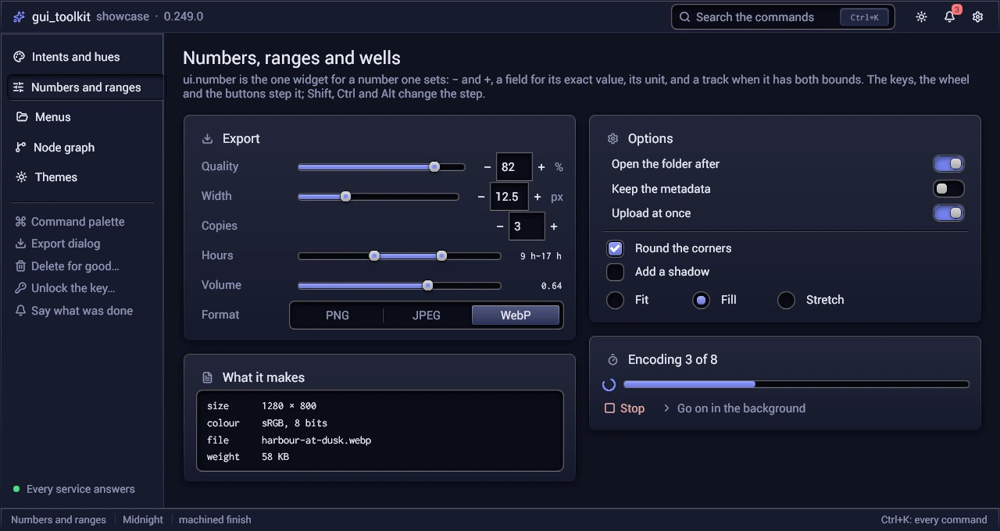
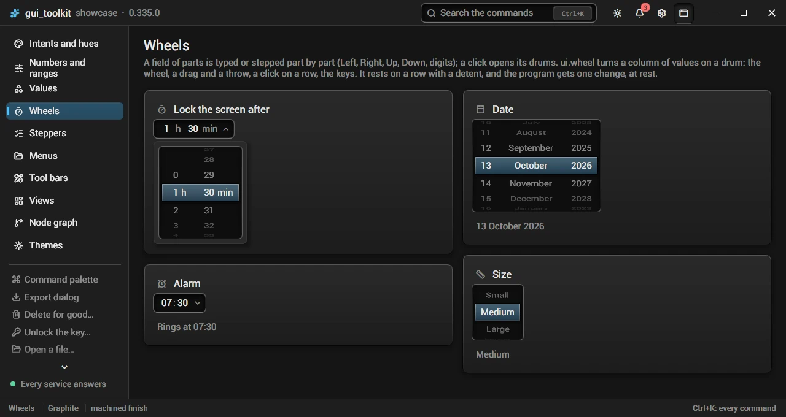

# Buttons, numbers and small widgets

The widgets a program asks for most, in `src/ui/widgets.odin` and `src/ui/widgets_ext.odin`: the buttons, the numbers one
sets, and small marks (a spinner, a dot, a label that shows what it cuts), and the stepper of a long work. Every widget takes a stable `id` (key.odin)
and keeps its value in the caller's variables.

## Buttons


One procedure:

```odin
button :: proc(id: string, text := "", icon := "", o := Button_Options{}) -> Signal
```

`id` is its id (key.odin: `"save"` or `"###save"`); what it shows is `text`, its words, and `icon`, a glyph of
`o.icon_font` (0: `State.icon_font`; `lucide_icons()` for Lucide's), in `o.icon_color` when given (a glyph that shows a
mode by its colour), else the words' colour. Changing them keeps its state. What the call asks
for decides how it is laid out:

| Call | How it is laid out |
|---|---|
| `button(id, text)`, `button(id, text, icon)` | one row: its glyph and words are boxes in it; its corners rounded |
| `button(id, icon = g)` | a glyph alone (a tool of a bar, a close cross): one box, its size the style's or `next`'s, a ghost unless told |
| `button(id, text, icon, {face = .Link})` | words (and a glyph) with no face, weak like a hint, lit under the pointer, as a link |

Every control has one height: `ui.CONTROL_HEIGHT_EM` (2 em) of the font size, `ui.control_height()` in pixels with the
density. A button, a field, a list to choose from (`dropdown`, the font picker), a number, a segmented control in a form
row, a tool bar's item: two controls one beside or under the other line up. A row taller than its control (a form's
row, a settings line) keeps room between two controls. Every control with a face and an edge has the theme's corners
of a control (`ui.shape_of(.Control)`, 0.45 em unless the theme says another: [themes.md](themes.md), "A theme's
shape"), scaled by the rounding setting (`appearance.rounding`); the showcase's test checks every page for a square one.

`Button_Options`:

- **`intent`** (`Intent`: Neutral, Primary, Info, Success, Warning, Danger): what the act means, and so its
  colour (a Cancel is Neutral: giving up is never coloured as a danger), the soft pair of its hue (`soft_pair`: a tinted fill, its words of the same hue), the same in every theme.
- **`face`** (`Maybe(Button_Face)`): how it sits. nil: `.Raised`, a glyph alone `.Ghost`. `.Raised`: a face of its own
  (bevelled by the machined finish). `.Ghost`: no face until the pointer is over it, a tool among many; an intent then
  colours its words. `.Toggled`: held down, the option chosen (the box flag `.Held`; a screen reader reads it pressed).
  `.Link`: no face at all, words that say what can be done and do it; an intent colours them, a little quieter away
  from the pointer. `.Row`: a line of a navigation (a sidebar's page): a row's face, inset and rounded, under the
  pointer, and with **`selected`** the selected row's, a bar of the accent at its leading edge (a screen reader reads
  it as the current page).
- **`width`** (`{}`: as wide as what is in it; `fill()` a share of the row; `px(...)` its least) and **`height`** (of one
  line, in pixels, its least; 0: the toolkit's). They win over what `next` says. A button's words are never cut: a width
  or a height in pixels (from `o` or `next`) is a least, the button growing to its words on one line; given less room
  than that (a share of a narrow row, a dialog, a column), its words wrap onto more lines, its padding kept, and it grows
  taller. Its lines break only between words: a word wider than the room makes the button wider, never split. A height that is a share of the parent's (`pct`) stays that. `button_width(text, glyph)` is the width a button
  takes on one line in the style in use: what a column of buttons measures to be as wide as its longest.
- **`size`** (`Button_Size`: Medium, Small, Large): all its measures together, its line, its room, its words and its
  glyph, because each is of the font size: a size is a font size for the button alone (`button_size_scale`: 0.85 and
  1.2). Small for an act in each row of a list, often with the Ghost face; Large for the one act of a page.
- **`left`**: what is in a row wider than it at its left, whatever the style's `text_align`.
- **`quiet`**: a secondary act, smaller; a Neutral one's words weak until the pointer is over it.
- **`disabled`**: shown faded, takes no press and no focus.
- **`busy`**: its act is under way. The spinner turns in its glyph's place (a cell is made for it when it has none), the
  button keeps its size and look, a click does nothing, and a screen reader hears it busy. Put the button in this state
  instead of a spinner beside it: nothing moves when the act starts or ends.

  ```odin
  if ui.button("install", "Accept and install", lucide.DOWNLOAD, {intent = .Success, busy = app.reading}).clicked { start(app) }
  ```
- **`lit`**: drawn as under the pointer while what it opened is open (a menu). The box flag `.Lit`.
- **`tip`**: a tooltip once the pointer rests on it for `Feel.tooltip_delay_ms`; its description for a screen reader,
  and the name of a glyph alone (else its id: a glyph says nothing).
- **`icon_font`**: the glyph's font.

A row takes what the caller says of it, as any box:

- **Its size**: `o.width` and `o.height`, else `next`'s, else as wide as what is in it and a line of the toolkit's
  height. A `text_size(pad)` width is its words' and `pad` on each side. A `fill()` share is never narrower than what is
  in it; in a width of pixels too small for it, the padding gives way first.
- **Its padding**: beside its words, the toolkit's (0.95 of the font size, with the words' own `text_pad`); none when
  `next` gives a `text_pad`, which is then the words' own.
- **Its alignment**: what is in a row wider than it is centred unless a style or `next` sets `text_align`
  (`next({text_align = .Left})`, `style({text_align = .Right})`; `Style.text_aligned`), or `o.left`. The glyph of a
  glyph alone too.
- **Its words**: the style's font and size, and what `next` says of them: `font`, `font_size`, `fg`.

```odin
if ui.button("save", "Save", lucide.SAVE, {intent = .Success, icon_font = ui.lucide_icons()}).clicked { save(app) }
if ui.button("close", icon = lucide.X, o = {tip = "Close", icon_font = ui.lucide_icons()}).clicked { app.open = false }
ui.button("bold", "Bold", o = {face = app.bold ? .Toggled : .Raised})
if ui.button("restore", "Restore the defaults", o = {face = .Link}).clicked { restore(app) }
```

`ui.icon(icon, width, fg, icon_font)` is a glyph and no button: a cell `width` wide, as tall as its parent (0:
`State.icon_font`; `widget_icons()` for the toolkit's own marks, the `ICON_` characters).

The theme's tags of the buttons are named by the intent (`intent_tag`: `accent_button`, `info_button`,
`success_button`, `warn_button`, `danger_button`) and by the ghost face (`ghost_button`;
`icon_button` for a glyph alone): a theme gives them their colours (themes.md, "Button variants"); a program says
`intent =` and `face =`, not the tags.

`box_hot(b)` and `box_held(b)` say how much a box is drawn under the pointer and pressed in (its `.Lit` and `.Held`
flags count): a program's own draw of a button reads them.

### States: hover, press, toggled, chosen

Each widget draws its states in its own design and on its own geometry, never as a layer over it
([interaction-states](../src/md/features/interaction-states.md)). Under the pointer a face lifts a step toward the
theme's tint (lighter on a dark palette, darker on a light one); pressed it sinks (a gradient or a lit face turns over,
glass loses its gloss, a machined key goes in); a toggled one (`.Held`) stays sunk and lifts half a step under the
pointer. A press shows at once and eases out on release; a hover eases in and out with the theme's transition.

- A box of a program's own with `.Draw_Hot_Effects` gets this from its face with no code: its background lifts and
  sinks. Without a background, its face appears under the pointer in its own shape and radii, opaque once settled
  (its tags' `hover_sheen` makes it raised: a key in the machined finish).
- A check box, a radio and a switch: the row is the target, the mark reacts (its inside and ring, or its accent face;
  machined, the well's face and lit rim); the row draws nothing.
- A field: its border and face lift a little; a press does not sink it.
- A selected row is the theme's `selected` tint as its face; under the pointer it lifts. A list's selection is
  `weak_selected` when the list does not have the keyboard or the window is not the user's (`inactive`).
- A row (`.Row`: a row of a list, a table, a menu, the palette, a file browser's places, a sidebar) draws its face
  inset in it, `ROW_FACE_INSET_EM` from its sides and `ROW_FACE_GAP_PX` from its top and bottom, rounded as a row
  (the box's radius, the theme's `shape_of(.Row)` by default, scaled by the rounding setting; at most half the face's height),
  in the finish: a plain fill (flat), a soft gradient and a faint lit line (gradient), a calm gloss with a fine edge of
  the accent (glass), a low plate (machined, edged). The content does not move. Selected rows that touch (`.Chosen`)
  are one rounded block. A navigation's selected row (tag `nav`: a sidebar's page, a place, the palette's row) has a
  short bar of the accent at its leading edge (theme: `row_mark`). A zebra stripe or a row's `tint` stays square, from
  edge to edge, under the face. Square rows: `rounding` 0, the edged finish, or `next({radius = 0})` before the row.
- A sidebar's page is a button of face `.Row`, `selected` on the page shown: `ui.button(id, title, glyph, {face =
  .Row, selected = shown, width = ui.fill(), left = true})`. A `.Row` button stays on one line, truncates with `…` when
  narrower than its words, and shows its full words in a tooltip on hover. An icon-only `.Row` button (a collapsed
  sidebar rail) shows its `tip` immediately on hover with zero delay (`Button_Options.tip_now` requests the same on any
  button). Non-`.Row` buttons wrap when narrow, keeping vertical padding above and below their lines.

A custom draw paints its own states with the same parts:

| Procedure | What it gives |
|---|---|
| `face_state(b)` | `Face_State`: how much `b` is under the pointer, pressed (at once), toggled |
| `face_step(st, hover, press)` | how far a face goes toward the tint in that state (the theme's steps) |
| `box_face(s, b)`, `draw_face(s, dc, r, radii, f)` | the face a box draws in its state, and its painting by the finish |
| `face_of(rest, under, tint, st, hover, press, hover_sheen, space)` | the same from colours: a face of colour `rest` (alpha 0: none) on `under` |
| `state_fill(b, "hover_fill", under)` | the opaque face of a state over `under`, with `b`'s tags' step |
| `state_tint()` | the theme's tint of the states, opaque |
| `mark_colors(st, t, ring, accent, under, tint)` | a check box's or a radio's colours in a state |
| `row_face_of(s, b)` | a row's face: its rect and radii, the block of selected rows it is part of, how it joins them |
| `row_face_rect(r, inset, gap, joins)`, `row_face_radii(face, radius, joins)` | the same from a rect: inset, square where joined |
| `row_face(s, b)`, `row_face_paint(dc, r, radii, color, k, sunk, edge)` | a row's face in its state, and its painting by the finish |

A custom draw reads the states when it draws (`face_state(b)` in the draw proc), not when its box is built: the states
are stepped at the end of the build.

### Wells and search launchers

`if ui.well("###facts") { ... }` is a sunken box, carved in the surface (code, a preview, a list of facts): the theme's
"well" colour, carved in by the machined finish. Its size and corners come from `next`; `axis` lays out its children.
`pad = ui.INNER_PAD` insets its content the same on its four sides; `edge = false` draws no border (a tinted area inside
a card).

### The spacing scale, cards and list cards

Every gap and inset of a page is a step of one scale ([spacing.md](../src/md/features/spacing.md)):
`ui.SPACE_1`..`ui.SPACE_6` (0.25, 0.5, 0.75, 1, 1.5 em), named by role: `PAGE_MARGIN`, `CARD_PAD`, `ROW_PAD`,
`GROUP_GAP`, `ITEM_GAP`, `LINE_GAP`, `ICON_GAP`, `CONTROL_GAP`, `TOOL_GAP`, `INNER_PAD`. `ui.space(step)` is a spacer of
that many font sizes, on whole pixels. A program uses the roles, never values of its own.

`if ui.card("Title", icon) { ... }` is a panel whose content sits `CARD_PAD` from its four edges; nothing follows it, the
page puts `GROUP_GAP` or `ITEM_GAP` between two cards. `if ui.list_card("###id") { if ui.card_row("###a") { ... } }` is
a card of rows split by hairlines, each row `ROW_PAD` above and below, its first and last rows `CARD_PAD` from its edges.

`ui.card(title, icon, id = "", o = ui.Card_Options{})`: `id` is its box's id (`""`: `"###card_<title>"`; give one to
each card without a title in a list). `o` is its own look, in every finish; a zero field is the theme's:

| `Card_Options` | |
|---|---|
| `radius` | its corners, logical pixels (0: 0.6 font size) |
| `look.top`, `look.bottom` | its face, a gradient from its top to its bottom (the flat forms: their mean) |
| `look.border` | its edge, a `Maybe(Color)` (nil: the finish's; a colour of alpha 0, `Color{}` included: none) |
| `look.rim` | the light along its top edge, an alpha (machined, edged) |
| `look.shadow` | its soft shadow, logical pixels (machined, edged; 0: none) |

```odin
look := ui.Plate_Look{top = warm_top, bottom = warm_bottom, border = ui.with_alpha(ui.color("accent"), 0.55), rim = 0.1, shadow = 8}
if ui.card("", id = fmt.tprintf("###perm_%s", p.id), o = {look = look}) { ... }
```

`ui.list_card(id, o)` takes the same options. A `.Plate` box of a program's own takes a look the same way:
`b.plate = ui.frame_new(ui.Plate_Look); b.plate^ = look` after `build_box` (this build's arena).

`ui.card_box() -> ^Box`, inside a card's scope (`card` or `list_card`, a row of it too): the card's own box, its `.Plate`
panel, of the innermost card; nil outside a card. A program gives it the keyboard or reads its rect with it, never by
counting the card's inner boxes (`parent_box()` in a card is its body, and the boxes between are the card's own):

```odin
if ui.card("", id = fmt.tprintf("###perm_%s", p.id), o = {look = look}) {
	if p.focus_now { ui.set_focus(ui.card_box().key) }
	...
}
```

`ui.set_wireframe(state, on)` draws every box as its outline and each gap in the colour of its step, a gap off the
scale in red, the box under the pointer named: where a page leaves the scale shows at a glance. Ctrl+Alt+Shift+W
toggles it in a build with the devtools; Chrome DevTools' "Layer borders" too.

`ui.set_exploded(state, on)` draws the window's boxes as planes in depth instead of the page: each parent behind its
children, menus, toasts and tooltips on their own planes. Turned on, the flat page eases into the view in about 600 ms;
turned off, it eases back, then the page takes input again. Its panel is a view (`ui.EXPLODED_VIEW`, "Exploded
view"), floating at the top right at first: it sets the mode (Layers, Depths, Outlines), the yaw, the pitch, the
spread and the zoom, and moves, docks or goes to a window of its own as any view; its close cross turns the view off.
A drag on the planes turns them, the wheel spreads them, Tab changes the mode, Escape turns the view off; the page
takes no input meanwhile. Ctrl+Alt+Shift+E toggles it in a build with the devtools.
`ui.exploded(state)` says whether it is on: false from the moment it is turned off.

A well around a field that shows when the field has the keyboard (a composer, a search): `flags = {.Focus_Within,
.Draw_Focus_Ring}`, the ring of the well lit while any box in it has the keyboard.

`ui.search_launcher(id, hint, keys, tip)` is a search field that opens a search elsewhere (a title bar's "Search the
commands" that opens the palette): sunken with an input's border, its magnifying glass, the hint in weak words, the keys
at its end. It holds no text; a click, Enter or Space is its `clicked`. Its size comes from `next` (19 ems wide).

### Search bands

`ui.search_band(id, &field, {placeholder, count, clearable})` is the search over a list that it filters: a band from edge
to edge in a field's background, a line under it, a magnifier, the field, and `count` (the number of results, weak) at its
end. The command palette, a menu that searches and a sidebar's filter all use it: one look wherever a list is searched.
Build it first in its box: its top corners are that box's (a dialog's, a menu's, a popover's). Its size comes from `next`
(the whole width, `SEARCH_BAND_EM` high). It returns the field's `Edit_Result`; focus the field with
`set_focus(res.box.key)`. The hint stays while the field is empty and has the keyboard. With `owner_keys`, the keys reach
the field through its owner (a menu keeps the keys that move in its items): the field is drawn with its caret and takes
neither the keyboard nor a click.

```odin
res := ui.search_band("find", &app.query, {placeholder = "Search the files", count = len(app.hits)})
if app.opened { ui.set_focus(res.box.key) }
if res.committed { open_hit(app) }
```

`ui.top_strip_draw` is the band's drawing, as a box's custom draw: a dialog's header uses it too, with a colour of its own.

### What gives way in a row that is too narrow

When the children of a row are wider together than the row, they give up width in this order:

1. An empty `fill()` or `pct` spacer gives its width first: a box with no children, no text, no custom draw, nothing
   drawn and nothing to click. Two spacers give in proportion to their widths, so what they centre stays centred.
2. A `fill()` share that holds boxes gives what it has beyond what is in it (`natural_width`).
3. What has a strictness under 1 shrinks by its size: a label of `text_size(0, 0)` is cut here, only by what is still
   missing.

A row `label … spacer(fill()) … buttons` therefore lays out as before when it has room: the spacer pushes the buttons to
the right edge. The label is cut only when the row truly lacks room for it. A spacer that asks for the whole row
(`spacer(fill())` at the end of a row of fixed parts) never takes the room of a label.

No child gives up width under the width its content needs (`Box.least_x`, as CSS's `min-width: auto`): wrapped words
their widest word (a path or an address longer than 8 em may break), a box of its own size what its strictness keeps, a
row the sum of its children's, a column the widest. A card whose row of fields is wider than its share of the page
stays as wide as the row, and the overflow goes up to the view that scrolls. A box that scrolls along X, lets its
children overflow or has `.Fits_Width` (a tool bar that folds what does not fit) asks nothing of its parent for what is
in it. Design: [src/md/features/least-width.md](../src/md/features/least-width.md).

A row or a column puts its `gap` (`next({gap = ...})`) between two children along its axis, as CSS's `gap`: a stack of
cards takes `gap = {0, em * ui.ITEM_GAP}` instead of a spacer between each two.

In a `flow`, a child sized as a share of the width (`fill()`, `pct`, `fill_least`) is a column: a line takes as many as
fit at the width their content needs (at least their own `least`), then they split the rest of the line by their
values. Two columns of cards `{kind = .Percent, value = 1, least = em * 24}` stand side by side when the page holds
both, one under the other when it does not. A column starts at the top of its line; a button is centred in it.

A grid of equal columns gives each cell `pct(1.0 / columns)` and puts its part of the gaps inside the cell (column `c`
of `n`: `c / n` of a gap before, `(n - 1 - c) / n` after). Every cell then has the same width, the cells of a last row
that is not full too. `prefs_page.theme_cards` is built so.

### Words wrap rather than spill

A row whose children are wider together than it, once what may shrink did (its `fill()` spacers and shares, what has a
strictness under 1), does not let them spill past its edge to be cut: the words of a `.Text_Wrap` box of a text width
(a button's) wrap onto more lines (`wrap_room`: down to its widest word, `widest_word_cached`; never between the
letters of a word of a sentence), and the box holding them grows taller. The same in a column narrower than a child, and in a `.Wrap` row (`flow`) for an item wider than the row on its
own. A box that scrolls or lets its children overflow gives nothing: they fit already. `natural_width(b)` is the width a
box asks for before any layout (its words on one line, its children's): what a dialog and a popover measure to grow to
what is in them.

### A cut text shows itself whole

A one-line text narrower than its words (data: a row's title, a cell, a path in a column) ends with "...". That
ellipsis is a target in every program, with no flag: the pointer over it is a hand and lights it, and a click opens a
bubble under it with the whole text, selectable and wrapped at a reasonable width, and two small glyphs in its corner:
Copy and close. The bubble stays until its cross, Escape or a
press outside it; Ctrl+C in it copies the selection, or all of it. The rest of the box acts as before: a row's click is
anywhere but on its ellipsis. `text_reveal_shown()` says whether one is open, and its text. Design:
[src/md/features/text-reveal.md](../src/md/features/text-reveal.md).

`flow(gap, id, align)`: `align` is where each line goes (`.End`: at the right, as a dialog's buttons).

### Scroll views in scroll views

Two views that scroll the same way, one in the other, show one bar on that axis: the innermost's. A box that scrolls along
an axis (`View_Scroll_X`, `View_Scroll_Y`) gives up its size along it when the room runs short, down to its `least`,
whatever its strictness: it scrolls to what it hides. In a view that scrolls the same way and lets its children overflow
(`Allow_Overflow_X`, `Allow_Overflow_Y`), it is held to that view's room. A wide table in a page that scrolls sideways
scrolls in its own box, and the page does not scroll for it.

## Tool bars (`src/ui/toolbar.odin`)

`if ui.toolbar(id, o) { ... }` is a bar of groups; `if ui.toolbar_group(id, o) { ... }` is one group; the group's block
declares its items, each once. The program chooses what happens when the window is too narrow, `o.overflow`:

- `.Wrap`: the bar takes more lines, as tall as they are. A group goes to the next line whole; a group wider than a line
  wraps its items, each whole (a label with its slider, the swatches with their disc). `next` gives the bar's width; a
  height in pixels is a line's.
- `.Fold`: the bar keeps one line (`next` gives its size). What does not fit goes into the menu of a "…" button: the
  lowest priority first (of two alike, the later group), a group's last item first, the group whole once its items are
  all folded. The menu is a toolkit menu: a folded group is a section (its `title` as a heading, a separator between
  two), a tool is a row (icon, label, shortcut), a control is a row with its label at the left and its widget at the
  right, the widgets in one column. Arrows, Enter and Escape work as in every menu; the control rows are for the
  pointer. `ui.toolbar_menu_open(id)` says whether the menu is open (a program's own Escape waits).

| Procedure | What it is |
|---|---|
| `toolbar(id, {overflow, align, labels})` | the bar; `align`: `.Start` (the default: the groups from the bar's start) or `.Center` (`.Wrap`: each line centred, the last one too; `.Fold`: the groups left in the bar centred in the room before the "…" button and the pinned groups); the pinned groups stay at its end, in `.Wrap` at the end of the last line; `labels.more`: the "…" button's tooltip (zero: the toolkit's words) |
| `toolbar_group(id, {title, priority, pinned, end, separator})` | a group: `title` heads its menu section; `pinned` puts it at the bar's end (after the "…" button, at the end of the last line), where it never folds nor wraps away; `end` puts it at the bar's end too, before the "…" button and the pinned groups, and `.Fold` folds it as any group (`.Wrap` keeps it at the end of the last line); `separator` draws a line before it. Build the groups in that order: the others, the `end` ones, the pinned ones |
| `toolbar_tool(id, {label, icon, shortcut, command, priority, words, bar_label, on, disabled, intent, face, lit, icon_font, icon_intent, badge, dot, badge_intent, menu, tip}) -> bool` | an act. The toolkit builds it: a glyph button in the bar (its words with `words`, or with no glyph), a row in the menu. In the bar it has no face until the pointer is over it (`Button_Face.Ghost`), but words of intent `.Primary` (Done, Send), which are raised; `face` chooses `.Ghost`, `.Raised` or `.Link`. `bar_label`: shorter words for the bar ("high"), `label` staying the menu row's, the tooltip's and a screen reader's ("Thinking: high"). `lit`: its face shown while a picker it opened is open. `icon_intent`: its glyph in an intent's hue (a mode it shows). `badge`: a count on its corner (`ui.badge`); `dot`: `.Still` or `.Pulse`, a dot there when it has no count (`ui.badge_dot`); `badge_intent`: their hue. These four are the bar's: the menu row says the mode in its words. `command` gives the label, icon and first key that the fields leave "". `on`: held down in the bar, checked in the menu. True when clicked, in either place. `menu`: the id of a menu the program builds as always (`if ui.menu(id) { ... }`, outside the bar); the tool opens it under itself and is lit while it is open, and folded it is a submenu row of the "…" menu, built by the same block. Such a tool is never true. That menu filters what is typed, as every menu ([menus](menus.md)). `tip`: its tooltip in the bar, whatever it shows ("": the command's tooltip, else the label and shortcut of a glyph tool, or of words with a shortcut) |
| `toolbar_control(id, {label, priority, labelled}) -> bool` | `if toolbar_control(...) { ...widget... }`: a property whose widget the block builds, in the bar (its label before it with `labelled`) or in the right column of a menu row |
| `toolbar_in_menu() -> bool` | the item being built is in the menu (a widget that sizes itself otherwise there) |
| `toolbar_menu_show(id) -> bool` | opens the bar's "…" menu as a click on its button does (a picture, a tour); false while the bar shows no laid-out "…" button: call it until it is true |

In the "…" menu, a group of one item has no title: its one row already says what it is, and the separators keep it
apart.
| `toolbar_separator()` | a vertical line and its room: for a bar a program builds itself (in a tool bar, use the group's `separator`) |

The spacing is the toolkit's, for every program: 0.2 em between two items, 0.15 em more on each side of a control (its
widget is seen to its edge, a ghost tool's glyph stands inside its face), a separator's room (0.9 em) between two groups
of one line, its line in it when the later group has `separator`; each follows the density. A separator never starts
a line: a group that wraps starts its line with no room and no line. Every item sits on its line's middle, a control
taller or shorter than a tool too.

An item's `priority` (nil: its group's) places it among every group's parts: a rare tool of a group kept long folds
before the needed items of a group that folds early. Order a group's items from the most needed to the least. The bar
puts its pinned groups at its end itself: build no spacer in it. Build a `.Fold` bar of items only: what a group builds
besides its items is not shown once the group folds.

```odin
ui.next({width = ui.fill(), height = ui.px(bar_h)})
if ui.toolbar("editor_bar", {overflow = .Fold}) {               // .Wrap: the same groups, on more lines
    if ui.toolbar_group("tools", {title = "Tools", priority = 2}) {
        for t in Tool {
            if ui.toolbar_tool(tool_ids[t], {command = TOOL_COMMANDS[t], on = tool == t}) { tool = t }
        }
    }
    if ui.toolbar_group("style", {title = "Style", separator = true}) {   // folds first, its last item first
        if ui.toolbar_control("colour", {label = "Colour"}) { swatches(&colour) }
        if ui.toolbar_control("width", {label = "Width", labelled = true}) { ui.slider("###w", &width, 1, 20) }
    }
    if ui.toolbar_group("end", {pinned = true}) {                // Cancel, Done: always shown, at the end
        if ui.toolbar_tool("cancel", {label = "Cancel", words = true}) { cancel() }
        if ui.toolbar_tool("done", {label = "Done", words = true, intent = .Primary}) { done() }
    }
}
```

## Numbers



`ui.number(id, &value, lo, hi, step, unit, slider, disabled, default, parse)` is the one widget for a number one sets, of any integer
or float type: − and + around a field where its exact value is typed, then its unit; with `slider = true` and both
bounds, a slider before them. It returns whether the value changed this frame. `parse` (`ui.Number_Parse{fn, user}`)
reads what is typed when the field takes more than a number: a setting's unit and its suffixes ("1.5 s" in a field of
milliseconds; the settings page gives it from the value kind); zero, a number in either decimal mark.

```odin
ui.number("###count", &app.count, lo = 0)                                   // an int, no upper bound
ui.number("###width", &app.width, lo = 1, hi = 40, step = 0.5, unit = "px", slider = true)
```

- **Bounds**: `lo` and `hi` are optional (`nil`: none on that side). Every change is clamped to them and rounded to
  `step` (an integer to a whole number). At a bound, its button is disabled.
- **Step**: one step of the keys, the wheel and the buttons (0: 1; a float with both bounds: a hundredth of the range).
- **Field**: shows the value (its digits, a float's as many after the point as `step` has). Given the keyboard, the field holds the value, all selected; what is typed applies at Enter or when
  the keyboard goes elsewhere. Escape, or text that is no number, gives the value back. The text being typed lives in
  `ui.State` (`number_edit`): one field has the keyboard at a time, so a number keeps nothing of the caller's.
- **Keys** (the field has the keyboard): Up / Down a step, Page Up / Page Down ten; Shift ten times as much, Ctrl a
  hundred, Alt a tenth (`num_step_delta`).
- **Wheel**: over the field or the slider, a notch is a step (Shift: ten); in a view that scrolls, only once it has the
  keyboard (`wheel_steps`).
- **Buttons**: a step each (Shift: ten), repeated while held (`repeat_pressed`). They are no Tab stops: the field is.
- **Screen readers**: the field is a spin button (value, bounds, step; Set value, Increment, Decrement); the slider a
  slider.
- **Default** (`default`, optional): the value a person comes back to. The field's right click opens a menu with
  "Reset to 10"; a double click on the slider's track sets it too. `ui.slider` takes the same `default` (a double click
  on its track).

`ui.slider(id, &value, lo, hi, step, format, default)` is the track alone, the lowest widget: its keys (arrows a step, Home / End,
Page Up / Page Down ten steps), its wheel, its screen reader's requests. `format` is a printf format of the value's text
at its right end ("": none, the track runs to it). Its width is never less than its pads, a track of 4 em and its
value's room (about 10 em with a value; 3.5 em without one, as in `ui.number`): a share of a narrow row or a width given too small does not leave the knob
alone. With no width given (in a box as wide as what is in it: a tool bar's control, a menu's control row) it is 12 em.

`ui.range_slider(id, &lo_v, &hi_v, lo, hi, step, format, default)` has two thumbs on one track. Each thumb is a Tab stop and a
slider for a screen reader; the active thumb (the one a press took, or the one Tab reached) moves as `slider` does:
arrows a step, Home / End to its ends (the other thumb is one), Page Up / Page Down ten steps. The wheel over the track
moves the active thumb (none: the one nearest the pointer). `format` is each value's ("%.0f": "20-80"; "": no text).
It shares its keys, its rounding and its drawing with `slider`.

### A number dragged in its field

`ui.drag_number(id, &value, lo, hi, step, o)` is the instrument's number: the value inside its field, changed by a
horizontal drag (Shift slower, Ctrl faster), the wheel over it, Up and Down; a double click, Ctrl+click or Enter types
it. With both bounds it fills as a slider's track. `ui.drag_vector` puts N of them on one row, each marked by its axis's
colour. They belong to dense instruments (`ui.dense_scope`, the debug window): a person's settings take `ui.number`.
[debug.md](debug.md), "The dense look", has the rest.

## What a value widget returns

Every widget that edits a value of the caller's returns `changed: bool`, true in the frame the value changed:
`checkbox`, `radio`, `toggle`, `slider`, `range_slider`, `number`, `segmented`, `dropdown`, `tabs`, the colour pickers
(`color_picker`, `hue_picker`, `alpha_picker`, `sat_val_picker`), `hotkey_field`.

`color_picker(id, &cp, text = true)`: with `text` false, no format switch and no text field, for a caller whose own
field holds the colour's text (the palette's run mode: the text said once).

`checkbox(id, text, &value, wrap)` and `toggle(id, text, &value, wrap)`: with `wrap`, a label longer than the row goes
on to the next lines, the row as tall as they are, the box or the switch on the first line.

`dropdown(id, items, &selected)` takes the width `next` gives it; without one, it is as wide as its widest item, its
padding and its arrow (`dropdown_width(items)`), so a header's tools or any row as wide as its children shows it whole.
When closed, the scroll wheel steps to the next or previous item (`wheel_steps`: on hover outside a scrolling view, once
focused inside one); `segmented` and `font_picker` do the same.

A `segmented` control with no width from `next` asks for its labels' width and gives way down to a dropdown's. In a row
that cannot hold its labels it is a dropdown of the same choices, at the room the row has; when the row holds them
again it is a segmented control again. The size it asks is the same in both forms, so it stays in one form from one
frame to the next. Seven kinds of value in a narrow window, or the five finishes on a narrow themes page, need no choice
of the program's.

The chosen label of a pill `segmented` always reads on its key (WCAG AA, 4.5): when the theme's `accent_text` does not,
it takes the page's or the text's colour made readable there. `segmented_key_color()` gives the key's colour in the
style in effect (the accent; machined, the page's face a step toward it).

A group of choices, `segmented` (pills or words), `tabs` and the `radio` buttons of one `selected`, is one Tab stop: the
chosen one. While it has the
keyboard, the arrows change the choice and the keyboard follows: Left and Right (and Up and Down in a segmented
control), Home the first, End the last, with no wrap. Each change returns `changed`, as a click does.

```odin
if ui.toggle("###dark", "Dark", &app.dark) { apply_theme(app) }
```

What else its box says (hovered for a tooltip, a right click, its key for a test or a screen reader) is the signal of
its box, read right after it with `prev_box`:

```odin
if ui.checkbox("###done", task.title, &task.done) { app.dirty = true }
if ui.signal(ui.prev_box("###done")).right_clicked { open_menu(app, task) }
```

`hue_picker(id, &hue, axis)` and `alpha_picker(id, hue, sat, val, &alpha, axis)` lay their bar along `axis` (`.X`:
left to right, `.Y`: top to bottom).

## Text fields

A single-line field is a `Line_Edit` (the program keeps it), edited by `line_edit(id, &edit, Line_Edit_Options{...})`; a
multi-line one is a `Text_Edit`, edited by `text_edit(id, &edit, Text_Edit_Options{...})`. Their procedures carry the
type's name: `line_edit_string`, `line_edit_set`, `line_edit_clear`, `line_edit_wipe`, `line_edit_clear_history`,
`line_edit_undo`, `line_edit_select_all`...; `text_edit_string`, `text_edit_set`, `text_edit_select_all`, `text_edit_clear_history`,
`text_edit_destroy`... `edit_menu` is the menu of either ([menus](menus.md)); `input_frame` is one surface for a field
and what goes with it (getting-started.md).

`Line_Edit_Options`:

- **`placeholder`**: weak words while the field is empty and has no keyboard.
- **`placeholder_focused`**: the placeholder stays while the field has the keyboard (a search opened with the keyboard in it).
- **`kind`** (`Line_Edit_Kind`): `.Plain`; `.Secret`, a password (bullets, neither copied nor cut); `.Read_Only`, shown,
  selected and copied, never changed.
- **`reveal`** (`^bool`, with `.Secret`): an eye at its end shows the text and hides it again.
- **`clearable`**: a cross at its end empties it while it holds text (not `.Read_Only`, nor beside the eye).
- **`own_menu`**: the program builds its own menu on a right press; else the field opens `edit_menu`.

`Text_Edit_Options`: `placeholder`, `line_numbers`, `tab_indents` (Tab inserts spaces), `wrap`, `auto_height` with
`min_lines` and `max_lines`, `highlight` (syntax colouring, text.md), `own_menu`, `enter_commits` (Enter is
`committed` and Shift+Enter breaks the line, as in a chat box or a caption typed in place; without it Enter breaks the
line and Ctrl+Enter is `committed`).

```odin
ui.line_edit("###password", &app.password, {kind = .Secret, reveal = &app.shown})
ui.text_edit("###notes", &app.notes, {placeholder = "Notes", wrap = true, auto_height = true, max_lines = 8})
```

## Small widgets

| Procedure | What it is |
|---|---|
| `spinner(id, size)` | the busy arc, turning: three quarters of a circle in the accent. While shown it asks for the next frames itself (none with animations off); a busy progress indicator to a screen reader |
| `dot(id, size, intent)` | a filled disc of the intent's hue (a recording, a state); with no intent, of the text's colour where it stands (a dot in a button's words). The icon fonts have no filled circle |
| `label_tip(text)` | a label whose whole text shows in a tooltip when its box cuts it and the pointer rests on it (`Feel.tooltip_delay_ms`); it takes no press |
| `tooltip_beside(at)` | a tooltip to the right of the pointer (to its left with no room), for a list's rows; `at`: beside that box instead, its middle, for a row the keyboard reached or a rail's mark the card must not cover. `if ui.tooltip_beside(sig.box.rect) { ... }` |
| `focus_by_keys(key)` / `keyboard_focused(sig)` | a list's own Up and Down: the focus moves to `key` as from the keyboard (its ring shows, its scroll boxes bring it into view by its last layout); `keyboard_focused`: the box has the focus and the keyboard put it there, so what a hover shows (a tooltip) shows then too |
| `morph_label(text)` | a label whose text changes without a blink (a count, a state, an address another source replaces): what stays the same stays still, the rest flips through glyphs of its kind and settles left to right in `MORPH_MS`; its width is the new text's at once; with the animations off, the new text at once |
| `morph_text(from, to, elapsed, duration, allocator) -> string` | what a change from `from` to `to` shows `elapsed` ms into `duration`: always as many characters as `to`; the characters both share (their longest common subsequence; by index above 128 runes either side) at once, wherever they moved; the others flip through glyphs of their kind and settle left to right, the last at `duration`. `morph_label` and a swap's words use it; a program's own drawing can |
| `stat_row(id, label, value, Stat_Row_Options{...})` | a label and its value on one line: the label weak and filling, the value right-aligned in monospace (a measure, a legend with `swatch`, a `tone`); with `key_width`, a column of labels and the values after them, left-aligned (a list of properties). `width` (its parent's by default), `height`, `label_size`, `proportional`, `value_color`, `selectable` (content: copied), `inset` (ems at its sides) |
| `pill(id, text, icon, color, {mono})` | a short label of a colour, as wide as its words, rounded at its ends: a light wash of the colour, a line of it around, an icon (Lucide's, "": none) and the words in the colour lightened; a version, a kind of change, a state. A tile (`tile`) is a block of full colour; a pill is a mark on the page |
| `progress(id, t, indeterminate, lively)` | a bar of `t` (0..1), its size from `next` or the style; `indeterminate`: a sweep, for a work of no known length. `lively`: drawn as `progress_fill` draws it, for what the user watches come (a download) |
| `progress_fill(b, t, from)` | box `b` shows a fill of `t` under its words, the green of a success button lit at its top in a darker border; the words change ink where the green is under them. The share reaches a new `t` in 600 ms (`tween`, `.Out`). `from` (0..1): where it starts the first time; -1: at `t`. Its well is the box's background (`.Custom_Ground`): in a swap, the shape that morphs |

## A status message

`Status_Line` holds a short message for a status bar ("Copied", "Saved") and the time it goes, on the interface's clock
(`now_ms`: a test's `session.advance` moves it). It draws nothing: the bar's layout and words stay the program's.

```odin
ui.status_say(&app.status, "Saved %s", name)          // shown STATUS_SHOWN_MS (3000 ms)
ui.status_say(&app.status, "Copied", shown_ms = 5000)  // a time of its own
// in the status bar's build
if msg := ui.status_text(&app.status); msg != "" { ui.label(msg) } else { ui.label(usual_words) }
ui.status_destroy(&app.status)                         // at the end
```

| Procedure | |
|---|---|
| `status_say(s, format, ..args, shown_ms = STATUS_SHOWN_MS)` | the message, in place of the one shown. In a build, the window wakes when it goes; outside a build, make a frame (`host_settle`) as for any change |
| `status_text(s) -> string` | the message while it shows, "" once its time is past. In a build, the window wakes when it goes |
| `status_clear(s)` | the message goes now |
| `status_destroy(s)` | frees the message |

## Transitions

A value or a place that changes from one state to another in a set time (design: [src/md/features/transitions.md](../src/md/features/transitions.md)).
With the animations off, both take the new state at once.

| Procedure | What it is |
|---|---|
| `tween(key, target, ms, ease, initial) -> f32` | the value goes from where it is to `target` in `ms` along `ease` (`.Linear`; cubic `.Out` and `.In_Out`; `.Sine`, gentler in its middle; `.Emphasized`, cubic-bezier(0.2, 0, 0, 1), a quick start and a long soft landing). A new target sets off from the value shown. The first call shows `target` (or `initial`). While it moves it asks for frames. `anim` eases without an end (what follows the pointer); `tween` has one |
| `ease_at(ease, p)` | where a curve is at `p` (0..1) |
| `swap(id, face, {ms, axis, align}) -> bool` | `if ui.swap(...) { ... }`: a place sized by what is built in it, whose content changes face. Its face is the first box built in it: that box's shape (rect, corners, colour, border) and its content (its words, its children). When `face` changes, over `SWAP_MS` (600, `.Emphasized`): its size glides from the last face's to the new one's and the face is drawn at that size (its round ends, border and relief right at every frame, its words and children at their natural places); one shape carries the old face's colour to the new one's; the old content (a picture of its last frame) fades out as the new face fades in; the main words (the widest text of each face) roll character by character, as an odometer: the old ones rise out of their slots, the new ones come up into theirs, left to right. What is in it keeps its own size, held at the place's start (`align`: `.Start`, `.Center`, `.End`): never squeezed or wrapped. During the change the contents are clipped to the morphing shape: words wider than it are revealed as it grows. Only the face built now takes input |
| `box_bare(b) -> bool` | while drawing: `b` is a swap's face drawn as content only. A custom draw that paints its own ground (flag `.Custom_Ground`, its ground given as its background) skips it then |

```odin
// "Install" morphs into the download's bar, which shows its share from its first frame
if ui.swap("###update", downloading ? "bar" : "button") {
	if downloading {
		ui.next({width = ui.text_size(em * 0.6), height = ui.fill()})
		bar := ui.label("Downloading…###bar").box
		ui.progress_fill(bar, share)
	} else if ui.button("install", "Install", "", {intent = .Success}).clicked {
		start_download()
	}
}
```

## Steppers


`ui.stepper` shows the stages of a long work as nodes joined by connectors (`src/ui/stepper.odin`; its design:
[src/md/features/stepper.md](../src/md/features/stepper.md)). The program gives the states at each build; the stepper
animates each change.

```odin
stepper :: proc(id: string, steps: []Stepper_Step, o := Stepper_Options{}) -> Stepper_Result
```

```odin
steps := [3]ui.Stepper_Step{
	{label = "Unpack", state = .Done},
	{label = "Install", detail = "12 MB of 40", state = .Active},
	{label = "Check"},
}
ui.next({width = ui.fill()})
ui.stepper("###install", steps[:])
```

A step's state (`Stepper_State`) decides what its node draws:

| State | Node | Words (by default) |
|---|---|---|
| `.Pending` | a hollow ring in the weak colour; its number with `o.numbers` | weak |
| `.Active` | the spinner's arc turns on a faint ring of the accent | the text's colour |
| `.Done` | a disc of the success hue pops in, then its check draws itself; the connector after it fills | the text, tinted toward the success hue |
| `.Failed` | a disc of the danger hue, its cross drawn in the same way | the danger hue, readable on the page |
| `.Skipped` | a weak ring and a dash | weak |

`Stepper_Step`: `label`, `detail` (a second line, smaller and weak), `state`, `tone` (an `Intent`: the words in its hue,
readable on the page), `color` (the words in any colour; it wins over `tone`), `tip` (a tooltip on the node).

`Stepper_Options`:

- **`direction`** (`Stepper_Direction`): `.Right` (the default), `.Down`, `.Left` (right to left), `.Up` (bottom to top).
- **`labels`** (`Stepper_Labels`): `.Below` or `.Above` the nodes of a horizontal stepper, `.After` (right) or `.Before`
  (left) those of a vertical one. Below and After are one side, Above and Before the other. `.Auto`: Below or After.
- **`compact`**: the nodes alone. Each step's label, detail and tip go to its node's tooltip.
- **`numbers`**: a pending node shows its number.
- **`node`**: a node's size in pixels (0: `STEPPER_NODE_EM`, 1.5 times the font size). **`thickness`**: a connector's
  (0: from the node's size).
- **`colors`** (`Stepper_Colors`): `active`, `done`, `failed` over the accent and the success and danger hues.
- **`name`**: what a screen reader calls it.

Its width is `next`'s (else its parent's), its height its content's. A horizontal stepper gives each step an equal
column: the nodes are evenly spaced, each in the middle of its column, the words wrapped and centred under it (or above
it, the nodes staying on one line). A word too long for its column is cut by it. A vertical stepper gives each step a
row: the label on one line level with its node (cut, its whole text in a tooltip), the detail wrapped under it.

The motion follows the animation setting. A mark takes `STEPPER_MARK_MS` (the disc pops with a small overshoot, then the
stroke is drawn), a connector's fill `STEPPER_FILL_MS`. A node seen for the first time is settled: a stepper that opens
on a half-finished work shows no cascade of checks. With animations off, every state is shown at once and nothing asks
for a frame. Otherwise the stepper asks for frames while an active step turns or a mark is drawn, and for none at rest.

A screen reader hears one progress indicator: its value says the step in words ("Step 2 of 4: Install, in progress",
"Every step is done"), its number is the share of the steps done or skipped. `stepper_progress(steps)`,
`stepper_fraction` and `stepper_spoken` give the same to a program; `stepper_look(state, mark_t, fill_t)` is what a
node draws. `Stepper_Result` gives the box, each step's look of this build, and the step whose node is under the
pointer (`hovered`, -1: none).

## Durations, times and wheels



A value of a few parts (a duration, a time of day, a date) is a field: each part is typed or stepped on its own, and a
click opens the parts' drums below it (`src/ui/parts_field.odin`, `src/ui/wheel_picker.odin`; their design:
[src/md/features/wheel-picker.md](../src/md/features/wheel-picker.md)).

```odin
duration_field :: proc(id: string, seconds: ^int, units := Duration_Units{.Hours, .Minutes}, least := 0, most := 0, minute_step := 1, o := Parts_Field_Options{}) -> (changed: bool)
parts_field :: proc(id: string, parts: []Field_Part, values: []int, o := Parts_Field_Options{}) -> (changed: bool)
wheel :: proc(id: string, labels: []string, index: ^int, o := Wheel_Options{}) -> (changed: bool)
wheel_number :: proc(id: string, value: ^int, lo, hi: int, step := 1, format := "%d", o := Wheel_Options{}) -> (changed: bool)
wheels :: proc(id: string, rows := 0) -> bool   // if ui.wheels(id) { drums side by side, one band }
```

```odin
ui.duration_field("###lock", &app.lock_seconds, least = 60)   // "0 h 05 min"

parts := [2]ui.Field_Part{{hi = 23, format = "%02d", wrap = true}, {hi = 59, format = "%02d", before = ":", wrap = true}}
values := [2]int{app.hour, app.minute}
if ui.parts_field("###alarm", parts[:], values[:]) { app.hour, app.minute = values[0], values[1] }
```

The field, with the keyboard: Left and Right choose a part, Up and Down step it (Page Up and Page Down ten steps, Home
and End its ends), digits typed replace it and go on to the next part once no more digit fits ("1", "3", "0": 13 h
then 0 min), a label's first letters choose it, Alt+Down or F4 open the drums. The wheel over a part steps it once the
field has the keyboard. A click opens the drums on the part clicked; a press outside, Escape, Enter or Alt+Up close
them. While a drum turns, its part shows the row at its band. `Parts_Field_Options.open` lets the program own whether
the drums are shown.

`Field_Part`: `lo`, `hi`, `step` (0: 1), `format` ("": `%d`) or `labels` (the value is then an index), `unit` after it
("h"), `before` it (":"), `wrap` (past its end comes its start: minutes). `duration_field` makes the parts of
`units` (hours from 0 to `most`'s, 23 without; minutes and seconds that wrap) and keeps the total between `least` and
`most`.

A drum: the wheel turns it a row a notch (a touchpad's fractions add up), a drag follows the hand and a throw glides on,
a click on a row turns to it, Up and Down, Page Up and Page Down, Home and End, and the first letters of a label typed
move it. It rests on a row with a small detent, and returns `true` once, at rest, with the row it rests on. A value the
program sets turns it there, with no change returned. A bounded drum stretches past its ends; `wrap` loops it.
`Wheel_Options`: `rows` (its height, `WHEEL_ROWS` by default; in `ui.wheels`, the group's), `wrap`, `unit` (a word at
the band, "min"), `wheel_when_focused` (in a long page that scrolls: the wheel turns it only once it has the keyboard),
`disabled`. A screen reader sees a spin button, and the field a combo box.

## A secret's memory

`ui.line_edit_wipe(&f)` empties a `Line_Edit` and leaves nothing of its text in memory: its buffer (all its capacity) and
every step of its undo and redo history are zeroed before they go. Call it once a password or a PIN is used or given
up. A step the history drops on its own (the oldest, a redo replaced) is zeroed too. What the buffer held before it last
grew is out of reach: reserve the capacity of a secret's field before it is typed in (`reserve(&f.buf, n)`).
